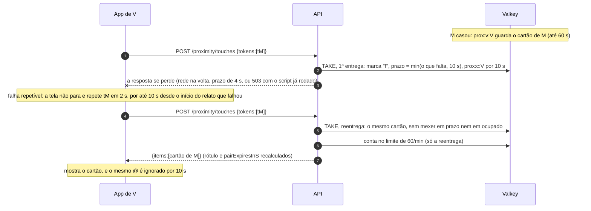

# ADR 0012: Conectar encostando os celulares, com observação mútua no servidor e QR de reserva

- Status: Aceita (PO, 2026-10-30) · Data: 2026-10-30
- Origem: revisão do D3 e substituição do D13 pelo PO em 2026-10-30 (`PROJETO.md` §8.2).
- Substitui em parte:
  - **ADR 0002:** a potência e o campo TX Power do anúncio, o evento da varredura e as capacidades;
  - **ADR 0003:** o `resolve` por Bluetooth, o token único para BLE e QR e o token cruzado no aceite do método `ble`;
  - as faixas "bem perto / por perto" (`arquitetura.md` §11.2).
- O resto das duas ADRs continua valendo.
- **Adendo A1 (2026-10-30, no fim do arquivo):** a detecção deixa de usar o campo TX Power declarado pelo emissor (veto ALTO do `seguranca`). Substitui, em §2, o `txRef` por emissor, as constantes do campo TX e a potência inicial do Android; em §8, as rodadas de potência e as conferências do campo; e acrescenta a linha "atacante" ao spike. Os trechos substituídos estão marcados com "→ A1".
  - **Revisão do A1 (2026-10-30, re-revisão do `seguranca`, MÉDIO 1 e BAIXO):** o R21 passa a ter a ordem de grandeza honesta (metros, a medir), sem a ideia de "teto" nos +20 dBm; a linha "atacante" do spike passa a medir afastando o transmissor, com antena direcional obrigatória; o endereço Bluetooth que não troca com o token entra no R17. Trechos marcados com "(revisto em 2026-10-30)".
- **Adendo A2 (2026-10-30, decidido pelo PO):** teto de pessoas novas por conta (10 por hora, 30 por dia) e revelação simétrica garantida (o cartão de quem casou fica guardado para o outro lado por até 60 s, mesmo com bloqueio, exclusão ou logout depois). Muda §2 (relato), §3 (janela, casamento, revelação), §6, §7 e as Decisões do PO. Trechos marcados com "→ A2". O PO aceitou o R21 com o A2 implementado antes do merge (A1-1).
  - **Revisão 1 do A2 (2026-10-30, revisão final do `seguranca`, MÉDIOS 1 e 2 e BAIXOS 3 a 5; decisão do PO pela opção (a) no MÉDIO 2):** a observação passa a ter prazo deslizante; o app faz um relato por vez, com orçamento de relatos por minuto e uma regra nova de "token novo"; o cartão devido sai antes de qualquer recusa; bloquear e denunciar passam a funcionar pelo cartão enquanto o par vale; o sinal de abuso conta uma vez por casamento e por sentido. Seção "Adendo A2, revisão 1", antes das Fontes; trechos marcados com "→ A2 rev. 1". (revisto em 2026-10-30) Na implementação, o item do `touches` ganhou o `pairExpiresInS` (R1-10, decisão do Tech Lead); o PO aprovou o T46 e, para o próximo PR, "denunciar quem você bloqueou" (R1-PO-1). (revisto em 2026-10-31) A R1-PO-1 foi implementada no PR `feat/denunciar-bloqueado`: a denúncia de conta passa ao `canReportAccount`, e o bloqueio fica no `canBlockOrReport` (A3-8, item 6).
- **Adendo A3 (2026-10-31, depois do merge do PR #2; para o PR `feat/denunciar-bloqueado`):** fecha os resíduos da revisão final do `seguranca`. O `touches` passa a fazer o mesmo caminho para todo token válido (R22); o servidor entrega o cartão devido de novo por até 10 s, e o app tenta de novo nas falhas de rede, renova os tokens sem parar a tela e mostra o cartão que chega fora do Pronto (R23); o cartão atrasado aparece sem ações, até a pessoa fechar (BAIXO 7); o `pairExpiresInS` fica limitado a 55. Seção "Adendo A3", antes das Fontes; trechos marcados com "→ A3". Muda a Política (decisão do PO, A3-PO-1).
  - **Depois da implementação (revisto em 2026-10-31; A3-8):** a revisão do `seguranca` sobre o A3 no servidor saiu sem veto, com três BAIXOs corrigidos no mesmo PR (decisão do Tech Lead). O `touches` passa a ler as duas contas pelo `findTouchPair`, e a política decide pelo `touchRevealParties` (BAIXO 1). Na reentrega, o rótulo só aceita o hash guardado (BAIXO 2). O texto da Política muda de novo (BAIXO 3). O orçamento do app chega a 56 inícios em 60 s com uma rede que alterna, e o Tech Lead aceitou. Ficam registrados dois riscos do `dados` (`arquitetura.md` §16, R24 e R25). (revisto em 2026-10-31, reconferência do `dados`) O R24 vale para o `findNearby` e o filtro de bloqueio (`hideBlockedFor`), não para o encosto; o R25 inclui o `searchCreators`.

## Contexto

**Como funciona hoje** (Fase 4 implementada, nunca testada em aparelho):
- com a tela Conectar aberta, o app anuncia o token por BLE e varre;
- cada token visto vai para o `POST /proximity/resolve`, que devolve @, nome e foto de **qualquer** token válido;
- a lista "Por perto agora" mostra quem está acima de -90 dBm, o que dá vários metros;
- a resposta do `POST /connections/requests` também traz `other {handle, name, avatarUrl}`.

**A decisão do PO:** só quem encosta o celular vê a pessoa. Quem está a alguns metros não deve nem enxergá-la.

**Fatos de plataforma** (verificados em 2026-10-30; fontes no fim):

- **NFC:**
  - o Core NFC só lê etiquetas;
  - a emulação de cartão (HCE) no iPhone só existe para apps do Espaço Econômico Europeu, com entitlement e para pagamentos, ingressos, transporte e acessos [1];
  - resultado: iPhone ↔ iPhone não funciona.
- **iOS anunciando:**
  - o `CBPeripheralManager` só aceita `LocalName` e `ServiceUUIDs` [2]; a potência e o intervalo não são configuráveis;
  - a chave de TX Power é recusada no anúncio [3];
  - consequência: o iPhone anuncia na potência do sistema e é ouvido a vários metros.
- **Android anunciando:**
  - `AdvertiseSettings.setTxPowerLevel` tem `ULTRA_LOW`, `LOW`, `MEDIUM` (o que usamos hoje) e `HIGH`; no AOSP correspondem a -21, -15, -7 e +1 dBm [4]. O valor é nominal e depende do chip;
  - `AdvertiseData.setIncludeTxPowerLevel(true)` põe o campo TX Power (3 bytes) no anúncio. O pacote fica com 24 de 31 bytes (flags 3 + UUID de 128 bits 18 + TX 3);
  - o receptor lê o campo em `ScanRecord.getTxPowerLevel()` no Android (`Integer.MIN_VALUE` sem o campo) e em `CBAdvertisementDataTxPowerLevelKey` no iOS, e estima a perda como TX − RSSI [5][6].
  - → A1: o campo é um número que o emissor escreve, e o receptor não tem como conferi-lo. O Sussurro deixou de pôr e de ler o campo.
- **Variação de RSSI:**
  - o padrão de calibração "Presence" do Android aceita mediana de RSSI a 1 m entre -65 e -45 dBm (20 dB de janela entre aparelhos) e até 18 dB de amplitude em 1.000 leituras do mesmo aparelho [7];
  - orientação, corpo e modelo mudam o RSSI tanto quanto andar 2 m [8];
  - o iOS manda RSSI 127 quando não mediu [9].
- **Android varrendo:**
  - a partir do Android 7, mais de cerca de 5 inícios de varredura em 30 s fazem o sistema segurar a varredura em silêncio [10];
  - no Android ≤ 11, varrer exige `ACCESS_FINE_LOCATION` [11] **e** a localização do sistema ligada; desligada, a varredura volta vazia, sem erro [12];
  - no Android 12+, `neverForLocation` dispensa a localização, mas filtra alguns beacons [11]. O nosso anúncio não é beacon.
- **Piso do Expo:** suporta Android 7+ [13], então Android 7 a 11 entram no público.

**Consequência central:** a força do sinal é medida pelo cliente, e qualquer um lê o anúncio.
- Um scanner passivo a 10 m lê o UUID de um iPhone, e um cliente modificado mente o RSSI.
- Se o servidor continuar resolvendo qualquer token válido, a regra do PO vira só uma regra de interface, e o pedido de conexão continua revelando a pessoa.
- **A garantia precisa estar no servidor.**

## Decisão

### 1. Dois tokens por emissão, um por canal

`POST /proximity/tokens` passa a devolver `{bleToken, qrToken, expiresAt, renewInS}`:
- os dois têm 12 bytes de CSPRNG, a mesma validade (30 s válido, 120 s recente) e a mesma rotação (20 s);
- os dois são gravados como hash, com o canal no registro: `{uid, iat, ch: 'ble' | 'qr'}`;
- o `bleToken` só vai no anúncio e nunca é resolvido sozinho;
- o `qrToken` só aparece na tela, no QR, e nunca vai ao ar.

**Por quê:** se o anúncio e o QR usassem o mesmo token, quem lesse o anúncio a 10 m usaria o caminho do QR (`resolve`) para descobrir a pessoa.

O limite de 6 emissões por minuto não muda: cada emissão já traz os dois tokens. A marca de "tela aberta" (`prox:u`) também não muda.

### 2. Detecção do "encostado" no cliente (o que o app afirma)

A detecção roda no app, em TypeScript puro e testável (`touch-detector.ts`). Os valores ficam num **ponto único de calibração**, `apps/mobile/src/features/connect/touch-calibration.ts`:
- o nativo recebe a potência e o intervalo mínimo entre eventos como parâmetros;
- Swift e Kotlin não guardam nenhum limiar.

**Métrica: perda estimada, em dB.**
- `perda = txRef − rssi − correçãoRx`; quanto menor, mais perto.
- ~~`txRef`:~~ → A1: `txRef` é uma referência única, `advertiserTxDbm`, igual para todo emissor e que nunca vem do anúncio.
  - ~~anúncio **com** o campo TX Power (Android): o valor do campo. Se o spike mostrar campo errado em algum chip, usa `androidAdvertiserTxDbm`;~~
  - ~~anúncio **sem** o campo (iPhone): `iosAdvertiserTxDbm`.~~
- ~~Assim a potência do Android vira um botão de calibração, sem refazer os limiares.~~ → A1: a potência do Android continua configurável, mas para igualar o Android ao iPhone, não para entrar na conta.
- `correçãoRx` é a correção de quem recebe, por plataforma, mais uma tabela opcional por modelo (só para os outliers medidos). O nativo informa o modelo, que é usado só no aparelho.

**Suavização e tempo sustentado, por token:**
1. Mediana das amostras dos últimos `windowMs`, exigindo pelo menos `minSamples`. A mediana ignora os vales de desvanecimento por multipercurso, que a média puxaria.
2. Estados de cada token:

| Estado | Condição |
|---|---|
| `longe` | mediana > `nearMaxLossDb` |
| `quase` | mediana ≤ `nearMaxLossDb` (o app pode mostrar "aproxime mais") |
| `encostando` | mediana ≤ `enterMaxLossDb` |
| `encostado` | `encostando` sustentado por `holdMs` |

3. Histerese: sai de `encostado`/`encostando` só com mediana > `exitMinLossDb`.
4. RSSI 127, positivo ou abaixo de -127 é descartado.
5. Token novo (rotação de 20 s) começa do zero. O custo é cerca de 0,7 s a mais se a rotação cair no meio do encosto.

**Relato ao servidor:**
- quando um token entra em `encostado`, o app manda `POST /proximity/touches`;
- repete a cada `reportEveryMs` por até `reportForMs` (8 s), contados do primeiro `encostado`, **mesmo que os celulares já tenham se afastado**, e para quando o servidor devolve o cartão;
  - → A2: o prazo de 8 s também recomeça na **resposta do primeiro relato de cada token novo** (vale o mais tardio). Assim o app sempre relata de novo depois da janela de casamento do servidor (5 s contados do primeiro relato), e quem foi visto recebe o cartão (A2, "Revelação simétrica garantida");
  - → A2 rev. 1: "token novo" passa a incluir o token cujo último relato aceito começou há 5 s ou mais; o prazo é um só e nunca desce; e um encosto novo ou um token novo só entram se o orçamento de relatos permitir (R1-3);
- **por quê:** cada aparelho detecta num tempo; se quem detectou primeiro parasse de relatar ao afastar, o segundo receberia o cartão e o primeiro não, e a revelação deixaria de ser simétrica;
- sem cartão aberto, cada chamada leva **um** token: o de menor perda. Com cartão aberto, o app não relata nada. Assim só existe um par por vez, e quem encosta ao mesmo tempo não recebe o cartão de quem não o recebeu (P8 do UX);
- as chamadas não se sobrepõem; (→ A2 rev. 1: nem na troca de sessão, nem entre visitas à tela; pelo menos 1 s entre o início de uma e o da seguinte, no processo inteiro)
- o RSSI, o campo TX e o modelo **nunca saem do aparelho**. (→ A1: o campo TX nem é mais lido.)

**Constantes iniciais.** São provisórias: só dão um ponto de partida ao código, e o spike 4.1-B substitui os valores.

| Constante | Inicial | Para que serve |
|---|---|---|
| `android.advertiseTxPower` | ~~`ultraLow`~~ → A1: `high` | potência do anúncio no Android (`ultraLow`, `low`, `medium` ou `high`) |
| ~~`android.includeTxPowerField`~~ | ~~`true`~~ | → A1: sai (o anúncio nunca leva o campo) |
| ~~`trustAdvertisedTx`~~ | ~~`true`~~ | → A1: sai (o campo não é lido) |
| ~~`androidAdvertiserTxDbm`~~ | ~~-21~~ | → A1: sai |
| ~~`iosAdvertiserTxDbm`~~ | ~~0~~ | → A1: vira `advertiserTxDbm` (0), a referência única de todo emissor |
| `rxCorrectionDb` | `{ios: 0, android: 0}` | correção de quem recebe, por plataforma |
| `modelCorrectionDb` | `{}` | correção por modelo de quem recebe (só os medidos) |
| `sightingMinIntervalMs` | 200 | no máximo 1 evento por UUID a cada 200 ms (hoje 500 ms, fixo no nativo) |
| `windowMs` / `minSamples` | 1500 / 3 | janela da mediana |
| `enterMaxLossDb` | 40 | entra em `encostando` |
| `exitMinLossDb` | 46 | sai (histerese de 6 dB) |
| `nearMaxLossDb` | 52 | faixa `quase` |
| `holdMs` | 700 | tempo sustentado até `encostado` |
| `reportEveryMs` / `reportForMs` | 1000 / 8000 | relato ao servidor |
| `confirmWarnAfterMs` | 4000 (→ A3: **7000**, A3-3 item 8) | a tela avisa "Não deu para confirmar" (o relato continua até `reportForMs`) |
| `noTouchFallbackMs` | 20000 | 20 s no Pronto sem `encostado`: QR em destaque |
| `nearFallbackMs` | 10000 | 10 s em `quase` sem confirmar: QR em destaque |
| `failuresBeforeQr` | 2 | dois "Não deu para confirmar" seguidos: QR em destaque |
| `cardTtlMarginMs` | 5000 | o app tira o cartão 5 s antes do fim do par (55 s), para o pedido não chegar com o par vencido |

Com isso, a detecção leva cerca de 1 a 1,5 s depois do contato, e o "casamento" no servidor mais 1 a 2 s.

**Diferenças entre iOS e Android:**

| | iOS | Android |
|---|---|---|
| **Anúncio** | potência do sistema, sem o campo TX; ~~receptores tratam "sem campo" como iPhone~~ | potência configurável (~~`ULTRA_LOW`~~ → A1: `HIGH` como padrão inicial), ~~com o campo TX~~ → A1: sem o campo TX, `LOW_LATENCY`, não conectável |
| **Varredura** | primeiro plano, `AllowDuplicates`, filtro do prefixo em código | `SCAN_MODE_LOW_LATENCY` (só com a tela aberta), `ScanFilter` com máscara |

**Varredura no Android:**
- **uma sessão contínua por tela**: o app não para e reinicia a varredura ao mudar de estado (limite de cerca de 5 inícios em 30 s);
- reinicia só quando o Bluetooth liga ou desliga, ou ao voltar do background.

**Android ≤ 11:** `getCapabilities` passa a informar `locationServices: 'on' | 'off' | 'not_required'`. Com a localização desligada, a tela mostra um estado próprio e o QR.

**Capas e modelos:** não há como prever todas as combinações. As mitigações:
- margem entre os limiares de entrar e sair;
- correção por plataforma, e por modelo só para os outliers medidos;
- a dica "aproxime mais" na faixa `quase`;
- o QR em destaque pelos tempos `noTouchFallbackMs`, `nearFallbackMs` e `failuresBeforeQr`.

O spike mede três capas: sem capa, silicone fina e carteira grossa ou com ímã.

### 3. Observação mútua no servidor (o que o servidor garante)

Um token BLE só vira pessoa quando **os dois aparelhos afirmaram, numa janela curta, que viram o token um do outro já no limiar de encostado**. A afirmação de um cliente sozinho não revela nada: o aparelho honesto da outra pessoa só afirma ter visto o atacante se o sinal dele chegou com força de encosto, o que a 10 m não acontece com um celular comum.

> → A1: essa garantia só vale se a "força de encosto" for julgada **só pelo que o receptor mede**. Com o `txRef` tirado do campo TX, o atacante escrevia um número no anúncio e o aparelho honesto da vítima calculava "encostado" a 15–30 m. O adendo A1 tira o campo da conta. Sobra o transmissor mais forte que um celular (R21), que chega a "encostado" a metros (ordem de grandeza na revisão do A1).

**`POST /proximity/touches {tokens: [1..4]}`** (→ A2: `{tokens: [1]}`, exatamente um token). Exige conta pessoal, e-mail confirmado, tela aberta (409 `PROXIMITY_SCREEN_CLOSED`) e não estar bloqueado; limite de 60 por minuto (o app relata 1 por segundo por até 8 s em cada encosto). O que o servidor faz (→ A2: os passos 2 a 4 mudam; o desenho em vigor está no Adendo A2):

1. Para cada token distinto, aceita só o que estiver **válido** (até 30 s) no `prox:t`, com `ch = 'ble'` e dono diferente de quem chama. Os outros são ignorados em silêncio e não contam como falha.
2. Para cada dono O, num script Lua (atômico):
   - `SET prox:o:{caller}:{O} <agora> PX janela`;
   - `EXISTS prox:o:{O}:{caller}`: se existe, é **mútuo**.
3. Para os mútuos, a política (como no `resolve` de hoje: `ProximityRepository.findNearby` com `hideBlockedFor`) exige conta pessoal, ativa e sem bloqueio em nenhum sentido. Para os que passam:
   - `SET prox:m:{menorUid}:{maiorUid} <agora> PX parTtl`;
   - a pessoa entra na resposta como `NearbyPerson` (o token informado, @, nome, foto e `alreadyConnected`).
4. A resposta é sempre 200 `{items}`. Token não mútuo, vencido, inexistente, do próprio chamador, de criador, de conta excluída ou com bloqueio é indistinguível: simplesmente não aparece.

**Revelação simétrica.** Quem relata primeiro recebe `items: []` e, no relato seguinte (cerca de 1 s depois), o cartão. Ninguém vê quem não o vê.
- → A2: como estava, a garantia podia ser derrotada (MÉDIO 2 do `seguranca`): o cartão de quem relatou primeiro só chegava no relato seguinte dele, de novo pelo `findNearby`. O atacante recebia o cartão da vítima e, em milissegundos, bloqueava a vítima, excluía a conta ou saía (tokens revogados), e a vítima via só "Não deu para confirmar". E havia um segundo caminho: com a observação renovada a cada relato e válida 10 s, o atacante podia casar **depois** do último relato da vítima. O A2 fecha os dois. (→ A2 rev. 1: e havia um terceiro, a chave da observação vencendo com a vítima ainda relatando, que a revisão 1 fecha com o prazo deslizante.)

**Tempos** (env da API, com padrão no `packages/shared`):

| Variável | Padrão | O que é |
|---|---|---|
| `PROX_TOUCH_WINDOW_S` | 10 (→ A2: **5**) | janela entre os dois relatos (→ A2: contada do **primeiro** relato de cada lado, sem renovar; a chave vive o dobro) (→ A2 rev. 1: o dobro **desde o último relato**; o horário do primeiro não muda enquanto a chave vive) |
| `PROX_TOUCH_PAIR_TTL_S` | 60 | quanto tempo o par encostado vale para pedir (→ A2: e quanto tempo o cartão devido espera a entrega) |
| → A2: `PROX_TOUCH_PAIRS_PER_HOUR` | 10 | pessoas novas por conta por hora (decisão do PO; padrão só no `env.schema.ts`, o app não usa) |
| → A2: `PROX_TOUCH_PAIRS_PER_DAY` | 30 | pessoas novas por conta por dia (decisão do PO; idem) |

- A validação do env exige `PROX_TOUCH_PAIR_TTL_S + PROX_TOKEN_TTL_S ≤ PROX_RECENT_TTL_S` (60 + 30 ≤ 120). Assim, o token devolvido no casamento ainda é "recente" durante todo o par.
- A validação também exige `PROX_TOUCH_WINDOW_S ≤ PROX_TOKEN_TTL_S`.

**O `resolve` passa a servir só ao QR.** Token com `ch = 'ble'` não resolve; a resposta é igual à de token inexistente.

**O que o servidor revela antes do aceite, e para quem:**

| Situação | Quem chama | O que recebe |
|---|---|---|
| Token BLE lido do ar (scanner passivo, cliente modificado), sem encosto mútuo | qualquer conta pessoal | nada: `touches` → `items: []`; `resolve` → `items: []`; pedido → 400 `PROXIMITY_TOKEN_INVALID` (genérico, conta como falha) |
| Encosto mútuo | A e B | o cartão um do outro (@, nome, foto, `alreadyConnected`) |
| QR lido | quem leu | o cartão de quem mostrou o QR (consentimento de mostrar o código) |
| Pedido recebido | B | o cartão de A na folha (igual a hoje) |
| Bloqueio, conta excluída, criador | — | o mesmo que inexistente |

### 4. Pedido e aceite

**Pedido `ble`** (`{targetToken: tB, method: 'ble'}`):
- `tB` precisa estar **válido ou recente** (até 120 s), com `ch = 'ble'` e dono B;
- `prox:m` do par A–B precisa existir;
- sem o par, com canal trocado ou com o token de outra pessoa → 400 `PROXIMITY_TOKEN_INVALID`, contado como falha;
- daí em diante, tudo igual à Fase 4a: trava do par, política, intervalo depois da recusa, corrida A→B ∥ B→A e pendente único;
- o token pode estar só "recente" porque o app conhece apenas o token devolvido no casamento: depois da rotação, ele não consegue mais ligar os tokens novos de B a B. A prova forte é o par.

**Pedido `qr`:** igual a hoje, mas `targetToken` precisa ter `ch = 'qr'`.

**Aceite `ble`:**
- dispensa o `observedToken`: se vier, é ignorado;
- continua exigindo tela aberta, pedido pendente e não vencido, para B;
- **motivo:** o pedido só nasce com o par mútuo, e o par já prova que B viu o token de A com força de encosto. Isso é mais forte que o token cruzado da ADR 0003, e some o problema da A-10 (o `tA` envelhecendo com a folha aberta);
- a folha de um pedido `ble` deixa de ligar a varredura.

**Aceite `qr`:**
- `observedToken` obrigatório (sem ele → 400 `VALIDATION_ERROR`), com `ch = 'qr'`, dono igual a `from_id` e até 120 s;
- token de canal trocado → 400 `PROXIMITY_TOKEN_INVALID`, e o pedido continua pendente.

**Fluxo de produto.** O protocolo serve a dois fluxos ao mesmo tempo:
- (a) cartão → "Conectar" → folha e aceite do outro;
- (b) os dois tocam "Conectar" e a corrida vira conexão na hora.

A tela é do UX/UI. O PO decidiu (a) + (b) (decisão 1, abaixo).

### 5. QR de reserva

O D7 continua igual: B lê o QR de A para aceitar, e o QR leva o `qrToken` (`sussurro://c/{qrToken}`). `parseProximityQr` e o deep link não mudam.

O app oferece o QR, pelo seletor, sempre, e como saída principal quando:
- falta permissão de Bluetooth e não dá para pedir de novo;
- o Bluetooth está desligado (junto com "Ligar");
- o aparelho não tem BLE ou o módulo não existe no build (Expo Go, dev build antigo);
- o aparelho **não anuncia** (`canAdvertise = false`). O "Procurar mesmo assim" sai: só varrer não serve, porque o encosto exige os dois anunciando;
- é Android ≤ 11 com a localização do sistema desligada;
- passaram 20 s no Pronto sem `encostado`, 10 s em `quase` sem confirmar ou dois "Não deu para confirmar" seguidos (P9 do UX), inclusive quando um lado vê "encostado" e o outro não.

### 6. Limites de tentativas

| Limite (por conta) | Antes | Depois |
|---|---|---|
| Tokens | 6/min | 6/min (cada emissão traz os dois) |
| `resolve` | 30/min | 30/min, só QR |
| `touches` | — | 60/min, até 4 tokens por chamada (o app manda 1) (→ A2: exatamente 1); nunca conta como falha (→ A2 rev. 1: o cartão devido sai antes do limite; o app fica em até 39 relatos em qualquer janela de 60 s) (→ A3: a reentrega do cartão conta no limite; com a repetição depois de falha, o app fica em até 52) (revisto em 2026-10-31: 52 é por admissão; com uma rede que alterna, até 56, medido, sempre abaixo dos 60; A3-8) |
| → A2: pessoas novas (pares criados) | — | 10/h e 30/dia por conta, nos dois lados do par; acima disso o encosto só não confirma (`items: []`, sem 429, sem falha) |
| Pedidos | 10/min e 50/dia | igual |
| Aceites | 10/min | igual |
| Falhas de token | 20 em 10 min → proximidade bloqueada por 15 min | igual; passam a contar também o pedido `ble` sem par e o token de canal trocado |

Os novos limites ficam no `ProximityStore`, falham fechados e rodam sem Valkey em 503 `PROXIMITY_UNAVAILABLE`, como os outros.

### 7. Contratos (sem migration)

**`packages/shared` vem primeiro:**
- `proximity.ts`:
  - `ProximityTokenSchema` → `{bleToken, qrToken, expiresAt, renewInS}`;
  - novos `ProximityTouchRequestSchema` (`strictObject {tokens: 1..4}`; → A2: `1..1`) e `ProximityTouchResultSchema` (`{items: NearbyPerson[]}`); (→ A2 rev. 1, R1-10: os itens passam a ser `ProximityTouchItemSchema`, o `NearbyPerson` com `pairExpiresInS`)
  - novas constantes `PROXIMITY_TOUCH_MAX_TOKENS` (4; → A2: 1), `PROXIMITY_TOUCH_WINDOW_S` (10; → A2: 5), `PROXIMITY_TOUCH_PAIR_TTL_S` (60) e `PROXIMITY_TOUCH_REPORT_INTERVAL_S` (1); → A2: mais `PROXIMITY_TOUCH_REPORT_FOR_S` (8);
  - os helpers de UUID e QR não mudam.
- `connections.ts`:
  - `AcceptConnectionRequestSchema` → `{observedToken?}` (obrigatório no `qr` pela regra do serviço);
  - `ConnectionMethodSchema` continua `ble | qr`: `ble` passa a significar "encostando".

**Rotas da API:**
- nova: `POST /v1/proximity/touches`;
- mudam: `POST /proximity/tokens` (resposta), `POST /proximity/resolve` (só `qr`), `POST /connections/requests` (canal e par) e `POST /connections/requests/:id/accept` (por método);
- `POST /dev/simulate-request` continua: no `ble`, grava o par da persona; o `observedToken` devolvido passa a ser o `qrToken` da persona;
- opcional: `POST /dev/simulate-touch` (só em desenvolvimento) grava a observação de uma persona e devolve o `bleToken` dela, para testar o casamento com um aparelho só;
- toda rota nova entra no canário PERM-10.

**Chaves no Valkey:**
- `prox:t` e `prox:r` ganham `ch`;
- novas: `prox:o:{observador}:{dono}` (10 s), `prox:m:{a}:{b}` (60 s) e `rl:prox-touches:user`;
- → A2: `prox:o` passa a guardar `{primeiroMs}:{hash do token relatado}`, sem renovar o prazo (a chave vive 10 s) (→ A2 rev. 1: com prazo deslizante, 10 s desde o último relato; e `prox:m` passa a guardar também os sentidos já contados no sinal de abuso, `"{horário}:{a|b|ab|ba}"`); entram `prox:v:{uid}` (o cartão devido, 60 s), `prox:c:{uid}` (ocupado, 10 s), `rl:prox-pairs:hour:{uid}`, `rl:prox-pairs:day:{uid}` e `rl:prox-block-after-touch:{blocker|blocked}:{uid}` (7 dias);
- `prox:u`, `prox:ut` e `prox:lock` não mudam;
- o logout não precisa apagar `prox:o`/`prox:m`: vencem em até 60 s, e o pedido exige tela aberta e token válido de quem chama.

**Códigos de erro:** nenhum novo. O par vencido devolve o `PROXIMITY_TOKEN_INVALID` genérico; o app sabe a hora do casamento e, antes disso, já troca o "Conectar" por "Encostem de novo".

**Banco:** **sem migration**. `connection_method` continua `ble | qr`, e não há SQL novo (o `findNearby` é reaproveitado).

### 8. Calibração em aparelhos reais (spike 4.1-B, substitui a meta do MAN-BLE-01)

**Pré-requisitos:**
- dev build do EAS, Android e iOS (precisa do aval do PO);
- uma tela `/dev/proximidade`, só na variante `development`, como o D15:
  - mostra ao vivo, por token: RSSI, ~~campo TX,~~ perda, mediana e estado (→ A1: sem o campo TX);
  - escreve linhas CSV no `console`, capturadas no terminal do Metro;
  - sem dependência nova e sem enviar nada ao servidor;
- aparelhos I1, I2, A1 e A2 (A3 opcional) e três capas (sem capa, silicone fina, carteira grossa ou com ímã).

**Roteiro, em cada par e nos dois sentidos** (I1↔I2, I1↔A1, I2↔A2, A1↔A2):
1. Posições:
   - os quatro gestos da §9 (topo com topo, lado a lado, base com base, costas com costas);
   - as distâncias 5 cm, 15 cm, 30 cm, 50 cm, 1 m, 3 m e 10 m (corredor, com e sem uma pessoa no meio);
   - 30 s por posição, na mão e sobre a mesa.
2. ~~Android com `ULTRA_LOW` e com `LOW` (duas rodadas).~~ → A1: Android com `HIGH` e com `MEDIUM` (duas rodadas), com a regra de escolha do adendo.
3. Registrar por posição: mediana, P10 e P90 da perda; tempo até `encostado`; quantos estados `encostado` fora do contato.
4. 20 encostos naturais por par, com pessoas seguindo só o texto da tela.
5. Conferir:
   - ~~se o campo TX lido no outro aparelho bate com o nível pedido (`trustAdvertisedTx`);~~ → A1: que o anúncio do Android sai sem o campo TX;
   - o Android ≤ 11 com a localização desligada;
   - o PROX-28 no nRF Connect (~~sem nome, potência baixa e campo TX no Android~~ → A1: sem nome e sem campo TX, nos dois sistemas);
   - que um scanner a 10 m não recebe nenhum cartão.
6. → A1: a linha **"atacante"** (roteiro e critério no adendo).

**Critério de aprovação, por par e por capa:**
- encosto detectado e casado em até 3 s em pelo menos 95% das 20 tentativas;
- **nenhum** `encostado` a 30 cm ou mais em 5 min parado (requisito do UX, P2);
- `quase` em no máximo 5% das leituras a 1 m ou mais (o `quase` não revela ninguém: falso `quase` é só uma dica errada);
- mediana do tempo até casar ≤ 2 s;
- → A1: a linha "atacante" aprovada ~~(nenhum `encostado` a 1 m, 3 m ou 10 m)~~ (revisto em 2026-10-30: o campo declarado não muda nada, e a distância medida afastando o transmissor cabe na ordem de grandeza do R21; roteiro no adendo).

**Saída:**
- os valores em `touch-calibration.ts`, com data, aparelhos e versão;
- o relatório e os prints em `docs/evidencias/fase-4/`;
- correções por modelo só para os outliers;
- o gesto escolhido (§9);
- par que não cumprir usa o QR (decisão 3 do PO).

### 9. Gesto, orientação e NameDrop (risco levantado pelo UX/UI)

**O risco:**
- entre dois iPhones desbloqueados, aproximar os aparelhos abre o **NameDrop** (troca de contatos do sistema) por cima do app;
- a Apple descreve o gesto como segurar um iPhone a poucos centímetros do outro [14];
- há relato de que dispara também com os celulares lado a lado, e a Apple confirma que **não existe API para pausar o NameDrop** dentro de um app [15];
- o NameDrop não compartilha nada sozinho: a pessoa escolhe "Compartilhar" ou "Só receber", e afastar ou bloquear o aparelho cancela [16]. Só a própria pessoa desliga, em Ajustes > Geral > AirDrop > "Aproximar dispositivos" [16];
- **não acontece** entre iPhone e Android.

**O conflito:** o gesto que menos provoca o NameDrop pode afastar as antenas. Base com base, por exemplo, deixa as partes de cima a uns 30 cm uma da outra, e não se sabe onde fica a antena de Bluetooth de cada modelo. Por isso o gesto não se decide no papel: decide-se no spike.

**Recomendação de arquitetura:**
- **Distância:** encostados, até cerca de 2 cm. O limiar de entrada (`enterMaxLossDb`) é calibrado para o contato, não para "perto".
- **Orientação:** a do gesto vencedor no spike. Enquanto isso, o "topo com topo" do UX fica como provisório (D-UX23).
- **Duração:**
  - "segurem um instante" até o **cartão** (casamento no servidor), não até o `encostado` local;
  - a vibração e o "pode afastar" pertencem ao estado Encostado (cartão), como já está na `ux.md` §11.4;
  - quem afastar depois do `encostado` local, mas antes de o outro detectar, impede o casamento.
- **Regra de escolha:**
  1. entre os gestos que cumprem o critério de detecção da §8, o que tiver **menor incidência de NameDrop** entre iPhones;
  2. se todos dispararem o NameDrop, o mais natural, com a nota T41 só no iPhone (`ux.md`);
  3. o app nunca pede para desligar o recurso do sistema.
- **Detectar o NameDrop:** não há sinal confiável. Se o UX quiser a nota só quando o NameDrop provavelmente abriu, existe uma heurística: no iPhone, o app passar a `inactive` durante o Confirmando ou o Encostado. Mas a central de controle e outros alertas também fazem isso, então é decisão do UX.

**O que testar em aparelho** (entra no spike 4.1-B):
1. **Configuração:** I1↔I2, os dois desbloqueados, com o Sussurro no Encostar e "Aproximar dispositivos" ligado (o padrão).
2. **Tentativas:** 20 por gesto (topo com topo, lado a lado, base com base, costas com costas).
3. **Medir em cada tentativa:**
   - se o NameDrop apareceu, e em quanto tempo;
   - em quanto tempo saiu o cartão do Sussurro;
   - se o casamento aconteceu mesmo com o NameDrop na tela, ou seja, se a varredura e o anúncio continuaram;
   - o estado do app durante o NameDrop (`inactive` ou `background`; em `background`, tudo para e recomeça na volta);
   - se, ao fechar o NameDrop, a tela volta no mesmo estado.
4. **Controle:** os mesmos gestos com "Aproximar dispositivos" desligado, e em I1↔A1 (não pode aparecer NameDrop).
5. **Detecção:** a perda de cada gesto em todos os pares da matriz (§8).

### 10. Premissas do UX/UI (`ux.md` §11.2): confirmação

| # | Premissa do UX | Resposta da arquitetura |
|---|---|---|
| P1 | Nome, @ e foto só depois de o servidor confirmar a observação mútua | **Confirmada** (§3). A revelação é simétrica, mas não simultânea: quem relata primeiro recebe o cartão no relato seguinte, cerca de 1 s depois. |
| P2 | Dois limiares no cliente, "aproximando" e "encostado"; o "encostado" nunca a 30 cm, o "aproximando" nunca a mais de 1 m | **Confirmada, com ressalva.** São o `quase` (`nearMaxLossDb`) e o `encostado` (`enterMaxLossDb` + `holdMs`, cerca de 1 s). Os 30 cm viraram critério do spike (§8), e o 1 m do `quase` virou meta (no máximo 5% das leituras). "Nunca" vale para os pares medidos; num aparelho fora da matriz é meta, não garantia, porque a variação entre modelos chega a 20 dB [7]. O que vale sempre: ninguém é revelado sem os dois lados afirmarem o encosto. O "aproximando" também diz à pessoa que há alguém com a tela Conectar aberta a cerca de 1 m (não quem), o que é coerente com o prefixo do anúncio (R17). Na tela, nada muda. |
| P3 | O servidor confirma o outro lado em até 4 s | **Corrigida.** O normal é 1 a 3 s, e os 4 s ficam como o tempo do aviso (`confirmWarnAfterMs`). Mas o app **continua relatando até 8 s** depois do primeiro `encostado`, mesmo afastado. Sem isso, quem detectou primeiro poderia nunca receber o cartão, enquanto o outro recebe. **Muda na tela:** depois do "Não deu para confirmar" (estado 9), um casamento que chegar até 8 s depois do encosto ainda abre o cartão (transição 9 → 11). (→ A3-3, item 8: o aviso passa para 7 s, depois do último casamento possível.) |
| P4 | O cartão vale 60 s depois de encostar, mesmo afastados | **Confirmada, com dois ajustes.** Os 60 s contam do casamento no servidor, e o app usa 55 s (`cardTtlMarginMs`). E os 60 s são o prazo para **pedir**: o aceite segue a validade do pedido (120 s a partir do pedido), sem depender do par. Na tela, o estado 17 (o cartão venceu) acontece aos 55 s. |
| P5 | Se os dois tocam em "Conectar", a conexão sai na hora | **Confirmada:** é a corrida A→B ∥ B→A, já tratada. Precisa que o segundo toque aconteça dentro dos 60 s do par; depois disso, o cartão já virou "Aceitar" pelo polling, e o aceite não depende do par. |
| P6 | Quem não anuncia vai para o QR; o "Procurar mesmo assim" deixa de existir | **Confirmada** (§5). |
| P7 | A busca começa ao abrir a aba | **Confirmada**, com três condições. (1) Só com a permissão já dada; nada de pedido do sistema sem a explicação. (2) No Android, uma sessão de varredura por visita à aba, com uns 500 ms de espera antes de começar: abrir e fechar a aba várias vezes seguidas esbarraria no limite de cerca de 5 inícios em 30 s [10]. (3) Para ao sair da aba e no background, como hoje. A decisão da 4b de anunciar só depois do toque deixa de valer: o anúncio sozinho não identifica ninguém. |
| P8 | Uma pessoa por vez | **Confirmada**, e garantida pelo protocolo: sem cartão, o app relata só o token de menor perda; com cartão, não relata nada (§2). Quem encosta ao mesmo tempo não recebe o cartão de quem não o recebeu. (→ A2: agora também no servidor: 1 token por chamada, e ninguém casa com quem tem um cartão a receber ou recebeu um há menos de 10 s.) |
| P9 | QR em destaque depois de 20 s no Pronto, 10 s no "aproximando" ou 2 falhas seguidas | **Confirmada.** Os tempos ficam no arquivo de calibração (`noTouchFallbackMs`, `nearFallbackMs`, `failuresBeforeQr`). |
| P10 | Bloqueio e falha não se distinguem para quem encostou | **Confirmada** (§3): `touches` devolve o mesmo `items: []` para bloqueio, conta excluída, criador, token vencido e falta de encosto mútuo. Quem não confirmou o e-mail nem recebe token. O pedido devolve o mesmo 400 genérico. Só a falta de rede se distingue (estado 18). |
| P11 | O método gravado na conexão continua `ble` | **Confirmada:** `ble` = encostando, sem valor novo e sem migration. |

## Alternativas

1. **NFC.** Descartado: no iPhone, o Core NFC só lê etiquetas, e a emulação de cartão exige o Espaço Econômico Europeu e um entitlement para pagamentos e acessos [1]. iPhone ↔ iPhone não funcionaria.
2. **Só QR.**
   - Prós: o mais privado (nada vai ao ar), funciona em qualquer aparelho e já está pronto.
   - Contras: mais atrito (câmera, permissão, luz, segunda leitura no D7) e não atende ao "encostar" que o PO pediu.
   - Fica como reserva.
3. **Bluetooth no alcance atual** (lista "Por perto"). Descartado: é justamente o que o PO quer evitar (quem está a metros vê nome, @ e foto).
4. **Encostar com limiar só no cliente** (o `resolve` aceitaria um "encostado: sim" do app). Descartado: um scanner passivo ou um cliente modificado ignora o limiar. Enviar o RSSI ao servidor também não resolve, porque o número vem do mesmo cliente, e ainda expõe o sinal.
5. **Encostar + QR, com observação mútua: escolhida.** Outras garantias de servidor avaliadas:

| Opção | Impede o scanner a 10 m? | Custo | Decisão |
|---|---|---|---|
| Observação mútua | **sim**: exige que o aparelho honesto da vítima afirme ter visto o atacante com força de encosto | 1 rota, 2 chaves, 1 script Lua | **escolhida** |
| Revelação cega (nenhum cartão antes do aceite; o par só vê quem é depois que os dois confirmam) | sim | aceite sem ver quem é; mais fraca contra relay; UX pior | descartada |
| "Bump" por acelerômetro + horário (como o antigo app Bump) | parcialmente | ambíguo em multidão; para desempatar precisaria de localização (custo de privacidade) | descartada |
| UWB / Nearby Interaction (distância medida) | sim | fora da v1 (`PROJETO.md` §5); poucos Androids com UWB | futuro |

## Consequências

- **Privacidade bem mais forte:**
  - a 10 m não se descobre ninguém pelo Bluetooth, nem com cliente modificado; (→ A1: só depois do adendo, com a referência única; com o campo TX na conta, não valia. Contra transmissor amplificado, ver R21.) (revisto em 2026-10-30: vale com celular comum; com amplificador e antena direcional, a distância pode passar de 10 m, R21);
  - o servidor fica sabendo de menos pares: só quem encostou, em vez de todos que estavam "por perto";
  - o registro do encosto vive até 60 s no Valkey e não vai para o Postgres nem para os logs.
- **Riscos que ficam** (registrados na `arquitetura.md` §16):
  - **relay ativo:** dois aparelhos encostados nos dois alvos retransmitindo os anúncios (R12);
  - quem consegue pôr o celular a poucos centímetros do da vítima enquanto ela está com a tela Conectar aberta;
  - **o prefixo fixo** `53555353` ("SUSS") revela que alguém por perto está com a tela Conectar aberta, mas não quem; (revisto em 2026-10-30) e o endereço Bluetooth, que não troca junto com o token, deixa um scanner ligar os tokens sucessivos do mesmo aparelho enquanto a tela está aberta (R17);
  - → A1: **transmissor mais forte que um celular** (amplificador, antena direcional), que chega a "encostado" de mais longe (R21): de cerca de 1 m a mais de 10 m, conforme o equipamento (revisão do A1). Aceito pelo PO com o A2 (teto e revelação garantida).
- **Falso negativo é o novo risco de produto:**
  - os limiares dependem de aparelho, capa e orientação [7][8];
  - mitigações: mediana + hold, histerese, dica "aproxime mais", correções por plataforma e modelo, QR depois de 20 s, e o spike como portão;
  - a Fase 4 não fecha sem o spike 4.1-B aprovado.
- **Calibração exige build novo:** o app não tem `expo-updates`, então os valores de `touch-calibration.ts` só mudam com build novo. O PO decidiu não adicionar atualização OTA por agora (decisão 6); o tema volta se o campo mostrar necessidade.
- **O app fica mais simples:**
  - saem a lista "Por perto", as faixas, o `resolve` em lote (A-17), a varredura da folha (A-10 e PROX-26 no `ble`) e o "Procurar mesmo assim";
  - entram o detector de encosto, a chamada `touches` e o estado de localização do Android ≤ 11.
- **Política de Privacidade e textos de permissão mudam** (`arquitetura.md` §15):
  - quem vê o quê;
  - o registro do encosto;
  - ~~a potência baixa no Android~~ → A1: o anúncio do Android passa a ter o alcance do iPhone, e o risco residual R21;
  - o prefixo;
  - a localização do sistema no Android ≤ 11.
- **Implementação, em ordem** (pastas pela tabela do `CLAUDE.md`):
  1. **`backend`:**
     - primeiro o contrato em `packages/shared/src/proximity.ts` e `connections.ts`, com os testes do shared;
     - depois a API: `apps/api/src/modules/proximity/` (store com canal, `recordTouch`/`markTouchPair`/`hasTouchPair`, script Lua e fake em memória; serviço com os dois tokens, `resolve` só QR e `touches`; controller; limite `touches`), `apps/api/src/modules/connections/` (canal e par no pedido, aceite por método), `apps/api/src/modules/dev/` e `apps/api/src/config/env.schema.ts`, com testes unitários;
     - nenhum repositório muda.
  2. **`dados`:** nada (sem migration nem SQL novo). Só entra se o `backend` precisar mudar o `findNearby`, o que não é esperado.
  3. **Em paralelo, com pastas disjuntas:**
     - `frontend`, depois do `ux.md` atualizado: `apps/mobile/modules/sussurro-proximity/**` (potência ~~e campo TX~~ por parâmetro, ~~`txPower` no evento~~ (→ A1: o evento é `{uuid, rssi}`), intervalo por parâmetro, `locationServices` e modelo nas capacidades), `apps/mobile/src/features/connect/**` (`touch-calibration.ts`, `touch-detector.ts`, `useTouch` no lugar de `useNearby`, dois tokens, aceite `ble` sem token, varredura contínua, QR com `qrToken`), `apps/mobile/src/app/dev/` (calibração) e o texto do `app.plugin.js`;
     - `testes`, com o e2e da API: `apps/api/test/e2e/` (`proximity`, `connections`, `dev-routes`, `privacy-canary`, `routes` e o adaptador Valkey em `real-services`).
  4. **`testes`:** regressão do app, mutação nas regras novas (canal, par, mútuo, janela, revelação) e os casos no `docs/equipe/testes.md`; dá o veredito.
  5. **`seguranca`** revisa o diff inteiro, e **`ux-ui`** revisa a tela.
  6. **Tech Lead:**
     - README, backlog (4.1-B e 4.4 reescrita) e `PROJETO.md`;
     - a Política no site, fora do repositório, com o PO;
     - depois do build EAS autorizado: o spike 4.1-B, o ajuste do `touch-calibration.ts` (`frontend`) e os MAN-* de novo.

## Decisões do PO (tomadas em 2026-10-30)

O PO aprovou esta ADR e aceitou todas as recomendações. As alternativas descartadas ficam registradas.

1. **Fluxo depois do encosto: decidido (a) + (b).**
   - (a) cartão → "Conectar" → folha e aceite do outro;
   - (b) se os dois tocarem "Conectar", a conexão sai na hora.
   - Descartada: (c) conexão automática ao encostar, porque conecta sem conferir quem é e por acidente.
2. **Revelação no encosto: decidida a simétrica.** Os dois veem o cartão um do outro depois do encosto mútuo.
   - Descartada: a revelação cega até o aceite.
3. **Critério do spike e par reprovado: decidido.**
   - **Critério:** pelo menos 95% de encostos casados em até 3 s e nenhum `encostado` a 30 cm ou mais, por par e por capa.
   - **Par reprovado:** usa o QR.
   - Descartado: afrouxar o limiar.
4. **Android ≤ 11: mantido**, com o estado "ligue a localização do sistema" e o QR.
   - Descartado: subir o piso para Android 12.
5. **Telemetria de calibração em produção: nenhuma** na v1.
6. **Atualização OTA da calibração (`expo-updates`): não por agora.**
7. **Pré-requisitos do spike:**
   - o build EAS de desenvolvimento está autorizado;
   - o PO vai criar a conta Apple Developer para os builds de iOS;
   - os aparelhos da matriz e as três capas continuam necessários.
8. **Texto da Política de Privacidade:** aprovado o texto da `arquitetura.md` §15, inclusive o aviso do prefixo fixo. (→ A1: o trecho "No Android, o anúncio sai com potência baixa" deixa de valer; decisão A1-2.)
9. (2026-10-30) **Risco residual R21: aceito**, nos termos corrigidos da revisão do A1, com as duas mitigações do Adendo A2 implementadas antes do merge (decisão A1-1, abaixo).
10. (2026-10-30) **Teto de pessoas novas: 10 por hora e 30 por dia**, por conta, com os valores-padrão nas variáveis de ambiente. Acima do teto o encosto só não confirma, sem mensagem especial (A2-1).
11. (2026-10-30) **Revelação simétrica garantida: opção (a)** do `seguranca` (A2-2).
12. (2026-10-30) **Textos T43, T44 e T45 aprovados** (o `ux-ui` os marca no `ux.md`).

## Adendo A1 (2026-10-30): o "encostado" não usa o que o emissor declara

- Status: proposto pelo Arquiteto em 2026-10-30, a pedido do Tech Lead, para levantar o veto ALTO do `seguranca` na revisão da Fase 4 (branch `feat/f4-encostar`, sem commit). **Implementado** pelo `frontend`; o `seguranca` re-revisou e o veto ALTO caiu para o código. **R21 aceito pelo PO em 2026-10-30**, com o Adendo A2 (A1-1).
- A mudança é técnica e já pode ser implementada. O risco residual R21 e os textos da Política dependem do PO (A1-1 e A1-2, no fim do adendo; decididos em 2026-10-30).
- (revisto em 2026-10-30) Na re-revisão, o `seguranca` apontou que o R21 estava subestimado e que o spike não media o resíduo acima de 1 m (MÉDIO 1), e que o endereço Bluetooth não troca com o token (BAIXO). As seções "Risco residual" e "Spike 4.1-B" abaixo foram reescritas; o que saiu está riscado.
- Substitui os trechos marcados com "→ A1" nos §2, §3 e §8 e nas Consequências. O resto da ADR continua valendo.

### Contexto

**A falha** (apontada pelo `seguranca` e conferida pelo Tech Lead no código):
- com `trustAdvertisedTx: true`, o `txRef` era o campo TX Power **declarado pelo emissor**, aceito de -127 a +20 dBm. Sem o campo, valia o TX do iPhone (0);
- o receptor não tem como conferir esse número: é um byte que o emissor escreve;
- **exploração:**
  1. M pega o próprio `bleToken` pela API e o anuncia de um notebook, ESP32 ou Android com root, com o campo TX = -100 dBm;
  2. a vítima V, a 15–30 m, mede -85 dBm: perda = -100 + 85 = -15 ≤ 40, "encostado" em 0,7 s, e o app de V relata o token de M;
  3. M lê o `bleToken` de V do ar e relata também: há encosto mútuo, e M recebe @, nome e foto de V;
  4. são até 4 tokens por chamada e 60 chamadas por minuto. Com a menor perda da sala, o anúncio forjado ainda ganha dos encostos legítimos (P8);
- **variante sem valor absurdo:** declarar -21 (o `ULTRA_LOW` legítimo) e transmitir a +8 ou +20 dBm. Basta RSSI ≥ -61 na vítima, o que acontece a vários metros;
- **consequência:** caíam a garantia do §3 ("o aparelho honesto só relata com força de encosto") e o texto da tela "Quem está por perto não vê seu nome nem sua foto".

**O que o campo dava aos aparelhos honestos: quase nada.**
- O campo leva o valor **nominal** do nível pedido, não a potência irradiada [4][5].
- O nível vem do `touch-calibration.ts`, que é o mesmo em todo build.
- Ou seja, o receptor já sabia o que o campo diria. A única informação nova era a que o emissor quisesse dar.

### Decisão

**1. Referência única, que nunca vem do ar.**
- `perda = advertiserTxDbm − rssi − correçãoRx`, com `advertiserTxDbm` igual para todo emissor (inicial 0, o antigo `iosAdvertiserTxDbm`).
- Na prática é um limiar absoluto de RSSI, escrito como perda: com referência 0 e sem correção, `encostando` = mediana do RSSI ≥ -40 dBm.
- Não mudam: os limiares (40/46/52), a mediana, o `holdMs`, a histerese e a regra de relato (P8).
- Entram na decisão só o UUID (o token), o RSSI medido pelo próprio receptor e a correção do próprio receptor. Nada que o emissor declare.

**2. O campo TX sai do anúncio e da varredura.**
- O Android anuncia sem o campo (`setIncludeTxPowerLevel(false)`), e o pacote fica 3 bytes menor.
- O nativo deixa de ler `ScanRecord.getTxPowerLevel()` e `CBAdvertisementDataTxPowerLevelKey`. O evento da varredura vira `{uuid, rssi}`.
- **Anúncio que trouxer o campo é tratado como qualquer outro: o campo é ignorado, e o anúncio não é descartado.**
  - Descartar não dá segurança: o atacante só omite o campo, como já faz um iPhone.
  - E criaria uma falha nova: dev build antigo, ou pilha de fabricante que ponha o campo.
  - O anúncio sem o campo passa a ser o normal, nos dois sistemas.

**3. O Android anuncia perto da potência do iPhone: `HIGH` (+1 dBm no AOSP [4]) como valor inicial.**
- **Por quê:** com um limiar único, ele precisa pegar no encosto o emissor honesto **mais fraco**, e a vantagem do atacante é a potência dele menos a desse emissor. O iPhone não deixa baixar a potência [2][3]; então o Android sobe até ele.
- Com `ULTRA_LOW` (-21 dBm), o limiar teria de ficar uns 21 dB mais frouxo. O atacante ganharia cerca de 11 vezes em distância, e o iPhone chegaria a "encostado" de mais longe. A outra saída seria o Android nunca ser detectado.
- `MEDIUM` (-7 dBm) deixa uns 7 dB de diferença se o iPhone estiver perto de 0 dBm: cerca de 2,2 vezes em distância.
- A potência real do iPhone não é pública. O spike mede `HIGH` e `MEDIUM` e escolhe pela regra da seção "Spike 4.1-B", abaixo.

**4. A proposta (a) do `seguranca` fica contida nesta.** Nenhum valor declarado reduz nem aumenta a perda, porque nenhum valor declarado é lido. Os testes de regressão de (a) viram testes deste adendo (PROX-44).

**Efeitos:**
- **"quase" e "encostado":** para emissores honestos, a distância não muda.
  - Os limiares já eram perda em relação ao emissor, e o campo só trazia o nível nominal, que agora é o mesmo para todos.
  - A variação real entre modelos (antena, capa, mão; até 20 dB [7]) nunca foi corrigida pelo campo. Continua coberta pela correção de quem recebe, pela histerese, pela dica, pelo QR e pelo spike.
- **P8:** "a menor perda" passa a ser "o maior RSSI no mesmo receptor". Um campo forjado não ganha mais; só ganha um sinal de fato mais forte (R21).
- **Privacidade do anúncio:**
  - em `HIGH`, o anúncio do Android é ouvido de tão longe quanto o do iPhone. De -21 para +1 dBm são +22 dB: cerca de 12 vezes a distância no espaço livre, menos em ambiente fechado;
  - o que se ouve não muda: o token anônimo que troca a cada 20 s e o prefixo fixo (R17). O Android perde o alcance curto, que o iPhone nunca teve;
  - (revisto em 2026-10-30) o endereço Bluetooth é aleatório, mas **não troca junto com o token**: no iOS o endereço privado dura cerca de 15 min, e o app só reinicia o anúncio (informação do `seguranca`, a conferir no spike); no Android, depende de o sistema trocar o endereço a cada `startAdvertising` (o spike confere). Enquanto a tela está aberta, um scanner passivo liga os tokens sucessivos ao mesmo aparelho (sabe que é o mesmo, não quem é). Em `HIGH`, isso passa a valer no Android à mesma distância do iPhone (R17);
  - ganho pequeno: sem o campo, um scanner passivo não distingue mais Android de iPhone entre os anúncios do Sussurro.
- **Versões misturadas:** o nível fica no build. Se um build futuro mudar o nível, os anteriores continuam no antigo, com alguns dB de diferença na referência única. Por isso o spike escolhe o nível antes do primeiro build público (a Fase 4 já não fecha sem o spike).
- **Bateria:** desprezível. O anúncio só existe com a tela Conectar aberta e acesa.

### Risco residual: transmissor mais forte que um celular (R21)

O receptor mede só o que chega, não a potência de quem transmite. Quem transmitir mais forte que um celular chega a "encostado" de mais longe.

- **Física:** no espaço livre, a potência recebida cai com o quadrado da distância. Cada +6 dB dobra a distância em que se mede o mesmo RSSI; +20 dB a multiplicam por 10.
- ~~**Emissor legítimo:** um celular, perto de 0 dBm, com antena interna sem ganho e alguns dB perdidos na mão e na capa.~~
- ~~**Atacante:** +20 dBm, o teto do Bluetooth LE (classe 1) [17] […]; em ordem de grandeza, de +20 a +35 dB sobre o celular, ou seja, de 10 a cerca de 50 vezes a distância em que um celular honesto chega a "encostado".~~
- ~~**Em metros:** se o encosto honesto dispara a poucos centímetros, o atacante apontado para a vítima dispara a algumas dezenas de centímetros, ou a 1 ou 2 m.~~

**(revisto em 2026-10-30) Ordem de grandeza honesta.** A estimativa acima subestimava o alcance por três motivos, apontados pelo `seguranca` e conferidos aqui com a fonte [7]:
1. **O encosto honesto não dispara "a poucos centímetros".** Pela fonte [7], um celular a 1 m mede de -65 a -45 dBm (mediana perto de -55). Com o limiar inicial de -40 dBm (referência 0, `enterMaxLossDb` 40) e a perda do espaço livre (20 dB por década [18]), o limiar é cruzado a **cerca de 18 cm** na mediana, **de 6 a 56 cm** nos extremos da faixa. Isso já pesa contra o critério dos 30 cm, e o spike provavelmente aperta o limiar.
2. **O celular honesto perde de 5 a 10 dB** em antena, mão e capa; o transmissor do atacante não tem essas perdas. A vantagem dele é a potência irradiada dele menos a do celular (de -10 a -5 dBm efetivos), não menos 0 dBm.
3. **+20 dBm não é teto.** É a classe 1 da especificação [17], não um limite físico. Amplificadores de 1 W (+30 dBm) para 2,4 GHz são fáceis de comprar (segundo o `seguranca`; transmitir assim é ilegal, o que não detém um atacante).

**A conta** (mediana da fonte [7], perdas do celular honesto de 5 a 10 dB, perda do espaço livre a 2,44 GHz de cerca de 40 dB a 1 m [18]; em ambiente fechado, expoente perto de 3 a partir de 1 m [19]). É **ordem de grandeza, não medição**:

| Transmissor do atacante | Vantagem sobre o celular | "Encostado" no espaço livre | Em ambiente fechado |
|---|---|---|---|
| celular honesto (referência) | 0 dB | ~18 cm (6 a 56 cm) | igual |
| dongle de +8 dBm, antena ~0 dBi | 13 a 18 dB | ~0,8 a 1,4 m | ~0,9 a 1,3 m |
| +20 dBm, antena omni ~2 dBi | 27 a 32 dB | ~4 a 7 m | ~2,5 a 3,7 m |
| +20 dBm, antena direcional ~12 dBi | 37 a 42 dB | ~13 a 23 m | ~5 a 8 m |
| +30 dBm (1 W), direcional ~12 dBi | 47 a 52 dB | ~40 a 70 m | ~12 a 17 m |

- Com receptores no topo da faixa da fonte [7] (-45 dBm a 1 m), as distâncias crescem cerca de 3 vezes; no fundo da faixa, encolhem na mesma proporção. A correção por plataforma e por modelo, ao aproximar todos os receptores do mesmo ponto, também aproxima essas distâncias.
- **Cada dB que o spike apertar no limiar encurta todas as linhas na mesma proporção** (6 dB a mais, metade da distância). Se o critério dos 30 cm levar o encosto honesto a ~10 cm, a tabela inteira cai para pouco mais da metade.
- **Em resumo, para a Política e para o PO:** com um transmissor pequeno, cerca de 1 m; com amplificador, alguns metros; com amplificador e antena direcional, mais de 10 m, e algumas dezenas em linha de visada com 1 W. **A medir no spike** (linha "atacante", abaixo), que substitui a tabela pelos números medidos.
- **O que continua valendo contra ele:**
  - a vítima precisa estar com a tela Encostar aberta;
  - o atacante precisa de conta pessoal com e-mail confirmado, tela aberta, a janela de 10 s (→ A2: 5 s) e os limites do §6;
  - ~~a revelação é simétrica: a vítima vê o cartão do atacante no mesmo momento e pode bloquear e denunciar;~~ → A2: a revelação é simétrica **e garantida**: quem recebe o cartão deixa o próprio guardado para o outro lado, entregue cerca de 1 s depois, mesmo que bloqueie, exclua a conta ou saia. ~~Se o atacante bloquear a vítima, ela vê o cartão mas não consegue denunciar pelo app (o perfil some para ela); o bloqueio logo depois do encosto vira sinal para a moderação (A2-3);~~ → A2 rev. 1: a vítima pode bloquear e denunciar o atacante pelo próprio cartão até 60 s depois do encosto, mesmo sem serem conexões e mesmo que ele a tenha bloqueado (decisão do PO, opção (a)); três bloqueios logo depois de encostos, em 7 dias, avisam a moderação, e cada encosto conta no máximo uma vez em cada sentido (A2-3 e R1-6);
  - → A2: o teto de 10 pessoas novas por hora e 30 por dia limita a colheita por conta; para colher mais, o atacante precisa de várias contas com e-mail confirmado;
  - a conexão ainda exige "Conectar" e o aceite.
- **O que não fica coberto:** dentro desse alcance, o atacante vê @, nome e foto de quem está com a tela aberta, sem encostar, e a vítima vê o dele. É risco residual, registrado ao lado do R12. ~~para o PO aceitar (A1-1)~~ **Aceito pelo PO em 2026-10-30**, nos termos desta revisão e com o A2 implementado antes do merge (A1-1), com a Política e o `privacyNote` ajustados (A1-2).

### Alternativas descartadas

| Opção | Por que não |
|---|---|
| (a) sozinha: campo aceito só em [-24, +4] e `txRef = max(campo, androidAdvertiserTxDbm)` | Declarar menos deixa de ajudar, mas declarar -21 e transmitir a +20 dBm ainda dá cerca de 41 dB de vantagem (cerca de 110 vezes a distância). Com a referência única e o Android em `HIGH`, a vantagem é a potência do atacante menos a de um celular: uns 20 dB a menos. |
| Assinar o campo TX, ou o servidor informar a plataforma do emissor | Autentica a afirmação, não a potência: o atacante assina a dele e transmite mais forte. E a plataforma informada ao servidor vem do cliente do atacante. |
| Teto de RSSI "plausível" | O atacante regula a potência e fica abaixo do teto. E o teto arrisca falso negativo no encosto real, que satura o receptor. |
| Descartar anúncio com o campo | Sem ganho de segurança (o atacante omite o campo) e com uma falha nova. |
| Medir a distância (UWB / Nearby Interaction) | Já está como futuro (Alternativas, item 5). Fecharia o R21, mas poucos Androids têm UWB. |

### Spike 4.1-B: o que muda (§8)

**Rodadas de potência do Android:** `HIGH` e `MEDIUM`, no lugar de `ULTRA_LOW` e `LOW`.
- **Regra de escolha:** o nível cuja mediana de RSSI, no mesmo receptor e nas mesmas posições (5 cm, 15 cm e 30 cm), fica mais perto da do iPhone emissor. Em empate, o mais baixo (alcance menor).
- O critério de aprovação por par, nos dois sentidos, já obriga o limiar único a servir aos dois tipos de emissor.

**Linha "atacante"** (revisto em 2026-10-30; o critério antigo, "nenhum `encostado` a 1, 3 e 10 m com +8 e +20 dBm", quase certamente reprovaria já com +8 dBm a 1 m, e a medição do resíduo só aproximava a partir de 1 m, então nunca media além dele):
- **Transmissor:** fora do app (notebook, dongle nRF52840, ESP32 ou módulo com amplificador). Anuncia o UUID com o `bleToken` de uma conta de teste M, pego pela API e renovado a cada 20 s.
- **Vítima:** I1 e A1 (um receptor de cada sistema), com a tela Encostar aberta, o CSV da `/dev/proximidade` ligado e os limiares **finais** do spike.
- **Parte 1, regressão do A1 (portão):** a 1 m, com +8 dBm, o campo TX declarado -21, -100 e sem campo, 5 min cada. A distribuição de estados no receptor precisa ser a mesma nas três: o campo não pode mudar nada. Diferença é bug e reprova.
- **Parte 2, medição do resíduo, afastando o transmissor:**
  - configurações: +8 dBm com antena omni; +20 dBm com antena omni; +20 dBm com **antena direcional (obrigatória**, 8 a 14 dBi, tipo patch ou yagi de 2,4 GHz) apontada para a vítima;
  - passos: 1, 2, 3, 5, 7, 10 e 15 m, com linha de visada (corredor ou salão) e repetidos numa sala comum, com móveis;
  - em cada passo, até 5 min; anotar o tempo em `encostado`, os relatos com o token de M e se houve casamento (a conta M relata o token da vítima por script);
  - para no **primeiro passo com 5 min sem nenhum `encostado`**. O resíduo medido é o maior passo com `encostado`. Se ainda houver `encostado` a 15 m, registrar "≥ 15 m";
  - **+30 dBm não é transmitido** (passa do limite legal): estima-se somando 10 dB ao resultado de +20 dBm com antena direcional, ou seja, **cerca de 3,2 vezes a distância** (espaço livre; o pior caso para a defesa), marcado como estimativa no relatório;
  - sem módulo de +20 dBm, a linha roda em +8 dBm e o +20 dBm é estimado (+12 dB, cerca de 4 vezes a distância), também marcado como estimativa.
- **Parte 3, endereço Bluetooth (R17):** com o nRF Connect num terceiro aparelho, anotar o endereço do anúncio do A1 em pelo menos 10 rotações do token (cada rotação reinicia o anúncio), e o do I1 por 20 min. Registrar se o Android troca o endereço a cada `startAdvertising` e quanto dura o do iPhone.
- **Critério:** a parte 1 sem diferença, e as distâncias da parte 2 dentro da ordem de grandeza do R21 (a tabela da seção anterior, ajustada ao limiar final). **Se passar dela, o Tech Lead leva ao PO antes de fechar a Fase 4.** As distâncias medidas substituem a tabela no R21 e entram na Política.
- ~~**Se reprovar:** aperta-se o `enterMaxLossDb` […].~~ O limiar sai do critério de detecção (95% em até 3 s e nada a 30 cm), não da linha "atacante". Cada 6 dB a mais de aperto cortam à metade a distância do atacante, ao custo de mais falso negativo; se o Tech Lead quiser trocar detecção por distância, é decisão do PO.
- ~~**Medição do resíduo** (não reprova): aproximar o transmissor de +20 dBm em passos (1 m, 50 cm, 30 cm, 15 cm) […]~~ (substituída pela parte 2).

### Implementação

**`frontend`** (pastas dele; não precisa de contrato novo, migration nem dependência):
- **`touch-calibration.ts`:**
  - saem `android.includeTxPowerField`, `trustAdvertisedTx`, `androidAdvertiserTxDbm` e `iosAdvertiserTxDbm`;
  - entra `advertiserTxDbm: 0` (referência única de todo emissor; nunca vem do anúncio);
  - `android.advertiseTxPower` passa a `'high'`;
  - o resto não muda.
- **`touch-detector.ts`:**
  - `estimateLoss({rssi}, receiver, cal) = cal.advertiserTxDbm − rssi − (cal.rxCorrectionDb[receiver.platform] + (cal.modelCorrectionDb[receiver.model] ?? 0))`;
  - `TouchSighting` e `TouchReading` perdem o `txPower`.
- **Rádio (`modules/sussurro-proximity`):**
  - `NativeSightingEvent` e `ProximitySighting` ficam `{uuid, rssi}` e `{token, rssi}`; sai o `usableTxPower`;
  - o `onSighting` monta o avistamento só com o token e o RSSI e ignora qualquer outro campo do evento nativo (inclusive um `txPower` de build antigo). O anúncio não é descartado por trazer o campo;
  - `AdvertiseOptions` fica `{txPower}`, e `startAdvertisingAsync(serviceUuid, txPower)` perde o `includeTxPower`.
- **Kotlin:**
  - `setIncludeTxPowerLevel(false)`, fixo;
  - para de ler `record.txPowerLevel`, e o evento leva só `uuid` e `rssi`;
  - o nível desconhecido vira erro, e não `ULTRA_LOW` em silêncio: o nativo não guarda valor de calibração.
- **Swift:**
  - para de ler `CBAdvertisementDataTxPowerLevelKey`;
  - o `startAdvertisingAsync` recebe o mesmo `(serviceUuid, txPower)` e ignora a potência (o iOS não deixa escolher).
- **Tela `/dev/proximidade`:** sem a coluna e o CSV do TX; mostra `advertiseTxPower` e `advertiserTxDbm`.
- **Testes:** os de regressão PROX-44 (detalhes no relatório ao Tech Lead):
  - campo declarado -127, -100, -40 e +20 com RSSI -85 e -70 nunca chega a `quase`, `encostando` ou `encostado`;
  - RSSI forte de verdade (-30) chega a `encostado` com qualquer campo, ou sem ele;
  - o forjado nunca ganha o P8 de um encosto real.

**Os outros:**
- **`testes`:** o PROX-44 e o PROX-28 atualizados no `testes.md`; a linha "atacante" no MAN do spike; mutação no `estimateLoss`.
- **`seguranca`:** revisa de novo o diff da Fase 4.
- **Tech Lead:** a Política e o `privacyNote`, com o PO e o `ux-ui`.

### Decisões do PO (tomadas em 2026-10-30)

- **A1-1. Risco residual R21: aceito**, nos termos corrigidos desta revisão, **com as duas mitigações do Adendo A2 implementadas antes do merge**: o teto de pessoas novas por conta (A2-1) e a revelação simétrica garantida (A2-2, opção (a) do `seguranca`).
  - ~~aceitar que um transmissor amplificado […] revele o cartão sem encosto, dentro do alcance que o spike medir; recomendação: aceitar, com a linha "atacante" como portão do spike.~~
  - O que foi aceito, em linguagem simples: quem usar um transmissor mais forte que um celular, voltado para alguém com a tela Encostar aberta, pode ver o cartão dessa pessoa sem encostar, a cerca de 1 m com um aparelho pequeno e a vários metros (mais de 10 m com antena direcional) com amplificador. A pessoa vê o cartão de quem fez isso logo em seguida, mesmo que ele bloqueie, apague a conta ou saia; cada conta só casa com 10 pessoas novas por hora e 30 por dia; e o bloqueio logo depois do encosto avisa a moderação.
  - (revisto em 2026-10-30, A2 rev. 1) **O que o PO aceitou passa a valer no código**, com a revisão 1:
    - a pessoa vê o cartão de quem fez isso logo em seguida, mesmo que ele bloqueie, apague a conta ou saia, e o atacante não consegue mais escapar escolhendo a hora de casar (MÉDIO 1). Exceções que não dependem do atacante: a resposta com o cartão se perder na rede, ou a pessoa sair da tela Encostar antes de cerca de 8 s (R23); (revisto em 2026-10-30) e o cartão devido entregue com o par quase vencido, que aparece por poucos segundos ou pisca e some (BAIXO 7, R1-11); (revisto em 2026-10-31, A3) as exceções diminuem: a resposta perdida passa a ser entregue de novo por até 10 s, sair da tela por causa do aviso "Não deu para confirmar" deixa de perder o cartão, e o cartão atrasado não pisca mais (aparece sem ações, até a pessoa fechar). O que sobra está na A3-7 e cabe no que foi aceito aqui;
    - ela pode **bloquear e denunciar** essa pessoa pelo próprio cartão, até 60 s depois do encosto, mesmo sem serem conexões e mesmo que ele a tenha bloqueado (decisão do PO de 2026-10-30, opção (a));
    - ~~o bloqueio logo depois do encosto avisa a moderação~~ **três bloqueios** logo depois de encostos, em 7 dias (feitos ou recebidos pela mesma conta), avisam a moderação; cada encosto conta no máximo uma vez em cada sentido, então uma pessoa sozinha não dispara o aviso contra outra num encosto só.
  - O spike mede as distâncias; se passarem da ordem de grandeza do R21, voltam ao PO antes de fechar a Fase 4.
- **A1-2. Textos: decidido.**
  - O PO aprovou os textos do app **T43, T44 e T45** (`ux.md` §11.9; o `ux-ui` os marca). O T43 ("…e você vê a outra pessoa na mesma hora") depende do A2-2.
  - A orientação da Política na `arquitetura.md` §15 foi corrigida nesta revisão (alcance do R21 em metros, endereço Bluetooth do R17, cartão guardado por até 60 s e sinais de abuso do A2). O texto final vai ao site com o Tech Lead.

## Adendo A2 (2026-10-30): teto de pessoas novas e revelação simétrica garantida

- Status: **decidido pelo PO em 2026-10-30** (decisões 9 a 11 da ADR e A1-1). Especificado pelo Arquiteto a pedido do Tech Lead, a partir da re-revisão do `seguranca` (MÉDIO 2 e o MÉDIO anterior, sem teto de casamentos). **Implementa-se antes do merge da Fase 4.**
- Substitui, nos §2, §3, §6 e §7, os trechos marcados com "→ A2". O resto da ADR e do A1 continua valendo.
- **Sem migration, sem SQL novo, sem dependência nova.** O `dados` não entra.
- (revisto em 2026-10-30) **Revisão 1**, no fim deste adendo ("Adendo A2, revisão 1"): os trechos daqui que ela substitui estão riscados ou marcados com "→ A2 rev. 1".

### Contexto

**Revelação derrotável (MÉDIO 2 do `seguranca`).** Em `proximity.service.ts`, o cartão de quem relatou primeiro (V) só chega no relato seguinte dele e passa de novo pelo `findNearby` com `hideBlockedFor`. M controla o momento: espera V relatar, relata, recebe o cartão de V e, em milissegundos, bloqueia V, exclui a conta ou sai (o logout revoga os tokens, e o token de M que V relata deixa de existir). O relato seguinte de V volta `[]`, V vê "Não deu para confirmar", e M fica anônimo.

**Segundo caminho, achado nesta especificação.** A observação `prox:o` é renovada a cada relato e vale 10 s. V relata por 8 s desde o primeiro `encostado`; o último relato dele deixa a observação viva até cerca de 18 s. M controla o próprio transmissor: liga, espera V parar de relatar e relata nesse intervalo. Casa, recebe o cartão de V, e V nunca mais chama a API. Nenhuma garantia guardada no servidor resolve isso se o outro lado não chamar de novo; a janela precisa terminar antes do último relato de quem foi visto.

**Sem teto de casamentos (MÉDIO anterior).** Com até 4 tokens por chamada e 60 chamadas por minuto, nada limita quantas pessoas uma conta descobre por encosto. Com o R21, isso é colheita de cartões.

### Decisão

#### A2-1. Teto de pessoas novas por conta

- **O que conta:** um **par criado**, ou seja, um casamento entre duas contas que não têm par vivo (`prox:m`, 60 s). Renovar o mesmo par (os relatos seguintes do mesmo encosto, ou encostar de novo enquanto o par vale) **não conta**.
  - Reencostar na mesma pessoa depois que o par venceu conta de novo. Contar pessoas distintas na hora e no dia exigiria guardar com quem a conta encostou por até 24 h, e a Política promete que o registro do encosto vive no máximo 60 s. Por isso "pessoa nova" = "par novo"; o efeito é um teto um pouco mais apertado para quem reencosta na mesma pessoa.
- **Conta para os dois lados:** o par criado soma 1 para cada conta. **O teto vale para os dois:** se qualquer um dos dois já está no teto, o par não é criado. Assim o atacante não escapa sendo sempre "o primeiro a relatar".
- **Valores (decisão do PO):** `PROX_TOUCH_PAIRS_PER_HOUR` = 10 e `PROX_TOUCH_PAIRS_PER_DAY` = 30, inteiros ≥ 1, com `PER_DAY ≥ PER_HOUR` (senão a API não sobe). Padrão no `env.schema.ts` e listados no `.env.example`. O app não os conhece.
- **Janelas:** fixas, como os outros limites da proximidade (começam no primeiro par novo e duram 1 h e 24 h).
- **Chaves:** `rl:prox-pairs:hour:{uid}` e `rl:prox-pairs:day:{uid}`, só contadores (nenhum id do outro lado, nenhum horário de encosto).
- **Acima do teto:** o encosto só não confirma, sem mensagem especial (decisão do PO). `touches` responde 200 `items: []`, **sem gravar o par, sem cartão devido e sem somar em nenhum contador**; não conta como falha e não dá 429.
  - **Não é oráculo:** a resposta é idêntica, byte a byte, à de token não mútuo (PROX-37), para quem chama e para o outro. Quem está no teto só descobre o próprio teto, que já conhece. Quem casaria com alguém no teto vê o mesmo que veria se o celular do outro não tivesse percebido o encosto. A política (bloqueio, exclusão, criador) é aplicada **antes** do teto: par recusado pela política nunca toca os contadores.
  - Log: uma linha `warn` com o código `PROXIMITY_TOUCH_CAPPED`, **sem ids e sem tokens**, para calibrar o teto.
- **Com o limite de 60/min:** são independentes. O de 60/min é consumido primeiro, conta chamadas e dá 429; o teto conta pares criados e nunca dá 429. Com 1 token por chamada, cada chamada cria no máximo um par.
- **Fail-closed:** o teto roda no mesmo script atômico do casamento (A2-2); erro ou demora do Valkey → 503 `PROXIMITY_UNAVAILABLE`, como os outros.
- **`PROXIMITY_TOUCH_MAX_TOKENS` = 1** (`packages/shared/src/proximity.ts`): o schema passa a `tokens: 1..1`; continua uma lista, e o app (que já manda 1) não muda. Faz da regra "uma pessoa por vez" (P8) uma regra do servidor. Não há motivo contra.
  - Testes que mudam: `packages/shared/src/proximity.test.ts` (espera 4 e monta 4 tokens; passa a 1, e 2 tokens → erro); o e2e do PROX-38 (`1..4` e o `five` viram "exatamente 1" e "2 → 400"); os unitários do serviço que passam vários tokens direto ao `service.touches` (PROX-32 e PROX-20 em `proximity.service.spec.ts`) continuam passando, mas devem usar 1 token para refletir o contrato.

#### A2-2. Revelação simétrica garantida (opção (a))

**Regra:** **quem recebe o cartão do outro deixa, no mesmo passo atômico, o próprio cartão guardado para o outro lado.** A política decide uma vez, no casamento, pelos dois lados; a entrega depois só cumpre a decisão. O cartão guardado é entregue no relato seguinte do outro, mesmo que quem o deixou bloqueie, exclua a conta ou saia. O bloqueio continua valendo para o pedido de conexão. E **uma pessoa por vez** passa a ser regra do servidor: ninguém casa com quem tem um cartão a receber ou acabou de receber um.

**1. Janela contada do primeiro relato** (fecha o segundo caminho):
- `prox:o:{observador}:{dono}` passa a guardar `"{primeiroMs}:{hash}"`: o horário do **primeiro** relato do observador sobre aquele dono e o hash do token que ele relatou por último. ~~Os relatos seguintes atualizam só o hash (`SET … KEEPTTL`), sem renovar o prazo.~~ → A2 rev. 1: os relatos seguintes mantêm o `primeiroMs`, trocam o hash e **renovam o prazo** (`PX 2 × janela`), R1-1.
- ~~A chave vive `2 × PROX_TOUCH_WINDOW_S` (10 s); o casamento só usa a observação do outro se `agora − primeiroMs < PROX_TOUCH_WINDOW_S` (**5 s**, novo padrão; antes, 10 s renovados a cada relato). Os relatos dentro dos 10 s não reabrem a janela; depois, a chave some e um relato novo abre outra.~~ → A2 rev. 1: a chave vive `2 × PROX_TOUCH_WINDOW_S` (10 s) **desde o último relato**; o casamento só usa a observação do outro se `agora − primeiroMs < PROX_TOUCH_WINDOW_S` (5 s). Enquanto o observador relatar, a janela não reabre; só depois de 10 s sem relato a chave some, e o relato seguinte abre outra. **Por que mudou:** com a chave vencendo 10 s depois do primeiro relato, um relato que chegasse depois disso (o app ainda relatando, por um encosto novo) recriava a chave e abria uma janela que o app não cobria (MÉDIO 1 da revisão final).
- ~~**Contrato com o app:** o app relata até 8 s depois da **resposta** do primeiro relato de cada token novo (§2). Como 8 ≥ 5 + 2, quem foi visto sempre faz pelo menos um relato depois do último casamento possível com a observação dele, mesmo com 2 a 3 s de latência no primeiro relato.~~ → A2 rev. 1: substituído pelo **invariante** da R1-2 (as duas metades, servidor e app, e por que fecham).
  - Os 8 s viram contrato: nova constante `PROXIMITY_TOUCH_REPORT_FOR_S` (8) no `packages/shared`, usada pelo `touch-calibration.ts` no lugar do 8000 escrito à mão. A validação do env da API recusa `PROX_TOUCH_WINDOW_S + 2 > PROXIMITY_TOUCH_REPORT_FOR_S`: subir a janela por env sem um build novo do app quebraria a garantia em silêncio.
- **Encosto honesto com atraso entre os aparelhos:** se B percebe o encosto até 5 s depois de V, o relato de B casa (B cria o par); se percebe entre 5 e cerca de 8 s depois, o relato seguinte de V casa usando a observação nova de B (V cria o par). A tolerância continua perto de 8 s, como antes. Antes, um B atrasado podia casar depois do último relato de V e ver V sem ser visto; agora não.

**2. O casamento (`claimTouchPair`, um script Lua):**

| Chave (`KEYS`) | O que é |
|---|---|
| 1 `prox:m:{menor}:{maior}` | o par |
| 2 `prox:o:{outro}:{quemChama}` | a observação do outro sobre quem chama |
| 3, 4 `rl:prox-pairs:hour:{quemChama}`, `rl:prox-pairs:day:{quemChama}` | teto de quem chama |
| 5, 6 `rl:prox-pairs:hour:{outro}`, `rl:prox-pairs:day:{outro}` | teto do outro |
| 7, 8 `prox:v:{outro}`, `prox:v:{quemChama}` | o cartão devido a cada um (no máximo um por pessoa) |
| 9, 10 `prox:c:{outro}`, `prox:c:{quemChama}` | "recebeu um cartão há pouco" (ocupado) |

`ARGV`: agora (ms, do `Clock` da API), TTL do par, janela, teto por hora, 3.600.000, teto por dia, 86.400.000, o cartão de quem chama (JSON `{s, at, h, n, a, c}`: id, horário, @, nome, chave da foto e `alreadyConnected`) e o tempo de ocupado (`2 × janela`, 10 s).

Passos, nesta ordem:
1. Lê KEYS[2]. Sem ela, ou com `agora − primeiroMs ≥ janela` → `'gone'` (não casa; protege contra a observação vencer durante a consulta ao banco).
2. Se existe qualquer uma de KEYS[7..10] → `'busy'`, sem gravar nada. **Uma pessoa por vez, no servidor:** quem tem um cartão a receber, ou recebeu um há menos de 10 s (o app dela parou de relatar), não casa com mais ninguém. Sem isso, uma segunda conta casaria com a vítima enquanto o app dela mostra o primeiro cartão, sem que ela a visse.
3. Se o par existe, é **renovação**: não conta no teto. Se não existe: se qualquer contador de KEYS[3..6] já está no teto (`GET ≥ limite`) → `'capped'`, sem gravar nada; senão, `INCR` de KEYS[3..6], com `PEXPIRE` da janela na primeira vez (como o `RATE_LIMIT_SCRIPT`).
4. `SET` do par com o TTL.
5. `SET` de KEYS[7] = `"{hash}|{cartão de quem chama}"`, `PX` do TTL do par, em que `hash` é o da observação lida no passo 1 (o token de quem chama que o outro relatou por último).
6. `SET` de KEYS[10] (quem chama recebe o cartão agora), `PX` do tempo de ocupado.
7. Devolve `'renewed'` ou `'created'`.

O cartão devido é gravado também na renovação (encostar de novo enquanto o par vale, depois dos 10 s de ocupado): quem casa recebe o cartão na hora, e o outro recebe o dele no relato seguinte.

Como o `TOUCH_SCRIPT`, o script usa várias chaves sem hash tag e supõe Valkey sem cluster, como hoje. O Valkey 8.1 do projeto tem `KEEPTTL`.

**3. O `touches`, passo a passo** (substitui os passos 2 a 4 do §3; `tokens` tem 1 token, `t`):
1. As mesmas condições de antes: bloqueio da proximidade, limite de 60/min e tela aberta.
2. **Primeiro, o cartão devido.** `takeOwedCard(quemChama)` (um script: `GET` de `prox:v:{quemChama}`, `DEL` e `SET` de `prox:c:{quemChama}` com o tempo de ocupado). Se havia um, ele é a resposta, e o relato para aqui (sem observação e sem casamento). O `token` do cartão segue esta regra de rótulo:
   - o hash de `t` é o guardado no cartão, ou `t` é (válido ou recente, `findRecent`) do dono do cartão → `t`; (→ A3-8, BAIXO 2, revisto em 2026-10-31: isso vale para a primeira entrega; na reentrega, só o hash guardado, sem o `findRecent`)
   - qualquer outro caso (`t` revogado no logout ou na exclusão, vencido, inexistente, ou de **outra** pessoa) → um token novo de 12 bytes que nunca foi emitido (`generateProximityToken()`, não gravado). O cartão aparece, e o "Conectar" dá o 400 genérico. Isso impede que o botão de um cartão mande o pedido para outra pessoa com quem a conta tenha par.
3. `newestByOwner` como hoje: o dono O de `t`, se `t` for um `bleToken` válido de outra conta.
4. `recordTouch(quemChama, O, hash(t), agora, janela)` grava ou atualiza a observação e devolve se a do outro está **dentro da janela** (`agora − primeiroMs < janela`).
5. Se está, a política, com uma consulta só: `findNearby(quemChama, [O, quemChama], hideBlockedFor(quemChama))`. A linha de quem chama vem junto (o filtro de bloqueio não a afeta) e vira o cartão dele para o outro; não é SQL novo. Sem a linha de O (bloqueio, exclusão, criador) ou sem a de quem chama, não casa. (→ A3-1: a consulta e o casamento rodam em todo relato com token válido; → A3-8, BAIXO 1, revisto em 2026-10-31: a consulta passa a ser o `findTouchPair`, com as duas linhas sempre, e a decisão, o `touchRevealParties` da política)
6. `claimTouchPair`. Em `'created'` ou `'renewed'`, o cartão de O (lido agora do banco, com o token `t`) é a resposta. Em `'capped'`, o log sem ids. Em `'busy'` e `'gone'`, nada.
7. Responde 200 `{items}`, com no máximo um cartão. A forma é a do `NearbyPerson`: o cartão devido é indistinguível do normal, e `'capped'`, `'busy'` e `'gone'` são indistinguíveis de não mútuo.

**4. O que se grava, e a LGPD.**
- `prox:v` guarda o **cartão** (@, nome, chave da foto, `alreadyConnected` do momento do casamento), não só o id. Com só o id, a entrega precisaria ler o banco ignorando o bloqueio e a exclusão, o que abriria uma exceção na `AccessPolicyService` e leria dados de conta excluída. Com o cartão, a decisão fica toda no casamento.
- **Prazo:** até 60 s (o TTL do par), entrega única (→ A3-2: depois da primeira entrega, reentregue à mesma pessoa por até 10 s), só no Valkey. Não vai para o Postgres nem para os logs; o token não aparece em claro (só o hash, PROX-01). `prox:c` guarda só "1", por 10 s.
- **Conta excluída:** a conta some de tudo na hora, mas um cartão que ela já deixou num casamento ainda pode ser entregue uma vez, nos 60 s seguintes, à pessoa com quem ela casou, e some sozinho. (→ A3-2 e A3-8, BAIXO 3, revisto em 2026-10-31: e de novo, por até 10 s depois da primeira entrega, a cada relato dessa pessoa, também com a conta já excluída ou com o bloqueio já gravado) O precedente é o A-19 (URLs de mídia já emitidas valem até vencer). A Política diz isso (`arquitetura.md` §15). A foto é assinada na entrega; se o objeto já tiver sido apagado, a imagem só não carrega.
- `alreadyConnected` é o do casamento. Se quem deixou o cartão bloquear depois, a conexão já foi desfeita; o cartão pode mostrar "Conectados" por alguns segundos, e qualquer ação dá o erro genérico.

**5. Os casos.**

| Caso | Resultado |
|---|---|
| M casa (é quem cria o par), recebe o cartão de V e bloqueia V, exclui a conta ou sai | o relato seguinte de V (≤ 1 s, dentro da janela garantida) recebe o cartão de M; o pedido `ble` de V para M dá o 400 genérico |
| M espera V parar de relatar para casar | não casa: a observação de V passa da janela de 5 s antes do último relato dele |
| V já tinha bloqueado M, ou alguém bloqueia entre os dois relatos | não há casamento: sem par, sem cartão devido, sem contar no teto; os dois veem `[]` (PROX-36) |
| V (quem relatou primeiro) é quem cria o par | V recebe o cartão de M na hora; o de V fica devido a M |
| M casa, recebe o cartão de V e passa a anunciar o token de outra conta sua, P, mais forte | o relato seguinte de V traz o token de P, mas recebe o cartão devido de M, com um token que não serve para pedir |
| Uma segunda conta tenta casar com V enquanto V tem um cartão a receber, ou até 10 s depois de receber um | `'busy'`: não casa. V nunca tem dois cartões de uma vez, e ninguém vê V sem ser visto |
| A resposta de quem criou o par se perde | quem criou não vê o cartão; o outro vê o dele (a falha favorece quem foi visto) |
| Encostar de novo enquanto o par vale, depois dos 10 s de ocupado | `'renewed'`: quem casa recebe o cartão na hora e o outro no relato seguinte, sem contar no teto |
| Fechar o cartão e encostar em outra pessoa em menos de 10 s | `'busy'` por alguns segundos ("Não deu para confirmar"); depois funciona. É o custo da regra "uma pessoa por vez" |
| ~~A rede de V cai logo depois do casamento~~ | ~~V não recebe o cartão (resíduo; o cartão espera 60 s e sai no próximo relato dele)~~ → A2 rev. 1: o texto estava errado, porque a entrega é única e sem confirmação. Os casos certos estão na R1-7 |
| → A2 rev. 1: a rede de V cai **antes** de o relato chegar ao servidor, ou o servidor responde 503 **antes** da retirada | o cartão continua guardado até 60 s depois do casamento e sai no próximo relato de V que chegar |
| → A2 rev. 1: a resposta a V se perde **depois** da retirada (a rede cai na volta, ou o Valkey responde depois dos 500 ms com o script já rodado, o que vira 503) | **o cartão se perde**: M viu V, e V não vê M. Resíduo (R23): o atacante não provoca |
| → A2 rev. 1: M casa depois de V receber o cartão de outra pessoa, ou espera a chave de V vencer | não casa: V fica ocupado 10 s, e a observação de V já passou dos 5 s; com a chave vencida, não há observação de V (R1-2) |

**6. Porta do `ProximityStore`** (Valkey com scripts Lua e fake em memória sobre o `Clock`, que roda cada método sem intercalar, como hoje):
- `recordTouch(observerId, ownerId, ownerTokenHash, atMs, windowMs) → Promise<boolean>`: o `TOUCH_SCRIPT` passa a ler a própria observação (`GET`), gravar `"{primeiroMs}:{hash}"` com `PX 2×janela` se não existe ~~ou com `KEEPTTL` se existe~~ (→ A2 rev. 1: e também se existe, mantendo o `primeiroMs`; script na R1-1), e devolver 1 se a do outro existe e `atMs − primeiroMs < janela`. Valor em formato antigo ou ilegível = não existe (fecha, como o `decodeRecord`).
- → A2 rev. 1: `countBlockSignal(blockerId, blockedId, windowMs)`, novo (R1-6).
- `claimTouchPair({callerId, otherId, atMs, pairTtlMs, windowMs, busyMs, perHour, perDay, callerCard}) → Promise<'created' | 'renewed' | 'capped' | 'busy' | 'gone'>`: o script acima. No fake, os contadores precisam de uma leitura sem incremento antes do `INCR`.
- `takeOwedCard(recipientId, busyMs) → Promise<OwedCard | null>` (`{subjectId, atMs, tokenHash, handle, name, avatarKey, connected}`): o script de entrega única. Valor ilegível = não existe, mas é apagado. (→ A3-2: reentrega por até 10 s, com `redelivered` no resultado; o valor ilegível deixa de ser apagado e vence em até 10 s.)
- `markTouchPair` continua, só para o `/dev/simulate-request` no `ble`. `hasTouchPair` não muda. `forgetTouchState(userId)` é novo e só serve às rotas de desenvolvimento (item 7).
- `TestProximityStore` ganha os overrides dos métodos novos, para o `failing` derrubar cada um (PROX-35). O `entries()` do fake inclui `prox:v` e `prox:c` (PROX-43).
- `RedisProximityStore`: só `eval` nos três scripts; o `ProximityRedis` não muda.
- Novas chaves em `proximityKeys`: `owed(uid)` = `prox:v:{uid}`, `busy(uid)` = `prox:c:{uid}`, `pairsPerHour(uid)` e `pairsPerDay(uid)`.

**7. Simulação em desenvolvimento.** O `simulateTouchFrom` passa um hash aleatório (`hashProximityToken(generateProximityToken())`) como o token que a persona "viu". A persona nunca relata, então o cartão devido a ela nunca seria entregue e a deixaria ocupada por 60 s: antes de gravar a observação, a simulação chama `forgetTouchState(persona)` (novo na porta, só para as rotas de desenvolvimento: `DEL` de `prox:v` e `prox:c` da persona). A persona e a conta contam no teto; em desenvolvimento, quem testar o encostar muitas vezes por hora sobe o teto no `.env` (o `.env.example` avisa).

#### A2-3. Sinal de abuso: bloqueio logo depois de um casamento

- **O que é:** um bloqueio gravado (`POST /me/blocks`, quando o bloqueio é de fato inserido) entre duas contas que têm par vivo, ou seja, **até 60 s depois do último casamento**. (→ A2 rev. 1: o código contava qualquer bloqueio que passasse pela transação, inclusive repetido, e uma pessoa sozinha levava o contador da outra a 3 (BAIXO 3). Agora conta **no máximo uma vez por casamento e por sentido**, com a marca no próprio par (R1-6). E, com a opção (a) do PO, o bloqueio entre desconhecidos com par vivo passa a ser gravado, então o sinal dispara no cenário do R21 (R1-5).) O N é a vida do par, de propósito: guardar o encosto por mais tempo, só para pegar bloqueios mais tardios, contraria a promessa de 60 s. Com o A2-2, bloquear já não esconde o atacante; o sinal pega quem colhe cartões e bloqueia, e quem é bloqueado por várias pessoas logo depois de encostar.
- **Onde:** sem tabela nova e sem migration. Dois contadores no Valkey, 7 dias de janela fixa: `rl:prox-block-after-touch:blocker:{uid}` (quem bloqueou) e `rl:prox-block-after-touch:blocked:{uid}` (quem foi bloqueado), em `PROXIMITY_LIMITS.blockAfterTouch` (`limit: 3`, `windowMs: 7 dias`). Só números, sem a outra parte.
- **Ação:** quando um contador chega a **exatamente 3**, um e-mail para `MODERATION_EMAIL`, pela porta `EmailSender`, como as denúncias: o @ da conta, o papel ("bloqueou" ou "foi bloqueada por") e "3 pessoas até 60 s depois de um encosto, nos últimos 7 dias". (→ A2 rev. 1: o contador conta bloqueios, não pessoas; o texto passa a "fez 3 bloqueios" / "recebeu 3 bloqueios", com a orientação de conferir a tabela `blocks`; texto exato na R1-6.) Sem o @ da outra parte. Nenhuma ação automática: três pessoas combinadas podem gerar o sinal contra alguém, e a moderação avalia. Conta já excluída: sem e-mail.
- **Falha aberta, de propósito:** o bloqueio é uma proteção e nunca pode falhar por causa do Valkey. O sinal roda **depois** do commit, com o prazo de 500 ms e o erro só no log (como o `revokeQuietly`), e o `POST /me/blocks` responde 204 do mesmo jeito.
- **Código** (pastas do `backend`):
  - `ProximityService.noteBlockAfterTouch(blockerId, blockedId) → Promise<ProximityAbuseFlag[]>`: ~~`hasTouchPair`; se existe, os dois `hit`~~ (→ A2 rev. 1: um script só, `countBlockSignal`, R1-6); devolve os papéis que chegaram a 3. Nunca lança.
  - `reports/moderation-signals.service.ts` (novo, exportado pelo `ReportsModule`): `proximityBlockAfterTouch(flag)` busca o @ (`UsersService.findActiveAccountById`), monta o e-mail (`proximityAbuseEmail` em `moderation-email.ts`) e despacha sem bloquear, como o `dispatch` das denúncias.
  - `BlocksService.block`: depois da transação, se o bloqueio foi gravado, chama os dois. O `BlocksModule` passa a importar o `ProximityModule` e o `ReportsModule` (sem ciclo: nenhum dos dois importa o `BlocksModule`).
- **Exclusão de conta logo depois do encosto** não vira sinal: não há conta para moderar.

#### A2-4. O que muda no app (`frontend`)

Só o prazo do relato: em `apps/mobile/src/features/connect/useTouch.ts`, o relato continua até `reportForMs` depois da **resposta do primeiro relato de cada token novo** (vale o prazo mais tardio), além dos 8 s desde o primeiro `encostado`; em `touch-calibration.ts`, `reportForMs = PROXIMITY_TOUCH_REPORT_FOR_S * 1000`. O aviso dos 4 s não muda. Um teste confere `reportForMs ≥ (PROXIMITY_TOUCH_WINDOW_S + 2) × 1000`. Sem texto novo, sem tela nova. (→ A2 rev. 1: a regra de token novo, o relator único, o ritmo no processo inteiro e o orçamento estão na R1-3; e o cartão ganha "Bloquear" e "Denunciar", R1-5 e R1-9.)

### Alternativas descartadas

| Opção | Por que não |
|---|---|
| (b) do `seguranca`: tirar a frase da garantia e aceitar sem ela | O PO escolheu (a). E o T43 ("você vê a outra pessoa na mesma hora") deixaria de ser verdade |
| Guardar só o id e ler o cartão do banco na entrega | Abriria uma exceção ao bloqueio fora da `AccessPolicyService` e leria dados de conta excluída; o cartão de 60 s é menos dado e mais simples |
| Cartão devido indexado só pelo hash do token que o destinatário relatou | O atacante troca o token anunciado (tem vários válidos, ou anuncia o de outra conta sua) e sai; o relato seguinte da vítima traria um token sem o hash guardado, e o cartão não sairia |
| Vários cartões devidos por pessoa, entregues juntos | A tela mostra uma pessoa por vez (P8), e o app para de relatar no primeiro cartão: os outros ficariam sem entrega. A regra de ocupado garante que nunca haja dois |
| Contar pessoas distintas (conjunto ou HyperLogLog de ids por conta, 24 h) | Guarda com quem a conta encostou por 24 h, contra a promessa de 60 s; o HyperLogLog ainda erra para baixo |
| Teto em zset deslizante (um horário por casamento) | Guarda o horário de cada encosto da conta por 24 h; o contador fixo guarda só números, como os outros limites |
| 429 para quem está no teto | O PO decidiu "só não confirma"; e a resposta diferente para o outro lado viraria oráculo |
| Janela de 10 s renovada (como estava) e o app relatando mais tempo | Qualquer prazo renovado deixa um intervalo depois do último relato; só a janela contada do primeiro relato fecha o caminho |

### Implementação, em ordem

1. **`backend`**, contrato primeiro: `packages/shared/src/proximity.ts` (`PROXIMITY_TOUCH_MAX_TOKENS` = 1, `PROXIMITY_TOUCH_WINDOW_S` = 5, a nova `PROXIMITY_TOUCH_REPORT_FOR_S` = 8 e os comentários) e o teste do shared. Depois a API: `proximity.store.ts` (scripts e fake), `proximity.service.ts` (`touches`, `noteBlockAfterTouch`, `simulateTouchFrom`), `proximity-token.ts` (`blockAfterTouch`), `config/env.schema.ts` (+ spec) e `.env.example`, `reports/` (serviço e e-mail novos, módulo), `blocks/` (serviço e módulo), com testes unitários. Nenhum repositório muda.
2. **Em paralelo:** `frontend`, o prazo do relato (A2-4); `testes`, os e2e e o adaptador Valkey (casos abaixo).
3. **`testes`:** mutação nas regras novas (janela do primeiro relato, renovação sem contar, teto nos dois lados, ocupado, entrega única, regra do rótulo, sinal só com par vivo) e o veredito.
   - Nos testes que já existem: casar a mesma conta com outra pessoa logo depois agora dá `'busy'`; avance o `FakeClock` 10 s entre os casamentos. Quem casar mais de 10 pares na mesma conta dentro de uma hora de relógio de teste avança o relógio 1 h ou sobe o teto no env de teste. O `clear()` do fake já zera tudo entre os testes.

### Casos de teste (para o `testes.md`)

**Novos:**

| ID | Caso | O que verifica | Tipo |
|---|---|---|---|
| PROX-45 | **Teto de pessoas novas** | com 10/h e 30/dia: o 11º par novo na hora → `items: []` para os dois lados, sem par, sem cartão devido, sem somar em nenhum contador, sem falha e sem 429; renovação (encostar de novo com o par vivo) não conta; o teto vale para os dois (o outro no teto → ninguém casa); a hora seguinte libera (FakeClock), e o 31º no dia continua barrado; o log `PROXIMITY_TOUCH_CAPPED` sai sem ids nem tokens | U/E |
| PROX-46 | **Teto e ocupado sem oráculo** | `'capped'`, `'busy'` e `'gone'` dão resposta idêntica, byte a byte, à de não mútuo (PROX-37), para quem chama e para o outro; par recusado pela política (bloqueio, exclusão, criador) nunca toca os contadores | E |
| PROX-47 | **Env do teto e da janela** | `PROX_TOUCH_PAIRS_PER_HOUR` 10 e `PROX_TOUCH_PAIRS_PER_DAY` 30 por padrão; vazio = padrão; 0, negativo, não inteiro ou `PER_DAY < PER_HOUR` → a API não sobe; `PROX_TOUCH_WINDOW_S` 5 por padrão, e `PROX_TOUCH_WINDOW_S + 2 > PROXIMITY_TOUCH_REPORT_FOR_S` (8) → a API não sobe | U |
| PROX-48 | **Janela do primeiro relato** | `prox:o` não renova com os relatos seguintes (só o hash muda; `KEEPTTL`); casa se o primeiro relato do outro tem 4,999 s, não casa com 5 s; a chave vive 10 s, e um relato depois abre outra janela; atraso honesto: V relata em 0 s, B em 6 s → o relato de V em 7 s casa, e B recebe o cartão de V no relato seguinte | U/E |
| PROX-49 | **Revelação garantida: bloqueio depois** | V relata, M relata, recebe o cartão de V e bloqueia V; o relato seguinte de V recebe o cartão de M (@, nome, foto, `alreadyConnected` do casamento) com o token relatado; o pedido `ble` de V para M → 400 genérico; o relato depois desse → `[]` (entrega única) | U/E |
| PROX-50 | **Revelação garantida: exclusão e logout** | o mesmo com M excluindo a conta (V recebe o cartão de M em até 60 s, e o cartão não é lido do banco na entrega) e com M saindo (tokens revogados; V relata o token revogado e recebe o cartão); depois de 60 s sem relato, nada | E |
| PROX-51 | **Rótulo do cartão devido** | `token` = o `t` relatado quando o hash bate ou `t` é do dono do cartão; `t` de outra pessoa (com quem V tem par), revogado ou inexistente → um token nunca emitido, e o pedido com ele dá o 400 genérico, sem chegar a ninguém | U/E |
| PROX-52 | **Atacante sem janela** | M espera o último relato de V e relata dentro dos 10 s da chave → não casa (passou dos 5 s do primeiro relato de V); M anuncia o token de outra conta sua depois de casar → V recebe o cartão de M | U/E |
| PROX-53 | **Uma pessoa por vez (ocupado)** | com um cartão devido a V, ou até 10 s depois de V receber um, nenhuma outra conta casa com V (`'busy'`), nos dois sentidos; quem cria o par fica ocupado 10 s; depois, casa; o cartão devido nunca é sobrescrito | U/E |
| PROX-54 | **Atomicidade e Valkey fora** | falha só no `claimTouchPair` ou só no `takeOwedCard` → 503 `PROXIMITY_UNAVAILABLE` e nada gravado; dois relatos simultâneos do mesmo par → um `'created'`, e o outro lado recebe o cartão devido na mesma chamada ou na seguinte (nunca dois pares, nunca dois cartões devidos); cada conta soma 1 | U/E |
| PROX-55 | **Sinal de abuso** | bloqueio com o par vivo (≤ 60 s) soma para quem bloqueou e para quem foi bloqueado; no 3º em 7 dias, um e-mail para a moderação por papel, com o @ e o papel e sem o @ da outra parte; sem par (ou depois de 60 s) não soma; bloqueio que não grava (perfil que não se vê) não soma; Valkey fora ou lento → o bloqueio responde 204 no tempo de sempre e nada soma; o e-mail não se repete na janela; conta excluída → sem e-mail | U/E |
| PROX-56 | **Adaptador Valkey** | os três scripts (`TOUCH_SCRIPT` com `KEEPTTL`, `claimTouchPair` e `takeOwedCard`) contra o Valkey real, com os mesmos casos do fake (`real-services`) | I |
| PROX-57 | **App: prazo do relato por token** | cada token novo relatado estende o relato até 8 s depois da resposta do primeiro relato dele; o aviso dos 4 s não muda; `reportForMs ≥ (PROXIMITY_TOUCH_WINDOW_S + 2) × 1000` | U (app) |

(→ A2 rev. 1: o PROX-48, o PROX-52 e o PROX-57 foram reescritos, e o PROX-55 e o PROX-56 atualizados; versão em vigor em "Adendo A2, revisão 1", casos de teste.)

**Atualizados:** PROX-32 (janela de 5 s contada do primeiro relato; o cartão de quem relatou primeiro chega pelo cartão devido), PROX-35 (`claimTouchPair` e `takeOwedCard` no lugar do `markTouchPair` no casamento), PROX-38 (exatamente 1 token; 0 ou 2 → 400), PROX-43 (`prox:o` com `{primeiroMs}:{hash}`; `prox:v` com hash, id, horário, @, nome, chave da foto e `alreadyConnected`; `prox:c` com "1"; nenhum token em claro nem dado de sinal), o teste de env do `PROX_TOUCH_WINDOW_S` (padrão 5) e o MAN da linha "atacante" do spike (revisão do A1).
4. **`seguranca`** revisa o diff; o Tech Lead atualiza a Política no site com o texto da §15.

### Consequências

- **R21 aceito com as duas compensações de pé:** a vítima sempre vê quem a viu, e cada conta colhe no máximo 10 cartões por hora e 30 por dia.
- **Dado novo no Valkey:** o cartão de cada lado por até 60 s, a marca de ocupado por 10 s e contadores por conta (hora, dia e 7 dias), sem ids da outra parte. A Política muda (§15).
- **Uma pessoa por vez vira regra do servidor:** depois de receber um cartão, a conta fica 10 s sem casar com outra pessoa.
- **Encosto um pouco mais exigente:** os dois aparelhos precisam relatar dentro de 5 s do primeiro relato um do outro (antes, 10 s renovados); a tolerância real continua perto de 8 s, porque quem relata depois casa com a observação nova do outro.
- **Quem encosta muito** (evento, escola, primeiro dia de uso) chega ao teto de 10 por hora e passa ao QR, que não tem esse teto. O log `PROXIMITY_TOUCH_CAPPED` mostra se isso acontece; os valores mudam por env, sem build do app.
- **Moderação:** um e-mail novo, raro, sem ação automática.

## Adendo A2, revisão 1 (2026-10-30): prazo deslizante, um relato por vez, bloquear e denunciar pelo cartão

- Status: especificado pelo Arquiteto em 2026-10-30, a pedido do Tech Lead, a partir da revisão final do `seguranca` sobre o A2 implementado (branch `feat/f4-encostar`, sem commit; sem veto, com MÉDIOS 1 e 2 e BAIXOS 3 a 5). A R1-5 segue a **decisão do PO de 2026-10-30 pela opção (a)** do MÉDIO 2. Implementa-se **antes do merge**, porque o A1-1 aceitou o R21 com o A2 funcionando.
- (revisto em 2026-10-30) **Revisão final do `seguranca`: aprovada com ressalvas, sem veto** (R1-11). O BAIXO 6 foi corrigido antes do merge. Ficam para depois do merge o BAIXO 7 (com o R23), o BAIXO 4 (R22) e três endurecimentos opcionais. (revisto em 2026-10-31) Tratados no Adendo A3.
- Substitui os trechos do A2 marcados com "→ A2 rev. 1". O resto do A2 continua valendo.
- **Sem migration, sem SQL novo, sem dependência nova, sem código de erro novo e sem campo novo nos contratos.** Entra uma constante no `packages/shared`. O `dados` não entra (só entraria com a decisão R1-PO-1, se o PO a aprovar).
  - (revisto em 2026-10-30) Entra um campo novo: `pairExpiresInS` no item do `touches` (R1-10, decisão do Tech Lead). O PO aprovou a R1-PO-1 para o **próximo PR**, e é lá que o `dados` entra.

### Contexto

**MÉDIO 1: a revelação simétrica ainda podia ser derrotada.** A janela "do primeiro relato" era **por chave**: `prox:o:{V}:{M}` sumia 10 s depois do primeiro relato (`KEEPTTL`), mesmo com V relatando sem parar. O relato seguinte de V recriava a chave com um `primeiroMs` novo e abria outra janela de 5 s. O app só garantia 8 s de relato depois do primeiro relato de cada token **novo**, e o relato que recriava a chave não contava como novo. Três variantes:
- **A, com o R21.** Em t = 0, V vê tM "encostado" e relata (a chave vence em 10,1 s). Em t ≈ 3, M desliga e religa o transmissor (ou anuncia tM2), o que é um "encostado" novo, e V relata até ≈ 12. Em t ≈ 11, o relato de V recria a chave (janela de 11 a 16). M relata tV entre 13 e 15, recebe `'created'` e o cartão de V; o de M fica devido por 60 s, mas V já parou.
- **B, que vale mesmo com o servidor corrigido.** M com vários transmissores: V relata tM em 0, tX em 1 e tY em 9, e cada token novo estende o prazo. Em 15, V volta a tM, já aceito, que não estendia. A janela nova abre em 15 e V parava em ≈ 17.
- **C.** Cada "encostado" novo disparava um relato na hora, fora do ritmo de 1 s e por cima do relato em voo. V passava de 60/min, recebia 429 antes do `takeOwedCard`, e a tela parava com o cartão devido sem entrega.

**BAIXO 5, ligado ao C.** Qualquer UUID com o prefixo vira token, e o servidor responde 200 `[]` a token inexistente, o que conta como "aceito" e estende o prazo. Um transmissor **sem conta** girando UUIDs mantinha V relatando sem parar até o 429 (negação do Conectar).

**MÉDIO 2: entre desconhecidos, ninguém bloqueava nem denunciava pelo cartão.** O perfil pessoal só é visível às conexões: `POST /me/blocks {handle}` respondia 204 sem gravar (`blocks.service.ts`), e a denúncia de conta dava 404 (`findVisibleProfile`). O sinal do A2-3 nunca disparava no cenário do R21, embora o §15 e o A1-1 prometessem "pode bloquear e denunciar". **O PO decidiu em 2026-10-30 pela opção (a):** com o par vivo, aceitar o @ do outro no bloqueio e na denúncia de conta, com "Bloquear" e "Denunciar" no cartão, reaproveitando os textos e os fluxos do perfil.

**BAIXO 3: uma pessoa sozinha levava a 3 o contador `blocked` de outra**, com N bloqueios simultâneos ou bloqueando, desbloqueando e bloqueando de novo (pelo @ ou pelo `commentId`) dentro dos 60 s do par.

**BAIXO 4** (diferença de tempo entre o não mútuo e os casos recusados): fica aberto e fora deste PR. Não estava registrado em nenhum documento; passa a ser o R22 (`arquitetura.md` §16).

**Texto errado no A2-2 §5:** a entrega do cartão devido é única e sem confirmação. A linha "A rede de V cai…" só valia se a queda fosse antes da retirada.

### Decisão

#### R1-1. Observação com prazo deslizante (servidor)

`prox:o:{observador}:{dono}` continua `"{primeiroMs}:{hash}"`, mas **todo relato regrava a chave com `PX 2 × janela`, mantendo o `primeiroMs`** (sai o `KEEPTTL`). A chave só some depois de 10 s sem nenhum relato do observador sobre aquele dono. Enquanto ele relatar, o `primeiroMs` não muda, e a janela de 5 s, contada dele, fica fechada.

`TOUCH_SCRIPT` em `apps/api/src/modules/proximity/proximity.store.ts` (substitui o atual; as chaves e os argumentos não mudam):

```lua
local window = tonumber(ARGV[2])
local own = redis.call('GET', KEYS[1])
local first = own and string.match(own, '^(%d+):.+$')
redis.call('SET', KEYS[1], (first or ARGV[1]) .. ':' .. ARGV[3], 'PX', 2 * window)
local other = redis.call('GET', KEYS[2])
local otherFirst = other and string.match(other, '^(%d+):.+$')
if otherFirst and tonumber(ARGV[1]) - tonumber(otherFirst) < window then
  return 1
end
return 0
```

- **Fake** (`MemoryProximityStore.recordTouch`): sai o ramo que preserva o `expiresAt`; fica `this.write(ownKey, `${String(own?.firstMs ?? atMs)}:${ownerTokenHash}`, 2 * windowMs)`.
- Valor ilegível ou no formato antigo continua "não existe" e abre uma observação nova.
- O `CLAIM_TOUCH_SCRIPT` e o `TAKE_OWED_CARD_SCRIPT` não mudam.
- Comentários a corrigir: `proximityKeys.touch` ("vive `2 × janela` desde o **último** relato") e o `recordTouch` da porta ("prazo deslizante; o `primeiroMs` não muda").

#### R1-2. O invariante (substitui o "Contrato com o app" do A2-2 §1)

> **Toda janela que o servidor abre sobre V é seguida de relatos de V por pelo menos `PROXIMITY_TOUCH_REPORT_FOR_S` (8 s), contados da resposta do relato que a abriu.**

- A janela abre quando um relato de V sobre M chega ao servidor no instante T e **cria** `prox:o:{V}:{M}`. Ela fecha em T + 5 s, e V relata, a cada 1 s, até pelo menos T + 8 s.
- Então V faz pelo menos um relato depois do último casamento possível com essa observação, e esse relato recebe o cartão devido, que sai antes de qualquer recusa (R1-4).

**As duas metades:**
- **servidor (R1-1):** só cria a chave um relato de V sobre M que chega depois de 10 s sem nenhum relato de V sobre M;
- **app (R1-3):** um relato aceito (200 sem cartão) conta como **token novo** quando o token nunca foi aceito antes no período do Pronto, ou quando o último relato aceito dele **começou** há `PROXIMITY_TOUCH_WINDOW_S` (5 s) ou mais, medido na hora da **resposta**. Token novo leva o prazo a pelo menos `resposta + 8 s`.

**Por que fecha:**
1. Se o relato r, com o token t de M, criou a chave em T, nenhum relato de V sobre M chegou ao servidor entre T − 10 s e T.
2. Ou t nunca foi aceito no período (é novo), ou o último relato aceito de t chegou ao servidor antes de T − 10 s.
3. Esse relato começou antes de chegar, e a resposta de r vem depois de T. Então o app mede mais de 10 s, o que passa dos 5 s: t é novo.
4. Um relato aceito de um token válido sempre grava a observação. O 200 sem gravar só acontece com token inválido (que não volta a valer) ou com o cartão devido (que encerra o relato).
5. A margem (5 s no app contra 10 s no servidor) absorve a diferença entre o início do relato e a chegada.

**As variantes, depois da revisão:**
- **A:** V relata tM de 0 a ≈ 12 s (o encosto de 3 s traz tM de novo, aceito há 1 s, ou tM2, que é novo). A chave de V sobre M desliza, com `primeiroMs` = 0, e só vence cerca de 10 s depois do último relato. ~~M não casa em momento nenhum.~~ (revisto em 2026-10-30) Depois do último relato de V, M não casa. Se M relatar enquanto V ainda relata (aos 9,9 s, por exemplo), quem casa é o relato seguinte de V, pelo atraso honesto: V cria o par e vê M na hora, e M recebe o cartão de V no relato seguinte. Isso é a revelação simétrica funcionando, não o ataque. Se M esperar a chave vencer, não há observação de V; o próximo relato de V sobre M abre outra janela e é token novo para o app.
- **B:** em 15, o último relato aceito de tM começou em 0 (há 15 s), então tM é novo, e V relata até a resposta + 8 s (≈ 23 s). A janela aberta em 15 fecha em 20, e o cartão devido sai num relato de V entre 20 e 23.
- **C:** um relato por vez e o orçamento (R1-3) deixam V em até 39 relatos em qualquer janela de 60 s, longe dos 60/min.

#### R1-3. O app: token novo, um relato por vez e prazo que só cresce (`frontend`)

Em `apps/mobile/src/features/connect/useTouch.ts` e `touch-calibration.ts`:

1. **Um relator só.** Um único laço de relato por `TouchEngine`, e não um por sessão. Um encosto novo (a sessão da tela, com o "Encostou!" e o aviso dos 4 s) não inicia outro laço: troca o token do próximo relato e estende o prazo.
2. **Um relato por vez, com pelo menos 1 s entre inícios, no processo inteiro.**
   - O estado do ritmo fica num objeto **do módulo**, fora do componente (`touchReportGate`), compartilhado por todas as instâncias do motor: relato em voo, início do último relato e os inícios dos últimos 60 s.
   - Nenhum relato começa com outro em voo, nem antes de `início do anterior + reportEveryMs`. Vale também na troca de sessão, ao sair e voltar ao Pronto e ao desmontar e montar a tela.
   - A resposta de um relato em voo que chega depois de sair do Pronto ainda libera o próximo.
   - Os testes zeram o estado com `resetTouchReportGate()`, exportado só para eles.
3. **Prazo único e que só cresce:** `reportUntil`, por período do Pronto (de entrar a sair dele).
   - Num encosto novo admitido (item 5): `max(reportUntil, agora + reportForMs)`.
   - Em cada relato aceito de token novo: `max(reportUntil, resposta + reportForMs)`.
   - Nunca desce. O laço relata enquanto `agora < reportUntil`, até o cartão.
4. **Token novo** (a metade do app no invariante):
   - `accepted: Map<token, início do último relato aceito>`, por período do Pronto. Zerar ao entrar no Pronto torna tudo novo, o que só estende.
   - Na resposta 200 sem cartão de um relato de t que começou em `s`: t é novo se `!accepted.has(t)` ou `resposta − accepted.get(t) ≥ PROXIMITY_TOUCH_WINDOW_S × 1000`. Depois disso, `accepted.set(t, s)`.
   - 409, 429, 503 e falta de rede não contam como aceitos.
5. **Orçamento** (variante C e BAIXO 5). Constantes novas em `touch-calibration.ts`:

   | Constante | Valor | Regra |
   |---|---|---|
   | `reportBudgetPerMinute` | **40** | no máximo 2/3 do limite do servidor (`PROXIMITY_TOUCH_LIMIT_PER_MIN`, 60); é o teto que o app nunca atinge, não um corte |
   | `reportReserve` | **10** | ≥ `ceil(reportForMs / reportEveryMs) + 1` (9): os relatos de que um prazo já aberto ainda precisa |

   - **Portão:** só entram se houve **no máximo `reportBudgetPerMinute − reportReserve` (30) inícios nos últimos 60 s**:
     - um relato que **pode** contar como token novo (t nunca aceito no período, ou `agora − accepted.get(t) ≥ 5 s` no início do relato);
     - um encosto novo (que abre a sessão da tela e leva o prazo a `agora + 8 s`), seja o token novo ou não. Sem isso, um transmissor que some e volta com o mesmo token estenderia o prazo para sempre.
   - **Relato de cobertura nunca é recusado.** Os relatos que só mantêm um prazo já aberto (token aceito há menos de 5 s) saem sempre, e a extensão pela resposta de um relato que só se revelou novo na resposta (latência acima de ~4 s) também vale. Cortar o prazo de um token já relatado reabriria o MÉDIO 1.
   - **Ao fechar o portão:**
     - o token novo é **ignorado**: o próximo relato leva o último token aceito, e não o mais forte;
     - sem prazo aberto, nada é relatado;
     - o encosto recusado não abre a sessão da tela, não muda a fase e não conta como atividade, então o QR em destaque aparece aos 20 s sem encosto admitido (P9);
     - o portão reabre sozinho quando os inícios antigos saem dos 60 s.
   - **A conta:** cada admissão acontece com no máximo 30 inícios nos 60 s anteriores (31 com ela). Depois dela, o prazo vai até a resposta + 8 s, ou seja, no máximo 8 relatos (um por segundo, sem sobrepor). Logo, nunca há mais de 39 inícios em qualquer janela de 60 s. Sobram 21 para a diferença entre a janela deslizante do app e a janela fixa do servidor e para a latência. O relato que só vira novo na resposta acontece com latência alta, quando o app faz menos de 15 relatos por minuto. (→ A3-3 item 7: 52 por admissão com falhas de rede; → A3-8, revisto em 2026-10-31: 56 com uma rede que alterna, porque cada 200 depois de uma sequência de falhas pode estender o prazo de novo, e a folga cai para 4)
6. **Escolha do token (P8):** sem cartão, o token encostado de menor perda, se ele não for novo ou se passar pelo portão; senão, o último token aceito. Afastados, o último relatado, como hoje.
7. **Erros:** como hoje (o 409 renova os tokens e segue; os outros param a tela). Com o orçamento, o app não recebe mais 429 dos próprios relatos.
8. **Simulação em desenvolvimento** (`simulate`): passa pelo mesmo portão e pelo mesmo ritmo.

Contrato: `PROXIMITY_TOUCH_LIMIT_PER_MIN` = 60, novo em `packages/shared/src/proximity.ts`, usado em `PROXIMITY_LIMITS.touches.limit` (`proximity-token.ts`, no lugar do 60 escrito à mão) e no teste do app.

#### R1-4. O cartão devido sai antes de qualquer recusa (servidor, defesa)

O `touches` passa a esta ordem:
1. Os guards e o schema, como hoje (conta pessoal, e-mail confirmado, `tokens: 1..1`).
2. **`takeOwedCard`** (fail-closed: 503 se o Valkey falhar). Com cartão, responde 200 com ele: não consome o limite, não exige a tela aberta e sai mesmo com a proximidade bloqueada.
3. `assertNotLocked`, `consume(touches)` e `assertScreenOpen`.
4. O resto, sem mudança.

**Por quê:** com um cartão esperando, qualquer recusa entre V e o cartão (429, 409, bloqueio da proximidade) quebraria o invariante. A entrega não é força bruta (cada conta só recebe o cartão devido a ela mesma), e o script custa o mesmo que o contador.

#### R1-5. Bloquear e denunciar pelo cartão (MÉDIO 2, opção (a) do PO)

**Regra** (do `AccessPolicyService`): pode-se bloquear e denunciar (a conta) pelo @ quem o leitor vê, como hoje, **ou**, entre duas contas pessoais diferentes, quem tem **par encostado vivo** com o leitor (`prox:m`, até 60 s depois do último casamento). Vale mesmo que um dos dois já tenha bloqueado o outro.

**Rotas que mudam** (só a regra; o contrato não muda, porque `BlockRequestSchema` e `CreateReportRequestSchema` já recebem o @):
- `POST /me/blocks {handle}`;
- `POST /reports {target: {type: 'account', handle}, reason, details}`.

Não mudam: o bloqueio por `{commentId}`, as denúncias de post e de comentário e o `DELETE /me/blocks/:handle`.

**O "par vivo" vem pelo @, com o `hasTouchPair`. Não há campo novo.** Pelo token do cartão não serviria: o cartão devido pode trazer um token que nunca existiu (a regra do rótulo), e o token de quem saiu foi revogado; o @ funciona enquanto o par vive.

**Código** (`backend`):
- `policies/access-policy.service.ts`:
  - função pura `isTouchActionAllowed(viewer, target, touchPair: boolean)` = `touchPair && viewer.accountType === 'personal' && target.accountType === 'personal' && target.id !== viewer.userId`;
  - método `canBlockOrReport(viewer, target: ProfileTarget | undefined, touchPair: (targetId: string | undefined) => Promise<boolean>): Promise<boolean>`: alvo visível (`canViewProfile`) → `true`, sem consultar o Valkey; senão, chama `touchPair(target?.id)` **sempre**, mesmo sem conta, e devolve `target !== undefined && isTouchActionAllowed(viewer, target, resultado)`.
  - A decisão fica na política; o fato (o par existe) vem da proximidade, porque só ela fala com o Valkey.
- `proximity/proximity.service.ts`: `hasLiveTouchPair(viewerId: string, otherId: string | undefined): Promise<boolean>` = `this.guarded(() => this.store.hasTouchPair(viewerId, otherId ?? viewerId))`. Sem conta, consulta uma chave que nunca existe (o próprio id nos dois lados), para o tempo e a falha não revelarem se a conta existe. (revisto em 2026-10-30, revisão final) O tempo igual vale só para a parte do Valkey: a consulta da relação ao banco continua só para @ existente, uma diferença que já existia, a mesma do `GET /users/:handle` (R1-11). Fail-closed: Valkey fora ou lento → 503 `PROXIMITY_UNAVAILABLE`.
- `blocks/blocks.service.ts`, `resolveTarget`, ramo do @: `findActiveAccount` → o próprio @ → 400 (como hoje) → `canBlockOrReport` → o id, ou `undefined` (204 sem gravar, como hoje). O comentário da classe passa a dizer "…ou com quem encostou há até 60 s".
- `reports/reports.service.ts`, `resolveTarget`, caso `account`: `findActiveAccount` + `canBlockOrReport`; sem permissão ou sem conta → `profileNotFound()` (o mesmo 404 de hoje). O `ReportsModule` passa a importar o `ProximityModule` e o `PoliciesModule` (sem ciclo: nenhum dos dois importa `reports`).
  - (revisto em 2026-10-31, R1-PO-1 implementada no PR `feat/denunciar-bloqueado`) A denúncia de conta passa a usar o `AccessPolicyService.canReportAccount`, que inclui esta regra e acrescenta "quem denuncia bloqueou o alvo" (A3-8, item 6). O bloqueio continua no `canBlockOrReport`.
- **Consulta:** nenhuma nova. O `UsersService.findActiveAccount` (`UsersRepository.findActiveByHandle`) já resolve @ → id sem filtro de visibilidade. O `dados` não entra. (revisto em 2026-10-31: a R1-PO-1 trouxe o `RelationsRepository.hasBlocked`, do `dados`)

**Fora do par vivo: como hoje, sem oráculo.**
- @ inexistente, conta excluída, @ inválido e perfil que não se vê, sem par: bloqueio → 204 sem gravar; denúncia → o 404 de inexistente.
- O par só existe entre quem casou, e quem casou já viu o @ do outro no cartão. Para qualquer outro @, nada muda.
- A única diferença: com alvo **não visível**, a rota consulta o Valkey, sempre (exista a conta ou não). Com o Valkey fora ou lento, responde 503 `PROXIMITY_UNAVAILABLE`, igual para @ existente, inexistente, excluído e inválido, e não grava nada. Alvo visível não consulta o Valkey (o bloqueio de uma conexão nunca depende dele). Um 503 honesto é melhor do que um 204 de um bloqueio que não aconteceu, e a resposta igual para todos não revela a conta.

**Ordem do bloquear e do denunciar: o par não é consumido.** Os dois só leem o par (`EXISTS`); nenhum o apaga. Enquanto o par vive:
- denunciar e depois bloquear: as duas passam;
- bloquear e depois denunciar: as duas passam (o bloqueio não tira o alvo da regra do par);
- os dois lados podem fazer as duas coisas.

Depois dos 60 s, volta a regra de sempre. O BAIXO 3 se resolve sem consumir o par (R1-6). O pedido `ble` depois de um bloqueio continua recusado pela política (400 genérico).

**Prazo da denúncia:** ela precisa ser **enviada** até 60 s depois do casamento (o app tira o cartão aos 55 s). A tela precisa caber nisso (R1-9). Para tirar essa pressa, ver a decisão R1-PO-1. (revisto em 2026-10-31) Com a R1-PO-1 implementada, quem bloqueou o outro denuncia sem prazo; a pressa fica só para quem denuncia sem bloquear.

#### R1-6. O sinal conta uma vez por casamento e por sentido (BAIXO 3)

A marca fica **no valor do próprio par**: `prox:m` passa de `"{horário}"` a `"{horário}:{sentidos}"`, em que `a` = o menor id do par bloqueou o maior, e `b` = o contrário. (revisto em 2026-10-30) Os sentidos são um conjunto, gravado na ordem da contagem: o valor pode ser `a`, `b`, `ab` ou `ba` (~~`{a|b|ab}`~~). O casamento (`claimTouchPair`, `SET … PX`) e o `markTouchPair` regravam só o horário, então um casamento novo (inclusive a renovação) limpa as marcas. O `hasTouchPair` (`EXISTS`) não muda.

Script novo, `BLOCK_SIGNAL_SCRIPT`, e método novo na porta, `countBlockSignal(blockerId, blockedId, windowMs) → Promise<{blocker: number; blocked: number} | null>` (Redis e fake; `null` = sem par, ou o sentido já foi contado neste casamento):

```lua
-- KEYS[1] = prox:m:{menor}:{maior}
-- KEYS[2] = rl:prox-block-after-touch:blocker:{quemBloqueou}
-- KEYS[3] = rl:prox-block-after-touch:blocked:{quemFoiBloqueado}
-- ARGV[1] = sentido: 'a' se quem bloqueou é o menor id do par, 'b' se é o maior
-- ARGV[2] = janela dos contadores (ms, 7 dias)
local pair = redis.call('GET', KEYS[1])
if not pair then return false end
local at, marks = string.match(pair, '^(%d+):?([ab]*)$')
if not at or string.find(marks, ARGV[1], 1, true) then return false end
redis.call('SET', KEYS[1], at .. ':' .. marks .. ARGV[1], 'KEEPTTL')
local counts = {}
for index = 2, 3 do
  local count = redis.call('INCR', KEYS[index])
  if count == 1 or redis.call('PTTL', KEYS[index]) < 0 then
    redis.call('PEXPIRE', KEYS[index], ARGV[2])
  end
  counts[index - 1] = count
end
return counts
```

- `ProximityService.noteBlockAfterTouch` passa a usar só o `countBlockSignal`, no lugar do `hasTouchPair` com os dois `hit`. Continua em falha aberta (500 ms, nunca lança) e devolve os papéis cujo contador chegou a **exatamente 3**.
- Chaves novas em `proximityKeys`: `blockSignal(role, uid)` = `rl:prox-block-after-touch:{role}:{uid}` (os mesmos nomes de hoje).
- `TestProximityStore` (`apps/api/src/testing/`, do `testes`): o override do `countBlockSignal` para o `failing`.

**Efeito:**
- N bloqueios simultâneos: o script serializa, e só o primeiro marca e conta.
- Bloquear, desbloquear e bloquear de novo (pelo @ ou pelo `commentId`): a marca fica no par, e não conta de novo.
- O outro lado também bloqueia: conta uma vez no sentido dele (`blocker` dele, `blocked` de quem bloqueou primeiro).
- Uma pessoa sozinha soma no máximo 1 ao `blocked` de outra por casamento. Cada casamento exige o encosto mútuo (e, na renovação, nenhum bloqueio entre os dois naquela hora). Para chegar a 3 sozinha, precisa de 3 casamentos com a mesma conta. Por isso o e-mail diz "bloqueios", e não "pessoas", e manda conferir `blocks`.

**E-mail** (`proximityAbuseEmail` em `reports/moderation-email.ts`):
- assunto: `Sinal no Conectar: @{handle} {fez|recebeu} 3 bloqueios logo depois de encostar`;
- corpo, linha a linha:
  ```
  Sinal de possível abuso no Conectar (encostar os celulares).

  Conta: @{handle}
  Sinal: {fez|recebeu} 3 bloqueios até 60 s depois de um encosto, nos últimos 7 dias.
  Cada encosto conta no máximo um bloqueio em cada sentido, mas os 3 podem envolver a mesma pessoa, em encostos diferentes.
  Detectado em: {ISO 8601}

  Para saber quantas pessoas: na tabela blocks, as linhas dos últimos 7 dias com {blocker_id|blocked_id} igual ao id de @{handle}. Um desbloqueio apaga a linha, então pode haver menos linhas do que bloqueios.

  Nenhuma ação automática foi tomada. Pessoas combinadas, ou uma só pessoa em encostos repetidos, podem gerar este sinal contra alguém: avalie antes de agir.
  ```
- Papel `blocker` → "fez" e a coluna `blocker_id`; papel `blocked` → "recebeu" e a coluna `blocked_id`. Continua sem o @ e sem o id da outra parte.

#### R1-7. Entrega do cartão devido: o texto certo e o que fica

A entrega é **única e sem confirmação**. Os casos (substituem a linha do A2-2 §5):

| Caso | Resultado |
|---|---|
| A rede de V cai **antes** de o relato chegar, ou o servidor responde 503 **antes** da retirada | o cartão continua guardado até 60 s depois do casamento e sai no próximo relato de V que chegar ao servidor. Como o app para a tela no erro, esse relato só vem no próximo encosto (→ A3-3: o app não para mais na hora; repete o relato por até 10 s) |
| A resposta a V se perde **depois** da retirada (a rede cai na volta, ou o Valkey responde depois dos 500 ms com o script já rodado, o que vira 503) | o cartão **se perde**: M viu V, e V não vê M |
| A resposta com o cartão chega depois de V sair do Pronto (trocou para o QR, por exemplo) | o app descarta o cartão, que já foi retirado: perde-se do mesmo jeito |
| V sai do Pronto (QR, outra aba, segundo plano, erro) antes do fim do prazo, e M casa nesse intervalo | o cartão de M espera 60 s e só sai se V relatar de novo nesse tempo |

Nenhum desses casos é provocável pelo atacante: ele não controla a rede nem a tela de V. Ficam como resíduo, o R23 da `arquitetura.md` §16. (revisto em 2026-10-30) O BAIXO 7 da revisão final, o cartão devido que chega com o par quase vencido (R1-11), entra no mesmo resíduo e é tratado junto, depois do merge.

**Mitigação proposta, fora deste PR** (decisão do Tech Lead): (revisto em 2026-10-31) **→ A3-2 a A3-4**, com ajustes: prazo de 4 s no relato, repetição do mesmo token por até 10 s, renovação dos tokens sem parar a tela, reentrega contada no limite, aviso aos 7 s e cartão atrasado sem ações.
- **servidor:** o `takeOwedCard` não apaga o cartão. Marca-o como entregue e reduz o prazo para `min(PTTL, busyMs)` (10 s); cada relato de V nesses 10 s recebe o mesmo cartão;
- **app:** falta de rede ou 503 durante o prazo não param a tela na hora: o relato tenta de novo no ritmo e no orçamento, e a tela só para se o prazo acabar com erro. O cartão com o mesmo @ de um cartão mostrado há menos de 10 s é ignorado (é a reentrega). O cartão que chega depois de sair do Pronto, com a tela montada, é mostrado.
- **Custo:** um script e o fake, uns 4 testes no servidor, o motor do app e a Política ("entrega única" vira "entregue de novo por até 10 s, se a resposta se perder").
- **Segurança:** não revela nada novo (o mesmo cartão, para a mesma pessoa, dentro dos 60 s), e o ocupado já cobre os 10 s.
- **Recomendação:** fazer depois do merge, porque o resíduo não depende do atacante e a mudança mexe numa promessa da Política. Se o Tech Lead preferir agora, o desenho acima basta.

#### R1-8. BAIXO 4: só o registro

O não mútuo responde logo depois da observação, sem banco. A recusa pela política, o `capped`, o `busy` e o casamento passam pelo `findNearby` e pelo script do casamento. Quem mede o tempo distingue "o outro lado me relatou na janela, mas não casou" de "não mútuo", o que revela um bloqueio, um teto ou um ocupado (contra o P10). **Aberto, fora deste PR**, como R22: as saídas possíveis são rodar sempre a consulta (custo de banco a cada relato) ou responder num tempo fixo; a medição de carga diz se a diferença aparece na rede. (revisto em 2026-10-31) **→ A3-1:** todo token válido faz o mesmo caminho (a consulta e o script do casamento sempre), testado pela sequência de chamadas.

#### R1-9. Para o `ux-ui` (a tela, antes do `frontend`)

O que a arquitetura exige; os textos e o visual são do `ux-ui`:
1. **O cartão do encosto ganha "Bloquear" e "Denunciar"** enquanto vale (até os 55 s do app; revisto em 2026-10-30: até o `expiresAt` da R1-10, que no cartão devido pode ser menor). Vale para o cartão de desconhecido e, se o `ux-ui` quiser, para o de conexão (estado 12), que já funciona pelo caminho normal. Não vale para o cartão do QR (lá não há par).
2. **Reaproveitar os fluxos do perfil:** o bloqueio com a confirmação de sempre (`blockTitle`, `BLOCK_MESSAGE`, `blockedMessage`) e a denúncia de conta com o formulário de sempre (`question`, `REPORT_PRIVACY_NOTE`, `REPORT_SENT_MESSAGE`).
3. **Depois de "Bloquear" (204):**
   - o "Conectar" sai do cartão (o pedido seria recusado);
   - o "Denunciar" continua disponível até o cartão vencer;
   - o pedido pendente do par, se houver, foi cancelado pelo servidor.
4. **Depois de "Denunciar" (202):** o aviso de enviada e a volta ao cartão (se ainda valer) ou ao Pronto, com o "Bloquear" ainda disponível.
5. **O prazo:** a denúncia precisa ser **enviada** até 60 s depois do encosto. A tela não pode perder o cartão ao abrir o formulário, nem levar a pessoa para longe do Conectar sem volta (sugestão: o formulário por cima do cartão). Se o prazo acabar, o servidor responde o 404 de sempre, e a tela mostra o texto de perfil indisponível que já existe. (revisto em 2026-10-30) O `ux-ui` propôs o T46, aviso do prazo no formulário aberto pelo cartão, e o PO o aprovou; o texto está no `ux.md` §11.14.
6. **Erros:** 503 (`PROXIMITY_UNAVAILABLE`, "Conectar está indisponível agora…") no bloqueio ou na denúncia mantém o cartão para tentar de novo; 429 usa a mensagem de sempre; o bloqueio de uma conta excluída responde 204 como sucesso.
7. **Encostar com o orçamento estourado** (raro; transmissor hostil) não muda a fase: a pessoa vê o Pronto e, aos 20 s, o QR em destaque. **"Não deu para confirmar" pode se repetir** se as duas pessoas tentarem de novo poucos segundos depois de uma tentativa em que os dois celulares se viram (ver Consequências); o P9 já leva ao QR depois de 2 avisos. Texto novo é opcional.

#### R1-10. O cartão diz quanto falta para o par vencer (contrato; decisão do Tech Lead, 2026-10-30)

- **Problema** (achado do `ux-ui`, `ux.md` §11.14): o app contava os 55 s do cartão a partir da chegada. Um cartão devido pode chegar até 60 s depois do casamento. A tela mostraria "Conectar", "Bloquear" e "Denunciar" com o par quase vencido, ou já vencido, e as ações dariam o 400 ou o 404 genérico.
- **Contrato** (`packages/shared/src/proximity.ts`):
  - `ProximityTouchItemSchema` = `NearbyPersonSchema` + **`pairExpiresInS`** (inteiro ≥ 0, obrigatório): os segundos que faltam para o par vencer no servidor;
  - `ProximityTouchResultSchema` = `{items: ProximityTouchItem[]}`;
  - o `NearbyPersonSchema` do `resolve` (QR) não muda.
- **Servidor** (revisto em 2026-10-30, como foi implementado):
  - ~~no casamento na hora (`created` ou `renewed`), vale o TTL inteiro do par (`PROX_TOUCH_PAIR_TTL_S`, 60);~~
  - ~~no cartão devido, vale `floor((at + TTL − agora) / 1000)`, limitado a [0, TTL], com `at` = o horário do casamento guardado no cartão (`OwedCard.atMs`).~~
  - os dois caminhos (o casamento na hora e o cartão devido) usam **a mesma fórmula**, contada do horário do casamento: `pairExpiresInS = 5 × floor(max(0, at + TTL − agora − 1) / 5000)`, limitado a [0, TTL], com `PAIR_EXPIRES_STEP_S = 5`. Aqui, `at` é o horário do casamento (no cartão devido, `OwedCard.atMs`) e `TTL` é `PROX_TOUCH_PAIR_TTL_S` (60 s);
  - o casamento na hora dá **55**. O cartão devido entregue até 4,999 s depois do casamento também dá 55; de 5 a 9,999 s depois, 50; e assim por diante, até 0.
- **App:** ~~`expiresAt = chegada + min(cardTtlMs, pairExpiresInS × 1000 − cardTtlMarginMs)`~~ (revisto em 2026-10-30) `expiresAt = chegada + min(cardTtlMs, pairExpiresInS × 1000)`, sem subtrair a margem de novo, porque o arredondamento para baixo já é a margem. O cartão do casamento na hora continua vencendo aos 55 s. Os botões do cartão (R1-9) seguem esse `expiresAt`.
  - (revisto em 2026-10-30, BAIXO 6 da revisão final) "O arredondamento já é a margem" **vale só no servidor**: o `floor` dá folga no instante em que o servidor envia, mas não cobre a volta do cartão nem a ida do bloqueio. No app, a margem do bloqueio é de **3 s** (R1-11).
- **Compatibilidade:** **a API sai antes do app.** Um app novo falha na validação da resposta de uma API antiga, que não traz o campo obrigatório. Um app antigo com a API nova só ignora o campo a mais.
- **Efeito no PROX-37** ("nada de … horário do encosto ou de quem relatou primeiro"): ~~no cartão devido, o número costuma ser 59, e não 60, então dá para saber quem casou primeiro […]~~ (revisto em 2026-10-30) **fechado pela implementação.** Com a mesma fórmula nos dois caminhos e degraus de 5 s, quem casou na hora e quem recebeu o cartão devido no relato seguinte (até 4,999 s depois) recebem o mesmo 55, então o valor não revela quem casou primeiro. O campo só diz, às duas pessoas do encosto, quanto falta para o par, em degraus de 5 s. O PROX-37 passa a aceitar o `pairExpiresInS` no cartão, e o PROX-64 confere que os dois lados recebem o mesmo valor.
- **Teste:** PROX-64 (texto no `testes.md`). Valores que ele confere: 55 no casamento na hora e no cartão devido entregue até 4,999 s depois; 50 de 5 a 9,999 s; 0 no fim do par (nunca negativo, nunca acima do TTL); no app, o `expiresAt` é a chegada + 55 s no casamento na hora e a chegada + `pairExpiresInS` s no cartão devido que chega tarde.

#### R1-11. Revisão final do `seguranca` sobre a revisão 1 (2026-10-30)

**Aprovada com ressalvas, sem veto.** O MÉDIO 1, o MÉDIO 2, o BAIXO 3 e o BAIXO 5 estão fechados. O BAIXO 4 continua aberto (R22).

**BAIXO 6: corrigido antes do merge** (`frontend`, decisão do Tech Lead).
- O `floor` do `pairExpiresInS` só garante folga no instante do envio pelo servidor. Não cobre a volta do cartão nem a ida do bloqueio.
- Sem margem no app, a tela podia dizer "Você bloqueou" com o par já vencido, caso em que o servidor responde 204 sem gravar.
- **Correção:** o app recusa o "Bloquear" confirmado quando `agora ≥ expiresAt − 3 s` (a margem de ida e volta).

**BAIXO 7: aberto, para depois do merge, junto com o R23.**
- Um cartão devido entregue entre 55 e 60 s depois do casamento chega com `pairExpiresInS` = 0: pisca e cai no T20 ("encostem de novo"). Com 5, aparece por só 5 s.
- Entra nas exceções do "logo em seguida" do A1-1 e no R23.
- **Mitigação proposta:** abaixo de um piso (por exemplo, 10 s), mostrar o cartão por um tempo mínimo, sem ações depois do prazo do par e sem o T20. (revisto em 2026-10-31) **→ A3-4:** abaixo de 10 s, o cartão aparece sem ações desde a chegada e fica até a pessoa fechar, sem o T20.

**Endurecimentos opcionais: registrados, não feitos agora.** (revisto em 2026-10-31) **→ A3-5:** o teto de 55 entra; o relógio monotônico e o tempo igual para @ ficam registrados.
- Limitar o `pairExpiresInS` a `TTL − STEP` (55). O 60 só aparece com relógio atrasado entre instâncias da API e, quando aparece, denuncia que o cartão é devido.
- O `connectClock` usa `Date.now()`, que não é monotônico: um ajuste no relógio do aparelho mexe nos prazos do app.
- O "tempo igual para @ existente e inexistente" da R1-5 vale **só para a parte do Valkey**. A consulta da relação ao banco continua só para @ existente. A diferença já existia e é a mesma do `GET /users/:handle`.

### Alternativas descartadas (revisão 1)

| Opção | Por que não |
|---|---|
| Manter o `KEEPTTL` e o app tratar como novo o token relatado 10 s depois do primeiro relato dele | A chave é por dono, não por token, e o app não sabe quais tokens são do mesmo dono. Cobrir todos os casos faria o app relatar enquanto qualquer token continuasse encostado, sem fim |
| Prazo deslizante no app a cada relato aceito | V relataria para sempre com o celular encostado num token, ou com o transmissor hostil |
| Consumir o par no bloqueio (`DEL prox:m`, a sugestão do `seguranca`) | A denúncia depois do bloqueio perderia o par vivo. A marca no valor do par conta uma vez sem apagar nada |
| Chave separada `prox:s:{quemBloqueou}:{bloqueado}` com o prazo do par | Mais uma chave, e as marcas sobreviveriam à renovação do par; no valor do par, morrem com o casamento |
| Campo novo no contrato (bloquear pelo token do cartão) | O cartão devido pode trazer um token que nunca existiu, e o de quem saiu foi revogado; o @ funciona enquanto o par vive |
| Bloqueio de @ não visível em falha aberta (grava sem conferir o par se o Valkey cair) | Reabriria o oráculo de existência: a lista de bloqueados mostra o @ |
| 204 sem gravar quando o Valkey cai | A pessoa acharia que bloqueou |
| Corte fixo em 40 relatos por minuto no app | Cortaria o prazo de um token já relatado (reabre o MÉDIO 1). A reserva dá o mesmo limite sem cortar |

### Consequências (revisão 1)

- **A garantia do A2 volta a valer** contra o atacante (MÉDIO 1), com as duas metades do invariante.
- **Custo novo: a tentativa repetida "gruda".** Com o prazo deslizante, se os dois celulares se viram mas o casamento falhou (`busy`, por encostar em alguém até ~7 s depois de receber um cartão; teto; política; erro do Valkey), uma tentativa nova só funciona depois de ~10 s sem os dois se relatarem; quem insiste antes continua falhando e vai ao QR depois de 2 avisos (P9). Antes, isso se resolvia 10 s depois do primeiro relato. Se o campo mostrar que incomoda, o ocupado pode cair para uma janela (5 s), o que ainda cobre o invariante; não muda agora.
- **Transmissor hostil girando UUIDs:** o app admite no máximo cerca de 30 encostos novos por minuto e nunca leva 429; a pessoa vai para o QR (P9).
- **Cartão de desconhecido:** bloquear e denunciar funcionam por 60 s, e o sinal do A2-3 passa a disparar no cenário do R21 (o atacante que bloqueia soma como quem bloqueou; as vítimas que bloqueiam somam para ele como quem foi bloqueado).
- **Valkey fora:** bloquear ou denunciar alguém que a pessoa não vê passa a dar 503 (antes, 204 ou 404). Quem a pessoa vê, como hoje.
- Sem migration, sem SQL, sem código de erro novo e sem campo novo; uma constante no `packages/shared`. (revisto em 2026-10-30: mais o `pairExpiresInS` no item do `touches`, R1-10, com a API saindo antes do app)

### Implementação, em ordem

1. **`backend`**, contrato primeiro: `packages/shared/src/proximity.ts` (`PROXIMITY_TOUCH_LIMIT_PER_MIN` = 60) e o teste. Depois a API, com testes unitários:
   - `proximity/proximity.store.ts`: `TOUCH_SCRIPT` e o fake (R1-1); `BLOCK_SIGNAL_SCRIPT` e `countBlockSignal` na porta, no Redis e no fake; `proximityKeys.blockSignal`;
   - `proximity/proximity-token.ts`: `touches.limit` vindo do shared;
   - `proximity/proximity.service.ts`: a ordem do `touches` (R1-4), `hasLiveTouchPair` e o `noteBlockAfterTouch` com o script novo;
   - `policies/access-policy.service.ts`: `isTouchActionAllowed` e `canBlockOrReport`;
   - `blocks/blocks.service.ts`; `reports/reports.service.ts` e `reports.module.ts`; `reports/moderation-email.ts`.
2. **`ux-ui`:** o cartão com "Bloquear" e "Denunciar" (R1-9), no `ux.md`.
3. **Em paralelo, com pastas disjuntas:**
   - `frontend`: a R1-3 (`useTouch.ts`, `touch-calibration.ts`) e, depois do `ux-ui`, o cartão (`TouchCard.tsx`, `useConnectSession.ts`);
   - `testes`: o override no `TestProximityStore`, os e2e e o adaptador Valkey.
4. **`testes`:** mutação nas regras novas (prazo deslizante, token novo, portão, ordem do cartão devido, regra do par no bloqueio e na denúncia, marca por sentido) e o veredito.
5. **`seguranca`** revisa o diff de novo. O Tech Lead leva a Política (§15) ao site.
6. (revisto em 2026-10-30) **Publicação:** por causa do `pairExpiresInS` obrigatório (R1-10), a API vai para produção antes do app.

### Casos de teste (para o `testes.md`)

O maior ID em uso é o **PROX-57**. Novos: **PROX-58 a PROX-63**. (revisto em 2026-10-30: e o **PROX-64**, o `pairExpiresInS` da R1-10, escrito pelo `testes` no `testes.md`.)

**Reescritos:**

| ID | Caso | O que verifica | Tipo |
|---|---|---|---|
| PROX-48 | **Janela do primeiro relato, com prazo deslizante** | cada relato regrava `prox:o` com `PX` de 2 × janela (10 s) **desde o último relato**, sem mudar o `primeiroMs` (sem `KEEPTTL`); com relatos a 1/s por 30 s, o `primeiroMs` continua o do 1º, e o outro nunca casa depois dos 5 s; casa com 4,999 s, não com 5 s; 9,999 s sem relato → a chave vive, e o relato seguinte mantém o `primeiroMs`; 10 s sem relato → a chave some, e o relato seguinte abre outra janela; valor no formato antigo = não existe; atraso honesto, como antes: V relata de 0 a 5 s, B só aos 6 s (não casa), o relato de V aos 7 s casa e B recebe o cartão de V no relato seguinte | U/E/I |
| PROX-52 | **Atacante sem janela (variantes A e B no servidor)** | (A) V relata tM a cada 1 s de 0 a 12 s, com tM2 (outro token de M) no meio; M relata tV só depois do último relato de V, aos 13, 15 e 21,9 s → nunca casa, sem par e sem cartão devido (com o `KEEPTTL` antigo, o de 13 s casaria). (revisto em 2026-10-30, ~~"aos 9,9, 11, 13, 15 e 21,9 s"~~) Teste à parte: com M relatando enquanto V ainda relata (aos 9,9 s), o relato de V aos 10 s casa pelo atraso honesto, V vê M na hora e M recebe o cartão de V no relato seguinte (revelação simétrica, não ataque); (B) V relata tM em 0, tX de 1 a 8 s, tY de 9 a 14 s e tM de novo de 15 a 23 s → a chave de V sobre M some aos 10 s e volta aos 15 (janela de 15 a 20); M relata aos 16 s → `created`, e o relato de V aos 17 s recebe o cartão de M; M casa e passa a anunciar o token de outra conta sua (P) → V recebe o cartão de M (PROX-51) | U/E |
| PROX-57 | **App: token novo e prazo que só cresce** | `reportForMs` = `PROXIMITY_TOUCH_REPORT_FOR_S` × 1000 e cobre `(PROXIMITY_TOUCH_WINDOW_S + 2) × 1000`; o relato vai até 8 s depois do mais tardio entre o encosto admitido e a resposta de cada relato de token novo; token novo = nunca aceito no período do Pronto, ou último relato aceito começou há ≥ 5 s na hora da resposta; (A) tM encostado em 0 e de novo em 3 s (aceito há 1 s, não é novo) → prazo até 11 s, relatos a 1/s até lá; tM2 em 3 s → novo, prazo = resposta + 8 s; (B) tM em 0, tX em 1 s, tY em 9 s e tM de novo em 15 s → tM conta como novo em 15 s, e o app relata até a resposta + 8 s (≥ 23 s); o prazo nunca desce; o 409 não conta como aceito; voltar ao Pronto zera o mapa (só estende); o aviso dos 4 s não muda; P8: o token de menor perda, se não for novo ou se passar pelo portão | U (app, `useTouch.test.tsx`) |

**Novos:**

| ID | Caso | O que verifica | Tipo |
|---|---|---|---|
| PROX-58 | **App: um relato por vez (variante C)** | 5 tokens novos encostados em 300 ms → um relato em voo, com inícios espaçados ≥ 1 s (`reportEveryMs`); com a resposta levando 2 s, nunca dois em voo; a troca de sessão, sair e voltar ao Pronto e desmontar e montar a tela não furam o ritmo (estado no módulo; `resetTouchReportGate()` entre os testes); a resposta que chega depois de sair do Pronto libera o próximo relato | U (app) |
| PROX-59 | **App: orçamento contra transmissor girando UUIDs (BAIXO 5)** | `reportBudgetPerMinute` 40 ≤ 2/3 de `PROXIMITY_TOUCH_LIMIT_PER_MIN`; `reportReserve` 10 ≥ `ceil(reportForMs / reportEveryMs) + 1`; um UUID novo encostado a cada 200 ms por 3 min, todos com 200 `[]` → nunca mais de 39 inícios em qualquer janela de 60 s, e nenhum 429; cada token novo e cada encosto admitidos o foram com ≤ 30 inícios nos 60 s anteriores; acima disso, o token novo é ignorado e o relato segue com o último token aceito até o fim do prazo aberto (o prazo nunca encurta: há relato depois de resposta + 7 s do último admitido); o mesmo token sumindo e voltando a cada 3 s também passa pelo portão; encosto recusado não abre a sessão nem muda a fase, e o QR em destaque aparece aos 20 s sem encosto admitido; o portão reabre quando os inícios antigos saem dos 60 s; um encosto real, mais forte, é o admitido quando o portão abre | U (app) |
| PROX-60 | **Cartão devido antes de qualquer recusa (R1-4)** | com um cartão devido a V: o 61º relato no minuto → 200 com o cartão (não 429), sem somar no limite; com a proximidade de V bloqueada (20 falhas) → 200 com o cartão; sem `prox:u` (tela fechada) → 200 com o cartão; sem cartão devido, os mesmos casos dão 429, 429 e 409, como hoje; Valkey fora no `takeOwedCard` → 503, e o cartão continua guardado | U/E |
| PROX-61 | **Bloquear pelo cartão (opção (a) do PO)** | V e M desconhecidos com par vivo: `POST /me/blocks {handle: M}` → 204, gravado, e o pedido pendente do par cancelado; o mesmo de M para V; também quando o outro já bloqueou quem chama; o bloqueado aparece no `GET /me/blocks` de quem bloqueou (só @ e data); sem par (sem encosto, ou 60 s depois do casamento; com 59,999 s ainda grava) → 204 sem gravar, como o A-05; conta excluída com par vivo → 204 sem gravar; o próprio @ → 400; (revisto em 2026-10-30, ~~"criador → 204 sem gravar"~~) criador visível → bloqueado como hoje (204, gravado, sem consultar o Valkey); criador que a pessoa não vê (há bloqueio entre os dois), mesmo com um par → 204 sem gravar, porque a regra do par só vale entre contas pessoais; Valkey fora ou lento com alvo não visível → 503 `PROXIMITY_UNAVAILABLE`, com o mesmo corpo para @ existente com e sem par, inexistente, excluído e inválido, nada gravado; alvo visível (conexão) com o Valkey fora → 204 gravado, sem consultar o Valkey; o pedido `ble` de V para M depois do bloqueio → 400 genérico | U/E |
| PROX-62 | **Denunciar pelo cartão** | com par vivo: `POST /reports {target: {type: 'account', handle: M}}` → 202, denúncia gravada (`target_user_id` = M) e e-mail para a moderação, também quando M bloqueou V; sem par, ou 60 s depois → o 404 idêntico ao de @ inexistente (X.1 CA1), nada gravado nem enviado; conta excluída com par → 404; Valkey fora com alvo não visível → 503 igual ao do PROX-61; denunciar e depois bloquear, e bloquear e depois denunciar, dentro dos 60 s e nos dois sentidos → tudo passa; depois do bloqueio, o `hasTouchPair` continua verdadeiro (o par não é consumido); post e comentário seguem a regra de sempre | U/E |
| PROX-63 | **Sinal uma vez por casamento e por sentido (BAIXO 3)** | com o par vivo: 5 bloqueios simultâneos de V para M (HTTP em paralelo) → +1 em `blocker:V` e +1 em `blocked:M`, só; bloquear, desbloquear e bloquear de novo (pelo @ e pelo `commentId`) → nada a mais; M também bloqueia V → +1 em `blocker:M` e em `blocked:V`; casamento novo (renovação, depois de desbloquear) → pode contar de novo; `prox:m` = `"{horário}:{a\|b\|ab\|ba}"` (conjunto de sentidos, na ordem da contagem), com o mesmo prazo (`KEEPTTL`), e o `hasTouchPair` continua verdadeiro; 3 contas diferentes bloqueando M em 7 dias → um e-mail; uma conta sozinha não leva M a 3 sem 3 casamentos; o e-mail segue o texto da R1-6 ("fez/recebeu 3 bloqueios", nunca "3 pessoas", com a orientação de conferir `blocks`), com o @ da conta e sem o da outra parte | U/E/I |

**Atualizados:**
- **PROX-34:** "61º relato no minuto → 429" vale "salvo com cartão devido (PROX-60)".
- **PROX-43:** `prox:o` vive 10 s desde o último relato; `prox:m` = `"{horário}"` ou `"{horário}:{a|b|ab|ba}"` (conjunto de sentidos).
- **PROX-49:** "e entre desconhecidos, bloqueio gravado por outro caminho" passa a "e entre desconhecidos, pela rota, com o par vivo (PROX-61)".
- **PROX-55:** o texto do e-mail passa a "fez/recebeu 3 bloqueios"; "bloqueio que não grava (perfil que a pessoa não vê, ex.: desconhecidos) não soma" passa a "bloqueio sem par não grava e não soma; entre desconhecidos com par, grava e soma (PROX-61)"; a contagem é uma por casamento e por sentido (PROX-63).
- **PROX-56:** o `TOUCH_SCRIPT` com `PX` de 2 × janela em todo relato, sem `KEEPTTL`, mantendo o `primeiroMs`; e o `BLOCK_SIGNAL_SCRIPT` (sem par → nada; marca e conta uma vez por sentido; `KEEPTTL` no par; `PEXPIRE` de 7 dias nos contadores; a renovação do par limpa as marcas).
- Os e2e `[A-05]` (`blocks`) e `X.1 CA1` (`reports`) mantêm o resultado e passam a dizer "sem par".

### Decisões do PO

- (2026-10-30) **R1-PO-1: aprovada pelo PO, para o próximo PR** (não entra no PR da Fase 4). Vale o desenho abaixo: a consulta do `dados`, a regra na política e o teste.
  - (revisto em 2026-10-31) **Implementada** no PR `feat/denunciar-bloqueado`: `RelationsRepository.hasBlocked` e `AccessPolicyService.canReportAccount`, com o caso PROX-65. A ordem e o porquê estão no A3-8, item 6.
- (2026-10-30) **T46 aprovado pelo PO:** o aviso do prazo no formulário de denúncia aberto pelo cartão (o `ux-ui` registra o texto no `ux.md` §11.14).
- **R1-PO-1 (recomendada; não bloqueia o merge): "denunciar quem você bloqueou".**
  - **Hoje**, com ou sem esta revisão, a denúncia exige ver o perfil ou, agora, o par vivo. Quem bloqueia primeiro não denuncia depois: isso já vale para qualquer perfil. No cartão, significa que a denúncia tem de ser enviada até 60 s depois do encosto.
  - **Opção:** aceitar a denúncia de conta quando quem denuncia bloqueou o alvo (linha em `blocks` com `blocker_id` = quem denuncia). Não é oráculo, porque a linha só existe se o bloqueio foi gravado, o que exige ver o perfil ou o par.
  - **Custo:** uma consulta do `dados` no `RelationsRepository` (`select exists(select 1 from blocks where blocker_id = $1 and blocked_id = $2)`), uma regra na política e um teste.
  - **Recomendação:** sim, depois do merge. Tira a pressa da denúncia pelo cartão e ajuda em qualquer bloqueio. É do PO porque muda o X.1 ("só se denuncia o que se vê").

## Adendo A3 (2026-10-31): tempo igual no `touches`, reentrega do cartão e cartão atrasado

- Status: especificado pelo Arquiteto em 2026-10-31, a pedido do Tech Lead, para o PR `feat/denunciar-bloqueado` (o mesmo da R1-PO-1), depois do merge do PR #2. Fecha o que a R1-11 deixou para depois do merge: o BAIXO 4 (R22), o R23 com o BAIXO 7 e os três endurecimentos opcionais.
- Substitui a "Mitigação proposta" da R1-7, a R1-8 e as propostas da R1-11 para o BAIXO 7 e os endurecimentos. Trechos marcados com "→ A3". O resto da ADR continua valendo.
- **Sem migration, SQL novo, dependência nova, código de erro novo ou mudança de contrato.** No `packages/shared`, só comentários. O `dados` só confere o plano do `findNearby`, que passa a rodar em mais relatos (A3-1).
  - (revisto em 2026-10-31) Entrou uma consulta nova, só de leitura e sem índice novo: `ProximityRepository.findTouchPair`, do `dados`, no lugar do `findNearby` no `touches` (A3-8, BAIXO 1). No mesmo PR, a R1-PO-1 trouxe o `RelationsRepository.hasBlocked`. Continua sem migration, dependência, código de erro ou contrato novo.
- **Muda uma promessa da Política** (A3-6). O texto novo só vai ao site depois do deploy, com a aprovação do PO.

### Contexto

**R22 (BAIXO 4).** Com um token válido de outra conta, o `touches` tem caminhos de tempo diferente:

| Caminho | Idas depois do `findValid`, hoje | O que o tempo revela |
|---|---|---|
| B. não mútuo | a observação | — |
| C. mútuo, recusado pela política (bloqueio em qualquer sentido, conta excluída) | a observação e o Postgres | "quem está aqui me relatou, e há bloqueio entre nós" |
| D. mútuo, sem casar (`capped`, `busy`, `gone`) | a observação, o Postgres e o script do casamento | o teto ou o ocupado do outro |
| E. casamento | as de D, e o cartão | nada a mais (o cartão já diz) |

O C é o que pesa: contra o P10, diz a quem bloqueou, ou foi bloqueado, que essa pessoa está ali com a tela aberta. A diferença é de cerca de 1 a 2 ms, contra dezenas de ms de ruído da rede móvel, e a janela é de 5 s; por isso é BAIXO. Mas a saída é barata.

**R23.** A R1-7 listou quatro casos em que o cartão devido se perde. Ao desenhar a mitigação, apareceram três fatos do app:
- **o `ApiClient` não tem prazo.** Uma conexão que trava (troca de Wi-Fi para dados, por exemplo) prende o relato em voo até o sistema desistir. Como o portão do relato é do processo inteiro (R1-3), nada mais é relatado enquanto isso;
- **a renovação dos tokens para a tela no primeiro erro** (`hooks.ts`, a cada 20 s). Uma queda de 3 s pega a renovação cerca de 1 vez em 7, para a tela e corta qualquer nova tentativa do relato;
- **o aviso "Não deu para confirmar" sai aos 4 s**, antes do fim da janela do servidor (5 s desde o primeiro relato). Quem sai da tela logo depois do aviso pode perder o cartão de um casamento feito no fim da janela. O atacante do R21 não controla a saída da vítima, mas controla a hora do casamento.

**BAIXO 7.** O cartão devido que chega 55 a 60 s depois do casamento vem com `pairExpiresInS` 0: pisca e cai no T20. Com 5, os botões somem em 5 s (o Bloquear, em 2). Isso acontece quando a pessoa ficou quase um minuto sem relatar: saiu da tela, voltou e encostou de novo, às vezes em outra pessoa. Nesse caso, o rótulo costuma ser o token nunca emitido (A2-2), e o "Conectar" dá o 400 genérico, que ainda conta como falha de token (PROX-20).

### Decisão

#### A3-1. R22: todo token válido faz o mesmo caminho (servidor, `backend`)

**Regra:** com um token válido, do canal `ble` e de outra conta, o `touches` faz sempre as mesmas idas, na mesma ordem: a observação (`recordTouch`), a política (~~`findNearby`~~ revisto em 2026-10-31: `findTouchPair` e `touchRevealParties`, A3-8) e o script do casamento (`claimTouchPair`). O resultado de cada passo só decide a resposta no fim.

`proximity.service.ts`, `touches`:
- saem os dois retornos antecipados: `if (!inWindow)` e `if (owner === undefined || caller === undefined)`;
- ~~o `findNearby` roda sempre, uma vez;~~ (revisto em 2026-10-31, BAIXO 1, A3-8) o `findTouchPair` roda sempre, uma vez, e a política decide pelo `touchRevealParties`;
- o `claimTouchPair` roda sempre, uma vez, com `callerCard` = o cartão de quem chama quando as duas linhas voltaram (revisto em 2026-10-31: quando o `touchRevealParties` devolve as duas contas), ou `null` quando a política recusou;
- o booleano do `recordTouch` deixa de decidir: o script do casamento já confere a janela (passo 1). O booleano fica na porta, para os testes do store;
- a resposta não muda: o cartão em `created` e `renewed`; `{items: []}` no resto.

`proximity.store.ts`:
- `ClaimTouchPairInput.callerCard: TouchCard | null`;
- `TouchClaim` ganha `'refused'`, também no `TOUCH_CLAIMS` do adaptador;
- `CLAIM_TOUCH_SCRIPT`: logo depois do passo 1 (`gone`), `if ARGV[8] == '' then return 'refused' end`. O adaptador manda `''` para `null`. Em `refused`, o script não lê nem grava par, contadores, cartão devido ou ocupado;
- o fake faz o mesmo, na mesma ordem.

**Depois do A3-1**, os quatro caminhos chamam, nesta ordem: `takeOwedCard`, `lockRemainingMs`, `hit`, `isScreenOpen`, `findValid`, `recordTouch`, ~~`findNearby`~~ `findTouchPair` (revisto em 2026-10-31) e `claimTouchPair`. Só o resultado do script muda: `gone` (B), `refused` (C), `capped` ou `busy` (D), `created` ou `renewed` (E, que ainda assina a foto).

**O que sobra:**
- microssegundos dentro do Valkey (o script faz mais comandos em D e E) e do Postgres ~~(0, 1 ou 2 linhas)~~. Ficam abaixo do ruído da rede; (revisto em 2026-10-31, BAIXO 1) com o `findNearby`, o bloqueio no `WHERE` dava 1 linha em vez de 2, cerca de 0,1 ms, e a consulta passou a rodar mesmo sem o outro lado relatar. Com o `findTouchPair`, são sempre 2 linhas e a mesma forma de plano; sobra +1 buffer hit por busca que encontra a linha (A3-8);
- o caminho A (token inexistente, vencido, revogado, do QR ou próprio) para no `findValid`. Depende só do token, não da relação entre as duas pessoas: não revela bloqueio, teto nem ocupado;
- de quebra: com o Postgres fora, hoje só o relato na janela dá 500. Agora todos dão, e a falha também deixa de distinguir os caminhos.

**Custo:** uma leitura indexada (users pela chave, com o `exists` de `connections` e o filtro de `blocks`) em todo relato com token válido de outra conta, e uma ida a mais ao Valkey no não mútuo. (revisto em 2026-10-31) Com o `findTouchPair`: as duas linhas de `users` pela chave e três buscas por índice, uma em `connections` e uma em cada sentido de `blocks`; p50 de cerca de 0,36 ms no PGlite (A3-8).
- O app honesto faz de 2 a 9 relatos por encosto, e no máximo 39 por minuto com transmissor hostil (R1-3). (revisto em 2026-10-31: até 52 por admissão com falhas de rede, e 56 com uma rede que alterna; A3-8) O transmissor sem conta gira UUIDs que param no `findValid`, sem banco.
- Com 100 pessoas encostando no mesmo minuto (2% dos ~5 mil ativos por dia da premissa, `PROJETO.md` §3), são uns 15 relatos por segundo, cada um com uma leitura de menos de 1 ms. A premissa de pico é ~50 req/s. Cabe no `db.t4g.small`.
- O `dados` confere o plano da consulta. ~~O SQL não muda.~~ (revisto em 2026-10-31) O SQL muda: consulta nova, o `findTouchPair` (A3-8, BAIXO 1).

**Teste, sem medir a rede:** pela sequência de chamadas. (revisto em 2026-10-31) Na sequência, o `findTouchPair` entra no lugar do `findNearby`. Para B, C (bloqueio em cada sentido; conta excluída), D (`capped`, `busy`) e E, a lista de operações do store e de consultas do repositório é a mesma, com o `findNearby` e o `claimTouchPair` uma vez cada. B, C e D dão o mesmo corpo (PROX-46). A mutação que devolve qualquer um dos retornos antecipados derruba o teste.

#### A3-2. R23: reentrega por 10 s (servidor, `backend`)

**Regra:** a primeira entrega não apaga o cartão. Marca-o como entregue e encurta o prazo para `min(o que falta, busyMs)` (10 s). Cada relato da mesma pessoa nesses 10 s recebe o mesmo cartão. O ocupado é gravado só na primeira entrega.

`TAKE_OWED_CARD_SCRIPT` (substitui o atual; as chaves e o argumento não mudam):

```lua
-- KEYS[1] = prox:v:{uid}, KEYS[2] = prox:c:{uid}
-- ARGV[1] = tempo de ocupado (ms), que é também o da reentrega
local card = redis.call('GET', KEYS[1])
if not card then return false end
if string.sub(card, 1, 1) == '!' then return card end
local keep = tonumber(ARGV[1])
local ttl = redis.call('PTTL', KEYS[1])
if ttl > 0 and ttl < keep then keep = ttl end
redis.call('SET', KEYS[1], '!' .. card, 'PX', keep)
redis.call('SET', KEYS[2], '1', 'PX', ARGV[1])
return card
```

- A marca `!` nunca aparece no hash (`base64url`). O valor é `"{hash}|{json}"` antes da primeira entrega e `"!{hash}|{json}"` depois.
- Porta: `takeOwedCard(recipientId, busyMs) → Promise<(OwedCard & {redelivered: boolean}) | null>`. O adaptador e o fake tiram o `!` e marcam `redelivered`.
- Valor ilegível: `null`, como hoje, mas sem o `DEL`; vence em até 10 s.
- Fake (`MemoryProximityStore.takeOwedCard`): o mesmo, com o prazo `min(expiresAt, agora + busyMs)`.

No `touches`:
- a primeira entrega segue a R1-4: não consome o limite, não exige a tela aberta e sai mesmo com a proximidade bloqueada;
- **a reentrega conta no limite de 60/min:** depois do `takeOwedCard`, se `redelivered`, `consume(touches)`; acima do limite, 429. O 429 não perde nada: a reentrega não mexe em chave nenhuma, e o cartão segue até o fim dos 10 s. Sem isso, um cliente modificado faria chamadas sem limite por 10 s a cada casamento. O app honesto nunca chega ao limite (A3-3, item 7);
- o rótulo e o `pairExpiresInS` são recalculados em cada entrega, ~~pela mesma regra e~~ pela mesma fórmula. (revisto em 2026-10-31, BAIXO 2, A3-8) O rótulo segue a regra do A2-2 só na primeira entrega. Na reentrega, ele é `t` só se `hash(t)` for o guardado no casamento; senão, é o token nunca emitido, sem o `findRecent`.

**O que não muda:** o ocupado dura 10 s desde a primeira entrega, como hoje. O `prox:v` reentregável já conta como ocupado no casamento (passo 2) e vence junto com o `prox:c` ou antes (os dois saem do mesmo script). O cartão continua só para a pessoa do encosto, dentro dos 60 s do par: nada novo é revelado.

#### A3-3. R23: o app tenta de novo e mostra o cartão que chega (`frontend`)

Constantes em `touch-calibration.ts` (contrato do app com o servidor, não calibração do spike):

| Constante | Valor | Para que serve |
|---|---|---|
| `reportTimeoutMs` | 4000 (nova) | prazo de cada relato |
| `reportRetryEveryMs` | 2000 (nova) | ritmo da repetição depois de uma falha |
| `cardRedeliveryMs` | `2 × PROXIMITY_TOUCH_WINDOW_S × 1000` = 10 000 (nova) | a reentrega do servidor (o ocupado, `2 × janela`): quanto dura a repetição e quanto tempo o mesmo @ é ignorado |
| `lateCardBelowMs` | 10 000 (nova) | o cartão atrasado (A3-4) |
| `confirmWarnAfterMs` | ~~4000~~ **7000** | o aviso "Não deu para confirmar" (item 8) |

1. **Prazo no relato.** `ApiClient.request` ganha `timeoutMs` opcional: um `AbortController`, o `signal` no `FetchLike`, e o fim do prazo vira `NetworkError`. Só o `reportTouch` usa (`reportTimeoutMs`); as outras chamadas não mudam. O `Promise.race` sozinho não serve: deixa a conexão aberta por trás.
2. **Falha repetível:** `NetworkError` (inclusive o prazo), 503 e outros 5xx. O 429, o 403 e o 400 param a tela na hora, como hoje. O 409 continua renovando a tela; se a renovação falhar por rede ou 503, conta como falha repetível.
3. **Sequência de falhas.** Na primeira falha repetível, `failingSince` = o início desse relato.
   - A tela não para. O relator repete **o mesmo token** do relato que falhou, sem a escolha do P8 e sem o portão do orçamento (é cobertura), um relato por vez e com `reportRetryEveryMs` entre os inícios.
   - Ele segue enquanto `agora < max(reportUntil, failingSince + cardRedeliveryMs)`.
   - Qualquer 200, com ou sem cartão, encerra a sequência (`failingSince = null`); no relato seguinte, voltam a escolha do P8 e o portão. O 200 sem cartão de token novo estende o prazo, como sempre (R1-3).
   - Se o relator parar com a sequência aberta, a tela para com o último erro (estados 18 e 19), como hoje.
   - **Por que 10 s desde o início do primeiro relato que falhou:** se ele retirou o cartão, foi na chegada, depois do início, e a reentrega dura 10 s desde a retirada. Qualquer repetição que chegue antes recebe o cartão.
4. **Renovação dos tokens** (`hooks.ts`): falha repetível não para a tela na hora. Tenta de novo a cada 3 s, até 3 vezes, e só então para. As três cabem nos 10 s entre a renovação (aos 20 s) e o fim da validade (aos 30 s), e o total fica em até 6 emissões por minuto, o limite do servidor.
5. **Reentrega no app.** O cartão com o mesmo @ do último cartão mostrado há menos de `cardRedeliveryMs` é ignorado. O estado fica no módulo, junto do `touchReportGate`, porque outra instância do motor pode ter mostrado o cartão. A resposta ignorada é **neutra**: não abre cartão, não conta como aceita, não estende o prazo e não para o relator; só encerra a sequência de falhas.
   - Quando acontece: a pessoa fecha o cartão e encosta de novo em menos de 10 s. Hoje ela vê "Não deu para confirmar" (ocupado), e continua vendo.
   - Um casamento novo com a mesma pessoa só sai depois do ocupado (10 s). Se o cartão dele chegar no limite e for ignorado, a pessoa viu esse mesmo cartão segundos antes: a garantia não sofre.
6. **Cartão que chega fora do Pronto.** A resposta com cartão de um relato em voo vai para a tela sempre que o motor não foi desmontado, mesmo depois de sair do Pronto (QR code, Bluetooth desligado, outro período do Pronto). A tela mostra o cartão, menos com a tela parada (18 a 20). Como mostrar é do `ux-ui` (abaixo).
7. **Orçamento (R1-3).** A sequência acrescenta no máximo 5 inícios (10 s, a cada 2 s), e o 200 que a encerra pode estender o prazo uma vez (mais 8). Pior caso por admissão: `30 + 1 + 8 + 5 + 8 = 52` inícios em 60 s, abaixo dos 60 do servidor (antes, 39). Relatos que falham por falta de rede nem chegam ao servidor. Se uma rede que falha sem parar ainda levar a um 429, ele é verdadeiro e para a tela, como hoje.
   - (revisto em 2026-10-31, medição do `frontend`; decisão do Tech Lead pela opção "a", aceitar) A conta acima é **por admissão, sem alternância**: o pior caso medido é **51**, porque a sequência acrescenta no máximo 4 inícios (o dos 10 s já não sai). Com uma rede que **alterna** (respostas e falhas intercaladas), o 200 que encerra uma sequência de falhas depois de ≥ 5 s sem aceite é token novo e estende o prazo de novo. Cada um desses 200 faz isso, e as extensões formam uma cadeia numa admissão só: **56 inícios em 60 s** (com os 30 de antes da admissão), acima dos 52 e abaixo dos 60 do servidor, sem 429. Restringir a extensão arriscaria o R1-2. O teste do app garante menos de 60 e nenhum 429 (PROX-68). Detalhes no A3-8, item 1.
8. **O aviso "Não deu para confirmar" passa para 7 s** (era 4 s). Regra, com teste: `confirmWarnAfterMs ≥ (PROXIMITY_TOUCH_WINDOW_S + 2 × PROXIMITY_TOUCH_REPORT_INTERVAL_S) × 1000`.
   - Assim o aviso só sai depois do último casamento possível e de mais um relato. Quem sai da tela por causa do aviso já recebeu o cartão de quem casou no fim da janela (com a latência normal).
   - O custo: o "Encostou!" dura 3 s a mais quando não confirma, e o QR em destaque por dois avisos seguidos (P9) chega 6 s depois. O relato continua até o prazo, como hoje. Muda a P3 (`ux.md` §11.2): vai ao `ux-ui`.

#### A3-4. BAIXO 7: o cartão atrasado aparece sem ações e não pisca (`frontend`, depois do `ux-ui`)

O `TouchCard` do app ganha três dados, calculados pelo motor na chegada:
- `actionsUntil = chegada + min(cardTtlMs, pairExpiresInS × 1000)`: o `expiresAt` de hoje (o nome fica a critério do `frontend`);
- `late = pairExpiresInS × 1000 < lateCardBelowMs`: na prática, 0 ou 5;
- `canConnect = person.token === o token do relato que trouxe o cartão`. Falso só no cartão devido com o token nunca emitido (regra do rótulo, A2-2): o pedido daria o 400 genérico e contaria como falha de token.

Na tela:
- **Cartão atrasado (`late`):** sem Conectar, Bloquear e Denunciar desde a chegada. Fica até a pessoa fechar ou sair da aba: **sem prazo, sem vencer e sem o T20**. Com um pedido pendente dessa pessoa (estado 14), Aceitar e Recusar seguem o prazo do pedido, que não depende do par.
  - Sem ações desde o início porque, com 5 s, os botões sumiriam embaixo do dedo (o Bloquear, em 2 s); com 0, nem apareceriam.
  - Sem prazo porque o que importa é ver quem a viu, e, sem ações, não há limite de tempo essencial (WCAG 2.2.1, `ux.md` §11.8).
- **Cartão sem Conectar (`!canConnect`, não atrasado):** sem o botão Conectar. Bloquear e Denunciar até o `actionsUntil` (o Bloquear com a margem de 3 s da R1-11). Vence como o 11.
- O resto, como hoje.

#### A3-5. Os três endurecimentos da R1-11

| Endurecimento | Decisão | Motivo |
|---|---|---|
| `pairExpiresInS` limitado a `TTL − STEP` (55) | **entra neste PR** (`backend`) | Uma linha: `min(max(0, TTL − STEP), …)` no `pairExpiresInS`. Tira o único valor que denunciava o cartão devido (60, quando a instância que entrega está com o relógio atrasado em relação à que casou; PROX-37). O app já corta em 55 s: nada muda na tela |
| Relógio monotônico no `connectClock` | **fica registrado** | O `performance.now()` do React Native usa o `std::chrono::steady_clock` [20], que, nas duas plataformas, tende a não contar o sono profundo do aparelho [21] (a conferir em aparelho). Trocaria um problema raro (o relógio do aparelho pular) por um pior: depois de travar a tela com o cartão aberto, o prazo do cartão e a margem do Bloquear (BAIXO 6) passariam do par no servidor. Um relógio monotônico que conta o sono (`SystemClock.elapsedRealtime` no Android, `mach_continuous_time` no iOS) pede código nativo e build novo. Com o `Date.now()`, um pulo para trás faz o relator esperar e o "Encostou!" ficar até o relógio alcançar; um pulo para frente encerra os prazos cedo e pode fazer a pessoa não receber o cartão (R23). O atacante não provoca nenhum dos dois |
| Tempo igual para @ existente e inexistente (R1-5) | **fica registrado** | A existência de um @ ativo já aparece pelo tempo do `GET /users/:handle`, e a de um @ em uso, pelo 409 `HANDLE_TAKEN` do cadastro. Igualar só o bloqueio e a denúncia não muda o que um atacante descobre. Se um dia o @ ativo virar segredo, a correção é em todas as rotas de perfil, juntas |

#### A3-6. Política de Privacidade

O texto novo está na `arquitetura.md` §15 (orientações 1, 2 e 8). Em resumo:
- "entregue **uma vez**… Se a entrega se perder na rede, o cartão não é enviado de novo" passa a ~~"depois da primeira entrega, fica guardado por mais até 10 s e é entregue de novo, só a essa pessoa, se a resposta se perder na rede"~~ (revisto em 2026-10-31, BAIXO 3 do `seguranca`, A3-8) "Depois da primeira entrega, o cartão fica guardado por mais até 10 segundos e pode ser entregue de novo, só a essa pessoa, a cada novo relato dela nesse tempo (para o caso de a resposta se perder na rede). Depois disso, some." O texto anterior não descrevia o servidor. Ele reentrega a cada relato da pessoa nesses 10 s, tenha a resposta se perdido ou não, e também quando o dono do cartão já bloqueou ou excluiu a conta;
- entra o tempo novo: "o cartão já entregue, até 10 s";
- as exceções ao "logo em seguida" mudam (A3-7), e o cartão atrasado passa a aparecer sem os botões, até a pessoa fechar.

**A publicar só depois do deploy do A3, com a aprovação do PO** (A3-PO-1).

#### A3-7. O que fica do R23

- a rede da pessoa fica fora por mais de uns 10 s logo depois do casamento (a reentrega acaba);
- a pessoa sai da tela Encostar, ou da aba, antes do fim do prazo (uns 8 s), por outro motivo que não o aviso, e o casamento acontece nesse intervalo. O cartão espera 60 s; se ela voltar e relatar perto do fim, ele vem atrasado (A3-4);
- o cartão chega com a tela parada (18 a 20): é descartado;
- o cartão atrasado não deixa bloquear nem denunciar pelo cartão (o par venceu);
- o relógio do aparelho pula para frente durante o prazo (A3-5);
- (revisto em 2026-10-31, implementação revista pelo `ux-ui`, `ux.md` §11.17, caso 4) o cartão que chegou e espera por baixo de outra tela, sem ter sido visto, e a pessoa sai da aba antes de vê-lo. Isso acontece com a leitura do QR em andamento, nos estados 13, 15 e 16 ou com a folha de pedido de outra pessoa aberta. É o mesmo caso de "sair da tela";
- (revisto em 2026-10-31, A3-8) um 429 numa rede que alterna, se cair justo na reentrega de um cartão cuja primeira resposta se perdeu. A primeira entrega nunca recebe 429 (R1-4).

Nenhum depende do atacante: ele não controla a rede nem a tela da vítima, e o aviso aos 7 s tira dele a vantagem de casar no fim da janela. Todos cabem nas exceções que o PO aceitou em A1-1.

#### A3-8. Depois da implementação: revisão do `seguranca`, medições e R1-PO-1 (revisto em 2026-10-31)

A revisão do `seguranca` sobre o A3 no servidor saiu **sem veto**, com três BAIXOs, que o Tech Lead decidiu corrigir neste PR. Esta seção registra também a medição do orçamento feita pelo `frontend`, dois riscos levantados pelo `dados` e a R1-PO-1, implementada no mesmo PR.

**1. Orçamento com uma rede que alterna (A3-3, item 7). Decisão do Tech Lead: aceitar (opção "a").**
- **Por admissão, sem alternância:** o pior caso medido é 51, dentro dos 52 do item 7. A sequência de falhas acrescenta no máximo 4 inícios, porque o dos 10 s já não sai.
- **Com uma rede que alterna** (respostas e falhas intercaladas), cada 200 que encerra uma sequência de falhas depois de ≥ 5 s sem aceite é token novo (R1-2). Esse 200 estende o prazo de novo sem passar pelo portão, porque é cobertura (R1-3, item 5). As extensões formam uma cadeia numa admissão só:
  - **56 inícios em 60 s**, contando os 30 de antes da admissão;
  - depois deles, uns 49 por minuto;
  - acima dos 52 do item 7 e abaixo dos 60 do servidor, sem 429.
- **Por que aceitar:** o app não sabe se o relato que falhou chegou ao servidor e abriu uma janela. Limitar a extensão (uma vez por admissão, ou só pelo portão) deixaria essa janela sem os 8 s de relatos, e o R1-2 voltaria a falhar (o MÉDIO 1 da revisão final).
- **Teste:** o do app garante menos de 60 inícios em qualquer janela de 60 s e nenhum 429 (PROX-68).
- **O que fica:**
  - a folga para a diferença entre a janela deslizante do app e a fixa do servidor, e para a latência, cai de 21 (com 39) para 4 (com 56);
  - se ainda sair um 429, ele para a tela, como hoje (A3-3, item 2);
  - a primeira entrega do cartão devido nunca recebe 429 (R1-4). Se o 429 cair justo na reentrega de um cartão cuja primeira resposta se perdeu, esse cartão se perde (A3-7);
  - isso exige uma rede alternando e latência variável no mesmo minuto. O atacante não controla nenhuma das duas.

**2. BAIXO 1 (resíduo do R22): o número de linhas da política.**
- **O problema:** o `findNearby` filtrava o bloqueio no `WHERE` e devolvia 1 linha com bloqueio e 2 sem. A diferença era de cerca de 0,1 ms, medida no PGlite. Depois do A3-1, essa consulta rodava em todo relato com token válido, mesmo sem o outro lado relatar. A diferença passou a não depender do encosto mútuo.
- **A correção (`dados` e `backend`):** o `touches` lê as duas contas com `ProximityRepository.findTouchPair(viewerId, ownerId)`.
  - O `WHERE` filtra só pelos dois ids. Voltam as duas linhas sempre que as duas contas existem, com bloqueio, conta excluída ou criador.
  - `personal`, `active`, `connected` e `blocked` vêm como colunas. `connected` e `blocked` são do par: o mesmo valor nas duas linhas.
  - Os dois são InitPlans (`loops=1`). As duas buscas do bloqueio são somadas, sem `or`, porque o `or` pararia na primeira encontrada.
  - Medido pelo `dados`: 1 forma de plano e 2 linhas nos 12 casos medidos, com p50 entre 0,3597 e 0,3637 ms. Resta +1 buffer hit por busca que encontra a linha. Ele é inerente ao índice ~~e não teve efeito medível no tempo~~. (revisto em 2026-10-31, reconferência do `dados`) Custa de 1 a 5 µs no PGlite, menos que a diferença entre duas contas sem relação, e o plano não muda com estatística velha. A exceção é `blocks` pequena, com ~12 µs (`arquitetura.md` §16, R22 e R24).
- **A decisão passa para a política:** `AccessPolicyService.touchRevealParties(viewer, ownerId, rows)` devolve `{owner, caller}` ou `null`.
  - Devolve as duas contas quando o dono e quem chama são pessoais e ativos, não há bloqueio no par e os ids são diferentes.
  - Não faz consulta própria, para o caminho ter as mesmas idas em todo caso.
  - O `callerCard` sai da linha de quem chama. A linha recusada, com @, nome e foto, não sai da política.
- O `resolve` (QR) continua no `findNearby` com o `hideBlockedFor`. Lá a consulta já é a resposta, e não há caminho a igualar.
- **Limite de módulo:** o `blocked` do encosto é calculado no SQL do `findTouchPair`, e não no `RelationsRepository` (`notBlockedWith`, `relationship`). Isso é uma exceção registrada à `arquitetura.md` §5, como já era o `connected` do `findNearby`.
  - **Por quê:** só uma consulta com a relação nas duas linhas iguala o plano, e o `RelationsRepository` não devolve linhas de conta.
  - **O que continua igual:** a regra fica só na política.
  - **O cuidado:** quem mudar o significado de `blocks` muda os dois lugares. Os e2e de bloqueio em cada sentido (PROX-46, PROX-66) pegam a divergência.

**3. BAIXO 2: a reentrega ampliava o oráculo do rótulo.**
- **O problema:** na primeira entrega, o rótulo é `t` quando o hash é o guardado ou quando o `findRecent` diz que `t` é do dono (A2-2). Repetido em cada reentrega (até 60 relatos por minuto, por 10 s), o `findRecent` deixava quem chama testar qualquer token de até 120 s e descobrir quais eram do dono do cartão.
- **A correção:** na reentrega, o rótulo é `t` só se `hash(t)` for o guardado no casamento. Senão, é o token nunca emitido, sem chamar o `findRecent`. A primeira entrega não muda: um teste por cartão, como no A2.
- **O custo:** o cartão reentregue chega sem Conectar (estado 22, com Bloquear e Denunciar até o prazo) quando o token relatado não é o guardado no casamento. Isso acontece quando o dono girou o token antes da primeira entrega (que saiu pelo `findRecent` e cuja resposta se perdeu) ou entre ela e a reentrega. O caso é raro, e a revelação não sofre: o cartão chega.

**4. BAIXO 3: o texto da Política (A3-6; `arquitetura.md` §15, orientação 1).**
- O texto "entregue de novo… se a resposta se perder" não descrevia o servidor. Ele reentrega a cada relato da pessoa nesses 10 s, tenha a resposta se perdido ou não. Reentrega também quando o dono do cartão já bloqueou ou excluiu a conta.
- Texto novo, do `seguranca`: "Depois da primeira entrega, o cartão fica guardado por mais até 10 segundos e pode ser entregue de novo, só a essa pessoa, a cada novo relato dela nesse tempo (para o caso de a resposta se perder na rede). Depois disso, some."
- A publicar só depois do deploy, com a aprovação do PO (A3-PO-1).

**5. Riscos registrados pelo `dados`, sem ação agora** (`arquitetura.md` §16, R24 e R25):
- **Estatística velha em `blocks` (R24):** ~~deixa o plano proporcional aos bloqueios de quem chama.~~ (revisto em 2026-10-31, reconferência do `dados`) Afeta o filtro de bloqueio com a coluna de fora (`hideBlockedFor`, `not exists (... or ...)`), medido no `findNearby` (QR): o plano lê todos os bloqueios de quem chama. O pior caso forçado deu 2,1 ms em média (p50 de 2,6 a 2,8 ms na reconferência). No `resolve`, o bloqueio já tira o cartão da resposta. **O `findTouchPair` (encosto) não muda de plano**, com ou sem estatística: 1 forma em 7 casos e 3 estados, inclusive no plano genérico. A exceção é `blocks` pequena (até ~3 páginas, ~300 bloqueios no app inteiro): Seq Scan, e o encosto com bloqueio no começo da tabela sai ~12 µs mais rápido (R22). Decisão do Tech Lead: sem mudança de código; a troca dos dois `exists` do `blocked` por dois `count(*)` fica registrada. O auto-analyze corrige sozinho. Se `blocks` chegar a milhões de linhas, vigiar o `last_autoanalyze`.
- **Coluna sem tabela ~~no `exists` de `connections`~~ em subconsulta na lista do `select` (R25):** o Drizzle escreve `"id"` sem o nome da tabela. Hoje ele se liga ao `users.id` de fora só porque ~~`connections` não tem `id`~~ (revisto em 2026-10-31, reconferência do `dados`) nem `connections` nem `follows` têm `id`. São dois lugares: o `connected` do `findNearby` e o `followedByMe` do `FollowsRepository.searchCreators`. Se uma das tabelas ganhar um `id`, o campo vira sempre falso, sem erro. Os e2e cobrem: PROX-05 (QR) e BUS-10 (busca). O `findTouchPair` não tem o problema.

**6. R1-PO-1, implementada neste PR.**
- **Onde fica:**
  - `POST /reports` com `type: 'account'` usa o `AccessPolicyService.canReportAccount(viewer, target, touchPair)`;
  - o `POST /me/blocks {handle}` continua no `canBlockOrReport`;
  - post e comentário não mudam.
- **Ordem, sem oráculo:**
  1. perfil visível → pode, sem consultar o par;
  2. alvo existente que quem denuncia bloqueou (`RelationsRepository.hasBlocked`, só nesse sentido) → pode, sem o Valkey;
  3. senão, o par encostado, consultado sempre, também sem conta (R1-5).
- **Sem oráculo:**
  - o `hasBlocked` roda para todo alvo existente que o leitor não vê, sem atalho pelo `blocked` da relação já lida. O atalho deixaria mais lento só o caso "o alvo bloqueou quem denuncia";
  - com o Valkey fora, só a denúncia de quem a pessoa bloqueou dá 202. Isso não revela nada: o `GET /me/blocks` já mostra essas contas a ela.
- **Na tela** (`ux.md` §11.14):
  - o estado Bloqueado do cartão deixa de vencer, porque o ‹Denunciar› dele não depende mais do par;
  - o nome e a foto ficam até "Voltar". Esse ponto do `seguranca` está com o PO (`ux.md` §11.16, item 4).

### Diagrama: a resposta com o cartão se perde



### Interações conferidas

| Regra | Efeito do A3 |
|---|---|
| Uma pessoa por vez (P8, `prox:c`) | O cartão reentregável conta como ocupado no casamento, e o `prox:c` só nasce na primeira entrega: a pessoa fica ocupada os mesmos 10 s de hoje. No app, a repetição usa o mesmo token, e nada é relatado com cartão na tela |
| Teto de pessoas novas | A reentrega e o `refused` não leem nem gravam contadores. Com o script do casamento em todo relato, o `gone` e o `refused` saem antes deles. Par recusado pela política continua sem tocar os contadores (PROX-46) |
| Sinal de 3 bloqueios | Nada muda: nem a reentrega nem o `refused` tocam o par |
| PROX-37 | Os caminhos recusados ficam iguais também no tempo (A3-1). A reentrega usa a fórmula do `pairExpiresInS`: a de 5 s depois mostra 50, como o cartão devido que chega tarde hoje (o atraso da rede já diz isso). O teto de 55 tira o 60. (revisto em 2026-10-31, A3-8) Com o `findTouchPair`, também o número de linhas e o plano ficam iguais (BAIXO 1). Na reentrega, o `token` é o relatado só com o hash guardado; senão, é o token nunca emitido, a mesma forma do A2-2 (BAIXO 2) |
| Invariante da R1-2 | A repetição só acrescenta relatos. Relato que falha não conta como aceito, nem o cartão ignorado por ser reentrega. O 200 que encerra a sequência decide "token novo" como sempre, e só estende. (revisto em 2026-10-31) Numa rede que alterna, ele estende de novo a cada sequência, e é isso que mantém o invariante (A3-8, item 1) |
| R1-4 | Vale para a primeira entrega. A reentrega passa só pelo limite de 60/min |
| Regra do rótulo | ~~Recalculada em cada entrega; a repetição usa o mesmo token, então o rótulo não muda.~~ (revisto em 2026-10-31, BAIXO 2, A3-8) Na primeira entrega, como no A2-2: o hash guardado ou o `findRecent`. Na reentrega, só o hash guardado, sem o `findRecent`, para as reentregas não servirem de oráculo de quais tokens são do dono. O rótulo pode mudar entre as duas mesmo com o mesmo token: se a primeira saiu pelo `findRecent` e a resposta se perdeu, a reentrega chega com o token nunca emitido. O app tira o Conectar quando o rótulo não é o token relatado (estado 22) |
| Orçamento (R1-3) | Pior caso de 39 para 52 inícios em 60 s, abaixo dos 60 do servidor. (revisto em 2026-10-31, A3-8, item 1) 51 medidos por admissão; com uma rede que alterna, 56, aceito pelo Tech Lead; a folga cai de 21 para 4 |
| Margem do Bloquear (BAIXO 6) | Continua nos 3 s. O cartão atrasado nem mostra o Bloquear |

### Alternativas descartadas (A3)

| Opção | Por que não |
|---|---|
| R22: piso de tempo (responder sem cartão só depois de, por exemplo, 300 ms) | Vaza na cauda: quando o banco demora mais que o piso, a resposta lenta é justamente a do caminho com banco. Soma latência a todo relato e pede relógio de verdade no teste |
| R22: rodar só a consulta, sem o script nos recusados | Fecha o bloqueio, mas o teto e o ocupado ficam a uma ida ao Valkey do não mútuo |
| R22: juntar a observação e o casamento num script só | Uma ida a menos e sem a corrida do `gone`, mas reescreve os dois scripts, o fake e os testes de atomicidade; o ganho não paga agora |
| R22: idas "de enfeite" (consultas falsas) | Frágil: cada mudança futura precisa manter o equilíbrio na mão. A sequência igual por construção se testa |
| R23: confirmação do app (ack) antes de apagar o cartão | Pede contrato novo, e a confirmação também se perde. A reentrega por 10 s resolve sem contrato |
| R23: reentrega pelos 60 s | A pessoa ficaria ocupada até 60 s depois de ver o cartão |
| R23: reentrega fora do limite | Um cliente modificado faria chamadas sem limite por 10 s a cada casamento |
| R23: continuar relatando depois de sair do Pronto, até o fim do prazo | Fecharia o "sair antes de 8 s", mas mistura cartão, câmera e pedido na mesma tela e mexe no P8. O aviso aos 7 s cobre o caso que o atacante explora. Fica registrado |
| BAIXO 7: estender o par na entrega atrasada (tempo para bloquear e denunciar) | Muda a promessa dos 60 s e dá mais tempo também a quem casou. O caso é raro e não provocável. Fica registrado |
| BAIXO 7: piso de exibição com fechamento automático | Fecharia sozinho um cartão sem ações, sem motivo de segurança; ficar até fechar é mais simples e mais acessível |

### Para o `ux-ui` (`ux.md` §11, antes do `frontend` na tela)

1. **Cartão atrasado (A3-4):** um estado novo no §11.4. Nome, @ e foto; um texto que diga que o tempo para conectar acabou e como seguir (encostar de novo ou o QR). Ele pode vir de um encosto anterior, enquanto a pessoa encosta em outra: o texto não pode dizer "você acabou de encostar". Só "Fechar". Sem contagem, sem vencer, sem T20. Tela acesa, vibração e anúncio: a critério (sugestão: como o 12, sem tela acesa). Com pedido pendente da pessoa, o 14, com Aceitar e Recusar.
2. **Cartão sem Conectar (A3-4):** o 11 sem o botão Conectar, com Bloquear e Denunciar. Texto curto opcional ("para conectar, encostem de novo").
3. **Cartão que chega fora do Pronto (A3-3, item 6):** no QR code (com o meu código ou com a câmera aberta) e nos estados de Bluetooth (2 a 5 e 4b). O cartão aparece sem toque a mais. O `ux-ui` define a transição (por exemplo, o seletor volta a Encostar e a câmera fecha) e para onde o "Fechar" e o "Cancelar" voltam. Com a tela parada (18 a 20), não aparece.
4. **O aviso aos 7 s (A3-3, item 8):** muda a P3 e o estado 9 do §11.4. Se o `ux-ui` vir problema no "Encostou!" mais longo, leva ao Tech Lead: sem o aviso aos 7 s, a saída logo depois do aviso volta a perder o cartão de um casamento no fim da janela.
5. **Erros:** a tela parada por falta de rede (18) ou indisponível (19) pode aparecer até uns 10 s depois da queda, porque o app tenta de novo antes. Sem texto novo.
6. **Opcional:** o 17 (cartão que venceu) pode seguir a ideia do atrasado (fica sem ações, até fechar) em vez de voltar ao Pronto com o T20. A arquitetura não exige.

Os textos novos (T47 em diante) vão ao PO (A3-PO-2).

### Implementação, em ordem

1. **`backend`** (A3-1, A3-2 e o teto do A3-5), com testes unitários:
   - `apps/api/src/modules/proximity/proximity.store.ts`: `callerCard` nulo e `refused` no `CLAIM_TOUCH_SCRIPT`, no adaptador e no fake; o `TAKE_OWED_CARD_SCRIPT` novo e o `redelivered` na porta, no adaptador e no fake; comentários (`proximityKeys.owed`, porta);
   - `apps/api/src/modules/proximity/proximity.service.ts`: o `touches` sem os retornos antecipados, o `consume` na reentrega, o teto de 55 no `pairExpiresInS` e os comentários;
   - `proximity.store.spec.ts` e `proximity.service.spec.ts`;
   - `packages/shared/src/proximity.ts`: só comentários ("entregue uma vez" e o teto de 55).
2. **`ux-ui`**, em paralelo (pastas disjuntas): `docs/equipe/ux.md` §11 (os itens acima).
3. **`frontend`:**
   - primeiro o motor, que não depende do `ux-ui`: `apps/mobile/src/lib/api/client.ts` (e `client.test.ts`), `features/connect/api.ts`, `touch-calibration.ts`, `useTouch.ts`, `errors.ts` e `hooks.ts`, com `useTouch.test.tsx`, `hooks.test.tsx` e `helpers.test.ts`;
   - depois a tela, com o `ux.md` pronto: `useConnectSession.ts`, `TouchCard.tsx`, `ConnectScreen.tsx` e `copy.ts`, com `connect*.test.tsx` e `TouchCard.test.tsx`.
4. **`testes`:**
   - `apps/api/src/testing/test-proximity.store.ts`: um registro `calls` (as operações, na ordem) para o teste de sequência. O `claims` passa a receber `gone` e `refused` em todo relato não mútuo ou recusado; o `testes` escolhe entre filtrar os dois no registro (os asserts de hoje continuam) e atualizar os asserts;
   - e2e: `proximity-touch.e2e-spec.ts`, `proximity.e2e-spec.ts` e `real-services.e2e-spec.ts` (só no CI);
   - `docs/equipe/testes.md` (casos abaixo); mutação; veredito.
5. **`dados`:** confere o plano do `findNearby`. Sem SQL novo. (revisto em 2026-10-31) Depois da revisão do `seguranca`: o `ProximityRepository.findTouchPair` novo e o plano dele (A3-8, BAIXO 1), mais o `RelationsRepository.hasBlocked` da R1-PO-1. O registro `calls` do item 4 passa a anotar o `findTouchPair`, e não o `findNearby`.
6. **`seguranca`:** revisa o diff inteiro.
7. **Tech Lead:** README e, depois do deploy e com o PO, a Política.

**Compatibilidade: a ordem de publicação não importa.** A API nova com o app de hoje: a reentrega quase nunca chega (o app de hoje para a tela no erro); se a pessoa fechar o cartão e encostar de novo em menos de 10 s, vê o mesmo cartão outra vez. O app novo com a API de hoje: a repetição recebe `[]` ou o cartão ainda não retirado. Recomendação: a API primeiro, como sempre.

### Casos de teste (sugestão para o `testes.md`; o `testes` numera)

O maior ID em uso é o PROX-64. A R1-PO-1, no mesmo PR, também pode pegar números.

**Novos:**

| Caso | O que verifica | Tipo |
|---|---|---|
| **`touches`: o mesmo caminho para todo token válido (R22)** | Para não mútuo, recusado pela política (bloqueio de V para M, de M para V, conta excluída depois do relato do outro), `capped`, `busy` e casamento: as operações do store, na ordem, são `takeOwedCard`, `lockRemainingMs`, `hit`, `isScreenOpen`, `findValid`, `recordTouch`, `findNearby` e `claimTouchPair`, com o `findNearby` e o `claimTouchPair` uma vez cada (revisto em 2026-10-31, A3-8: `findTouchPair` no lugar do `findNearby`, com 2 linhas em todos os caminhos); os recusados dão o mesmo corpo do não mútuo (PROX-46); `claimTouchPair` com `callerCard` nulo → `refused`, sem ler nem gravar par, contadores, cartão devido ou ocupado; token inexistente, do QR ou próprio para no `findValid`. Mutação: devolver o `if (!inWindow) return` ou o `if (owner === undefined …) return` derruba o caso | U/E |
| **Reentrega do cartão devido (R23)** | A 1ª retirada devolve o cartão, grava `"!{hash}\|{json}"` com prazo `min(o que falta, 10 s)` e o ocupado por 10 s; a retirada em menos de 10 s devolve o mesmo cartão (mesmo rótulo; `pairExpiresInS` pelo horário do casamento), sem mudar prazo nem ocupado; aos 10 s, nada; cartão com menos de 10 s de vida não ganha prazo; a 1ª entrega não conta no limite, e a reentrega conta (com o limite estourado, 429, e o cartão segue até os 10 s); resposta perdida depois do script → a retirada seguinte entrega; ilegível → `null`, sem apagar | U/E/I |
| **App: falha de rede no relato (R23)** | `NetworkError`, prazo de 4 s e 503 durante o prazo não param a tela; o mesmo token é repetido a cada 2 s, sem o portão e sem a escolha do P8; a repetição vai até 10 s depois do início do 1º relato que falhou; qualquer 200 encerra a sequência; terminou com erro → estado 18 ou 19 com o último erro; 429, 403 e 400 param na hora; o 409 cuja renovação falha por rede conta como falha repetível; a renovação dos tokens com erro de rede ou 503 tenta 3 vezes, a cada 3 s, antes de parar; pior caso de 52 inícios em 60 s (revisto em 2026-10-31: 51 por admissão; com uma rede que alterna, menos de 60 e nenhum 429; A3-8) | U (app) |
| **App: reentrega e cartão fora do Pronto (R23)** | Cartão com o @ do último cartão mostrado há menos de 10 s (também por outra instância do motor) → ignorado, sem contar como aceito, sem estender o prazo e sem parar o relator; aos 10 s, mostrado; o cartão que chega depois de sair do Pronto (QR, Bluetooth desligado), com a aba montada, aparece; com a tela parada ou desmontada, não | U (app) |
| **App: cartão atrasado, cartão sem Conectar e aviso aos 7 s (BAIXO 7)** | `pairExpiresInS` 0 ou 5 → sem Conectar, Bloquear e Denunciar desde a chegada, sem vencer e sem o T20, até "Fechar"; com pedido pendente da pessoa, Aceitar e Recusar seguem o prazo do pedido; com 10 → ações por 10 s (Bloquear até os 7 s) e o 17 de sempre; `token` diferente do relatado → sem Conectar, com Bloquear e Denunciar até o prazo, e nenhum pedido sai com esse token; `confirmWarnAfterMs` ≥ `(janela + 2 × intervalo) × 1000` (7 s) | U (app) |

**Atualizados:**
- **PROX-35:** com o `claimTouchPair` fora, também o relato não mútuo dá 503 (A3-1).
- **PROX-43:** `prox:v` = `"{hash}|{json}"` antes da primeira entrega e `"!{hash}|{json}"` depois, por até 10 s.
- **PROX-46:** o par recusado pela política chega ao script do casamento e volta `refused`, sem tocar os contadores.
- **PROX-49:** "o relato depois desse → `[]` (entrega única)" passa a "os relatos até 10 s depois da 1ª entrega recebem o mesmo cartão (contando no limite); depois, `[]`".
- **PROX-54:** "cada lado vê o outro exatamente uma vez" passa a "cada lado recebe o cartão do outro na mesma chamada ou na seguinte; um relato a mais em 10 s recebe a reentrega".
- **PROX-56:** o `TAKE_OWED_CARD_SCRIPT` novo e o `refused` do `CLAIM_TOUCH_SCRIPT` contra o Valkey real.
- **PROX-57 e PROX-59:** o aviso aos 7 s; o pior caso do orçamento com falhas (52). (revisto em 2026-10-31: e a rede que alterna, com menos de 60 e sem 429)
- (revisto em 2026-10-31, A3-8) **PROX-37:** na reentrega, o `token` é o relatado só com o hash guardado; senão, é um token nunca emitido, sem o `findRecent` (BAIXO 2).
- (revisto em 2026-10-31) O `testes` numerou os casos novos: PROX-65 (R1-PO-1) e PROX-66 a PROX-70 (A3, na ordem da tabela acima).
- **PROX-60:** a 1ª entrega fora do limite, a reentrega dentro.
- **PROX-64:** nunca acima de 55, mesmo com o horário do casamento no futuro (relógio de outra instância).

### Para o PO

- **A3-PO-1. Texto da Política (A3-6).** Muda uma promessa: "entregue uma vez" passa a ~~"entregue de novo por até 10 s, só a essa pessoa, se a resposta se perder"~~ (revisto em 2026-10-31, BAIXO 3) "pode ser entregue de novo, só a essa pessoa, a cada novo relato dela nos 10 s seguintes". As exceções ao "logo em seguida" também mudam. **Recomendação: aprovar, e publicar só depois do deploy.**
  - (revisto em 2026-10-31) Vai junto a frase da R1-PO-1: "também se denuncia a conta de quem você bloqueou, sem prazo" (`arquitetura.md` §15, orientação 6). Também só depois do deploy e com a aprovação do PO.
    - (revisto em 2026-10-31, BAIXO da segunda revisão do `seguranca`; decisão do Tech Lead) A frase depende do "Denunciar" na tela "Contas bloqueadas", que está com o PO (`ux.md` §11.16, item 2; recomendação do `ux-ui`: sim), porque hoje o app só oferece essa denúncia no estado Bloqueado do Conectar:
      - **se o PO aprovar, e ele estiver no ar:** a frase fica como está, valendo também fora do Conectar. A publicar só depois do deploy e com a aprovação do PO (A3-PO-1);
      - **senão:** "Depois de bloquear alguém pelo cartão do Conectar, você pode denunciar essa conta sem prazo." A publicar só depois do deploy e com a aprovação do PO (A3-PO-1).
- **A3-PO-2. Textos novos do app.** O `ux-ui` propõe os do cartão atrasado e do cartão sem Conectar; o PO aprova, como o T46. **Recomendação: aprovar o que o `ux-ui` propuser dentro do A3-4.**
- **Para ciência, sem decisão nova:** o que fica do R23 (A3-7) é menos do que o PO aceitou em A1-1. O cartão atrasado agora fica na tela, mas continua sem bloquear e denunciar pelo cartão. O aviso "Não deu para confirmar" passa de 4 s para 7 s (o `ux-ui` confirma).

### Consequências (A3)

- **R22 mitigado** por construção, com uma leitura indexada a mais por relato.
- **R23 menor:** a resposta perdida e o 503 tardio deixam de perder o cartão, e sair da tela por causa do aviso também; sobram os casos da A3-7.
- **O Conectar aguenta quedas curtas de rede** (até uns 10 s) sem parar a tela. A parada por falta de rede pode vir até 10 s depois.
- **O "Encostou!" dura 3 s a mais** quando não confirma.
- **O mesmo ocupado de hoje** (10 s), o mesmo teto e o mesmo sinal.
- **A Política muda** (A3-PO-1).
- Dois endurecimentos ficam registrados (A3-5).
- (revisto em 2026-10-31, A3-8) **Uma consulta nova, sem migration:** `findTouchPair`, com a decisão do encosto no `touchRevealParties` da política. O `blocked` do encosto fica no SQL dela, e não no `RelationsRepository` (exceção registrada na `arquitetura.md` §5).
- (revisto em 2026-10-31, A3-8) **O orçamento do app chega a 56 inícios em 60 s** com uma rede que alterna, abaixo dos 60 do servidor; a folga cai para 4.
- (revisto em 2026-10-31, A3-8) **A reentrega não consulta mais o `findRecent`:** raramente, chega sem Conectar (estado 22).

## Fontes (consultadas em 2026-10-30)

1. Apple, HCE-based contactless NFC transactions for apps in the EEA: https://developer.apple.com/support/hce-transactions-in-apps
2. Apple, Core Bluetooth Programming Guide, "Performing Common Peripheral Role Tasks" (anúncio só com `LocalName` e `ServiceUUIDs`): https://developer.apple.com/library/ios/documentation/NetworkingInternetWeb/Conceptual/CoreBluetooth_concepts/PerformingCommonPeripheralRoleTasks/PerformingCommonPeripheralRoleTasks.html
3. Apple Developer Forums, chave de TX Power recusada no anúncio: https://developer.apple.com/forums/thread/659541
4. Android, `AdvertisingSetParameters` (`TX_POWER_ULTRA_LOW` "restrict the visibility range", -21/-15/-7/+1): https://developer.android.com/reference/kotlin/android/bluetooth/le/AdvertisingSetParameters ; mapeamento de `AdvertiseSettings` para dBm no `BluetoothLeAdvertiser` (AOSP, Android 9): https://code.yawk.at/android/android-9.0.0_r35/android/bluetooth/le/BluetoothLeAdvertiser.java
5. AOSP, `ScanRecord.getTxPowerLevel()` (`Integer.MIN_VALUE` sem o campo; perda = TX − RSSI): https://code.yawk.at/android/android-9.0.0_r35/android/bluetooth/le/ScanRecord.java
6. Apple, `CBAdvertisementDataTxPowerLevelKey` (presente se o periférico anuncia a potência; estimar a perda): https://developer.apple.com/documentation/corebluetooth/cbadvertisementdatatxpowerlevelkey
7. Android, calibração de "Presence" (mediana a 1 m entre -65 e -45 dBm; amplitude ≤ 18 dB; propriedades de correção Rx/Tx): https://source.android.com/docs/core/connect/presence-requirements
8. D. Leith e S. Farrell, "Coronavirus Contact Tracing: Evaluating The Potential Of Using Bluetooth Received Signal Strength For Proximity Detection": https://arxiv.org/abs/2006.06822
9. Cabeçalho do `CBCentralManagerDelegate` (RSSI 127 = indisponível), reproduzido em: https://docs.rs/objc2-core-bluetooth/latest/objc2_core_bluetooth/trait.CBCentralManagerDelegate.html
10. Limite de inícios de varredura no Android 7+: https://punchthrough.com/android-ble-scan-errors/ e https://proandroiddev.com/to-find-a-beacon-without-losing-it-my-journey-into-a-realm-of-bluetooth-low-energy-on-android-aa3e2c2923aa
11. Android, permissões de Bluetooth (`ACCESS_FINE_LOCATION` no Android ≤ 11; `neverForLocation` filtra alguns beacons): https://developer.android.com/develop/connectivity/bluetooth/bt-permissions
12. Punch Through, "Why Your BLE Scan Returns No Results on Android" (localização do sistema ligada no Android 6 a 11): https://punchthrough.com/ble-scan-returns-no-results-on-android/
13. Expo FAQ (Android 7+): https://docs.expo.dev/faq/
14. Apple, Personal Safety User Guide, NameDrop (segurar o iPhone a poucos centímetros do outro): https://support.apple.com/en-ph/guide/personal-safety/ips97e16d3b1/web
15. Apple Developer Forums, thread 802004 (NameDrop com os celulares lado a lado; "there's no API to control NameDrop"): https://developer.apple.com/forums/thread/802004
16. Desligar o NameDrop, escolher "Só receber" e cancelar afastando ou bloqueando (fontes secundárias): https://www.tomsguide.com/how-to/how-to-disable-namedrop-on-iphone e https://iphonelife.com/content/exchange-contact-info-namedrop
17. (adendo A1) Bluetooth Core Specification 5.0 ou posterior, Vol 6, Part A, §3, "Transmitter Characteristics": classe de potência 1 do LE, até +20 dBm. Citada sem consulta à rede nesta revisão; a conferir no spike. (revisto em 2026-10-30) É a classe da especificação para um aparelho conforme, **não um limite físico**: um amplificador externo passa disso.
18. (revisão do A1) Perda no espaço livre (fórmula de Friis): `FSPL(dB) = 20·log10(d em m) + 20·log10(f em Hz) − 147,55`; a 2,44 GHz e 1 m, cerca de 40 dB, e 20 dB a mais por década de distância. Fórmula padrão, sem consulta à rede nesta revisão.
19. (revisão do A1) Expoente de perda em ambiente fechado, tipicamente de 2,5 a 3,5 (modelo log-distância; 3 usado na tabela do R21). Valor de literatura de propagação, sem consulta à rede nesta revisão; o spike mede no ambiente real.
20. (adendo A3, consultada em 2026-10-31) React Native, commit 114d31f: o `performance.now()` volta a usar o `std::chrono::steady_clock` no iOS e no Android (antes, `system_clock`): https://github.com/facebook/react-native/commit/114d31feeeb47f5a57419e5088c3cbe9340f757a
21. (adendo A3, consultada em 2026-10-31) Notas de versão do `react-native-ntp-sync`: o `CACurrentMediaTime()` (baseado em `mach_absolute_time()`) não avança no sono profundo; o `mach_continuous_time()` avança, como o `SystemClock.elapsedRealtime()` do Android: https://github.com/ruanitto/react-native-ntp-sync/releases . Que o `steady_clock` do iOS e do Android também não conte o sono é inferência, a conferir em aparelho.

Sem fonte pública e a medir no spike: a potência real do anúncio do iPhone (por isso ~~`iosAdvertiserTxDbm`~~ → A1: `advertiserTxDbm` é provisório) ~~e se o campo TX Power do Android reflete o nível pedido em todos os chips (por isso `trustAdvertisedTx`)~~ → A1: e qual nível do Android (`HIGH` ou `MEDIUM`) fica mais perto dele. (revisto em 2026-10-30) Também: a distância real do atacante (linha "atacante"), quanto dura o endereço Bluetooth do iPhone (cerca de 15 min, segundo o `seguranca`) e se o Android troca o endereço a cada `startAdvertising`.
