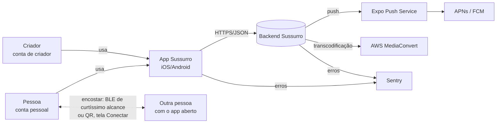
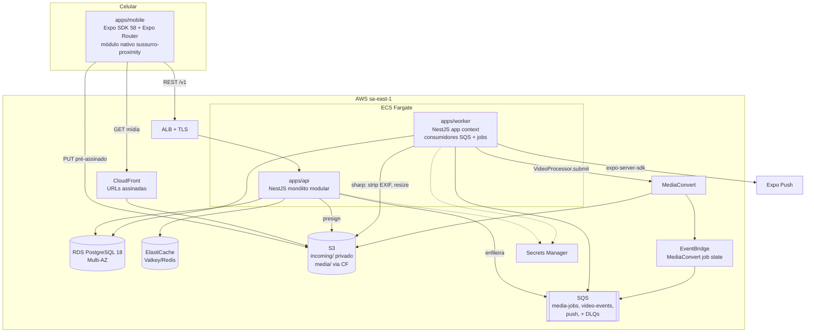
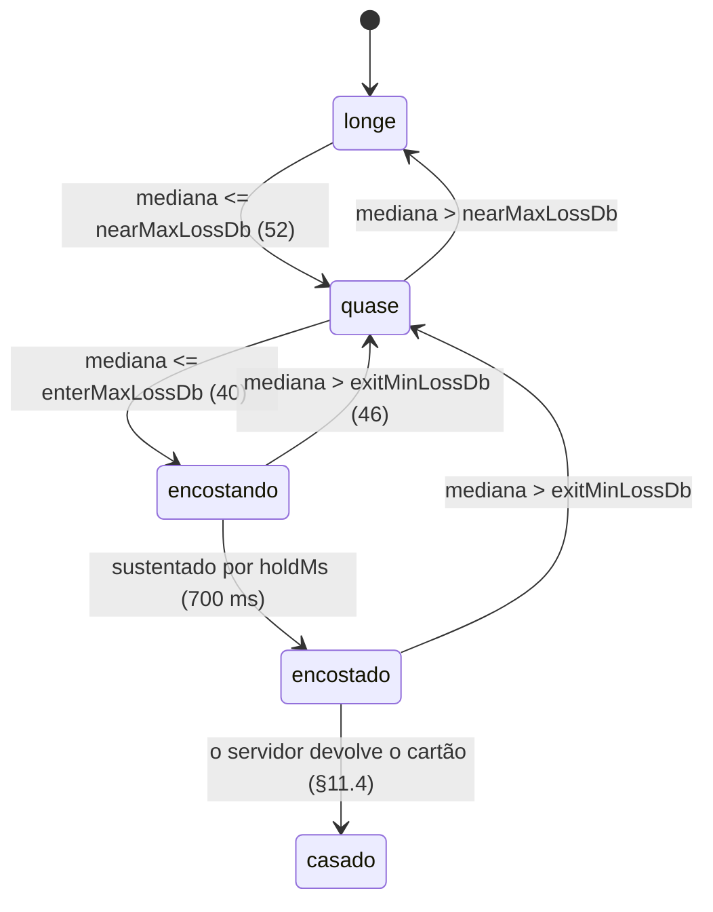

# Arquitetura do Sussurro (v1)

> Autor: Arquiteto. Data: 2026-10-29. Status: proposta para revisão do PO.
> (atualizado em 2026-10-30) Conexão presencial "encostando os celulares" (revisão do D3 e substituição do D13): ADR 0012 (aceita pelo PO em 2026-10-30), nas §2.1, §3, §5, §6, §11, §13, §15 e §16. O desenho ainda não está implementado.
> Entrada: `docs/equipe/briefing.md`. Decisões detalhadas em `docs/equipe/adr/`.
> Princípio: a solução mais simples que atende à v1. O que for preciso para escalar fica registrado como risco, sem complexidade antecipada.

## 1. Visão geral

O Sussurro é composto por um app mobile (Expo/React Native), uma API NestJS (monólito modular) e um worker NestJS que consome filas SQS. Os dados ficam no PostgreSQL. O Redis guarda os dados efêmeros: tokens de proximidade, rate limit e cache curto. A mídia vai direto do app para o S3 por URL pré-assinada e é servida pelo CloudFront com URL assinada. O vídeo é transcodificado pelo AWS MediaConvert, atrás da interface `VideoProcessor`.

### Requisitos não funcionais assumidos (confirmar com o PO)

| Tema | Premissa da v1 |
|---|---|
| Volume | Até ~50 mil usuários cadastrados e ~5 mil ativos por dia no primeiro ano; até ~50 req/s de pico. Uma instância da API e uma do worker dão conta disso, e o mínimo em produção são 2 tarefas da API por disponibilidade. |
| Disponibilidade | 99,5% (Multi-AZ na API e no RDS; Redis em nó único com réplica opcional). |
| Latência | Feed p95 < 300 ms no servidor. |
| Privacidade/LGPD | Dados em `sa-east-1` (recomendado). O grafo social (conexões e seguidos) é tratado como dado sensível do produto. Exclusão de conta disponível no app. |
| Backups | RDS com backup automático de 14 dias e PITR. S3 com Block Public Access, acesso só pelo CloudFront (OAC). |
| Custo | Começar com o menor porte: RDS `db.t4g.small` Multi-AZ, ElastiCache `cache.t4g.micro`, Fargate com 0,5 vCPU. |

## 2. Diagramas

### 2.1 C4 nível 1: contexto



### 2.2 C4 nível 2: containers



## 3. Stack e versões

As versões foram verificadas em 2026-10-29. Os números exatos ficam fixados no lockfile da Fase 0.

| Camada | Escolha | Justificativa |
|---|---|---|
| Runtime | **Node.js 26 LTS** (Active LTS desde 2026-10-28, suporte até abr/2029), fixado em `.nvmrc`, `engines` e `eas.json` | É a versão instalada na máquina do PO e já está em LTS. Expo SDK 58 pede Node >= 22.13 e NestJS 12 pede >= 20. A Fase 0 inclui um smoke test, com fallback para Node 24 (ADR 0001). |
| Gerenciador | pnpm 12.13.0 instalado à parte (`npm i -g`; o Node 26 não traz corepack) + `packageManager`; Turborepo 2.x | Fixado pelo PO. Usamos `nodeLinker` isolado (o padrão), suportado pelo Expo desde o SDK 54, com fallback para `hoisted` (ADR 0001). |
| App | Expo SDK 58 (RN 0.88, React 19.3, New Architecture), Expo Router, TS strict, dev build | Fixado pelo PO. O SDK 58 é o atual (out/2026). O fallback é o SDK 57 se alguma lib crítica não suportar o 58. |
| BLE | **Módulo Expo próprio `sussurro-proximity`** (Expo Modules API, Swift + Kotlin) que anuncia e varre sem conexão GATT | Diverge do `react-native-ble-plx`, que não anuncia (ADR 0002). (atualizado em 2026-10-30, ADR 0012) Serve só para reconhecer o celular **encostado**: ~~o Android anuncia com potência baixa e o campo TX Power~~ (atualizado em 2026-10-30, adendo A1 da ADR 0012: o Android anuncia perto da potência do iPhone, sem o campo TX Power, e o "encostado" usa só o RSSI medido por quem recebe), e o servidor só revela a pessoa com observação mútua (§11). |
| QR | `expo-camera` (leitura) + `react-native-qrcode-svg` ou equivalente (exibição) | Plano B da conexão. |
| Armazenamento seguro | `expo-secure-store` | Refresh token no Keychain/Keystore. |
| API | NestJS 12.x, adapter Fastify ou Express (padrão Express; não há motivo para trocar) | Fixado pelo PO. |
| Validação/contratos | Zod em `packages/shared` (request **e response**) | Uma única fonte de tipos para app e API. As respostas são validadas e filtradas (ADR 0004). |
| ORM | Drizzle ORM (0.45.x) + drizzle-kit migrations, em **`packages/db`** | O schema é usado pela API e pelo worker, por isso vira pacote compartilhado (complemento ao briefing). |
| Banco | PostgreSQL 18 (RDS suporta desde nov/2025) | `uuidv7()` nativo para IDs ordenáveis no tempo. |
| Cache/efêmero | Redis protocolo 7 (local: imagem `valkey/valkey` ou `redis`; AWS: ElastiCache for Valkey) | Valkey é compatível com Redis e mais barato no ElastiCache. A interface continua sendo Redis. |
| Filas | SQS (+ DLQ por fila) | Fixado pelo PO. |
| Emulação local | **ElasticMQ (SQS) + SeaweedFS (S3)** ou LocalStack com auth token | O LocalStack passou a exigir conta e token desde mar/2026 (ADR 0010, decisão do PO). |
| Imagens | `sharp` no worker | Faz rotação pelo EXIF, remove todos os metadados (GPS) e redimensiona. |
| Vídeo | `VideoProcessor` → **MediaConvert** na v1; em dev, `PassthroughVideoProcessor` | ADR 0006. |
| Senhas | argon2id via `@node-rs/argon2` (binários pré-compilados, sem node-gyp no Windows) | |
| Push | Expo Push (`expo-notifications` + `expo-server-sdk` no worker) | Fixado pelo PO. |
| Observabilidade | Sentry (`@sentry/react-native`, `@sentry/nestjs`) desde a Fase 0. Logs JSON (pino). Pontos de OTel preparados | Fixado pelo PO. Scrubbing de PII e tokens. (atualizado na Fase 6) No servidor: `@sentry/nestjs` 11 (o `sendDefaultPii` virou `dataCollection`), `beforeSend`/`beforeSendSpan` com a limpeza do `packages/shared` (`scrubTelemetryEvent`), release, ambiente e amostragem por env; `@opentelemetry/api` 1.10.0 (já vinha com o Sentry) nos pontos de borda, desligado por padrão. |
| IaC | Terraform (sem `apply`) | Fixado pelo PO. |

## 4. Estrutura do monorepo

```
sussurro/
  apps/
    mobile/                 Expo + Expo Router
      modules/sussurro-proximity/   módulo nativo local (Swift/Kotlin)
    api/                    NestJS (HTTP)
    worker/                 NestJS application context (SQS + jobs)
  packages/
    shared/                 schemas Zod (request/response), enums, constantes (limites, FEED_WINDOW)
    ui/                     theme.ts + componentes
    db/                     schema Drizzle, migrations, cliente, seeds   <- complemento
    config/                 tsconfig/eslint/prettier base               <- complemento
  infra/terraform/
  docs/ (design, equipe, adr)
  docker-compose.yml        postgres, redis(valkey), elasticmq, seaweedfs (ou localstack)
  .nvmrc  pnpm-workspace.yaml  turbo.json
```

## 5. Módulos NestJS (apps/api)

Regra de dependência: os controllers só falam com services do próprio módulo. Leituras de relacionamento entre módulos passam por `AccessPolicyService` (módulo `policies`). Nenhum módulo importa repositório de outro.

| Módulo | Responsabilidade |
|---|---|
| `auth` | Cadastro, login, refresh com rotação, logout, guard JWT, `@CurrentUser()`. Rate limit de login. |
| `users` | Perfil próprio (`/me`), edição, perfil por @ (com regras de visibilidade), contadores, exclusão de conta. |
| `policies` | `AccessPolicyService`: `canViewProfile`, `canViewPost`, `isConnected`, `isFollowing`, `assertPersonal`, `assertCreator`. É o único ponto que decide visibilidade e é coberto por testes de permissão. (atualizado na Fase 3) Também decide o bloqueio (X.2), nos dois sentidos: `canViewProfile`, `canViewPost`, `visibleProfiles`, `canFollow`, `canRequestConnection` (pronto para a Fase 4; atualizado na Fase 4: `connectionRequestState`, que também diz "já conectados") e `hideBlockedFor` (filtro SQL das listas com conteúdo de várias contas: comentários e busca). As consultas ficam no `RelationsRepository` ("é conexão?", "há bloqueio?", "segue?"), que nunca devolve listas. (atualizado em 2026-10-30, ADR 0012, A2 rev. 1) `canBlockOrReport`: bloquear e denunciar a conta pelo @ de quem o leitor vê ou, entre contas pessoais, de quem tem par encostado vivo com ele (60 s). A regra fica aqui; o fato "o par existe" vem do `proximity`, que é quem fala com o Valkey. |
| `connections` | Pedidos de conexão, aceite/recusa/cancelamento, criação do par ordenado, lista **própria** de conexões. (atualizado na Fase 4) A lista própria continua no `own-lists`. Aqui ficam os pedidos (`/connections/requests/*`) e desfazer conexão (`DELETE /connections/:handle`, D8). Toda escrita do par pega a trava do par (`lockAccountPair`, a mesma de seguir e bloquear) e decide pelo `AccessPolicyService.connectionRequestState` (tipo de conta, bloqueio e "já conectados") dentro da transação. O `ConnectionsService` é usado pelo `auth` no logout e na exclusão de conta (cancela os pendentes e revoga os tokens, PROX-27). |
| `proximity` | Emissão/rotação de tokens no Redis, resolução de tokens em cartões, validação de tokens cruzados, rate limits. Não grava no Postgres (delega a `connections`). (atualizado na Fase 4) O estado fica atrás da porta `ProximityStore`: `RedisProximityStore` em produção e `MemoryProximityStore` nos testes (sobre o `Clock`) e no desenvolvimento sem Docker (`PROXIMITY_STORE=memory`, recusado em produção). Os limites da proximidade são contados no próprio store e falham **fechados**, como os tokens. (atualizado em 2026-10-30, ADR 0012) Cada emissão traz dois tokens, um por canal (`bleToken` no anúncio, `qrToken` no QR). O `POST /proximity/touches` recebe os encostos, detecta a observação mútua e grava o par que libera o pedido `ble`. O `resolve` passa a servir só ao QR. A proximidade continua sem gravar no Postgres. |
| `dev` (atualizado na Fase 4) | `POST /dev/simulate-request` (4.11, D15): uma persona do seed (@lucasf ou @tomas) pede conexão para a conta logada e a resposta traz um token da persona para o aceite. O módulo só é importado com `NODE_ENV=development` (`devModules` no `AppModule`): em `test` e `production` a rota não existe (PROX-30). |
| `follows` | Seguir/deixar de seguir (personal→creator), lista **própria** de seguidos, busca de criadores por prefixo. (atualizado na Fase 3) A lista própria de seguidos saiu para o `own-lists`. Seguir pega a trava do par (`pg_advisory_xact_lock`), a mesma do bloqueio, e decide pelo `canFollow` dentro da transação. |
| `own-lists` (atualizado na Fase 3) | As **únicas** listas de relacionamento da API: `GET /me/connections`, `GET /me/following` e `GET /me/blocks`. O `OwnListsRepository` recebe `AuthContext` e só lista as relações de `auth.userId`. Regra de lint (`apps/api/eslint.config.mjs`, `no-restricted-imports`): o repositório só é importável pelo `OwnListsService`, e o service só pelo `MeListsController` (3.6 CA5, com teste). |
| `blocks` (atualizado na Fase 3) | Bloquear (`POST /me/blocks`) e desbloquear (`DELETE /me/blocks/:handle`). Grava o bloqueio e, na mesma transação, desfaz a conexão e os follows do par e apaga os comentários de cada um nos posts do outro. O efeito na visibilidade é todo do `policies`. (atualizado em 2026-10-30, ADR 0012, A2 rev. 1) O @ vale também para quem tem par encostado vivo (`canBlockOrReport`), e o sinal de abuso do Conectar roda depois do commit. |
| `reports` (atualizado na Fase 3) | Denúncias (`POST /reports`) e a fila de moderação mínima: um e-mail para `MODERATION_EMAIL` por denúncia nova, pela porta `EmailSender`. Sem painel na v1. (atualizado em 2026-10-30, ADR 0012, A2 e rev. 1) A denúncia de conta aceita também quem tem par encostado vivo (`canBlockOrReport`; importa `proximity` e `policies`), e o `ModerationSignalsService` manda o sinal de abuso do Conectar. |
| `posts` | Criação de texto, rascunhos de foto/reel, publicação, exclusão, leitura por perfil e aba. |
| `media` | URLs pré-assinadas (PUT), verificação de objeto (HEAD), enfileiramento, URLs assinadas do CloudFront para leitura. |
| `feed` | Query cronológica por janela e tipo, cursor, `caughtUp`. |
| `likes` | Curtir/descurtir idempotente, contador desnormalizado. |
| `comments` | Comentários e respostas (1 nível), exclusão pelo autor do comentário ou do post. |
| `notifications` | Criação (na mesma transação do evento), agregação de seguidores, listagem, marcação de lidas, registro de push tokens, enfileiramento de push. (atualizado na Fase 6) `NotificationsService.record*` recebe a transação de quem grava o evento (curtidas, comentários, seguir, conexões) e devolve as mensagens de push, entregues com `dispatch` depois do commit (falha da fila só vai para o log). `PushTokensService` é usado pelo `auth` (logout, sair de todos, troca de senha, refresh reusado e exclusão de conta). O módulo não importa nenhum dos que o usam. A leitura filtra no banco pelo `AccessPolicyService` (`hideBlockedFor`, `profileVisibleFilter`, `connectedFilter`). |
| infra (`database`, `redis`, `queue`, `storage`, `config`, `health`, `observability`) | Providers técnicos, sem regra de negócio. |

**apps/worker**: consumidores `media-jobs` (imagem: sharp; vídeo: `VideoProcessor.submit`), `video-events` (fim do job do MediaConvert), `push` (envio e recibos Expo). Jobs agendados com `setInterval` e `SELECT … FOR UPDATE SKIP LOCKED` no Postgres, que impede duas instâncias de processarem a mesma linha (atualizado nas Fases 1 e 2; antes: `@nestjs/schedule` com lock no Redis): expirar `connection_requests`, apagar rascunhos órfãos (> 24 h), limpar `refresh_tokens` vencidos, checar recibos de push. (atualizado na Fase 4) Os pedidos vencidos são marcados `expired` e os encerrados há mais de 30 dias apagados na mesma rodada da manutenção (`MAINTENANCE_INTERVAL_MS`, 1 h), não a cada minuto: a API já expira de forma preguiçosa em cada operação do par e nas leituras, então o job só arruma o que ninguém tocou. (atualizado na Fase 6) Fila `push`: a rodada inteira (até 10 mensagens) vai ao Expo num lote pela porta `PushSender` (`ExpoPushSender` com o `expo-server-sdk` 8.0.0; `LogPushSender` em dev; fake nos testes). O worker relê o banco antes de enviar (lida, bloqueio, conta ou post apagado, sessão encerrada: não envia). Tickets `ok` vão para `push_tickets`; a consulta dos recibos roda a cada `PUSH_RECEIPTS_INTERVAL_MS` (15 min), só para tickets com mais de 15 min, com `DELETE … FOR UPDATE SKIP LOCKED`. A manutenção apaga notificações com mais de 90 dias e push tokens desativados há 30 dias ou de sessões encerradas.

(atualizado na Fase 5) Vídeo dos reels (ADR 0006): a mensagem `post-video` da `media-jobs` vai para o `VideoProcessor` escolhido por `VIDEO_PROCESSOR` (`passthrough` em dev e nos testes; `mediaconvert` obrigatório em produção, porque o passthrough copia os metadados do original). A interface ficou `submit({mediaId, sourceKey, posterSourceKey, posterMime}) → {jobId, completion | null}` (o passthrough termina na hora; o MediaConvert devolve só o id do job) e `parseCompletion(evento) → VideoCompletion | null` (`null` = evento de outro app ou estado intermediário, descartado). Os dois conferem o vídeo antes (`video-probe.ts`: magic bytes `ftyp` e duração do `mvhd`, lidos por intervalo de bytes, sem baixar o vídeo e sem ffprobe). O consumidor da `video-events` só sobe com `mediaconvert`. Os dois consumidores herdam de `QueueConsumer` (`infra/queue-consumer.ts`).

## 6. Modelo de dados (PostgreSQL 18 + Drizzle)

Convenções: `uuid` com `DEFAULT uuidv7()`, `timestamptz` em UTC, nomes em snake_case. Enums Postgres:
- `account_type` = `personal | creator`
- `connection_method` = `ble | qr`
- `request_status` = `pending | accepted | declined | cancelled | expired`
- `post_type` = `photo | text | reel`
- `post_status` = `draft | processing | published | failed`
- `media_kind` = `image | video`
- `media_status` = `pending_upload | processing | ready | failed`
- `notification_type` = `post_liked | post_commented | comment_replied | new_followers | connection_created`

### users
| coluna | tipo | regras |
|---|---|---|
| id | uuid PK | |
| email | text NOT NULL | `CHECK (email = lower(email))`. (atualizado na Fase 1) único só entre contas ativas: `users_email_active_key ON users (email) WHERE deleted_at IS NULL` |
| password_hash | text NOT NULL | argon2id |
| handle | text NOT NULL UNIQUE | `CHECK (handle ~ '^[a-z0-9._]{3,30}$')`, sempre minúsculo. (atualizado na Fase 1) e com ao menos uma letra ou dígito |
| name | text NOT NULL | `CHECK (char_length(name) BETWEEN 1 AND 60)` |
| bio | text NULL | `CHECK (char_length(bio) <= 150)` |
| avatar_key | text NULL | chave S3 já processada. (atualizado na Fase 2) `media/{uploadId}/avatar.jpg` (quadrado de 400 px, sem metadados); o objeto anterior é apagado na troca e no "Remover foto" |
| account_type | account_type NOT NULL | **imutável** (trigger `users_account_type_immutable`) |
| email_verified_at | timestamptz NULL | (atualizado na Fase 1) e-mail confirmado pelo link (X.3). (atualizado na Fase 2) sem ele, criar rascunho, post de texto, publicar e comentar dão 403 `EMAIL_NOT_VERIFIED` |
| created_at / updated_at | timestamptz NOT NULL DEFAULT now() | |
| deleted_at | timestamptz NULL | exclusão: anonimiza e apaga em cascata via job |

Constraints/índices:
- `UNIQUE (id, account_type)`: alvo das FKs compostas que garantem o tipo de conta no banco (ADR 0008).
- `users_creator_handle_prefix_idx ON users (handle text_pattern_ops) WHERE account_type = 'creator' AND deleted_at IS NULL`: a busca por prefixo só enxerga criadores.
- (atualizado na Fase 1) `users_deleted_at_idx ON users (deleted_at) WHERE deleted_at IS NOT NULL` (job de hard delete). O índice de busca por prefixo entra na Fase 3.
- (atualizado na Fase 3) O índice da busca ficou `users_creator_handle_prefix_idx ON users ((handle COLLATE "C")) WHERE account_type = 'creator' AND deleted_at IS NULL`, em vez de `text_pattern_ops`: a collation "C" (ordem de bytes) serve o `LIKE 'abc%'` e também o `ORDER BY` alfabético, igual em qualquer locale do servidor (teste com `EXPLAIN` em `packages/db/src/moderation-schema.int.test.ts`).

### retired_handles (atualizado na Fase 1)
| coluna | tipo | regras |
|---|---|---|
| handle | text PK | `CHECK (handle = lower(handle))`. Sem FK: sobrevive ao hard delete da conta |
| retired_at | timestamptz NOT NULL DEFAULT now() | |

- Gravado na mesma transação do `DELETE /me`: o @ de conta excluída nunca volta (A-14).

### email_tokens (atualizado na Fase 1)
| coluna | tipo | regras |
|---|---|---|
| id | uuid PK | |
| user_id | uuid NOT NULL FK users ON DELETE CASCADE | |
| purpose | email_token_purpose NOT NULL | `verify_email \| reset_password` (D6) |
| email | text NOT NULL | endereço para onde o link foi |
| token_hash | bytea NOT NULL UNIQUE | SHA-256 do token opaco |
| created_at / expires_at | timestamptz | 24 h (verificação) e 1 h (redefinição) |
| used_at | timestamptz NULL | uso único |

- Índices `(user_id, purpose)` e `(expires_at)`; o job de manutenção apaga os vencidos.

### connections (par ordenado)

(atualizado na Fase 2) A tabela existe desde a Fase 2 só como schema, factories e seed: o feed e a política de acesso dependem dela. As rotas chegam na Fase 4, junto com `connection_requests` e a FK de `request_id`. As FKs e CHECKs têm nome (`connections_user_a_fk`, `connections_ordered_pair_chk`…).
| coluna | tipo | regras |
|---|---|---|
| user_a_id | uuid NOT NULL | `user_a_id < user_b_id` |
| user_a_type | account_type NOT NULL DEFAULT 'personal' | `CHECK (user_a_type = 'personal')` |
| user_b_id | uuid NOT NULL | |
| user_b_type | account_type NOT NULL DEFAULT 'personal' | `CHECK (user_b_type = 'personal')` |
| method | connection_method NOT NULL | |
| request_id | uuid NULL FK connection_requests | rastreabilidade |
| created_at | timestamptz NOT NULL DEFAULT now() | |

- PK `(user_a_id, user_b_id)`. Índice `(user_b_id, user_a_id)` para a busca pelo outro lado.
- FK `(user_a_id, user_a_type) → users(id, account_type) ON DELETE CASCADE` e o mesmo para b.
- (atualizado na Fase 4) FK `connections_request_fk (request_id) → connection_requests(id) ON DELETE SET NULL`, com o índice parcial `connections_request_idx`: a retenção de 30 dias dos pedidos deixa `request_id` nulo e a conexão fica. `created_at` vem do `Clock` da API. Desfazer conexão (D8) apaga a linha; contadores e listas são `COUNT(*)`/consultas na leitura, então mudam na hora.

### connection_requests

(atualizado na Fase 4) Migration `0004_connection_requests`. Como ficou: colunas `from_type`/`to_type` (`DEFAULT 'personal'`, `CHECK = 'personal'`) para as FKs compostas `connection_requests_from_fk`/`_to_fk` (`ON DELETE CASCADE`); `id` com `DEFAULT uuidv7()`; `created_at` e `expires_at` gravados pela API com o `Clock`; CHECKs `connection_requests_not_self_chk`, `_expiry_chk` (`expires_at > created_at`) e `_responded_chk` (`responded_at` existe só fora de `pending`). Índices: o único parcial `connection_requests_pending_pair_key`, `connection_requests_to_idx (to_id, status, created_at)` (caixa de entrada, em ordem crescente: as folhas saem da mais antiga), `connection_requests_from_idx (from_id, to_id)` (intervalo depois da recusa, logout e cascade) e `connection_requests_created_idx (created_at)` (retenção). O intervalo de 1 h depois da recusa é lido da própria linha `declined` (`responded_at`), não de uma chave no Redis.

| coluna | tipo | regras |
|---|---|---|
| id | uuid PK | |
| from_id / to_id | uuid NOT NULL | FKs compostas com `*_type = 'personal'`, `CHECK (from_id <> to_id)` |
| status | request_status NOT NULL DEFAULT 'pending' | |
| method | connection_method NOT NULL | método do pedido; o da conexão é o do pedido que a originou |
| created_at | timestamptz NOT NULL | |
| expires_at | timestamptz NOT NULL | `created_at + 120 s` |
| responded_at | timestamptz NULL | |

- `UNIQUE (LEAST(from_id,to_id), GREATEST(from_id,to_id)) WHERE status = 'pending'`: no máximo **um** pedido pendente por par, em qualquer direção.
- Índice `(to_id, status, created_at DESC)` para a caixa de entrada.
- Retenção: o job apaga linhas não pendentes com mais de 30 dias.

### follows
| coluna | tipo | regras |
|---|---|---|
| follower_id | uuid NOT NULL | FK `(follower_id, follower_type)`, `CHECK (follower_type='personal')` |
| follower_type | account_type NOT NULL DEFAULT 'personal' | |
| creator_id | uuid NOT NULL | FK `(creator_id, creator_type)`, `CHECK (creator_type='creator')` |
| creator_type | account_type NOT NULL DEFAULT 'creator' | |
| created_at | timestamptz NOT NULL | |

- PK `(follower_id, creator_id)`, que também serve para listar seguidos e contar "criadores".
- Índice `(creator_id)` para contar seguidores.
- (atualizado na Fase 2) Existe desde a Fase 2 só como schema, factories e seed (o feed depende dela); seguir e deixar de seguir chegam na Fase 3.
- (atualizado na Fase 3) `created_at` é gravado com o `Clock` da API. A lista própria ordena por `created_at DESC, id DESC`, e o cursor leva o `created_at` com microssegundos (texto), sem perder itens no mesmo milissegundo. O número de seguidores tem cache de 60 s no Redis (`cnt:followers:{creatorId}`).

### blocks (atualizado na Fase 3)
| coluna | tipo | regras |
|---|---|---|
| blocker_id | uuid NOT NULL FK users ON DELETE CASCADE | quem bloqueou |
| blocked_id | uuid NOT NULL FK users ON DELETE CASCADE | quem foi bloqueado |
| created_at | timestamptz NOT NULL | |

- PK `(blocker_id, blocked_id)` (a lista do dono e "A bloqueou B?"); índice `blocks_blocked_idx (blocked_id, blocker_id)` (o outro sentido e o cascade); `CHECK (blocker_id <> blocked_id)`. Qualquer tipo de conta bloqueia e é bloqueado.
- Os dois sentidos podem coexistir. Para a visibilidade, basta um deles (§7, regra 6).

### reports (atualizado na Fase 3)
| coluna | tipo | regras |
|---|---|---|
| id | uuid PK | |
| reporter_id | uuid NOT NULL FK users ON DELETE CASCADE | quem denunciou |
| target_type | report_target_type NOT NULL | `post \| comment \| account` |
| target_user_id | uuid NOT NULL FK users ON DELETE CASCADE | a conta denunciada ou a autora do conteúdo |
| post_id | uuid NULL FK posts ON DELETE SET NULL | só em `post` |
| comment_id | uuid NULL FK comments ON DELETE SET NULL | só em `comment` |
| reason | report_reason NOT NULL | `spam \| harassment \| hate \| violence \| sexual \| self_harm \| impersonation \| other` |
| details | text NULL | `CHECK (char_length(details) BETWEEN 1 AND 500)` |
| created_at | timestamptz NOT NULL | |

- Idempotência: índices únicos `(reporter_id, post_id) WHERE target_type = 'post'`, `(reporter_id, comment_id) WHERE target_type = 'comment'` e `(reporter_id, target_user_id) WHERE target_type = 'account'`; o INSERT usa `ON CONFLICT DO NOTHING`.
- `CHECK` de coerência do alvo com o tipo e `CHECK (reporter_id <> target_user_id)`.
- Retenção: some com o hard delete de quem denunciou ou da conta denunciada; se só o post ou o comentário for apagado de vez, a denúncia fica sem a referência.

### posts
| coluna | tipo | regras |
|---|---|---|
| id | uuid PK (v7) | |
| author_id | uuid NOT NULL FK users ON DELETE CASCADE | |
| type | post_type NOT NULL | |
| caption | text NULL | `CHECK (char_length(caption) <= 2200)`; NULL em `text` |
| text | text NULL | `CHECK ((type = 'text') = (text IS NOT NULL))`, `CHECK (char_length(text) BETWEEN 1 AND 280)` (code points) |
| status | post_status NOT NULL | texto nasce `published`; foto/reel nascem `draft` |
| like_count / comment_count | integer NOT NULL DEFAULT 0 | `CHECK (>= 0)`, desnormalizados |
| created_at | timestamptz NOT NULL | |
| published_at | timestamptz NULL | `CHECK ((status='published') = (published_at IS NOT NULL))`; **o feed ordena por este campo**. (atualizado na Fase 2) `CHECK (published_at = date_trunc('milliseconds', published_at))`: o cursor carrega o valor em ms sem perder nem repetir posts |
| deleted_at | timestamptz NULL | soft delete. (atualizado na Fase 2) some na hora; o job do worker apaga os objetos do S3 e depois a linha (curtidas, comentários e mídia em cascata) |

- `posts_author_type_pub_idx ON posts (author_id, type, published_at DESC, id DESC) WHERE status='published' AND deleted_at IS NULL` serve o feed e as abas do perfil. Substitui o `posts(author_id, created_at desc)` da especificação.
- Índice `(status, created_at) WHERE status IN ('draft','processing')` para o job de órfãos.
- (atualizado na Fase 2) Também: `CHECK (type <> 'text' OR status = 'published')` (texto nasce publicado), legenda só fora de `text`; `posts_author_created_idx (author_id, type, created_at DESC)` (aba do dono com `processing`/`failed`, contagem e FK em cascata); `posts_deleted_idx (deleted_at) WHERE deleted_at IS NOT NULL` (job dos posts apagados).

### post_media
| coluna | tipo | regras |
|---|---|---|
| id | uuid PK | é a chave do objeto S3 |
| post_id | uuid NOT NULL FK posts ON DELETE CASCADE | |
| position | smallint NOT NULL | `CHECK (position BETWEEN 0 AND 3)`, `UNIQUE (post_id, position)` |
| kind | media_kind NOT NULL | vídeo só em `position = 0` |
| mime | text NOT NULL | declarado; o worker confirma por magic bytes |
| size_bytes | integer NOT NULL | |
| incoming_key | text NOT NULL | `incoming/{user}/{id}` (privado, apagado após processar) |
| storage_key | text NULL | `media/{id}/full.jpg` ou `.../video.mp4` |
| thumb_key | text NULL | `media/{id}/thumb.jpg` (grade e poster) |
| width / height | integer NULL | |
| duration_s | numeric(6,2) NULL | vídeo |
| poster_incoming_key / poster_mime / poster_size_bytes | text / text / integer NULL | (atualizado na Fase 5) só no vídeo: o poster enviado pelo app, em `incoming/{user}/{id}-poster` |
| status | media_status NOT NULL | |
| processor_job_id | text NULL | id do job do MediaConvert |
| error | text NULL | |
| created_at / updated_at | timestamptz | |

- (atualizado na Fase 2) O `id` é gerado pela API (`randomUUID`, v4) porque entra na chave de `incoming/` gravada no mesmo INSERT. `CHECK (size_bytes > 0)`. Índice `post_media_processing_idx (updated_at) WHERE status = 'processing'` para o job que marca como `failed` a mídia presa (worker caído nas 3 tentativas). Uma imagem com falha deixa o post inteiro `failed` (MID-10).
- (atualizado na Fase 5, migration `0005_reels`) Reel: um vídeo na posição 0. `duration_s` é obrigatório e positivo no vídeo (`post_media_video_duration_chk`): a duração declarada no rascunho, trocada pela medida no arquivo quando fica pronto. O poster só existe no vídeo e completo (`post_media_poster_chk`, `post_media_poster_video_chk`, `post_media_poster_size_chk`). Saídas: `storage_key` = `media/{id}/video.mp4`; `thumb_key` = `media/{id}/poster.jpg` (passthrough, o poster do app sem metadados) ou `media/{id}/poster.0000000.jpg` (quadro do MediaConvert). O evento de fim só é aceito se `id` **e** `processor_job_id` baterem.

### likes
- `post_id uuid FK ON DELETE CASCADE`, `user_id uuid FK ON DELETE CASCADE`, `created_at`. PK `(post_id, user_id)`.
- Não existe endpoint que liste quem curtiu, só o contador e `likedByMe` (ADR 0004).
- (atualizado na Fase 2) Índice `likes_user_idx (user_id)`: no `DELETE /me` as curtidas da pessoa saem na hora, com os contadores ajustados na mesma transação (A-13); o hard delete recalcula os contadores dos posts afetados (A-12).

### comments
| coluna | tipo | regras |
|---|---|---|
| id | uuid PK | |
| post_id | uuid NOT NULL FK ON DELETE CASCADE | |
| author_id | uuid NOT NULL FK | (atualizado na Fase 2) `ON DELETE CASCADE` (hard delete da conta) |
| parent_id | uuid NULL FK comments | só 1 nível (a aplicação valida que o pai não tem pai). (atualizado na Fase 2) `ON DELETE CASCADE`; `CHECK (parent_id <> id)` |
| body | text NOT NULL | `CHECK (char_length(body) BETWEEN 1 AND 500)` |
| created_at | timestamptz | |
| deleted_at | timestamptz NULL | |

- Índice `(post_id, created_at, id) WHERE deleted_at IS NULL`.
- (atualizado na Fase 2) O índice `comments_post_idx (post_id, created_at, id)` ficou **sem** o `WHERE`, para servir também o `ON DELETE CASCADE` de `posts` (que alcança os apagados). Mais `comments_parent_idx (parent_id, created_at) WHERE parent_id IS NOT NULL` e `comments_author_idx (author_id)`. Apagar um comentário apaga as respostas dele (`deleted_at` nas duas), e `comment_count` conta comentários e respostas vivos. No `DELETE /me`, os comentários da pessoa e as respostas a eles saem na hora, com o contador ajustado (A-13).

### avatar_uploads (atualizado na Fase 2)
| coluna | tipo | regras |
|---|---|---|
| id | uuid PK | gerado pela API; é a chave `incoming/{user}/{id}` e `media/{id}/avatar.jpg` |
| user_id | uuid NOT NULL FK users ON DELETE CASCADE | |
| mime / size_bytes | text / integer NOT NULL | declarados (JPEG/PNG/WebP até 15 MB); o worker confirma por magic bytes |
| incoming_key / storage_key | text NOT NULL / text NULL | original privado e saída processada |
| status | media_status NOT NULL DEFAULT 'pending_upload' | `processing` no `PUT /me/avatar`, `ready` ou `failed` no worker |
| error | text NULL | |
| requested_at | timestamptz NULL | quando a troca foi pedida: a mais recente vence |
| created_at / updated_at | timestamptz | |

- Índices `(user_id, created_at)` e `(created_at)`. O job apaga as linhas com mais de 24 h, com o original e as saídas que não são a foto em uso.

### notifications
| coluna | tipo | regras |
|---|---|---|
| id | uuid PK | |
| recipient_id | uuid NOT NULL FK ON DELETE CASCADE | |
| type | notification_type NOT NULL | |
| actor_id | uuid NULL FK ON DELETE CASCADE | **sempre NULL** em `new_followers` (`CHECK`) |
| post_id | uuid NULL FK ON DELETE CASCADE | |
| comment_id | uuid NULL FK ON DELETE CASCADE | |
| count | integer NOT NULL DEFAULT 1 | agregação |
| bucket_key | text NULL | `new_followers`: `nf:YYYY-MM-DD` (dia em America/Sao_Paulo) |
| payload | jsonb NOT NULL DEFAULT '{}' | trecho do comentário etc. Nunca ids de seguidores |
| read_at | timestamptz NULL | |
| created_at / updated_at | timestamptz | ordenação por `updated_at` |

- Índice `(recipient_id, updated_at DESC)`. Índice parcial `(recipient_id) WHERE read_at IS NULL` para o ponto azul.
- `UNIQUE (recipient_id, bucket_key) WHERE bucket_key IS NOT NULL`: o upsert de seguidores faz `count = count + 1, read_at = NULL, updated_at = now()`.
- `UNIQUE (recipient_id, actor_id, post_id) WHERE type = 'post_liked'` impede spam de curtir/descurtir.
- Retenção: 90 dias.
- (atualizado na Fase 6) Como ficou na migration `0006_notifications_push`: `actor_id` obrigatório fora de `new_followers` e o `CHECK` de anonimato em `new_followers` (`actor_id`, `post_id` e `comment_id` nulos e `payload = '{}'`); `post_id` só nos tipos de post, `comment_id` só em `post_commented`/`comment_replied` (o trecho é lido do comentário na hora, não copiado para o `payload`, que fica vazio na v1); `count = 1` fora de `new_followers`; `bucket_key` no formato `nf:YYYY-MM-DD`; ninguém é notificado da própria ação (`actor_id <> recipient_id`); `created_at`/`updated_at` gravados com o `Clock` (sem `DEFAULT`). Índices parciais em `actor_id`, `post_id` e `comment_id` (cascatas e bloqueio) e em `updated_at` (retenção). O upsert de seguidores usa `RETURNING old.*` (Postgres 18) para saber se a linha é nova ou estava lida: só então sai um push.

### refresh_tokens
| coluna | tipo | regras |
|---|---|---|
| id | uuid PK | |
| user_id | uuid NOT NULL FK ON DELETE CASCADE | |
| family_id | uuid NOT NULL | uma família por login/dispositivo |
| token_hash | bytea NOT NULL UNIQUE | SHA-256 do token opaco (256 bits) |
| created_at / expires_at | timestamptz | 30 dias |
| used_at | timestamptz NULL | marcado na rotação |
| replaced_by | uuid NULL | |
| revoked_at | timestamptz NULL | |
| device_label | text NULL | ex.: "iPhone · iOS 27" (sem IP, por minimização) |

- Índices `(user_id)` e `(family_id)`.

### push_tokens
- `id uuid PK`, `user_id FK ON DELETE CASCADE`, `expo_token text UNIQUE NOT NULL`, `platform text CHECK IN ('ios','android')`, `refresh_family_id uuid NULL` (apagado no logout daquele dispositivo), `created_at`, `last_seen_at`, `disabled_at` (marcado quando chega `DeviceNotRegistered`). Índice `(user_id) WHERE disabled_at IS NULL`.
- (atualizado na Fase 6) `refresh_family_id` ficou `NOT NULL` (a família do access token de quem registrou) e o logout daquela sessão **apaga a linha** (não só limpa a coluna); sair de todos, troca de senha, refresh reusado e exclusão de conta apagam todas as da família ou da conta. `CHECK` do formato `ExponentPushToken[...]` (até 255). Índices `(user_id, last_seen_at DESC)` (envio, limite de 10 por conta e cascata) e `(refresh_family_id)`. O worker só envia para token não desativado de uma família com refresh vivo.

### push_tickets (atualizado na Fase 6)
- `ticket_id text PK`, `push_token_id uuid NOT NULL FK ON DELETE CASCADE`, `created_at`. Só o id do ticket do Expo e o token: nenhum conteúdo da mensagem. O job dos recibos consulta depois de 15 min e apaga; com mais de 24 h, sai sem recibo.

### Redis (efêmero)
| chave | conteúdo | TTL |
|---|---|---|
| `prox:t:{sha256(token)}` | `{uid, iat}`. (atualizado em 2026-10-30, ADR 0012) `{uid, iat, ch}`, com o canal `ble` ou `qr`; cada emissão grava dois tokens | 30 s (token **válido**) |
| `prox:r:{sha256(token)}` | `uid` (atualizado na Fase 4: `{uid, iat}`, o mesmo valor do `prox:t`; atualizado em 2026-10-30: com `ch`) | 120 s (token **recente**: confirma o aceite `qr` e identifica o alvo do pedido `ble` com par) |
| `prox:u:{uid}` | hash do token atual | 30 s (prova de "tela aberta") |
| ~~`prox:cool:{from}:{to}`~~ | (atualizado na Fase 4) não existe: o intervalo de 1 h depois da recusa é lido da linha `declined` em `connection_requests` | |
| `prox:ut:{uid}` | (atualizado na Fase 4) conjunto dos hashes emitidos pela conta, para revogar no logout e na exclusão (PROX-27) | 120 s, renovado a cada token |
| `prox:lock:{uid}` | (atualizado na Fase 4) proximidade bloqueada depois de 20 falhas de token em 10 min | 15 min |
| `prox:o:{observadorUid}:{donoUid}` | (atualizado em 2026-10-30, ADR 0012) o observador relatou um token **BLE** do dono com força de encosto; só o horário (ms). (atualizado em 2026-10-30, A2) `"{primeiroMs}:{hash}"`: o horário do **primeiro** relato (não renova) e o hash do token relatado por último | 10 s (`PROX_TOUCH_WINDOW_S`) (A2: `2 × PROX_TOUCH_WINDOW_S` = 10 s desde o primeiro relato; só casa nos primeiros 5 s) (atualizado em 2026-10-30, A2 rev. 1: 10 s **desde o último relato**, prazo deslizante; o `primeiroMs` não muda enquanto a chave vive) |
| `prox:m:{menorUid}:{maiorUid}` | (atualizado em 2026-10-30, ADR 0012) par com **encosto mútuo**, sem bloqueio: libera o pedido `ble` entre os dois; só o horário (ms). (atualizado em 2026-10-30, A2 rev. 1) Libera também bloquear e denunciar pelo @ (cartão do encosto). O valor ganha os sentidos já contados no sinal de abuso, `"{horário}:{a\|b\|ab\|ba}"` (conjunto de sentidos, na ordem da contagem; `a` = o menor id bloqueou o maior); o casamento regrava só o horário | 60 s (`PROX_TOUCH_PAIR_TTL_S`) |
| `prox:v:{uid}` | (2026-10-30, A2) o **cartão devido** à conta: `"{hash}\|{json}"`, com o id, o horário, o @, o nome, a chave da foto e o `alreadyConnected` de quem casou com ela; no máximo um; entrega única | 60 s (`PROX_TOUCH_PAIR_TTL_S`) |
| `prox:c:{uid}` | (2026-10-30, A2) a conta recebeu um cartão há pouco (ocupada): ninguém casa com ela; só "1" | 10 s (`2 × PROX_TOUCH_WINDOW_S`) |
| `rl:{rota}:{uid\|ip}` | contadores de rate limit. (atualizado na Fase 4) Os da proximidade (`rl:prox-tokens:user`, `rl:prox-resolve:user`, `rl:conn-requests:user:min` e `:day`, `rl:conn-accepts:user`, `rl:prox-failures:user`) ficam no `ProximityStore` e falham fechados. (atualizado em 2026-10-30) Mais `rl:prox-touches:user` (60/min). (A2) Mais `rl:prox-pairs:hour:{uid}` e `rl:prox-pairs:day:{uid}` (pessoas novas, fail-closed) e `rl:prox-block-after-touch:blocker:{uid}` e `:blocked:{uid}` (sinal de abuso, 7 dias, falha aberta; A2 rev. 1: contam bloqueios, no máximo um por casamento e por sentido) | janela |
| `cnt:followers:{creatorId}` | número de seguidores do criador (atualizado na Fase 3) | 60 s |

## 7. Regras de negócio no servidor

1. **Tipo de conta** (ADR 0008). O banco garante via FK composta: conexões e pedidos só entre `personal`; follow só `personal → creator`; `account_type` imutável. A aplicação garante via guard `@RequireAccountType('personal')` nas rotas de Conectar, seguir, feed e busca, para devolver um erro de domínio legível (403 `ACCOUNT_TYPE_NOT_ALLOWED`) antes de o banco recusar.
2. **Visibilidade de post**: o autor sempre vê. Post de criador é visível a qualquer conta autenticada (perfil de criador é público dentro do app). Post de conta pessoal é visível só às conexões do autor. Fora disso a resposta é **404** (não 403, para não confirmar existência).
3. **Visibilidade de perfil**: criador é visível a todos os autenticados. Pessoal é visível ao próprio dono e às suas conexões; os demais recebem 404.
4. **Busca**: só criadores, prefixo >= 3 caracteres, no máximo 20 resultados, ordem alfabética do @ (ordem determinística, sem ranqueamento). Sem sugestões.
5. **Troca de tipo de conta**: não existe na v1 (ADR 0008).
6. **Bloqueio** (atualizado na Fase 3, X.2). Se A bloqueou B (ou B bloqueou A), os dois deixam de se ver:
   - perfil, abas, posts, comentários e curtir/comentar respondem o 404 de inexistente, nos dois sentidos, sem URL assinada;
   - a busca esconde o criador;
   - seguir dá o 404 de @ inexistente; o pedido de conexão (Fase 4) fica recusado em `canRequestConnection`;
   - cada um deixa de ver os comentários do outro em qualquer post (e as respostas a eles); responder ou apagar um comentário escondido = inexistente;
   - na transação do bloqueio: conexão e follows do par desfeitos (contadores por `COUNT(*)`: conexões e "criadores" na hora, seguidores em até 60 s) e os comentários de cada um nos posts do outro apagados, com `comment_count` ajustado. Desbloquear volta a visibilidade, não as relações nem os comentários;
   - **sem oráculo**: o bloqueio só é gravado para quem a pessoa já vê (perfil visível ou autor de um comentário que ela vê, D11). @ inexistente, excluído ou invisível → o mesmo 204, sem gravar nada; a lista de bloqueados só mostra quem ela já conhecia (só @ e data).
7. **Denúncia** (atualizado na Fase 3, X.1). Só se denuncia o que se vê (o 404 das mesmas regras); a pessoa denunciada nunca é avisada; repetir é idempotente; o próprio conteúdo → 400.
8. **Seguir** (atualizado na Fase 3). Só pessoal → criador (guard + FK composta); @ de conta pessoal, inexistente, excluída ou com bloqueio → o mesmo 404 (PERM-03). Seguir e bloquear pegam a mesma trava do par, então um follow concorrente nunca sobrevive ao bloqueio.

Rate limits da Fase 3 (por conta, atualizado na Fase 3): busca 60/min (A-31), seguir e deixar de seguir 10/min, bloquear e desbloquear 60/h, denunciar 20/h.

## 8. Feed cronológico (ADR 0005)

`GET /v1/feed?type=photo|text|reel&cursor=...&limit=20` (só para `personal`).

```sql
WITH authors AS (
  SELECT CASE WHEN c.user_a_id = $viewer THEN c.user_b_id ELSE c.user_a_id END AS id
    FROM connections c WHERE c.user_a_id = $viewer OR c.user_b_id = $viewer
  UNION
  SELECT f.creator_id FROM follows f WHERE f.follower_id = $viewer
  -- UNION SELECT $viewer   -- incluir os próprios posts? (decisão do PO, recomendado: sim)
)
SELECT p.* FROM authors a
JOIN LATERAL (
  SELECT * FROM posts p
   WHERE p.author_id = a.id AND p.type = $type
     AND p.status = 'published' AND p.deleted_at IS NULL
     AND p.published_at >= $since
     AND (p.published_at, p.id) < ($cursorAt, $cursorId)
   ORDER BY p.published_at DESC, p.id DESC
   LIMIT $limit + 1
) p ON true
ORDER BY p.published_at DESC, p.id DESC
LIMIT $limit + 1;
```

- `$since = now() - FEED_WINDOW_HOURS` (env, padrão 72) é **fixado na primeira página** e viaja dentro do cursor, para a janela não "andar" durante a rolagem. O servidor limita `since` a no máximo `janela + 1 h` atrás, então o cliente não consegue estender a janela.
- Cursor opaco: base64url de `{at, id, since}`.
- Resposta: `{ items, nextCursor: string|null, caughtUp: boolean, windowHours }`. `caughtUp = (nextCursor === null)` aciona o bloco "Você está em dia".
- O `LATERAL` usa `posts_author_type_pub_idx` por autor (nested loop, cada autor lê no máximo `limit+1` linhas). Os índices de `connections` e o PK de `follows` resolvem o CTE.
- Enriquecimento em lote: autor (handle, nome, avatar, rótulo "Conexão"/"Criador"), `likedByMe` (PK de likes), mídia `ready` com URLs assinadas.
- Criador não tem feed (a barra dele não tem Início): a rota devolve 403.

**Contadores** (ADR 0004):
- `like_count` e `comment_count` são desnormalizados em `posts`, atualizados na mesma transação do like/comentário (são lidos em cada item do feed).
- Os contadores de perfil (publicações, conexões, criadores, seguidores) usam `COUNT(*)` na leitura, com index-only scan, e cache Redis de 60 s para o número de seguidores de criador.

## 9. Mídia (ADR 0009, ADR 0006)

1. `POST /v1/posts/drafts {type:'photo'|'reel', items:[{mime,sizeBytes,width,height,durationS?}]}`: valida limites (foto: 1–4 itens `image/jpeg|png|webp` <= 15 MB; reel: 1 `video/mp4|quicktime` <= 200 MB e <= 90 s, a confirmar) e cria `posts(status=draft)` + `post_media(pending_upload)`. Devolve, por item, uma **URL PUT pré-assinada** (10 min) com `Content-Type` e `Content-Length` assinados para `incoming/{userId}/{mediaId}`.
2. O app converte HEIC→JPEG e redimensiona para <= 2160 px com `expo-image-manipulator`. O sharp pré-compilado não decodifica HEIC, e o upload fica menor. Depois disso o app faz o PUT direto no S3.
3. `POST /v1/posts/:id/publish {caption}`: o servidor faz `HEAD` em cada objeto (existe, tamanho, tipo), muda `post_media` para `processing` e `posts` para `processing`, e envia uma mensagem por mídia para `media-jobs`.
4. O worker processa imagens assim: confere magic bytes, `sharp().rotate()`, **remove todos os metadados** (EXIF/GPS/XMP), gera `full` (1080 px de largura, JPEG q82) e `thumb` (360 px), grava em `media/{id}/`, apaga o `incoming` e marca `ready`. Vídeo: `VideoProcessor.submit()`, e o evento de conclusão chega pela fila `video-events`.
5. Quando todas as mídias do post estão `ready`, o post vira `published` com `published_at = now()`. Em caso de falha, `failed`, e o app mostra a opção de tentar de novo.
6. Leitura: o bucket fica privado e as URLs são **assinadas pelo CloudFront** (validade de 6 h, chave de cache no app = `mediaId`). Assim, a mídia de conta pessoal não fica acessível a quem não é conexão.
7. Lifecycle no S3: `incoming/` expira em 1 dia.

Texto: `POST /v1/posts {type:'text', text}` publica direto.

**Reels (atualizado na Fase 5; D10, ADR 0006):**

1. `POST /v1/posts/drafts {type:'reel', video:{mime,sizeBytes,durationS}, poster:{mime,sizeBytes}}`: vídeo `video/mp4` ou `video/quicktime` de até 200 MB (200 × 1024 × 1024 bytes) e até 90 s (`durationS` informado pelo seletor do aparelho, guardado com 2 casas, arredondado para cima); poster JPEG/PNG/WebP de até 5 MB, gerado no app. 91 s, 90,01 s ou 200 MB + 1 byte → 400. Rate limit próprio de 10 rascunhos de reel por hora (R10), além dos 20 rascunhos/h. Devolve `uploads` (o vídeo, posição 0) e `poster`, cada um com a URL PUT assinada (tipo e tamanho).
2. `publish`: `HEAD` no vídeo e no poster; o que faltar → 409 `MEDIA_NOT_UPLOADED` com `details.positions` (`[0]` = vídeo) e `details.poster`. Envia `{type:'post-video', mediaId}` para a `media-jobs`.
3. Worker: confere o vídeo por intervalo de bytes (`ftyp` + `mvhd`/`mehd` + `tkhd`, sem baixar o vídeo e sem ffprobe): não é MP4/MOV ou passa de 90,5 s (90 s + folga de 0,5 s do container) → `failed` na hora, sem criar job. Depois:
   - `passthrough` (dev): copia o original para `media/{id}/video.mp4` dentro do S3 (`CopyObject`), passa o poster do app pelo sharp (sem metadados, 720 px) para `media/{id}/poster.jpg` e publica na hora. **Copia os metadados do vídeo** (A-21): recusado em produção pelo worker;
   - `mediaconvert` (produção): `CreateJob` com `userMetadata.app = sussurro` e `userMetadata.mediaId`, `ClientRequestToken = mediaId`, entrada com `Rotate: AUTO`, saída MP4 H.264 (QVBR) + AAC 720×1280 (`FIT`, `moov` no começo, C2PA excluído) e um quadro JPEG; grava `processor_job_id` e apaga o poster do app. O EventBridge entrega `COMPLETE`/`ERROR` na `video-events`: evento de outro app, sem `mediaId` ou de job desconhecido é descartado sem efeito; `COMPLETE` confere de novo a duração (`durationInMs`) e as saídas (só dentro de `media/{id}/`) e publica; `ERROR` marca `failed`. Repetido não muda nada.
   - Nos dois casos, o original e o poster saem de `incoming/` ao terminar (pronto ou com falha).
4. Falha (5.6): o post `failed` só aparece para o autor (perfil e detalhe), nunca no feed. "Tentar de novo" **recria** (o app apaga o post com falha e faz um rascunho novo com o mesmo arquivo), como nas fotos: o original não fica guardado depois da falha. "Excluir" é o `DELETE /posts/:id`.
5. Leitura: `media[0]` traz `kind: 'video'`, `durationS` (medida), `url` (MP4) e `thumbUrl` (poster), assinadas só com `status = ready` (MID-09). O feed e as abas do perfil usam `type=reel`.
6. Limpeza: os jobs de rascunhos, posts apagados e hard delete apagam também o poster em `incoming/` e as saídas previstas do vídeo; um reel apagado com job do MediaConvert ainda rodando espera o evento (ou o tempo esgotado de `MEDIA_PROCESSING_TIMEOUT_MIN`) antes de sair, para as saídas não ficarem órfãs.

## 10. Autenticação (ADR 0007)

- Login por **e-mail + senha** (recomendação: seguir a especificação e trocar o rótulo do protótipo para "E-mail").
- Access JWT de 15 min (HS256, `kid` para rotação de segredo; claims `sub`, `acct` (tipo de conta, imutável), `fam`). Fica **só em memória** no app.
- Refresh opaco de 256 bits, guardado como hash no Postgres, válido por 30 dias, **rotacionado a cada uso**. Se um token já usado for reapresentado depois de 20 s de graça, a família inteira é revogada. Dentro dos 20 s, o servidor trata como retry de rede: revoga o sucessor e emite um novo par.
- App: refresh no `expo-secure-store` (`WHEN_UNLOCKED_THIS_DEVICE_ONLY`). O cliente HTTP usa *single-flight*: só uma chamada de refresh por vez.
- Logout revoga a família e desativa o push token do dispositivo. "Sair de todos os dispositivos" revoga todas as famílias.
- Rate limit: login 5/min por (IP+e-mail) e 20/min por IP; cadastro 5/h por IP.

## 11. Conexão presencial (ADR 0002, ADR 0003; atualizado em 2026-10-30: ADR 0012)

> (atualizado em 2026-10-30) **Encostar os celulares** (revisão do D3; substitui o D13). O Bluetooth deixa de mostrar quem está "por perto": só quem **encosta** o celular, com a tela Conectar aberta nos dois, vê a pessoa. A garantia não é o limiar do app, que um cliente modificado ignora. É a **observação mútua** no servidor: um token BLE só vira pessoa quando os dois aparelhos afirmam, numa janela de ~~10 s~~ 5 s contados do primeiro relato de cada lado (atualizado em 2026-10-30, A2), que viram o token um do outro com força de encosto. O QR continua de reserva, com token próprio. Resumo do que muda:
> - **Desenho:** §11.1 (anúncio), §11.2 (detecção no app), §11.3 (protocolo novo), §11.4 (garantia e o que o servidor revela), §11.5 (QR), §11.6 (calibração) e §11.7 (contratos).
> - **O que não muda:** a trava do par, a corrida A→B ∥ B→A, o pendente único, a recusa, o bloqueio, o logout e o desfazer da Fase 4a.
> - **Adendo A1 da ADR 0012 (2026-10-30, veto ALTO do `seguranca`):** o "encostado" usa só o RSSI medido por quem recebe, com uma referência única para todo emissor. O campo TX Power sai do anúncio e da varredura, e o Android anuncia perto da potência do iPhone (`HIGH`). Fica o risco residual do transmissor amplificado (R21). Muda em §11.1, §11.2, §11.4, §11.6, §15 e §16.
> - (atualizado em 2026-10-30) **Revisão do A1:** o R21 com a ordem de grandeza honesta (de cerca de 1 m a mais de 10 m, conforme o equipamento), a linha "atacante" do spike medindo afastando o transmissor, e o endereço Bluetooth no R17. **Adendo A2 (decidido pelo PO):** teto de 10 pessoas novas por hora e 30 por dia por conta, revelação simétrica garantida (o cartão de quem casou fica guardado para o outro por até 60 s), uma pessoa por vez no servidor e o sinal de abuso do bloqueio logo depois do encosto. **O PO aceitou o R21 com o A2 implementado antes do merge.** Muda em §6, §11.1, §11.2, §11.4, §11.6, §11.7, §15 e §16.
> - (atualizado em 2026-10-30) **Revisão 1 do A2** (revisão final do `seguranca`; MÉDIO 2 decidido pelo PO, opção (a)): a observação passa a ter prazo deslizante; o app faz um relato por vez, com orçamento de relatos e uma regra nova de "token novo"; o cartão devido sai antes de qualquer recusa; bloquear e denunciar funcionam pelo cartão enquanto o par vale (60 s); o sinal de abuso conta uma vez por casamento e por sentido. Muda em §5, §6, §11.2, §11.4, §11.7, §15 e §16.

### 11.1 Descoberta por BLE sem conexão
- Cada app com a tela Conectar aberta (em foreground) **anuncia e varre ao mesmo tempo**.
- O anúncio leva um único UUID de serviço de 128 bits: `4 bytes de prefixo fixo do Sussurro + 12 bytes do token`. Nada de nome local, nome do aparelho ou user id. No iOS em foreground, o `CBPeripheralManager` só anuncia `LocalName` e `ServiceUUIDs` em até 28 bytes; um UUID de 128 bits ocupa 18, então cabe. No Android: `AdvertiseData.addServiceUuid`, `setIncludeDeviceName(false)`.
- A varredura no Android usa `ScanFilter` com máscara no prefixo. No iOS a varredura é sem filtro (foreground) e filtra em código. `AllowDuplicates` fica ligado para atualizar o RSSI.
- O token é rotacionado a cada 20 s (TTL 30 s), sempre com novo anúncio. ~~O endereço MAC já é aleatório pelo SO.~~ (atualizado em 2026-10-30, revisão do A1) O endereço Bluetooth é aleatório pelo SO, mas **não troca junto com o token**: no iOS o endereço privado dura cerca de 15 min, e o app só reinicia o anúncio; no Android, depende de o sistema trocar a cada `startAdvertising` (o spike confere). Com a tela aberta, um scanner passivo liga os tokens sucessivos ao mesmo aparelho (R17).
- Tela fechada ou app em background: o anúncio e a varredura param.
- **Token**: 12 bytes aleatórios (96 bits, CSPRNG), em base64url com 16 caracteres. O mesmo valor vai no QR (`sussurro://c/{token}`).
- (atualizado na Fase 4) O prefixo fixo do UUID é `53555353` ("SUSS" em ASCII): o UUID anunciado é `53555353-xxxx-xxxx-xxxx-xxxxxxxxxxxx`, com os 12 bytes do token. Montar e ler o UUID e o QR são funções puras em `packages/shared/src/proximity.ts` (`proximityTokenToServiceUuid`, `serviceUuidToProximityToken`, `proximityQrPayload`, `parseProximityQr`), com testes (4.3 CA6), sem `Buffer` (rodam no Hermes).
- (atualizado em 2026-10-30, ADR 0012) O que muda no rádio:
  - **Dois tokens por emissão:** o anúncio leva o `bleToken`, e o QR leva o `qrToken`, que nunca vai ao ar. Os helpers de UUID e de QR não mudam.
  - **Android anunciando** (atualizado em 2026-10-30, adendo A1 da ADR 0012):
    - potência configurável: ~~`ULTRA_LOW`, -21 dBm no AOSP, como padrão inicial; `LOW` como alternativa do spike~~ → `HIGH` (+1 dBm no AOSP) como padrão inicial e `MEDIUM` (-7 dBm) como alternativa do spike. O objetivo é ficar perto da potência do iPhone, que não dá para baixar (§11.2);
    - ~~o campo **TX Power** no anúncio (`setIncludeTxPowerLevel(true)`; 24 de 31 bytes)~~ → **sem** o campo TX Power (`setIncludeTxPowerLevel(false)`), como o iPhone;
    - continua `LOW_LATENCY` e não conectável.
  - **iOS anunciando:** a potência e o campo TX não são configuráveis (o `CBPeripheralManager` só aceita `LocalName` e `ServiceUUIDs`). ~~Anúncio **sem** campo TX = iPhone.~~ (atualizado em 2026-10-30, A1) Os dois sistemas anunciam igual: só o UUID de 128 bits, sem nome e sem campo TX. Um scanner passivo não distingue Android de iPhone pelo anúncio.
  - **Varredura:** ~~o evento passa a ser `{uuid, rssi, txPower | null}` (Android: `ScanRecord.getTxPowerLevel()`; iOS: `CBAdvertisementDataTxPowerLevelKey`)~~ (atualizado em 2026-10-30, A1) o evento é `{uuid, rssi}`, e o nativo não lê o campo TX, com o intervalo mínimo por UUID vindo do TypeScript (200 ms, hoje 500 ms fixo). Anúncio que traga o campo é tratado como qualquer outro: o campo é ignorado, e o anúncio não é descartado.
  - **Android:** uma **sessão contínua** de varredura por tela, porque o sistema segura a varredura em silêncio com mais de cerca de 5 inícios em 30 s. Só reinicia quando o Bluetooth liga ou desliga, ou ao voltar do background.
  - **Capacidades:** ganham `locationServices: 'on' | 'off' | 'not_required'` (Android ≤ 11 exige a localização do sistema ligada para varrer) e o modelo do aparelho (usado só no aparelho, para a correção de calibração).
  - **Aparelho que não anuncia** (`canAdvertise = false`): vai direto para o QR. Só varrer não serve, porque o encosto exige os dois anunciando.

### 11.2 Detecção do encosto no app (atualizado em 2026-10-30, ADR 0012; substitui as faixas do D13)

~~Distância "a ~1 m": lista ordenada por RSSI suavizado, com as faixas "bem perto" (acima de -60 dBm) e "por perto" (até -90 dBm).~~ A lista "Por perto agora" e as faixas saem.

O app só afirma "encostado" para o servidor. O RSSI e o modelo **nunca saem do aparelho**. (atualizado em 2026-10-30, A1) O campo TX nem é lido.

**Onde fica:**
- a detecção é TypeScript puro e testável (`apps/mobile/src/features/connect/touch-detector.ts`);
- os valores ficam num **ponto único de calibração**, `touch-calibration.ts`, ao lado (tabela completa e valores iniciais na ADR 0012 §2);
- o nativo recebe a potência e o intervalo como parâmetros e não guarda limiares.

**Métrica: perda estimada** (atualizado em 2026-10-30, adendo A1 da ADR 0012).
- `perda = advertiserTxDbm − rssi − correçãoRx` (dB; quanto menor, mais perto);
- ~~`txRef` = o campo TX do anúncio (Android) ou `iosAdvertiserTxDbm` (anúncio sem o campo = iPhone)~~ → `advertiserTxDbm` é **uma referência única, igual para todo emissor** (inicial 0), que nunca vem do anúncio. Na prática é um limiar absoluto de RSSI: com referência 0 e sem correção, `encostando` = mediana do RSSI ≥ -40 dBm;
- `correçãoRx` = por plataforma de quem recebe, mais uma tabela opcional por modelo, só para os outliers medidos. É o único ajuste, e vem do próprio aparelho;
- ~~**por quê:** a variação entre aparelhos é grande (o padrão "Presence" do Android aceita mediana entre -65 e -45 dBm a 1 m), e a perda torna a potência do Android um botão de calibração, sem refazer os limiares.~~
- **por que não usar o campo TX do anúncio:** é um número que o emissor escreve, e o receptor não tem como conferi-lo. Com o campo na conta, um atacante declarava -100 dBm e a vítima calculava "encostado" a 15–30 m (veto ALTO do `seguranca`, 2026-10-30). Para os aparelhos honestos, o campo só trazia o nível nominal pedido, que já é conhecido pelo build;
- **por que o Android anuncia em `HIGH`:** com um limiar único, ele precisa pegar no encosto o emissor honesto mais fraco, e a vantagem de um atacante é a potência dele menos a desse emissor. O iPhone não deixa baixar a potência; então o Android sobe até perto dela. O spike escolhe entre `HIGH` e `MEDIUM` (§11.6);
- **o que não muda:** para emissores honestos, a distância do "quase" e do "encostado" é a mesma (os limiares já eram perda em relação ao emissor). A variação real entre aparelhos (o padrão "Presence" do Android aceita mediana entre -65 e -45 dBm a 1 m) nunca foi corrigida pelo campo e continua com a correção de quem recebe, a histerese, a dica, o QR e o spike.

**Suavização e tempo sustentado:**
- mediana das amostras dos últimos 1,5 s, com pelo menos 3 amostras; a mediana ignora os vales de multipercurso;
- histerese de 6 dB para sair;
- 0,7 s sustentado para virar `encostado`;
- RSSI 127, positivo ou abaixo de -127 é descartado;
- token novo (rotação) começa do zero.



Os números do diagrama são **provisórios**: o spike 4.1-B (§11.6) define os valores.

**Relato ao servidor:**
- `POST /proximity/touches` a cada 1 s, por até 8 s desde o primeiro `encostado`, **mesmo depois de afastar**, até o cartão chegar. Sem isso, quem detecta primeiro pode ficar sem o cartão que o outro recebeu;
  - (atualizado em 2026-10-30, A2) o prazo de 8 s também recomeça na resposta do primeiro relato de cada token novo (vale o mais tardio). Como a janela do servidor é de 5 s desde o primeiro relato, o app sempre relata de novo depois do último casamento possível, e recebe o cartão de quem o viu;
  - (atualizado em 2026-10-30, A2 rev. 1) o **invariante**: toda janela que o servidor abre sobre a pessoa é seguida de pelo menos 8 s de relatos dela. Para isso:
    - "token novo" é o token nunca aceito no período do Pronto, ou cujo último relato aceito começou há 5 s ou mais (medido na resposta);
    - o prazo é um só e nunca desce;
    - há um relator só, com um relato por vez e pelo menos 1 s entre inícios no processo inteiro (também na troca de sessão e entre visitas à tela);
    - **orçamento:** um encosto novo ou um token novo só entram com no máximo 30 relatos começados nos últimos 60 s (40 de teto, 10 de reserva). Acima disso, o token novo é ignorado, mas o prazo já aberto nunca é cortado. Assim o app fica em até 39 relatos por minuto, contra 60 do servidor (ADR 0012, A2 rev. 1, R1-3);
- sem cartão aberto, um token por chamada (o de menor perda); com cartão aberto, nenhum. É isso que garante uma pessoa por vez (P8 do UX). (atualizado em 2026-10-30, A2) O servidor também garante: exatamente 1 token por chamada, e ninguém casa com quem tem um cartão a receber ou recebeu um há menos de 10 s (§11.4). (atualizado em 2026-10-30, A1) Com a referência única, "a menor perda" é o maior RSSI no mesmo receptor: um campo TX forjado não ganha mais de um encosto real. Só um sinal de fato mais forte ganha (R21);
- chamadas sem sobreposição.

**Sinais para a tela** (o UX/UI define textos e visual; premissas P1 a P11 da `ux.md` §11.2 respondidas na ADR 0012 §10):
- `longe`: nada aparece;
- `quase`: o "Aproximando" do UX;
- `encostado`: o "Confirmando", com aviso aos 4 s, mas o relato continua até 8 s e um casamento tardio ainda abre o cartão;
- `casado`: o cartão. É aqui, e não no `encostado` local, que entram a vibração e o "pode afastar";
- QR em destaque: aos 20 s sem encostar, aos 10 s em `quase` ou depois de 2 avisos seguidos.

O cartão vale 55 s no app (o par vale 60 s no servidor).

### 11.3 Protocolo

(atualizado em 2026-10-30, ADR 0012) O fluxo por Bluetooth agora passa pelo encosto e pela observação mútua. O diagrama da Fase 4 (resolve de qualquer token visto, aceite com o token cruzado) está na ADR 0003 e no histórico do Git.

```mermaid
sequenceDiagram
  autonumber
  actor HA as Pessoa A
  participant A as App A
  participant B as App B
  actor HB as Pessoa B
  participant API as API
  participant R as Valkey
  participant DB as Postgres

  par Tela Conectar aberta nos dois, modo Encostar
    A->>API: POST /proximity/tokens
    API->>R: SET prox:t e prox:r de tA (ch ble) e de qA (ch qr), prox:u:A
    API-->>A: bleToken tA, qrToken qA (renova a cada 20 s)
  and
    B->>API: POST /proximity/tokens
    API-->>B: tB, qB
  end
  A--)B: anúncio UUID(prefixo|tA)
  B--)A: anúncio UUID(prefixo|tB)
  Note over A,B: celulares encostados: cada app vê a perda do outro abaixo do limiar por 0,7 s (§11.2)
  A->>API: POST /proximity/touches {tokens:[tB]}
  API->>R: tB válido, ch ble, dono B ≠ A; SET prox:o:A:B (A2: 1º relato, casa por 5 s); prox:o:B:A na janela? não
  API-->>A: {items: []}
  B->>API: POST /proximity/touches {tokens:[tA]}
  API->>R: SET prox:o:B:A; prox:o:A:B existe? sim (mútuo)
  API->>DB: A pessoal, ativa, sem bloqueio (findNearby)
  API->>R: SET prox:m:{par} (60 s)
  API-->>B: {items:[cartão de A]}
  A->>API: POST /proximity/touches {tokens:[tB]} (1 s depois)
  API-->>A: {items:[cartão de B]}
  HA->>A: toca "Conectar" no cartão de B
  A->>API: POST /connections/requests {targetToken:tB, method:"ble"}
  API->>R: tB válido ou recente, ch ble, dono B; prox:m:{par} existe; prox:u:A; limites
  API->>DB: BEGIN, pg_advisory_xact_lock(par), política, recusa recente, expira pendentes vencidos
  alt já existe pedido pendente B→A (pedidos simultâneos)
    API->>DB: INSERT connections ON CONFLICT DO NOTHING, request B→A = accepted
    API-->>A: 200 {status:"connected"}
  else
    API->>DB: INSERT request A→B (expires_at = now+120 s)
    API-->>A: 201 {requestId, status:"pending"}
  end
  loop a cada 2 s com a tela aberta
    B->>API: GET /connections/requests/incoming
  end
  API-->>B: [{id, from:{handle,name,avatar}}]
  B->>HB: folha "Pedido recebido" (Aceitar/Recusar)
  HB->>B: Aceitar
  B->>API: POST /connections/requests/{id}/accept {} (ble: sem token; qr: observedToken = qA lido do QR)
  API->>R: prox:u:B existe (no qr: qA recente, ch qr, dono = from_id)
  API->>DB: BEGIN, lock(par), SELECT request FOR UPDATE (pending, não expirado, to=B)
  API->>DB: INSERT connections(a<b, method) ON CONFLICT DO NOTHING, status=accepted
  API-->>B: 200 {status:"connected"}
  loop a cada 2 s
    A->>API: GET /connections/requests/{id}
  end
  API-->>A: {status:"accepted"}
```

**Regras**
- **Tokens cruzados**: o pedido exige o token de B (observado por A); a confirmação exige o token de A (observado por B, "válido ou recente", até 120 s). Os dois lados precisam estar com a tela aberta (`prox:u:*` ativo). Um atacante remoto que receba `tB` por relay não consegue que B confirme, porque B nunca viu o token dele.
  - (atualizado em 2026-10-30, ADR 0012) No método `ble`, o cruzamento passa a ser a **observação mútua com força de encosto**: o pedido exige o par `prox:m` e o aceite dispensa o token. É mais forte: B precisa ter relatado o token de A encostado, não só tê-lo visto a metros. Some o problema da A-10 no `ble`.
  - No `qr`, o cruzamento continua como está.
- **QR (plano B)**: A lê o QR de B e cria o pedido com `method:'qr'`. Para aceitar, B lê o QR de A, que fica exibido na tela "Aguardando". Isso mantém o cruzamento. A alternativa mais simples (aceite sem segunda leitura) é decisão do PO. (atualizado em 2026-10-30) O QR leva o `qrToken`, que nunca vai ao ar (§11.5).
- **Assimetria de BLE**: se um aparelho não consegue anunciar (Android sem `isMultipleAdvertisementSupported`), o app detecta e sugere o QR. (atualizado em 2026-10-30) Agora vai direto para o QR: sem anunciar não há encosto mútuo.
- **Corrida A→B e B→A**: o índice único parcial por par e o advisory lock serializam os pedidos. O segundo pedido encontra o primeiro e vira aceite mútuo, porque os dois tokens já foram observados.
- **Replay**: tokens vivem 30 s (120 s para confirmar), ficam guardados como hash e só valem para o dono. O aceite é idempotente (o mesmo request devolve o mesmo resultado). `resolve` exige que o próprio chamador esteja com a tela aberta.
- **Expiração**: o pedido expira em 120 s. A expiração é preguiçosa (verificada em cada operação) e um job limpa a cada minuto. O app de A mostra "não confirmado" ao expirar.
- **Recusa**: cria um cooldown de 1 h de A para B. A vê só "não confirmado" (não diferenciamos recusa de expiração).
- **Rate limits** (por usuário): emitir token 6/min; resolve 30/min; criar pedido 10/min e 50/dia; aceitar 10/min; 20 falhas de validação de token em 10 min bloqueiam a proximidade por 15 min. Se o Redis cair, a proximidade fica fail-closed. (atualizado em 2026-10-30, ADR 0012)
  - Entra `touches`: 60/min, até 4 tokens por chamada (o app manda 1), nunca contado como falha (não ser mútuo é normal). (atualizado em 2026-10-30, A2) Exatamente 1 token por chamada, e o teto de 10 pessoas novas por hora e 30 por dia por conta, sem 429 (§11.4).
  - O `resolve` fica só para o QR.
  - Passam a contar como falha o pedido `ble` sem par e o token de canal trocado.
  - O resto não muda (tabela na ADR 0012 §6).
- **Já conectados**: 409 `ALREADY_CONNECTED`.
- **Entrega do pedido**: polling de 2 s **somente com a tela Conectar aberta**. A Fase 6 adiciona push. WebSocket/SSE fica para depois (risco R7).

**Como ficou na Fase 4a** (atualizado na Fase 4; contratos em `packages/shared`, `proximity.ts` e `connections.ts`, e casos em `apps/api/test/e2e/proximity|connections|dev-routes.e2e-spec.ts`). (atualizado em 2026-10-30) É o registro do que foi implementado. A ADR 0012 muda os itens "`resolve` sem RSSI" (agora só QR; o Bluetooth usa `touches`), "Falhas de token" (novos casos), "Respostas do pedido" (canal e par no `ble`) e "Aceite" (sem token no `ble`), conforme §11.4 e §11.7. O resto continua valendo.
- **E-mail confirmado (X.3)**: emitir token, `resolve`, pedir e aceitar exigem e-mail confirmado (403 `EMAIL_NOT_VERIFIED`). Quem não confirmou nunca aparece "por perto" para os outros. Recusar, cancelar, os pollings e desfazer conexão não exigem.
- **`resolve` sem RSSI**: o app manda só os tokens (1 a 20). A distância em faixas (D13) é calculada no aparelho, e o servidor não recebe a força do sinal. A resposta tem uma linha por pessoa, com o token mais recente dela (PROX-25). Os tokens que não resolvem **não** contam como falha (é normal ver um token que acabou de vencer); o app junta os tokens novos numa chamada a cada 3 s, no máximo 20 por minuto (A-17).
- **Falhas de token**: contam o pedido e o aceite recusados por token (inexistente, vencido, de outra pessoa, de conta excluída, com bloqueio ou no intervalo da recusa). Todos recebem o mesmo 400 `PROXIMITY_TOKEN_INVALID` com o mesmo corpo. Na 20ª em 10 min, tokens, `resolve`, pedido e aceite dão 429 por 15 min (`Retry-After`).
- **Respostas do pedido**: `POST /connections/requests` devolve o pedido visto por quem chama (`ConnectionRequest`): 201 quando cria; 200 com o mesmo pendente (PROX-16); 200 com `status: accepted` quando já havia B→A pendente (a corrida vira conexão na hora, com o método do pedido de B). O pedido a si mesmo dá 400 `CANNOT_CONNECT_SELF`.
- **Estado visto por cada um**: quem pediu vê `pending`, `accepted` ou `not_confirmed` (recusa, expiração e cancelamento, sem diferença); quem recebeu vê o estado real. Terceiro, conta excluída ou bloqueio: o 404 de inexistente.
- **Aceite**: pedido recusado ou cancelado → 404; vencido → 410 `REQUEST_EXPIRED`; aceito → a mesma resposta (idempotente, também com dois toques ao mesmo tempo).
- **Logout e exclusão de conta** (PROX-27): os tokens da conta são revogados (`prox:ut`) e os pedidos pendentes dela, cancelados (o aceite dá 404). Sem Redis, o logout segue e os tokens vencem sozinhos em até 120 s.
- **Bloqueio**: bloquear cancela o pedido pendente do par, na mesma transação e sob a mesma trava.
- **Desfazer conexão** (D8): `DELETE /connections/:handle` → 204; @ que não é conexão, inexistente, excluído ou a própria conta → o mesmo 404. A outra pessoa não é avisada. As URLs de mídia já emitidas valem até vencer (até 6 h, A-19).
- **Simulação em dev** (D15): `POST /v1/dev/simulate-request` só com `NODE_ENV=development`.

### 11.4 Garantia no servidor: observação mútua (atualizado em 2026-10-30, ADR 0012, adendos A1 e A2, e revisão 1 do A2)

**Problema:** o RSSI é medido pelo cliente, e qualquer um lê o anúncio.
- Um scanner passivo a 10 m lê o UUID de um iPhone, cuja potência não dá para baixar.
- Um cliente modificado mente que está encostado.
- Antes, o `resolve` e até a resposta do pedido revelavam @, nome e foto de qualquer token válido.

**Regra:** um token BLE só vira pessoa quando **os dois** aparelhos relatam, numa janela de `PROX_TOUCH_WINDOW_S` ~~(10 s)~~ (atualizado em 2026-10-30, A2: 5 s, contados do primeiro relato de cada lado, sem renovar), o token um do outro com força de encosto. O aparelho honesto da vítima só relata o atacante se o sinal dele chegar com força de encosto, o que a 10 m não acontece com um celular comum.
- (atualizado em 2026-10-30, adendo A1 da ADR 0012) Isso só vale porque a "força de encosto" é julgada **só pelo RSSI que o receptor mede**, com uma referência fixa (§11.2). Quando o app usava o campo TX declarado pelo emissor, um atacante escrevia -100 dBm no anúncio e a vítima calculava "encostado" a 15–30 m.

**`POST /proximity/touches {tokens: [1..4]}`** (atualizado em 2026-10-30, A2: `{tokens: [1]}`). Exige conta pessoal, e-mail confirmado, tela aberta (409 `PROXIMITY_SCREEN_CLOSED`) e não estar bloqueado; 60 por minuto. O que o servidor faz (A2: o desenho em vigor está logo abaixo, em "Adendo A2"; os passos 2 a 4 a seguir são os da ADR original):
1. **Filtra os tokens.** Fica só o que estiver válido no `prox:t` (até 30 s), com `ch = 'ble'` e dono diferente de quem chama. O resto é ignorado em silêncio, sem contar como falha.
2. **Grava e confere, por dono O, num script Lua atômico:**
   - `SET prox:o:{caller}:{O} PX janela`;
   - `EXISTS prox:o:{O}:{caller}` → mútuo.
3. **Aplica a política aos mútuos** (`findNearby` com `hideBlockedFor`): conta pessoal, ativa e sem bloqueio em nenhum sentido.
   - grava `prox:m:{menor}:{maior} PX PROX_TOUCH_PAIR_TTL_S` (60 s);
   - devolve o `NearbyPerson` (o token relatado, @, nome, foto e `alreadyConnected`).
4. **Responde 200 `{items}`.** Não mútuo, vencido, inexistente, próprio, de criador, de conta excluída ou com bloqueio são indistinguíveis.

**Revelação simétrica:** quem relata primeiro recebe `items: []` e, no relato seguinte, o cartão. Ninguém vê quem não o vê.

**Adendo A2 (atualizado em 2026-10-30, decidido pelo PO; detalhes e script na ADR 0012, Adendo A2).** Como estava, a revelação podia ser derrotada: o atacante recebia o cartão e bloqueava, excluía a conta ou saía antes do relato seguinte da vítima, ou casava depois do último relato dela. Agora:
- **Janela do primeiro relato:** `prox:o` guarda o horário do primeiro relato (não renova) e só casa nos primeiros `PROX_TOUCH_WINDOW_S` (5 s); o app relata por 8 s desde o primeiro relato de cada token, então quem foi visto sempre relata de novo depois do último casamento possível.
  - (atualizado em 2026-10-30, A2 rev. 1) A chave tem **prazo deslizante**: cada relato a regrava por 10 s, mantendo o horário do primeiro. Ela só some depois de 10 s sem relato, então só a recria um relato que o app conta como token novo e cobre com mais 8 s. Antes, ela vencia 10 s depois do primeiro relato, mesmo com a vítima relatando, e o relato seguinte abria uma janela que o app não cobria (MÉDIO 1 da revisão final).
- **Cartão devido:** o casamento (`claimTouchPair`, um script Lua) grava, junto com o par, o cartão de quem chama para o outro (`prox:v:{outro}`, 60 s). O relato seguinte do outro recebe esse cartão **antes de tudo**, mesmo que quem o deixou tenha bloqueado, excluído a conta ou saído. A política decide uma vez, no casamento; o bloqueio continua valendo para o pedido de conexão.
  - (atualizado em 2026-10-30, A2 rev. 1) "Antes de tudo" inclui o limite de 60/min, a tela fechada e o bloqueio da proximidade: o cartão devido sai antes dessas três recusas.
  - A entrega é **única e sem confirmação**: se a resposta se perder depois da retirada, o cartão se perde (R23).
- **Uma pessoa por vez:** ninguém casa com quem tem um cartão a receber ou recebeu um há menos de 10 s (`prox:c`).
- **Teto:** cada par **novo** soma 1 para as duas contas (`rl:prox-pairs:hour|day`); com qualquer uma no teto (10/h, 30/dia), o par não nasce. Renovar não conta.
- **Resposta:** sempre 200 `{items}`, no máximo um cartão; teto, ocupado e janela vencida são iguais a não mútuo. O `token` do cartão devido é o relatado, se for do dono do cartão; senão, um token que nunca existiu (o "Conectar" falha, e o pedido nunca vai para outra pessoa).
- **Sinal de abuso:** um bloqueio entre contas com par vivo (até 60 s depois do casamento) soma para quem bloqueou e para quem foi bloqueado (7 dias); no 3º, um e-mail para a moderação com o @ e o papel. Falha aberta: o bloqueio nunca depende do Valkey.
  - (atualizado em 2026-10-30, A2 rev. 1) Conta **no máximo uma vez por casamento e por sentido**, com a marca no valor do próprio par (script atômico), então N bloqueios simultâneos, ou bloquear, desbloquear e bloquear de novo, não somam mais. O e-mail fala em "3 bloqueios" (podem envolver a mesma pessoa em encostos diferentes) e orienta conferir a tabela `blocks`.
- (atualizado em 2026-10-30, A2 rev. 1, decisão do PO, opção (a)) **Bloquear e denunciar pelo cartão:** com o par vivo, `POST /me/blocks {handle}` e a denúncia de conta aceitam o @ do outro, mesmo sem serem conexões e mesmo que um já tenha bloqueado o outro (`AccessPolicyService.canBlockOrReport`). Nenhum dos dois consome o par, então a ordem não importa.
  - (atualizado em 2026-10-30, R1-10) O cartão traz `pairExpiresInS`, e o app tira os botões quando o par está para vencer, mesmo no cartão devido que chega tarde.
  - (PO, 2026-10-30, **próximo PR**, R1-PO-1) Denunciar a conta de quem você bloqueou também passa a valer, sem o prazo de 60 s.
  - Fora do par, tudo continua como antes, sem oráculo.
  - Para alvo não visível, a rota consulta o Valkey sempre (exista a conta ou não). Com o Valkey fora, responde 503, igual para qualquer @.

**Pedido e aceite:**
- **pedido `ble`:** `targetToken` válido **ou recente**, `ch = 'ble'`, e o par `prox:m` existe. Sem o par ou com canal trocado → 400 `PROXIMITY_TOKEN_INVALID` (genérico, conta como falha). O token "recente" basta porque o app só conhece o token devolvido no casamento, e o par é a prova forte;
- **aceite `ble`:** sem `observedToken` (se vier, é ignorado). Exige a tela aberta, o pedido pendente e não vencido e B como destinatário. O pedido só nasce com o par;
- **validação do env:** `PROX_TOUCH_PAIR_TTL_S + PROX_TOKEN_TTL_S ≤ PROX_RECENT_TTL_S` e `PROX_TOUCH_WINDOW_S ≤ PROX_TOKEN_TTL_S`.

**O que o servidor revela antes do aceite, e para quem:**

| Situação | Quem chama | O que recebe |
|---|---|---|
| Token BLE lido do ar, sem encosto mútuo | qualquer conta pessoal | nada (`touches` e `resolve` → `items: []`; pedido → 400 genérico) |
| Encosto mútuo | A e B | o cartão um do outro |
| QR lido | quem leu | o cartão de quem mostrou o QR |
| Pedido recebido | B | o cartão de A na folha (como hoje) |
| Bloqueio, conta excluída, criador | — | o mesmo que inexistente |

**Riscos que ficam:**
- relay ativo com aparelhos encostados nos dois alvos (R12);
- (atualizado em 2026-10-30, A1) transmissor mais forte que um celular (amplificador, antena direcional), que chega a "encostado" de mais longe (R21): de cerca de 1 m a mais de 10 m, conforme o equipamento (revisão do A1); aceito pelo PO com o A2;
- alguém a poucos centímetros do celular da vítima com a tela aberta;
- o prefixo fixo `53555353` revela que alguém por perto está com a tela Conectar aberta, mas não quem (R17); (atualizado em 2026-10-30) e o endereço Bluetooth, que não troca com o token, liga os tokens sucessivos do mesmo aparelho enquanto a tela está aberta;
- (atualizado em 2026-10-30, A2 rev. 1) o tempo de resposta do `touches` distingue o não mútuo dos casos recusados (R22, aberto);
- (atualizado em 2026-10-30, A2 rev. 1) o cartão devido que se perde na rede depois da retirada, ou porque a pessoa saiu do Pronto antes do fim do prazo (R23).

### 11.5 QR de reserva (atualizado em 2026-10-30, ADR 0012)

- **O D7 continua igual:** A lê o QR de B e pede; B lê o QR de A para aceitar.
- **Token próprio:** o QR leva o `qrToken` (`sussurro://c/{qrToken}`), separado do `bleToken`. Com o mesmo token, quem lesse o anúncio a 10 m usaria o caminho do QR para descobrir a pessoa.
- **Separação de canais no servidor:**
  - o `resolve` só resolve `ch = 'qr'`;
  - o pedido `qr` exige `ch = 'qr'`;
  - o aceite `qr` exige `observedToken` com `ch = 'qr'`, dono igual a `from_id` e até 120 s (sem ele → 400 `VALIDATION_ERROR`; canal trocado → 400 `PROXIMITY_TOKEN_INVALID`, e o pedido segue pendente).
- **Quando o app oferece o QR.** O seletor está sempre disponível. O QR vira a saída principal quando:
  - falta permissão de Bluetooth e não dá para pedir de novo;
  - o Bluetooth está desligado (junto com "Ligar");
  - o aparelho não tem BLE, ou o build não tem o módulo;
  - o aparelho **não anuncia**;
  - é Android ≤ 11 com a localização do sistema desligada;
  - passaram 20 s no Pronto sem encostar, 10 s em `quase` sem confirmar, ou houve 2 "Não deu para confirmar" seguidos.

### 11.6 Calibração (atualizado em 2026-10-30, ADR 0012 e adendo A1)

**Ponto único:** `apps/mobile/src/features/connect/touch-calibration.ts`.
- **Conteúdo:**
  - potência do Android ~~e campo TX~~ (A1: o campo TX saiu);
  - ~~TX assumido do iPhone~~ → a referência única `advertiserTxDbm`, igual para todo emissor (A1);
  - correção por plataforma e por modelo;
  - limiares de entrar, sair e "quase";
  - janela, amostras mínimas e tempo sustentado;
  - cadência de relato e tempo até oferecer o QR.
- **Sem limiar no nativo:** o nativo recebe a potência e o intervalo por parâmetro.
- **Tempos do servidor:** ficam no env da API (`PROX_TOUCH_WINDOW_S`, `PROX_TOUCH_PAIR_TTL_S`), com padrão no `packages/shared`. (atualizado em 2026-10-30, A2) `PROX_TOUCH_WINDOW_S` passa a 5 s, contados do primeiro relato; o app precisa de `reportForMs ≥ (PROXIMITY_TOUCH_WINDOW_S + 2) s` (teste no app). O teto (`PROX_TOUCH_PAIRS_PER_HOUR` 10, `PROX_TOUCH_PAIRS_PER_DAY` 30) fica só no env da API e muda sem build do app.
- **Atualizar:** sem `expo-updates`, a calibração muda só com build novo.

**Spike 4.1-B** (roteiro completo na ADR 0012 §8):
- **Ferramenta:** uma tela `/dev/proximidade`, só na variante `development`. Mostra ao vivo, por token, RSSI, ~~campo TX,~~ perda, mediana e estado, e escreve CSV no `console` (capturado no Metro). Sem dependência nova e sem nada no servidor.
- **Medições:**
  - matriz de aparelhos do `testes.md` §8.1, em todos os pares e nos dois sentidos;
  - três capas e dez posições (de costas com costas até 10 m);
  - o Android ~~em `ULTRA_LOW` e em `LOW`~~ (A1) em `HIGH` e em `MEDIUM`. Fica o nível cuja mediana de RSSI, no mesmo receptor e a 5, 15 e 30 cm, mais se aproxima da do iPhone emissor; em empate, o mais baixo;
  - (A1) a linha **"atacante"**: ~~um transmissor fora do app […] a +8 e a +20 dBm, a 1, 3 e 10 m de I1 e de A1, 5 min por posição. Depois, aproximar em passos para medir a maior distância com `encostado` (com antena direcional, se houver), que vai para o R21.~~ (atualizado em 2026-10-30, revisão do A1) um transmissor fora do app anuncia o `bleToken` de uma conta de teste para I1 e A1, com os limiares finais:
    - **regressão do A1:** a 1 m e +8 dBm, com o campo TX declarado -21, -100 e sem campo, 5 min cada; os estados precisam ser os mesmos nas três;
    - **resíduo, afastando o transmissor:** +8 dBm omni, +20 dBm omni e +20 dBm com **antena direcional obrigatória** (8 a 14 dBi), em 1, 2, 3, 5, 7, 10 e 15 m, com linha de visada e numa sala comum, até 5 min por passo; para no primeiro passo com 5 min sem `encostado`, e o resíduo é o maior passo com `encostado` ("≥ 15 m" se ainda houver). +30 dBm não é transmitido: estima-se com +10 dB, cerca de 3,2 vezes a distância de +20 dBm direcional;
    - **endereço (R17):** com o nRF Connect, se o Android troca o endereço a cada `startAdvertising` (10 rotações) e quanto dura o do iPhone (20 min).
- **Critério de aprovação, por par e por capa:**
  - pelo menos 95% de encostos casados em até 3 s;
  - **nenhum** `encostado` a 30 cm ou mais em 5 min (requisito do UX);
  - `quase` em no máximo 5% das leituras a 1 m;
  - entre iPhones, a incidência de NameDrop por gesto (topo com topo, lado a lado, base com base, costas com costas), que decide o gesto (R20);
  - mediana até casar ≤ 2 s;
  - (A1) na linha "atacante", ~~**nenhum** `encostado` e nenhum relato com o token do atacante a 1 m, 3 m ou 10 m, em todas as combinações e nos dois receptores. Se só der para cumprir isso reprovando a detecção, o PO decide entre apertar o limiar (mais QR) e aceitar a distância medida.~~ (atualizado em 2026-10-30) o campo declarado não muda nada (portão), e as distâncias medidas cabem na ordem de grandeza do R21, ajustada ao limiar final. Se passarem dela, o Tech Lead leva ao PO antes de fechar a Fase 4. O limiar sai do critério de detecção, não do atacante (cada 6 dB a mais de aperto cortam à metade a distância dele).
- **Saída:**
  - os valores no arquivo de calibração (com data e aparelhos);
  - o relatório em `docs/evidencias/fase-4/`;
  - par reprovado usa o QR (decisão do PO, 2026-10-30).

### 11.7 Contratos (atualizado em 2026-10-30, ADR 0012, adendo A2 e revisão 1 do A2)

**`packages/shared`, primeiro:**
- `ProximityTokenSchema` → `{bleToken, qrToken, expiresAt, renewInS}`;
- novos `ProximityTouchRequestSchema` (`strictObject {tokens: 1..4}`; A2: `1..1`) e `ProximityTouchResultSchema` (`{items: NearbyPerson[]}`); (atualizado em 2026-10-30, A2 rev. 1, R1-10, decisão do Tech Lead) os itens passam a ser `ProximityTouchItemSchema` = `NearbyPersonSchema` + **`pairExpiresInS`** (inteiro ≥ 0, obrigatório): os segundos que faltam para o par vencer no servidor. (revisto em 2026-10-30, como foi implementado) Os dois caminhos, o casamento na hora e o cartão devido, usam a mesma fórmula, contada do horário do casamento (`at`): `pairExpiresInS = 5 × floor(max(0, at + TTL − agora − 1) / 5000)`, limitado a [0, TTL] (`PAIR_EXPIRES_STEP_S = 5`). O casamento na hora dá 55, e o cartão devido entregue até 4,999 s depois também dá 55, então o valor não revela quem casou primeiro (PROX-37). O app usa `expiresAt = chegada + min(cardTtlMs, pairExpiresInS × 1000)`, sem subtrair a margem de novo, porque o arredondamento para baixo já é a margem; o cartão do casamento na hora continua vencendo aos 55 s. (atualizado em 2026-10-30, BAIXO 6 da revisão final) Essa margem vale só no servidor, no instante do envio, e não cobre a volta do cartão nem a ida do bloqueio: o app recusa o "Bloquear" confirmado quando `agora ≥ expiresAt − 3 s`. O BAIXO 7 (o cartão devido que chega com 0 ou 5 s) fica com o R23, e os endurecimentos opcionais (teto de 55, relógio monotônico) estão na ADR 0012, R1-11. O `NearbyPersonSchema` do `resolve` não muda. **Compatibilidade:** a API sai antes do app, porque um app novo falha na validação da resposta de uma API antiga (sem o campo). Caso PROX-64;
- novas constantes `PROXIMITY_TOUCH_MAX_TOKENS` (4; A2: **1**), `PROXIMITY_TOUCH_WINDOW_S` (10; A2: **5**), `PROXIMITY_TOUCH_PAIR_TTL_S` (60) e `PROXIMITY_TOUCH_REPORT_INTERVAL_S` (1); (A2) mais `PROXIMITY_TOUCH_REPORT_FOR_S` (8), o prazo do relato no app, que a validação do env usa (`PROX_TOUCH_WINDOW_S + 2 ≤ 8`);
- `AcceptConnectionRequestSchema` → `{observedToken?}`;
- `ConnectionMethodSchema` continua `ble | qr` (`ble` = encostando);
- os helpers de UUID e QR não mudam.

**Rotas:**
- nova: `POST /v1/proximity/touches`;
- mudam: `POST /proximity/tokens` (resposta), `POST /proximity/resolve` (só QR), `POST /connections/requests` (canal e par) e `POST /connections/requests/:id/accept` (por método);
- `POST /dev/simulate-request` grava o par da persona no `ble` e devolve o `qrToken` da persona;
- opcional: `POST /dev/simulate-touch`, só em desenvolvimento;
- toda rota nova entra no PERM-10.

**`ProximityStore`:**
- o registro ganha `ch`; `issue` grava os dois tokens;
- novos `recordTouch(observerId, ownerId, windowMs, atMs) → Promise<boolean>` (mútuo), `markTouchPair(first, second, ttlMs, atMs) → Promise<void>` e `hasTouchPair(first, second)`, no Valkey com script Lua (`TOUCH_SCRIPT`: `SET ... PX` da observação e `EXISTS` da recíproca, numa chamada só) e no fake em memória sobre o `Clock`;
- `atMs` é o instante do `Clock` da API, gravado como valor de `prox:o` e de `prox:m` (só o horário, em ms). Vem de quem chama porque o `RedisProximityStore` não tem `Clock` e o script Lua não lê o relógio do Redis; o fake em memória recebe o mesmo argumento, para a porta ser igual. O valor não decide nada: a validade é o `PX` e o "mútuo" é só o `EXISTS`;
  - (atualizado em 2026-10-30, A2) agora decide: o casamento só usa a observação do outro se `atMs − primeiroMs < janela`;
- limite novo: `touches`.
- (atualizado em 2026-10-30, A2; assinaturas completas na ADR 0012, Adendo A2):
  - `recordTouch(observerId, ownerId, ownerTokenHash, atMs, windowMs) → boolean` (o outro está dentro da janela);
  - `claimTouchPair({callerId, otherId, atMs, pairTtlMs, windowMs, busyMs, perHour, perDay, callerCard}) → 'created' | 'renewed' | 'capped' | 'busy' | 'gone'` (par, teto, cartão devido e ocupado num script só);
  - `takeOwedCard(recipientId, busyMs) → OwedCard | null` (entrega única);
  - `markTouchPair` fica só para o `/dev/simulate-request`.
- (A2) **Env novo:** `PROX_TOUCH_PAIRS_PER_HOUR` (10) e `PROX_TOUCH_PAIRS_PER_DAY` (30), com `PER_DAY ≥ PER_HOUR`.
- (A2) **Bloqueio:** `BlocksService` chama, depois do commit, `ProximityService.noteBlockAfterTouch` e o novo `ModerationSignalsService` (`reports`), em falha aberta.
- (atualizado em 2026-10-30, A2 rev. 1; detalhes, scripts e testes na ADR 0012, "Adendo A2, revisão 1"):
  - `packages/shared`: `PROXIMITY_TOUCH_LIMIT_PER_MIN` (60), usado no limite do `touches` e no teste do orçamento do app;
  - `recordTouch`: prazo deslizante (`PX 2 × janela` em todo relato, mantendo o `primeiroMs`; sem `KEEPTTL`);
  - novo `countBlockSignal(blockerId, blockedId, windowMs) → {blocker, blocked} | null`: marca o sentido no valor do par (`KEEPTTL`) e soma os dois contadores, uma vez por casamento e por sentido;
  - `touches`: o `takeOwedCard` vem antes do bloqueio da proximidade, do limite e da tela aberta;
  - `ProximityService.hasLiveTouchPair(viewerId, otherId?)` e `AccessPolicyService.canBlockOrReport(viewer, target?, touchPair)`, usados por `POST /me/blocks {handle}` e pela denúncia de conta. Essas duas rotas não ganham campo novo, e não há consulta nova (o `findActiveAccount` já resolve o @ sem filtro de visibilidade);
  - (atualizado em 2026-10-30) o item do `touches` ganha o `pairExpiresInS` (R1-10, acima em `packages/shared`);
  - (PO, 2026-10-30, **para o próximo PR**) "denunciar quem você bloqueou" (R1-PO-1): uma consulta nova do `dados` no `RelationsRepository` e uma regra na política.

**Erros:** nenhum código novo.

**Postgres:** **sem migration** e sem SQL novo (o `findNearby` é reaproveitado). (atualizado em 2026-10-30, A2) Continua assim: o cartão de quem chama vem do mesmo `findNearby`, com o id dele na lista.

## 12. Notificações (ADR 0011)

- São criadas pela API na mesma transação do evento: curtida (dedupe por ator+post), comentário, resposta, conexão criada (para os dois) e novos seguidores.
- **Seguidores (criador)**: upsert em `(recipient_id, bucket_key='nf:'+dia)` com `count+1`, `actor_id NULL`. Texto: "N novas pessoas começaram a seguir você". Deixar de seguir não decrementa. O rate limit de follow/unfollow (10/min) evita inflar o número.
- Agrupamento "Hoje"/"Esta semana" é feito no app a partir de `updated_at`, com a lista limitada a 30 dias.
- Push: depois do commit, a API envia uma mensagem para a fila `push`. O worker resolve os `push_tokens` ativos e envia em lotes de 100 via `expo-server-sdk`, consulta os recibos depois de cerca de 15 min e desativa `DeviceNotRegistered`. O texto do push não inclui a íntegra do comentário (só "lucasf comentou na sua foto").
- `GET /v1/notifications/unread-count` alimenta o ponto azul do coração.
- (atualizado na Fase 6) Quem recebe: curtida → o autor do post (uma por pessoa e post; descurtir não apaga, curtir de novo não cria outra); comentário → o autor do post; resposta → o autor do comentário respondido e, se for outra pessoa, também o autor do post (`post_commented`); conexão criada → os dois, com push só para quem não fez a última ação (quem pediu, no aceite; quem pediu primeiro, nos pedidos cruzados); pedido de conexão novo → só push (não vira notificação), com `ttl` até o fim dos 120 s. Seguidores: push só quando a linha do dia é nova ou estava lida (sem um push por follow), com a mesma chave de agrupamento (`collapseId`/`tag`).
- (atualizado na Fase 6) Leitura: só os últimos 30 dias; some o que tem conta de quem agiu excluída ou com bloqueio (nos dois sentidos), post apagado ou que o leitor deixou de ver, comentário apagado e "conectados" de conexão desfeita (NOT-09, X.2). Bloquear também apaga as notificações entre os dois na transação do bloqueio; desfazer a conexão apaga o "conectados"; a exclusão de conta apaga as da pessoa e as em que ela agiu.
- (atualizado na Fase 6) App: o token é registrado (`PUT /me/push-tokens`) a cada abertura com sessão, só se a pessoa ativou neste aparelho (pedido contextual ou Conta) e o sistema permite; a escolha e o último token ficam no Keychain/Keystore por conta. O logout não chama o `DELETE` (o servidor já apaga o token da sessão); o `DELETE` é o "desligar" em Conta. O toque no push valida o `data` com `PushDataSchema` e só navega se a `url` for a de `pushTargetUrl(type, tipo da conta)`; com o app fechado, espera a sessão e a aba inicial. O ponto azul é atualizado ao abrir com sessão, ao voltar ao app, ao receber um push com o app aberto e pela resposta do `POST /notifications/read`.
- (atualizado na Fase 6) Push: a mensagem da fila leva só ids (`{type:"notification",notificationId}` ou `{type:"connection-request",requestId}`); o `data` do push leva só o tipo e a rota do app (`/pessoal/inicio/notificacoes`, `/criador/notificacoes` ou `/pessoal/conectar`), sem ids nem texto de ninguém. Os textos ficam em `packages/shared` (`pushBody`, `notificationTextParts`, `followersText`, `groupNotifications`).

## 13. Contratos de API (resumo por fase)

Prefixo `/v1`. JSON. Erros no formato `{ code, message }`. Todos os schemas ficam em `packages/shared`.

| Fase | Método e rota | Notas |
|---|---|---|
| 0 | `GET /health`, `GET /health/ready` | sem auth |
| 1 | `POST /auth/register` `{email,password,handle,name,accountType?,deviceLabel?}` → 201 `{user, tokens}` | (atualizado na Fase 1) sem auth. `accountType` ausente = `personal`. 400 `VALIDATION_ERROR`/`WEAK_PASSWORD`/`HANDLE_RESERVED`; 409 `EMAIL_TAKEN`/`HANDLE_TAKEN` (o @ de conta excluída nunca volta, A-14); 429 com 5/h por IP (A-05). Envia o link de confirmação de e-mail |
| 1 | `POST /auth/login` `{email,password,deviceLabel?}` → 200 `{user, tokens}`; `POST /auth/refresh` `{refreshToken}` → 200 `{accessToken, accessTokenExpiresAt, refreshToken, refreshTokenExpiresAt}`; `POST /auth/logout`, `POST /auth/logout-all` → 204 | (atualizado na Fase 1) login e refresh sem auth; só e-mail (D14). 401 `INVALID_CREDENTIALS` idêntico para senha errada e e-mail inexistente; refresh inválido, vencido, revogado ou reusado depois de 20 s → 401 `UNAUTHORIZED`. Logout revoga a família do claim `fam` |
| 1 | `POST /auth/password/forgot` `{email}` → 202; `POST /auth/password/reset` `{token,password}` → 204 | (atualizado na Fase 1, D6) sem auth. O 202 é igual exista o e-mail ou não; link de 1 h e uso único; a troca revoga todas as sessões. 400 `INVALID_TOKEN`/`WEAK_PASSWORD`; 429 (10/h por IP, 3/h por e-mail) |
| 1 | `POST /auth/email/verify` `{token}` → 204; `POST /me/email/verification` → 202 | (atualizado na Fase 1, D6/X.3) `verify` sem auth (o link pode abrir em outro aparelho), link de 24 h e uso único; o reenvio exige auth (3/h por conta) |
| 1 | `GET /me`, `PATCH /me` `{name?,bio?}` (outro campo → 400), `DELETE /me` `{password}` → 204 | exclusão de conta (exigida pela App Store). (atualizado na Fase 1) pede a senha (A-15): 401 `INVALID_CREDENTIALS` com a senha errada; a conta some na hora (`deleted_at`) e o hard delete roda no worker em até 30 dias |
| 1 | `GET /users/:handle` | perfil com contadores e regras da seção 7. (atualizado na Fase 1) 404 com corpo idêntico para @ inexistente, conta excluída e perfil pessoal sem permissão |
| 1 | todas | (atualizado na Fase 1) toda rota exige `Authorization: Bearer`, exceto as marcadas como sem auth acima e o health, e declara o schema de resposta em `packages/shared`: campos fora do schema não saem e rota sem schema responde 500 (ADR 0004). O 429 traz `Retry-After` |
| 2 | `POST /me/avatar/upload-url`, `PUT /me/avatar` | avatar entra na Fase 2, junto com o pipeline de mídia. (atualizado na Fase 2) `POST /me/avatar/upload-url` `{mime,sizeBytes}` → 201 `AvatarUpload` (URL PUT de 10 min); `PUT /me/avatar` `{uploadId}` → 200 `AvatarStatus` `{uploadId,status,avatarUrl}` (idempotente: o app repete até sair de `processing`; sem o objeto no S3 → 409 `MEDIA_NOT_UPLOADED`; upload de outra conta → 404); `DELETE /me/avatar` → 204. Sem exigir e-mail confirmado |
| 2 | `POST /posts` (texto), `POST /posts/drafts`, `POST /posts/:id/publish`, `GET /posts/:id`, `DELETE /posts/:id` | (atualizado na Fase 2) `POST /posts` `{type:'text',text}` → 201 `Post`; `POST /posts/drafts` `{type:'photo',items:[{mime,sizeBytes}]}` (1 a 4, JPEG/PNG/WebP, até 15 MB) → 201 `Draft` com uma URL PUT por imagem (`Content-Type` e `Content-Length` assinados, 10 min; rate limit 20/h); `POST /posts/:id/publish` `{caption?}` → 200 `Post` em `processing` (HEAD em cada objeto: 409 `MEDIA_NOT_UPLOADED` com `details.positions`; repetido = idempotente; fila fora → 503 e volta a rascunho); `GET /posts/:id` → 200 `Post` (o dono vê qualquer estado; os outros, só `published` e pela regra da §7); `DELETE /posts/:id` → 204 (só o autor). Para quem não pode ver, 404 idêntico ao de inexistente. Criar, rascunho e publicar exigem e-mail confirmado (403 `EMAIL_NOT_VERIFIED`) |
| 2 | `GET /users/:handle/posts?type=&cursor=` | abas do perfil. (atualizado na Fase 2) → 200 `ProfilePostsPage` `{items,nextCursor}`; mesmo 404 de `GET /users/:handle`; o dono vê também `processing` e `failed`; sem janela de tempo |
| 2 | `GET /feed?type=&cursor=` | só personal. (atualizado na Fase 2) `type` obrigatório, `limit` padrão 20 e máximo 50 → 200 `FeedPage` `{items,nextCursor,caughtUp,windowHours}`; inclui os próprios posts (D9); cursor assinado (HMAC) com aba, início da janela, `published_at` e id: adulterado ou de outra aba → 400 |
| 2 | `PUT /posts/:id/like`, `DELETE /posts/:id/like` | idempotentes. (atualizado na Fase 2) → 200 `LikeState` `{likeCount,likedByMe}`; criador → 403 (A-06); post que a pessoa não vê → 404 |
| 2 | `GET /posts/:id/comments?cursor=`, `POST /posts/:id/comments` `{body,parentId?}`, `DELETE /comments/:id` | (atualizado na Fase 2) `GET` → 200 `CommentsPage` (página de comentários de primeiro nível, cada um com as respostas; `author.profileVisible`, D11); `POST` → 201 `Comment` (e-mail confirmado; resposta de resposta → 400; criador só responde nos próprios posts, senão 403 `ACCOUNT_TYPE_NOT_ALLOWED`); `DELETE` → 204 pelo autor do comentário ou do post (apaga as respostas), 403 para outra pessoa que vê o post, 404 para quem não vê |
| 3 | `GET /search/creators?q=` | personal; q >= 3. (atualizado na Fase 3) → 200 `CreatorSearchResult` `{items:[{handle,name,avatarUrl,followersCount,followedByMe}]}` (até 20, ordem alfabética do @, collation "C"); `q` normalizado (trim, sem `@` inicial, minúsculo), 3 a 30 de `[a-z0-9._]`, senão 400; parâmetro a mais → 400; criador → 403; @ pessoal exato = `{items:[]}` idêntico ao de inexistente; criador com bloqueio some; 429 acima de 60/min |
| 3 | `PUT /creators/:handle/follow`, `DELETE /creators/:handle/follow` | personal→creator. (atualizado na Fase 3) → 200 `FollowState` `{following}` (idempotentes); criador → 403 `ACCOUNT_TYPE_NOT_ALLOWED`; @ pessoal, inexistente, excluído ou com bloqueio → 404 `NOT_FOUND` igual ao de perfil; 429 acima de 10/min |
| 3 | `GET /me/following`, `GET /me/connections` | **só a própria lista**; não existe rota com id de terceiro. (atualizado na Fase 3) → 200 `FollowingPage` / `ConnectionsPage` `{items:[{handle,name,avatarUrl,since}],nextCursor}` (mais recentes primeiro, `limit` padrão 20, máximo 50); só `cursor` e `limit`, outro parâmetro → 400 (PERM-08); criador → 403; contas excluídas não aparecem |
| 3 | `GET /users/:handle` | (atualizado na Fase 3) o perfil de criador ganha `followedByMe`; `counts.followers` com cache de 60 s; com bloqueio em qualquer sentido, o 404 de inexistente |
| 3 | `POST /me/blocks` `{handle}` ou `{commentId}`, `DELETE /me/blocks/:handle`, `GET /me/blocks?cursor=` | (atualizado na Fase 3, X.2) os dois tipos de conta. `POST` e `DELETE` → 204 sempre (alvo que a pessoa não vê: nada gravado); a própria conta → 400; `GET` → 200 `BlocksPage` `{items:[{handle,blockedAt}],nextCursor}`; 429 acima de 60/h |
| 3 | `POST /reports` `{target:{type:'post'\|'comment',id}\|{type:'account',handle},reason,details?}` | (atualizado na Fase 3, X.1) os dois tipos de conta → 202 sem corpo; o que a pessoa não vê → 404 igual ao de inexistente; o próprio conteúdo → 400; repetido → 202 sem duplicar; 429 acima de 20/h; e-mail para `MODERATION_EMAIL` |
| 4 | `POST /proximity/tokens`, `POST /proximity/resolve` | personal. (atualizado na Fase 4) Todas as rotas da Fase 4 são só de conta pessoal (criador → 403 `ACCOUNT_TYPE_NOT_ALLOWED`), sem cache (`no-store`), e as que tocam o Redis respondem 503 `PROXIMITY_UNAVAILABLE` sem ele. `tokens` (e-mail confirmado) → 201 `ProximityToken` `{token,expiresAt,renewInS}`; 429 acima de 6/min. `resolve` `{tokens:[1..20]}` (e-mail confirmado; campo a mais → 400) → 200 `ProximityResolveResult` `{items:[{token,handle,name,avatarUrl,alreadyConnected}]}`; sem a tela aberta → 409 `PROXIMITY_SCREEN_CLOSED`; 429 acima de 30/min. (atualizado em 2026-10-30, ADR 0012; ainda não implementado) `tokens` → `{bleToken,qrToken,expiresAt,renewInS}`; `resolve` só resolve tokens de QR; nova rota `POST /proximity/touches` `{tokens:[1..4]}` (e-mail confirmado, tela aberta) → 200 `ProximityTouchResult` `{items}`, só com quem tem encosto mútuo (§11.4); 429 acima de 60/min |
| 4 | `POST /connections/requests`, `GET /connections/requests/incoming`, `GET /connections/requests/:id`, `POST /connections/requests/:id/accept`, `POST /connections/requests/:id/decline`, `DELETE /connections/requests/:id` | (atualizado na Fase 4) Todas devolvem `ConnectionRequest` `{id,direction,status,method,other:{handle,name,avatarUrl},createdAt,expiresAt,expiresInS}` (a caixa de entrada, `{items:[...]}`, no máximo 20, do mais antigo para o mais novo). Pedido `{targetToken,method}` (e-mail confirmado) → 201 novo, 200 o mesmo pendente ou já `accepted`; 400 `PROXIMITY_TOKEN_INVALID` (genérico), 400 `CANNOT_CONNECT_SELF`, 409 `ALREADY_CONNECTED`, 409 `PROXIMITY_SCREEN_CLOSED`, 429 (10/min e 50/dia). `accept` `{observedToken}` (e-mail confirmado) → 200; sem o token → 400; token de outra pessoa ou com mais de 120 s → 400 `PROXIMITY_TOKEN_INVALID` (o pedido continua pendente); 409 `PROXIMITY_SCREEN_CLOSED`; 410 `REQUEST_EXPIRED`; recusado ou cancelado → 404; 429 (10/min). `decline` (só B) e `DELETE` (cancelar, só A) → 200 com o estado final. `:id` que não é uuid → 400; terceiro → 404. (atualizado em 2026-10-30, ADR 0012; ainda não implementado) Pedido `ble`: token válido ou recente de canal `ble` **e** o par de encosto mútuo (sem ele → 400 `PROXIMITY_TOKEN_INVALID`); pedido `qr`: token de canal `qr`; aceite `ble`: sem `observedToken`; aceite `qr`: `observedToken` obrigatório e de canal `qr` |
| 4 | `DELETE /connections/:handle` | desfazer conexão (decisão do PO). (atualizado na Fase 4, D8) → 204; @ que não é conexão, inexistente, excluído ou a própria conta → 404 `NOT_FOUND` idêntico; a outra pessoa não é avisada |
| 4 | `POST /dev/simulate-request` `{from?,method?}` | (atualizado na Fase 4, 4.11 e D15) só com `NODE_ENV=development` (em `test` e `production`, 404 de rota inexistente). Pessoal → 201 `SimulatedConnectionRequest` `{request,observedToken}`: @lucasf (padrão) ou @tomas pede conexão para a conta logada; o `observedToken` serve para o aceite. Persona fora da lista → 400; sem o seed → 404; já conectados → 409 |
| 5 | `POST /posts/drafts` com `type:'reel'`, `POST /posts/:id/publish`, `GET /feed?type=reel`, `GET /users/:handle/posts?type=reel` | (atualizado na Fase 5) Nenhuma rota nova. Rascunho `{type:'reel',video:{mime,sizeBytes,durationS},poster:{mime,sizeBytes}}` (MP4/MOV até 200 MB e 90 s; poster até 5 MB) → 201 `Draft` com `uploads[0]` (vídeo) e `poster`; 91 s ou 200 MB + 1 byte → 400; 429 acima de 10 rascunhos de reel/h. `publish` → 200 `Post` em `processing`; sem vídeo ou poster → 409 `MEDIA_NOT_UPLOADED` (`details.positions`, `details.poster`). `PostMedia` ganhou `kind` (`image`/`video`) e `durationS`. Processando ou com falha: só o autor vê (MID-09, MID-10) |
| 6 | `GET /notifications?cursor=`, `GET /notifications/unread-count`, `POST /notifications/read` `{upTo}` | (atualizado na Fase 6) Os dois tipos de conta; só as de quem chama. `GET /notifications?cursor=&limit=` (só esses parâmetros, senão 400) → 200 `NotificationsPage` `{items,nextCursor}`, da mais recente (`updatedAt`) para a mais antiga, dos últimos 30 dias; cada item é uma união por `type`: `post_liked` `{actor,post}`, `post_commented`/`comment_replied` `{actor,post,excerpt}`, `connection_created` `{actor}`, `new_followers` `{count}` (sem ator), todos com `id`, `read`, `createdAt` e `updatedAt`; `actor` = `{handle,name,avatarUrl,accountType,profileVisible}`, `post` = `{id,type,thumbUrl}`. Cursor assinado com a conta (o de outra pessoa → 400). `unread-count` → 200 `{count}` (até 99). `read` `{upTo}` (ISO 8601; no máximo agora; campo a mais → 400) → 200 `{count}` com as que continuam não lidas |
| 6 | `PUT /me/push-tokens` `{expoToken,platform}`, `DELETE /me/push-tokens/:token` | (atualizado na Fase 6) Os dois tipos de conta. `PUT /me/push-tokens` `{expoToken:"ExponentPushToken[...]",platform:"ios"\|"android"}` → 204 (idempotente; liga o token à sessão do access token; até 10 por conta). `DELETE /me/push-tokens` `{expoToken}` → 204: **o token vai no corpo, não na URL** (fora dos logs de acesso e do Sentry). Token ativo de outra conta: nada muda e a resposta é a mesma (6.4 CA3); token de uma sessão encerrada passa para quem registra. Formato ou plataforma inválidos → 400. 429 acima de 30/h |

## 14. Ambiente de desenvolvimento

- Windows 11 + Node 26 LTS + pnpm instalado à parte (o Node 26 não traz corepack; ver `infra.md` §1.2). Repositório em `C:\dev\sussurro` (caminho curto). Habilitar `git config core.longpaths true` e LongPathsEnabled no Windows.
- `docker compose up`: postgres:18, valkey (ou redis), elasticmq, seaweedfs (`s3`). Na alternativa, localstack com `LOCALSTACK_AUTH_TOKEN` no `.env`, nunca commitado. Os SDKs AWS leem `AWS_ENDPOINT_URL` do `.env`, então trocar de emulador é só configuração.
- App: dev build pelo EAS para iOS (sem Mac) e Android. No Android dá para buildar local se o PO quiser. **BLE não funciona no simulador iOS** e precisa de 2 aparelhos físicos. Para testar sozinho, o QR e uma rota de seed em dev (`/dev/simulate-request`, ausente do build de produção) substituem o "Simular um pedido recebido" do protótipo.
- O app chama a API local pelo IP da máquina na LAN (ou túnel). A variável `EXPO_PUBLIC_API_URL` fica por perfil do EAS.
- CI (GitHub Actions): Node pelo `.nvmrc`, pnpm via `pnpm/action-setup`, `pnpm install --frozen-lockfile`, `turbo lint typecheck test`, Postgres e Redis como services, gitleaks.

## 15. Segurança e LGPD

- Segredos no AWS Secrets Manager/SSM. `.env.example` sem valores. gitleaks no CI.
- TLS no ALB. Banco e Redis em subnets privadas. S3 privado com OAC.
- Sentry com `sendDefaultPii: false` e scrubbing de `Authorization`, `token`, `password`, `observedToken` e `targetToken`.
- (atualizado na Fase 6) No SDK 11 do servidor o equivalente ao `sendDefaultPii: false` é o `dataCollection` (sem usuário, cookies, corpos, query string, cabeçalhos de credencial, dados de banco e de fila). O `beforeSend` (e o `beforeSendSpan` dos spans) tira ainda o `user`, a query da URL, os cabeçalhos de credencial e de IP, qualquer chave com `token`, `password`, `secret`, `cookie` ou `authorization` (inclusive push tokens), as listas de contas e as chaves de relacionamento (`followerId`, `creatorId`, `fromId`, `toId`, `actorId`, `recipientId`, `blocked`…), e redige `Bearer …`, JWT, `ExponentPushToken[…]` e o `Key (…)=(…)` do Postgres em qualquer texto. O 503 `PROXIMITY_UNAVAILABLE` (Valkey fora, esperado) não vai ao Sentry: fica no log como `warn` com o código. Sem DSN, o SDK nem é inicializado.
- (atualizado na Fase 6) No app (`@sentry/react-native` 8.28, `apps/mobile/src/lib/sentry.ts`): `sendDefaultPii: false`, nenhum `setUser`, sem sessões de release health, captura de tela nem hierarquia de views; `beforeSend`, `beforeSendTransaction` e `beforeBreadcrumb` com o `scrubTelemetryEvent` e, além dele, as URLs e rotas sem @, ids e query (`/v1/creators/:handle/follow`, `/c/:token`) e os breadcrumbs de toque descartados; `sentry-trace` só para a API. Ambiente = variante; release e `dist` do SDK (iguais aos do upload dos source maps). Os crashes nativos não passam pelo `beforeSend` do JavaScript: levam o contexto do aparelho e os breadcrumbs (já limpos no `beforeBreadcrumb`).
- Exclusão de conta: `deleted_at` imediato (some de tudo), hard delete em cascata em até 30 dias, objetos S3 apagados. Backups do RDS expiram em 14 dias, o que precisa constar na política de privacidade.
- Logs não registram corpo de requisição nem listas de relacionamento.
- (atualizado em 2026-10-30, ADR 0012) **Conectar encostando.**
  - **O que muda na Política de Privacidade** (site, fora do repositório; Tech Lead com o PO):
    - **quem vê o quê:** antes da conexão, só quem encosta o celular no seu, com a tela Conectar aberta nos dois, ou quem lê o seu QR code vê seu nome, @ e foto;
    - **o anúncio Bluetooth:** leva só um código aleatório que muda a cada 20 s, sem nome. O prefixo fixo indica que alguém por perto está com a tela Conectar aberta, mas não quem é. ~~No Android, o anúncio sai com potência baixa;~~
      - (atualizado em 2026-10-30, adendo A1 da ADR 0012; texto a revisar com o PO, decisão A1-2) **O que o anúncio leva agora, nos dois sistemas:** só o UUID de 128 bits (o prefixo fixo e o código aleatório). Sem nome, sem o campo de potência (TX Power) e sem nada que diga o modelo ou o sistema. O Android passa a anunciar com a potência perto da do iPhone, e por isso o anúncio é ouvido de tão longe quanto o do iPhone (vários metros). O que se ouve é só o código e o prefixo;
      - (atualizado em 2026-10-30, revisão do A1, R17) **o endereço Bluetooth do celular** é aleatório, mas não muda junto com o código: enquanto a tela Conectar está aberta, quem estiver captando por perto consegue saber que os códigos sucessivos vêm do mesmo aparelho (não de quem é);
      - **exceção à regra de "quem vê o quê"** (R21): quem usar um transmissor mais forte que um celular (amplificador, antena direcional), voltado para alguém com a tela Conectar aberta, pode receber o cartão dessa pessoa sem encostar, ~~dentro de um alcance curto que o spike 4.1-B mede. A pessoa vê o cartão de quem fez isso no mesmo momento e pode bloquear e denunciar;~~ (atualizado em 2026-10-30, revisão do A1 e A2) a cerca de 1 m com um aparelho pequeno, e a vários metros (mais de 10 m com antena direcional) com amplificador; os números medidos no spike 4.1-B substituem esta estimativa. A pessoa recebe o cartão de quem fez isso logo em seguida, mesmo que ele bloqueie, apague a conta ou saia, e pode bloquear e denunciar ~~(se ele a tiver bloqueado, a denúncia pelo app não é possível, mas o bloqueio logo depois do encosto avisa a moderação)~~ (atualizado em 2026-10-30, A2 rev. 1) pelo próprio cartão, até 60 s depois do encosto, mesmo que ele a tenha bloqueado. Cada conta só confirma encostos com 10 pessoas novas por hora e 30 por dia;
    - **o que fica no servidor:** os códigos, como hash, por até 2 minutos, e o registro de que dois celulares se encostaram, por até 60 s, sem localização e sem força do sinal;
      - (atualizado em 2026-10-30, A2) **o cartão de cada um** (nome, @, foto e se já estão conectados), por até 60 s, só para ser entregue à outra pessoa do encosto. Se a conta for excluída nesse meio-tempo, o cartão ainda pode ser entregue uma vez nesses 60 s e depois some sozinho;
      - (A2) **contadores de uso do Conectar**, sem dizer com quem: quantas pessoas novas a conta encostou na última hora e no último dia, e, por 7 dias, quantas vezes ela bloqueou ou foi bloqueada logo depois de um encosto. Na terceira vez em 7 dias, a moderação recebe um aviso com o @ da conta (sem o da outra pessoa), sem ação automática;
    - (atualizado em 2026-10-30, A2 rev. 1) **Orientações para o texto final** (os itens 1 a 7 do `seguranca`; o Tech Lead redige com o PO; substituem, onde divergirem, os dois itens do A2 acima):
      1. **Cartão guardado:** o cartão de cada um (nome, @, foto e se já estão conectados) fica na memória do servidor (Valkey) por até 60 s, só para ser entregue **uma vez** à outra pessoa do encosto, inclusive se a conta for excluída nesse meio-tempo. Não vai para o banco nem para os logs. Se a entrega se perder na rede, o cartão não é enviado de novo;
      2. **Tempos:**
         - os códigos, como hash, por até 2 minutos;
         - o registro de que um celular viu o outro encostado, até 10 s depois do último relato;
         - o registro de que os dois se encostaram (o par, que libera o pedido de conexão, o bloqueio e a denúncia pelo cartão), 60 s;
         - a marca de "acabou de receber um cartão", 10 s;
      3. **Contadores, em janelas fixas** (cada janela começa no primeiro evento e dura o período inteiro): pessoas novas por hora e por dia, e bloqueios feitos e recebidos logo depois de um encosto, por 7 dias. Só números, sem dizer com quem;
      4. **Aviso à moderação:** no terceiro bloqueio feito, ou recebido, logo depois de um encosto em 7 dias, a moderação recebe um e-mail com o @ da conta e o papel, sem o @ da outra pessoa e sem ação automática. Cada encosto conta no máximo um bloqueio em cada sentido. **Retenção do e-mail: a definir com o PO** (hoje, a da caixa da moderação, como as denúncias); (atualizado em 2026-10-30, revisão final) continua aberta com o PO;
      5. **Conta descartável:** o cartão mostra a conta usada no encosto, que pode ter sido criada só para isso. Bloquear e denunciar valem do mesmo jeito;
      6. **Bloquear e denunciar pelo cartão:** até 60 s depois do encosto, cada um pode bloquear e denunciar o outro pelo cartão, mesmo sem serem conexões e mesmo que o outro já o tenha bloqueado. Depois disso, valem as regras de sempre (só se bloqueia e denuncia quem se vê; a partir do próximo PR, também se denuncia quem você bloqueou, R1-PO-1, aprovada pelo PO em 2026-10-30);
      7. **Teto e reencosto:** cada conta confirma encostos com no máximo 10 pessoas novas por hora e 30 por dia; encostar de novo na mesma pessoa depois de 60 s conta como pessoa nova, porque o servidor não guarda com quem a conta encostou. Acima do teto, o encosto só não confirma;
      8. (atualizado em 2026-10-30, revisão final do `seguranca` sobre a A2 rev. 1) **Ajustes ao texto final:**
         - **conta excluída:** se o outro excluir a conta, o cartão dele ainda chega, mas não há o que bloquear nem denunciar, e a moderação não é avisada;
         - **"até 60 s"** conta do último casamento no servidor; no app, o prazo pode ser menor (o cartão devido chega mais tarde, e o bloqueio pelo cartão para 3 s antes);
         - **a frase da R1-PO-1** ("também se denuncia quem você bloqueou", no item 6) **só vai ao site depois que o próximo PR estiver em produção**;
         - **a retenção do e-mail do sinal** (item 4) continua aberta com o PO;
         - **exceção ao "logo em seguida"** (na exceção do R21, acima): um cartão devido entregue perto do fim do par aparece por poucos segundos, ou pisca e some (BAIXO 7, R23);
    - **a força do sinal** é usada só no aparelho e nunca sai dele;
    - **Android 11 ou anterior:** o sistema exige a permissão de localização e a localização ligada para usar o Bluetooth, mas o Sussurro não lê nem guarda a localização.
  - **Permissões:** a lista não muda (iOS `NSBluetoothAlwaysUsageDescription`; Android 12+ `BLUETOOTH_SCAN` com `neverForLocation`, `BLUETOOTH_ADVERTISE` e `BLUETOOTH_CONNECT`; Android ≤ 11 `ACCESS_FINE_LOCATION`). Muda o texto de uso ("reconhecer o celular encostado no seu"), no `app.plugin.js` e na explicação antes do pedido (texto final do UX/UI).
    - (atualizado em 2026-10-30) **Android: entra `android.permission.VIBRATE`.** Vem do manifesto do `expo-haptics` (D-UX24), que o build junta ao do app. É uma permissão normal: o sistema concede na instalação, sem pedido na tela, e ela aparece na lista de permissões da loja. Serve só à vibração do cartão e dos outros dois momentos da `ux.md` §11.8. O iOS não tem permissão para isso.
    - **Lista do Conectar no Android:** `BLUETOOTH_SCAN` (`neverForLocation`), `BLUETOOTH_ADVERTISE`, `BLUETOOTH_CONNECT`, `VIBRATE`; no Android ≤ 11, também `ACCESS_FINE_LOCATION`, `BLUETOOTH` e `BLUETOOTH_ADMIN` (`maxSdkVersion` 30). As permissões que outras bibliotecas do app trazem (câmera, fotos, notificações) seguem as fases delas.
  - **Telemetria e chaves:** nenhuma telemetria de RSSI em produção (decidido pelo PO em 2026-10-30, que também aprovou o texto da Política acima). A limpeza do Sentry já cobre `tokens`, `bleToken` e `qrToken` (chaves com "token").
    - (atualizado em 2026-10-30) Os trechos acrescentados pela revisão do A1 e pelo A2 (endereço Bluetooth, alcance do R21, cartão guardado por 60 s, contadores e aviso à moderação) e pela revisão 1 do A2 (as orientações 1 a 7, acima) seguem a decisão do PO sobre o R21 e o A2; o Tech Lead leva o texto final ao site. O log `PROXIMITY_TOUCH_CAPPED` não leva ids nem tokens.

## 16. Riscos técnicos

| # | Risco | Impacto | Mitigação |
|---|---|---|---|
| R1 | Módulo BLE próprio é código nativo novo (Swift/Kotlin) e o comportamento varia por fabricante Android | Fase 4 atrasa | Spike curto no início da Fase 4 com 2 iPhones + 2 Androids (1 Samsung). Superfície mínima (anunciar UUID, varrer). QR como plano B. Alternativa avaliada: `munim-bluetooth` (ADR 0002). (atualizado em 2026-10-30) O spike vira o 4.1-B, que inclui a calibração do encosto (ADR 0012 §8, R14). |
| R2 | Expo SDK 58 é recente (out/2026), então libs podem atrasar suporte ao RN 0.88 | Bloqueio pontual | Verificar na Fase 0 as libs da lista (router, image, camera, secure-store, notifications, sentry). Fallback para o SDK 57. |
| R3 | Node 26 entrou em LTS ontem | Ferramenta incompatível | Smoke test na Fase 0. Fallback para o Node 24 trocando só `.nvmrc`/`engines` (ADR 0001). |
| R4 | Feed com muitos autores (pessoa que segue milhares) | Latência | O `LATERAL` limita a leitura por autor e há métrica de p95. No futuro: limitar follows (ex.: 2.000) ou timeline materializada. |
| R5 | `COUNT(*)` de seguidores de criador grande e linha quente de `like_count` | Latência e contenção | Cache de 60 s agora. Depois, contador desnormalizado com reconciliação e incrementos agregados. |
| R6 | Vazamento indireto do grafo (quem comenta em post de conexão aparece para outras conexões) | Privacidade | Documentado. Não existe lista de quem curtiu. Decisão do PO sobre comentários. |
| R7 | Polling de pedidos de conexão | Carga | Só com a tela aberta, a cada 2 s, consulta indexada. Migrar para SSE se medirmos problema. |
| R8 | **App Store exige, em apps com conteúdo de usuários, mecanismos de denunciar e bloquear e de exclusão de conta** (diretrizes 1.2 e 5.1.1(v)) | Rejeição na revisão | Exclusão de conta já incluída. Denúncia e bloqueio dependem do PO (fora da especificação). |
| R9 | Licença do LocalStack (token obrigatório, plano gratuito só para uso não comercial) | Custo/atrito | ElasticMQ + SeaweedFS (ADR 0010). |
| R10 | Custo e abuso de vídeo | Custo | Limites de duração e tamanho, rate limit de rascunhos (10/h), custo por minuto do MediaConvert monitorado com budget alarm. (atualizado na Fase 5) 90 s e 200 MB (D10) conferidos no rascunho e no arquivo antes de criar o job; 10 rascunhos de reel por hora por conta. |
| R11 | Redis indisponível | Proximidade e rate limit param | Auth não depende do Redis. Proximidade fail-closed com mensagem amigável. Os demais rate limits ficam fail-open com log. (atualizado na Fase 4) Proximidade: 503 `PROXIMITY_UNAVAILABLE` em até 500 ms (tokens, resolve, pedido e aceite, inclusive os limites dela); login, feed, perfil, caixa de entrada, recusar, cancelar, desfazer e logout seguem. Em desenvolvimento sem Docker, `PROXIMITY_STORE=memory`. |
| R12 | Relay attack de BLE (alguém retransmite anúncios de longe) | Conexão indevida | Tokens cruzados, TTL curto, aceite explícito vendo nome e avatar. (atualizado em 2026-10-30, ADR 0012) Com o encosto, o relay precisa de aparelhos **encostados nos dois alvos** retransmitindo nos dois sentidos com força de encosto. Os alvos veem o cartão um do outro, mas ainda precisam tocar "Conectar" e aceitar. Risco aceito. |
| R21 | (2026-10-30, adendo A1 da ADR 0012; **atualizado em 2026-10-30, revisão do A1**) **Transmissor mais forte que um celular.** O receptor mede só o sinal que chega, não a potência de quem transmite. No espaço livre, cada +6 dB dobra a distância em que se mede o mesmo RSSI (+20 dB a multiplicam por 10). ~~Um celular transmite perto de 0 dBm […]; um módulo com amplificador chega a +20 dBm (o teto do Bluetooth LE) […]: de dezenas de centímetros a 1 ou 2 m, voltado para a vítima.~~ **Ordem de grandeza honesta** (conta na ADR 0012, revisão do A1, a partir da fonte [7]): (1) o encosto honesto não dispara "a poucos cm": um celular mede de -65 a -45 dBm a 1 m (mediana -55), e o limiar inicial de -40 dBm é cruzado a ~18 cm (6 a 56 cm); (2) o celular honesto perde de 5 a 10 dB em antena, mão e capa, e o atacante não; (3) +20 dBm é a classe 1 da especificação, não um teto físico: há amplificadores de 1 W (+30 dBm). Resultado, voltado para a vítima: dongle de +8 dBm, ~1 m; +20 dBm com antena omni, ~4 a 7 m no espaço livre (2,5 a 3,7 m em ambiente fechado); +20 dBm com antena direcional, ~13 a 23 m (5 a 8 m); +30 dBm direcional, dezenas de metros (12 a 17 m). **Metros, a medir**; cada dB que o spike apertar no limiar encurta tudo na mesma proporção | Quem está com a tela Encostar aberta, dentro desse alcance, tem @, nome e foto revelados sem encostar (e vê os do atacante) | O campo TX declarado não entra mais na conta (referência única), e o Android anuncia perto da potência do iPhone, o que reduz a vantagem do atacante à potência dele menos a de um celular. **O spike 4.1-B mede** ~~(linha "atacante": nenhum "encostado" a 1, 3 e 10 m com +8 e +20 dBm […])~~ (atualizado em 2026-10-30: afastando o transmissor de 1 a 15 m, com +8 e +20 dBm e antena direcional obrigatória; +30 dBm estimado com +10 dB; as distâncias medidas substituem a estimativa e, se passarem dela, voltam ao PO). **A2 (decidido):** revelação simétrica garantida (o cartão do atacante chega à vítima mesmo que ele bloqueie, exclua a conta ou saia; janela contada do primeiro relato; uma pessoa por vez), teto de 10 pessoas novas por hora e 30 por dia por conta, e o bloqueio logo depois do encosto como sinal para a moderação. (atualizado em 2026-10-30, **A2 rev. 1**) A observação com prazo deslizante e o app com um relato por vez, orçamento e a regra nova de token novo fecham a janela que o atacante ainda conseguia abrir; o cartão devido sai antes de qualquer recusa; a vítima bloqueia e denuncia pelo próprio cartão (60 s), e o sinal conta uma vez por casamento e por sentido. Continuam: tela aberta nos dois, conta pessoal com e-mail confirmado e limites; a conexão exige aceite. UWB fica como futuro. ~~**Aceite pendente do PO** (A1-1)~~ **Aceito pelo PO em 2026-10-30** (A1-1), nestes termos e com o A2 implementado antes do merge; textos T43 a T45 aprovados e a Política ajustada (§15, A1-2). |
| R14 | (atualizado em 2026-10-30, ADR 0012) Variação de RSSI entre modelos, capas e orientação (o padrão "Presence" do Android aceita 20 dB de diferença a 1 m) | Encosto não detectado (falso negativo) ou detectado a ~30 cm | Métrica de perda ~~com TX do anúncio~~ (A1: com referência única para todo emissor e o Android perto da potência do iPhone), mediana + 0,7 s sustentado + histerese, correção por plataforma e por modelo, dica "aproxime mais", QR depois de 20 s. Spike 4.1-B como portão: pelo menos 95% de detecção em até 3 s, e nenhum "encostado" a 30 cm ou mais, por par e por capa. Um falso positivo só revela o cartão a quem está a centímetros e também com a tela aberta. (atualizado em 2026-10-30, revisão do A1) Pela fonte [7] da ADR 0012, o limiar inicial (-40 dBm) seria cruzado a ~18 cm na mediana e a até ~56 cm com os receptores mais sensíveis: o critério dos 30 cm deve apertar o limiar ou pedir correção por modelo, o que também encurta o alcance do atacante (R21). |
| R15 | (atualizado em 2026-10-30) Android ≤ 11: sem a localização do sistema ligada, a varredura volta vazia, sem erro | Encosto nunca funciona nesses aparelhos | `getCapabilities` informa `locationServices`; estado próprio na tela, com o QR. O PO decidiu manter o Android ≤ 11 assim (2026-10-30), sem subir o piso. |
| R16 | (atualizado em 2026-10-30) Android 7+ segura a varredura em silêncio com mais de cerca de 5 inícios em 30 s | Encosto para de funcionar depois de idas e vindas na tela | Uma sessão de varredura contínua por tela; reinício só quando o Bluetooth liga ou desliga, ou ao voltar do background; caso no MAN. |
| R17 | (atualizado em 2026-10-30) O prefixo fixo do UUID (`53555353`) revela, a quem varre, que alguém por perto está com a tela Conectar aberta (não quem) | Privacidade (uso do app) | O token muda a cada 20 s, o MAC é aleatório e não há nome; (atualizado em 2026-10-30, revisão do A1) **mas o endereço Bluetooth não troca junto com o token**: no iOS o endereço privado dura cerca de 15 min, e o app só reinicia o anúncio; no Android, depende de o sistema trocar a cada `startAdvertising` (o spike 4.1-B confere). Enquanto a tela está aberta, um scanner passivo liga os tokens sucessivos ao mesmo aparelho (não a quem é); com `HIGH`, isso vale no Android à mesma distância do iPhone. Mitigação: só com a tela aberta, e registrado na Política; se o Android não trocar o endereço, o `frontend` avalia com o spike se há como forçar a troca a cada rotação. ~~o Android anuncia com potência baixa~~ (A1, 2026-10-30: o Android passa a anunciar perto da potência do iPhone, então o anúncio dele é ouvido de tão longe quanto o do iPhone; sem o campo TX, um scanner não distingue mais os dois sistemas). Registrado na Política. Prefixo rotativo fica fora da v1 (o filtro do Android precisa de um padrão fixo). |
| R18 | (atualizado em 2026-10-30) Calibração presa ao build (sem `expo-updates`) | Correção de limiar demora uma publicação | Constantes num arquivo só. O PO decidiu não ter OTA por agora (2026-10-30); o tema volta se o campo mostrar necessidade. |
| R19 | (atualizado em 2026-10-30) O aceite exige a tela Conectar aberta (`prox:u`). Depois de encostar, B pode sair da tela antes de o pedido chegar | Pedido vence sem resposta | O aceite `ble` não depende mais de B continuar vendo o anúncio de A (sem `observedToken`): basta B voltar à tela dentro dos 120 s, inclusive pelo push do pedido (Fase 6), que abre o Conectar. O app mantém a tela acesa no modo Encostar e no "Aguardando". |
| R20 | (atualizado em 2026-10-30, levantado pelo UX/UI) **NameDrop**: entre dois iPhones desbloqueados, aproximar os aparelhos (a Apple descreve a poucos centímetros; há relato também lado a lado) abre a troca de contatos do sistema por cima do app. Não há API para pausar (fórum da Apple, thread 802004). Não acontece com Android | Confusão; a pessoa pode compartilhar o telefone sem querer (o NameDrop exige escolher "Compartilhar" e cancela ao afastar) | O gesto é decidido no spike 4.1-B (ADR 0012 §9): entre os gestos que cumprem o critério de detecção, o de menor incidência de NameDrop. Se todos dispararem, o mais natural, com a nota T41 só no iPhone. "Pode afastar" só no cartão. O app nunca pede para desligar o recurso do sistema. |
| R22 | (2026-10-30, BAIXO 4 da revisão final do `seguranca`; registrado na ADR 0012, A2 rev. 1, R1-8) **Tempo de resposta do `touches`.** O não mútuo responde logo depois de gravar a observação, sem banco; a recusa pela política (bloqueio, conta excluída), o teto, o ocupado e o casamento passam pelo `findNearby` e pelo script do casamento | Quem mede o tempo distingue "o outro me relatou na janela, mas não casou" de "não mútuo", o que revela bloqueio, teto ou ocupado (contra o P10) | **Aberto, fora do PR da Fase 4.** Saídas possíveis: rodar sempre a consulta (custo de banco a cada relato) ou responder num tempo fixo. A medição de carga diz se a diferença aparece através da rede. |
| R23 | (2026-10-30, ADR 0012, A2 rev. 1, R1-7) **Entrega do cartão devido sem confirmação.** A retirada apaga o cartão antes de a resposta chegar | O cartão se perde se a resposta não chegar depois da retirada (rede caindo na volta, ou o Valkey respondendo depois dos 500 ms com o script já rodado), se ela chegar depois de a pessoa sair do Pronto, ou se a pessoa sair do Pronto antes do fim do prazo e não relatar de novo em 60 s. Quem casou viu o outro, e o outro não o vê. (atualizado em 2026-10-30, BAIXO 7 da revisão final) Também: o cartão devido entregue entre 55 e 60 s depois do casamento chega com `pairExpiresInS` = 0 e pisca antes de cair no T20; com 5, aparece por só 5 s | O atacante não provoca nenhum desses casos (não controla a rede nem a tela da vítima). Mitigação proposta para depois do merge (ADR 0012, R1-7): reentrega por 10 s no servidor, e no app tentar de novo nos erros de rede durante o prazo e mostrar o cartão que chega fora do Pronto. Muda a promessa "entrega única" da Política. (BAIXO 7, ADR 0012, R1-11, também para depois do merge) Abaixo de um piso (por exemplo, 10 s), mostrar o cartão por um tempo mínimo, sem ações depois do prazo do par e sem o T20. |
| R13 | Dependência do Expo Push | Push indisponível | Notificações continuam no app (pull). Push é best-effort. |
