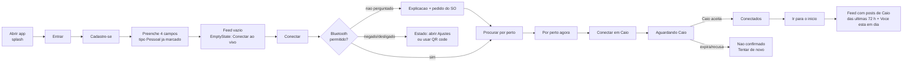
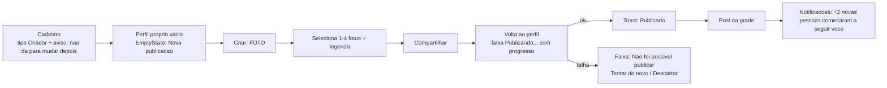
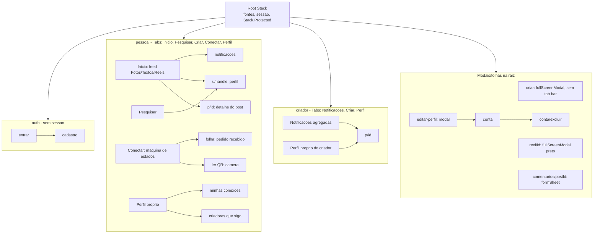
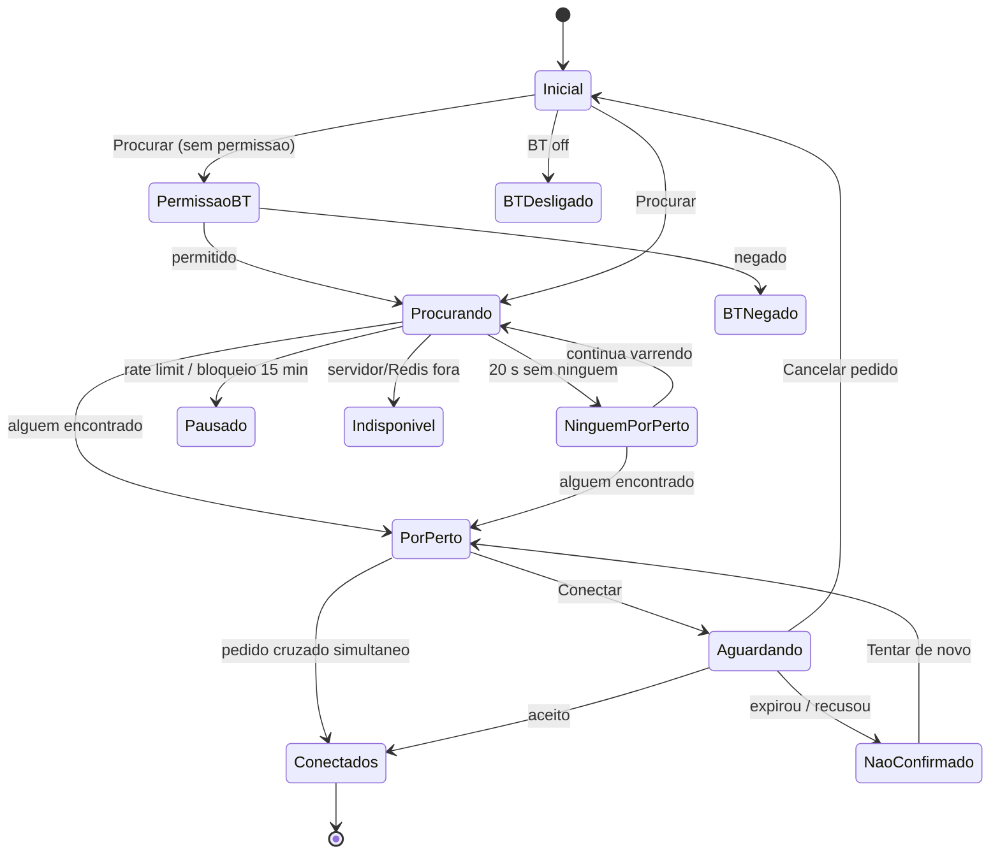
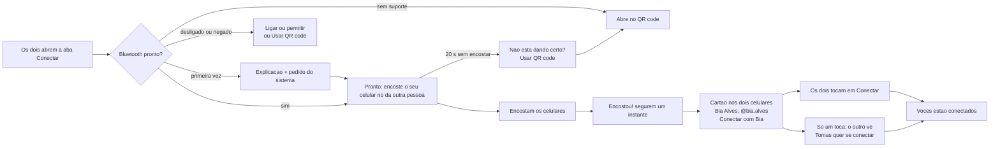
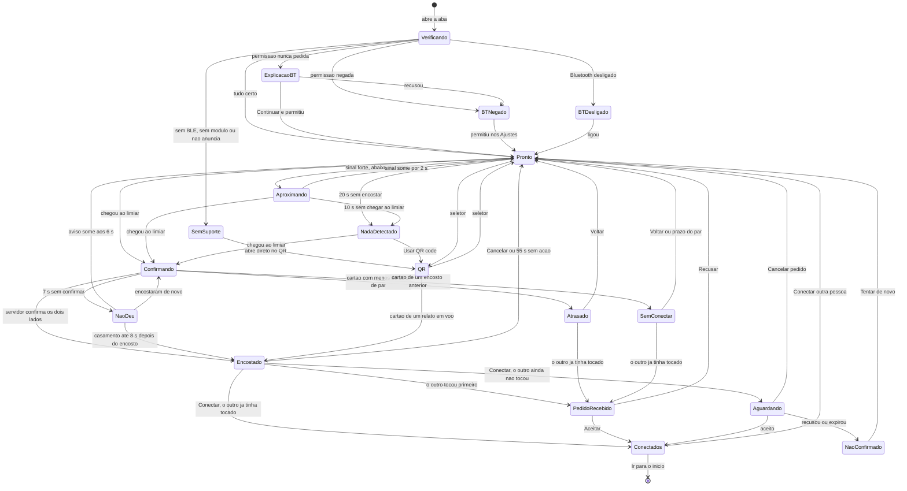

# UX/UI do Sussurro (v1)

> Autor: UX/UI Designer. Data: 2026-10-29. Status: proposta para revisão do PO.
> Entradas: `briefing.md` (seção 6 do PO = referência obrigatória), protótipo `docs/design/prototipo/p-01…p-22.png` + `texto-extraido.txt`, `arquitetura.md`, ADRs 0002–0005, 0008, 0011.
> Regra deste documento: o que está no protótipo é seguido como está; o que diverge da especificação ou do protótipo está marcado com **[DIVERGE]** e levado ao PO na seção 9.
> (atualizado em 2026-10-30) A tela Conectar mudou para **"encostar os celulares"** (D3 revisto, D13 substituído). A especificação nova está na **§11**, que substitui as partes do Conectar marcadas com "(atualizado em 2026-10-30)" ao longo do documento.

## 0. Leitura do protótipo (correções e método)

**Mapa real das páginas** (o briefing diz "p02–03 abertura/splash", mas não são telas):

| Página | Conteúdo real |
|---|---|
| p01 | Entrar |
| **p02** | **Asset solto: avatar "HS" (fundo azul pastel)**. Não é splash. |
| **p03** | **Asset solto: ilustração de paisagem quadrada** (imagem de exemplo). Não é splash. |
| p04 | Marca (símbolo, versões, cores) |
| p05 | Cadastro |
| p06–p08 | Feed Fotos / Textos / Reels + "Você está em dia" |
| p09 | Notificações (pessoal) |
| p10–p14 | Conectar: inicial, procurando, por perto, aguardando, conectados |
| p15 | Pesquisar (com resultado) |
| p16 | Perfil pessoal próprio |
| p17 | Perfil de criador visto por pessoa |
| p18 / p20 | Criar (pessoal / criador), modo FOTO |
| p19 | Perfil do próprio criador |
| p21 | Notificações do criador (agregadas) |
| p22 | Conectar bloqueado para criador |

Consequência: **não existe splash desenhada**. Proposta na seção 4.1, derivada do painel azul de p04.

**Método de medição**: o frame do protótipo tem 390 pt de largura (iPhone 14/15); os PNGs têm 447 px. Fator **1,146 px/pt**. Exemplo de verificação: o avatar do perfil mede 98 px = 85,5 pt, e a especificação diz 86. Todas as medidas abaixo estão em pt (unidades do React Native), já convertidas e arredondadas para a grade de 2/4 pt. Medidas marcadas com "≈" devem ser conferidas no catálogo com sobreposição do PNG (seção 6.15).

**Não desenhado no protótipo** (este documento cobre): splash, comentários, detalhe do post, visualizador de reels, Criar em modo TEXTO e REEL, folha de pedido recebido, QR, permissões, editar perfil, conta/exclusão, listas próprias de conexões e criadores, perfil de uma conexão, curtida ativa, e todos os estados de carregamento/erro/vazio/offline.

---

## 1. Personas

| | **Helena, 34** (pessoal) | **Tomás, 21** (pessoal) | **Bia, 41** (criadora) |
|---|---|---|---|
| Contexto | Arquiteta, iPhone, cansada de feed algorítmico. Usa o app 2–3x ao dia, rápido. | Universitário, Android intermediário. Conhece gente em festas e eventos, ambiente barulhento, celular na mão por segundos. | Padeira com perfil de receitas. Publica 2–3x por semana pelo celular. |
| Objetivo | Ver o que amigos reais postaram e "acabar". | Adicionar alguém que acabou de conhecer em < 30 s, sem trocar @. | Publicar e saber que as pessoas estão vendo, sem métricas de vaidade. |
| Dores | Rolagem infinita, anúncios, ver gente que não conhece. | Bluetooth que "não acha", permissões confusas, constrangimento se demorar. | Upload que falha em 4G, não saber se o post foi publicado. |
| Implicações | Feed com fim claro ("Você está em dia"), padrões do Instagram. | Conectar com 1 toque para começar, plano B (QR) visível, mensagens de erro acionáveis, nada de "NFC" enganoso. | Progresso de upload persistente, estado "processando" explícito, notificações agregadas. |

## 2. Jornadas principais

### 2.1 Pessoa: cadastro → primeira conexão → feed (meta: ≤ 9 toques após o cadastro)



Pontos de atrito e resposta de design: permissão de Bluetooth pedida **só ao tocar "Procurar por perto"** (não no cadastro); quem é procurado também precisa estar com a tela aberta (microcopy na tela inicial do Conectar); QR sempre a 1 toque.

(atualizado em 2026-10-30) Com o "encostar os celulares", esta jornada foi substituída pela §11.3.

### 2.2 Pessoa B (quem recebe o pedido)
Tela Conectar aberta (qualquer estado) → folha "Helena quer se conectar" com avatar, nome e @ → **Aceitar** → "Vocês estão conectados". Se B não está com a tela aberta, o pedido não chega na v1 (polling só com a tela aberta, ADR 0003); com push (Fase 6), a notificação abre o Conectar.

### 2.3 Criadora: cadastro → primeira publicação → seguidores



Criador não tem Início nem Pesquisar; a aba inicial do criador é **Perfil** (recomendação: a primeira coisa que o criador quer ver é o próprio conteúdo; Notificações fica à esquerda como no protótipo p19/p21).

---

## 3. Mapa de telas e navegação (Expo Router)

### 3.1 Diagrama



### 3.2 Árvore de rotas proposta

```
src/app/
  _layout.tsx                  Root Stack: carrega fontes, providers, Stack.Protected por sessão e tipo de conta
  index.tsx                    redireciona: sem sessão → /entrar; personal → /(pessoal); creator → /(criador)
  +not-found.tsx
  (auth)/
    _layout.tsx                Stack sem header
    entrar.tsx                 p01
    cadastro.tsx               p05
    esqueci-senha.tsx          só se D6 = sim
  (pessoal)/
    _layout.tsx                Tabs com <BottomTabBar variant="personal">
    (inicio)/_layout.tsx       Stack
    (inicio)/index.tsx         Feed p06–p08
    (inicio)/notificacoes.tsx  p09 (tab bar visível; ver D-UX19)
    (pesquisar)/_layout.tsx
    (pesquisar)/index.tsx      p15
    criar-tab.tsx              aba "fantasma": tabPress → preventDefault + router.push('/criar')
    conectar.tsx               p10–p14 (uma tela, máquina de estados)
    (perfil)/_layout.tsx
    (perfil)/index.tsx         p16
    (perfil)/conexoes.tsx      lista própria (GET /me/connections)
    (perfil)/seguindo.tsx      lista própria (GET /me/following)
    (inicio,pesquisar,perfil)/u/[handle].tsx   perfil de outra conta (p17 e perfil de conexão)
    (inicio,pesquisar,perfil)/p/[id].tsx       detalhe do post
  (criador)/
    _layout.tsx                Tabs com <BottomTabBar variant="creator">, initialRouteName = perfil
    (notificacoes)/index.tsx   p21
    criar-tab.tsx              aba fantasma
    (perfil)/index.tsx         p19
    (notificacoes,perfil)/p/[id].tsx
  criar.tsx                    fullScreenModal: Nova publicação (p18/p20 + modos TEXTO e REEL)
  reel/[id].tsx                fullScreenModal, fundo preto (ReelViewer); query ?origem=feed|perfil:@handle
  comentarios/[postId].tsx     formSheet (detents 0.7 / 0.95)
  conectar/pedido/[id].tsx     formSheet (pedido recebido)
  conectar/ler-qr.tsx          fullScreenModal (câmera)
  editar-perfil.tsx            modal (pageSheet no iOS)
  conta/index.tsx              "Conta": e-mail, sair de todos os dispositivos, excluir conta
  conta/excluir.tsx            exclusão de conta
  c/[token].tsx                deep link do QR (sussurro://c/{token}) → /conectar?qr={token}
  dev/catalog.tsx              catálogo (só dev, seção 6.15)
```

Notas de implementação de navegação:
- **Tab bars diferentes**: dois grupos `(pessoal)` e `(criador)` com `Tabs` próprios, protegidos por `Stack.Protected guard={accountType === 'personal'}` e `guard={accountType === 'creator'}` na raiz. O tipo de conta vem do claim `acct` do JWT (imutável), então não há troca em tempo de execução.
- **Aba Criar** não é uma tela: abre o modal `criar` e a tab bar some (spec). A aba nunca fica "ativa".
- **Notificações do pessoal** (p09) é empilhada no Início, com tab bar visível; a aba Início fica com o ícone ativo (preenchido). O protótipo mostra nenhuma aba ativa; recomendo Início ativo para manter a regra "sempre sei onde estou". **[DIVERGE leve]**
- **Rotas compartilhadas** `(inicio,pesquisar,perfil)/u/[handle]` mantêm a aba de origem ativa (p17 mostra Pesquisar ativo: confere).
- Tocar na aba ativa: volta ao topo da pilha; se já está na raiz, rola para o topo (padrão Instagram).
- **Deep link do QR** `sussurro://c/{token}`: se a câmera do sistema ler o QR, o app abre o Conectar já com o token e inicia o fluxo QR (o próprio token do usuário precisa estar ativo, então a tela é aberta antes de enviar o pedido). Sem sessão: guarda o token, pede login e descarta se tiver passado de 30 s.
- Orientação: **somente retrato** (inclusive no ReelViewer, vídeos são verticais). Somente celular (`supportsTablet: false`). Tema: **somente claro** na v1 (`userInterfaceStyle: "light"`). Ver D-UX12.

### 3.3 Inventário de telas

| Tela | Origem | Fase | Observação |
|---|---|---|---|
| Splash | novo (p04) | 0 | `expo-splash-screen` |
| Entrar | p01 | 1 | sem "demo"; rótulo "E-mail" |
| Cadastro | p05 | 1 | aviso de tipo imutável, termos |
| Feed (3 abas) | p06–p08 | 2 (reels: 5) | |
| Detalhe do post | novo | 2 | |
| Comentários (folha) | novo (spec) | 2 | |
| Criar FOTO | p18/p20 | 2 | |
| Criar TEXTO | novo (spec) | 2 | |
| Criar REEL | novo | 5 | |
| Perfil próprio pessoal | p16 | 1 (abas: 2) | |
| Perfil próprio criador | p19 | 1 | |
| Editar perfil | novo | 1 (foto: 2) | |
| Conta / Excluir conta | novo | 1 | App Store 5.1.1(v) |
| Pesquisar | p15 | 3 | |
| Perfil de criador visto por pessoa | p17 | 3 | |
| Minhas conexões / Criadores que sigo | novo | 3 (conexões: 4) | listas só do dono |
| Perfil de uma conexão | novo | 4 | |
| Conectar (5 estados + erros) | p10–p14, p22 | 4 | |
| Pedido recebido (folha) | novo (spec) | 4 | |
| QR: meu código / ler código | novo | 4 | |
| Visualizador de reels | novo | 5 | |
| Notificações pessoal / criador | p09 / p21 | 6 | |
| Catálogo (dev) | novo | 0 | |

---

## 4. Wireframes das telas não desenhadas

Convenções: `[Botão]` primário azul, `(Botão)` secundário cinza, `‹link›` texto azul, `▢` imagem, `◯` avatar, `───` divisor hairline.

### 4.1 Splash (Fase 0)
```
┌──────────────────────────┐
│                          │  fundo #0066FF (blue)
│                          │
│           S•             │  <Logo variant="mark" tone="onBrand"> 96 pt
│                          │  arco 1 branco, arco 2 #B3D1FF, ponto branco
│                          │  (sem texto: o expo-splash-screen usa imagem estática)
└──────────────────────────┘
```
Transição: fade de 200 ms para Entrar ou Feed. Ícone do app: mesmo símbolo onBrand sobre quadrado azul (p04 "Ícone do app"); Android adaptive icon = símbolo no foreground, `#0066FF` no background.

### 4.2 Detalhe do post (`p/[id]`)
```
┌──────────────────────────┐
│ ‹  Publicação            │  ScreenHeader 52, voltar + título titleLg
├──────────────────────────┤
│ <PostPhoto> ou <PostText>│  mesmo componente do feed
│ ...                      │
│ ───────────────────────  │
│ Comentários (inline)     │  lista de comentários (mesma do CommentsSheet)
│ ◯ lucasf 2 h             │
│   Que luz bonita!        │
│   Responder              │
├──────────────────────────┤
│ ◯ Adicione um coment… Publicar │ composer fixo acima do teclado
└──────────────────────────┘
```
Entradas: notificação, grade do perfil, lista de textos do perfil, toque no texto de um PostText. Reel → abre `reel/[id]` em vez desta tela. Post apagado/sem acesso (404): EmptyState "Esta publicação não está mais disponível."

### 4.3 Comentários (folha, `comentarios/[postId]`)
```
┌──────────────────────────┐
│          ▬▬▬             │  grabber 36×5, #DBDBDB, topo 8
│       Comentários      ✕ │  16/700 centralizado; ✕ 44×44 (alternativa ao arrasto)
├──────────────────────────┤
│ ◯ lucasf · 2 h           │  avatar 32; @ 14/600; tempo 13 grey
│   Que luz bonita!        │  14/20
│   Responder              │  13/600 grey
│      ◯ marinac · 1 h     │  resposta: recuo 44
│        Obrigada!         │
├──────────────────────────┤
│ Respondendo a @lucasf  ✕ │  chip só no modo resposta (bodySm grey, fundo greySoft)
│ ◯ [Adicione um comentário…]  Publicar │  Publicar azul; desabilitado = blueMist
└──────────────────────────┘
```
Ações por comentário (pressão longa + `accessibilityActions`): "Responder"; "Excluir" se autor do comentário ou do post. Contador "x/500" aparece a partir de 450.

### 4.4 Visualizador de reels (`reel/[id]`)
```
┌──────────────────────────┐ fundo #000, vídeo 9:16 (cover)
│ ✕                    🔊  │ ✕ fechar; alternar som (44×44, ícones brancos com sombra)
│                          │
│           ▶              │ toque = pausar/retomar (ícone 64 aparece 600 ms)
│                       ♡  │ coluna direita: curtir 28 + nº
│                      12  │
│                       ◌  │ comentar 28 + nº → CommentsSheet
│                       3  │
│ ◯ @cozinhadabia · Criador│ 14/600 branco
│ Receita do pão de quinta…│ 2 linhas, "mais" expande
│ ━━━━━━━━━━──────────────  │ progresso 2 pt (branco / branco 30%)
└──────────────────────────┘
Fim do vídeo: para no último quadro, escurece 40% e mostra
          ( ↻ Assistir de novo )
Nada avança sozinho.
```
Arrastar para baixo fecha. Navegação para o reel seguinte: ver D-UX7 (recomendo **sem paginação na v1**: o visualizador abre um reel; volta-se à grade para escolher outro).

### 4.5 Criar: modo TEXTO e modo REEL
```
TEXTO                                   REEL
┌──────────────────────────┐            ┌──────────────────────────┐
│ ✕ Nova publicação Compartilhar│       │ ✕ Nova publicação Compartilhar│
├──────────────────────────┤            ├──────────────────────────┤
│ ◯ helena                 │            │   ▢ prévia 9:16 (altura   │
│   [No que você está      │            │     limitada, centralizada)│
│    pensando?]            │            │   0:42 · toque p/ assistir│
│   (multilinha, 15/22)    │            ├──────────────────────────┤
│                   12/280 │            │ ◯ Escreva uma legenda…    │
│                          │            ├──────────────────────────┤
│ Para suas 4 conexões     │            │ Vídeos      Para suas 4 conexões│
│                          │            │ ▢0:42 ▢0:18 ▢1:35 ▢0:12  │ grade 4 col, só vídeos;
│                          │            │ (vídeo > 90 s: esmaecido, │ seleção única
│   ( FOTO  TEXTO  REEL )  │            │  "Até 90 s")              │
└──────────────────────────┘            └──( FOTO  TEXTO  REEL )────┘
```
Contador: grey até 260, preto 261–279, `danger` acima de 280 com Compartilhar desabilitado (o servidor conta code points; o app também). "Compartilhar" desabilitado = texto blueMist + `accessibilityState.disabled`.
Sair com conteúdo: Alert "Descartar publicação?" [Descartar] [Continuar editando].

### 4.6 Editar perfil (`editar-perfil`)
```
┌──────────────────────────┐
│ Cancelar  Editar perfil  Concluir │ Concluir azul 15/600; desabilitado sem mudanças
├──────────────────────────┤
│          ◯ 86            │
│     ‹Alterar foto›       │ Fase 2 (folha: Escolher da galeria / Remover foto)
│ Nome                     │
│ [Helena Souza      ]     │ 1–60
│ Nome de usuário          │
│ helena                   │ somente leitura (grey), helper "Não dá para mudar na v1."
│ Bio                      │
│ [Arquiteta. Café coado…] │ multilinha, contador x/150
│ Tipo de conta            │
│ Conta pessoal            │ somente leitura
├──────────────────────────┤
│ ‹Conta e segurança›    › │ → conta/index
└──────────────────────────┘
```

### 4.7 Conta (`conta/index`) e Excluir conta (`conta/excluir`)
```
┌──────────────────────────┐   ┌──────────────────────────┐
│ ‹  Conta                 │   │ ‹  Excluir conta         │
├──────────────────────────┤   ├──────────────────────────┤
│ E-mail                   │   │ Isso apaga sua conta para│
│ helena@exemplo.com       │   │ sempre:                  │
│ ───────────────────────  │   │ • publicações, curtidas e│
│ Sair deste dispositivo   │   │   comentários            │
│ Sair de todos os         │   │ • suas conexões (ou      │
│ dispositivos             │   │   seguidores)            │
│ ───────────────────────  │   │ • sua foto e seus dados  │
│ Termos de uso          › │   │ Some do app na hora; os  │
│ Política de privacidade› │   │ dados são apagados em até│
│ ───────────────────────  │   │ 30 dias.                 │
│ Excluir conta            │   │ Senha                    │
│ (texto danger)           │   │ [••••••••          ]     │
└──────────────────────────┘   │ [ Excluir minha conta ]  │ Button variant=destructive
                               └──────────────────────────┘
```
Depois do botão: Alert de confirmação final ("Excluir conta? Não dá para desfazer." [Cancelar] [Excluir]). Sucesso: volta para Entrar com Toast "Sua conta foi excluída." Pedir a senha exige que `DELETE /me` aceite `{password}` (a combinar com o Arquiteto). "Sair" no cabeçalho do perfil (ícone) também pede confirmação: "Sair da conta?".

(atualizado na Fase 6) Entre "Sair de todos os dispositivos" e "Contas bloqueadas" entrou a linha **"Notificações neste celular"** com um `Switch` e, abaixo, `bodySm` grey: "Curtidas, comentários, respostas e conexões. O texto dos comentários não aparece no aviso." (criador: "…respostas e novos seguidores."). Ligar pede a permissão do sistema (ou, negada de vez, Alert "Notificações bloqueadas" / "Permita as notificações do Sussurro nos Ajustes do celular." [Agora não] [Abrir Ajustes]); desligar apaga o token deste aparelho no servidor. Sem rede: Toast de erro e o `Switch` volta. É o único lugar para ligar de novo depois de "Agora não" (o pedido contextual não volta).

### 4.8 Minhas conexões / Criadores que sigo (só o dono)
```
┌──────────────────────────┐
│ ‹  Conexões              │
├──────────────────────────┤
│ Só você vê esta lista.   │ bodySm grey, ícone cadeado 16
│ ◯ caio.r                 │ UserRow: avatar 44, @ 14/600, nome 14 grey
│   Caio Ribeiro · desde 27 out │
│ ◯ bia.alves          ··· │ "···" → Desfazer conexão (se D8 = sim)
└──────────────────────────┘
```
"Criadores que sigo": mesma linha com `(Seguindo)` à direita (toque → deixar de seguir, com Alert). Vazio: EmptyState com ação ("Conectar ao vivo" / "Pesquisar criadores").

### 4.9 Perfil de uma conexão (pessoal visto por conexão)
Igual a p16 sem os ícones Criar/Sair, com `‹` e o @ no header, sem a nota de privacidade, números **não tocáveis** (a lista é privada), e um único botão `(Conectados ✓)` largura total. Toque em "Conectados" → folha de ações: "Desfazer conexão" (danger, se D8 = sim), "Cancelar". Pessoa não conectada (404 do servidor) → EmptyState "Perfil indisponível · Contas pessoais só aparecem para as conexões delas."

(atualizado em 2026-10-31) A posição do ✓ (o app o desenha antes do texto) está na §12.4: a recomendação é manter como está, a decidir pelo PO no PR 6.

### 4.10 Conectar: seletor e QR (proposta para D3: "Bluetooth | QR code")
> (atualizado em 2026-10-30) O seletor passa a "Encostar | QR code" e o radar sai (§11). O QR (meu código, ler o código e o fluxo cruzado abaixo) continua valendo, com os textos da §11.9.

```
INICIAL (p10 com seletor novo)          QR: MEU CÓDIGO
┌──────────────────────────┐            ┌──────────────────────────┐
│ Conectar                 │            │ Conectar                 │
│ Conexões só acontecem ao │            │ [ Bluetooth | QR code ]  │
│ vivo… As duas pessoas    │            │                          │
│ precisam confirmar.      │            │   ┌────────────────┐     │
│ [ Bluetooth | QR code ]  │            │   │  ▓▓ QR 240 ▓▓  │     │ QR preto em card branco,
│      ((  Procurar  ))    │            │   │     (S• no centro)│   │ borda border, raio 16
│      ((  por perto ))    │            │   └────────────────┘     │
│ Fiquem a poucos metros,  │            │   ◯ helena               │
│ os dois com esta tela    │            │ Peça para a outra pessoa │
│ aberta.                  │            │ ler este código.         │
└──────────────────────────┘            │ [ Ler o código dela ]    │ → conectar/ler-qr
                                        └──────────────────────────┘
```
O QR se renova a cada 20 s sem piscar (troca com fade de 150 ms). Brilho da tela não é alterado.

**Fluxo QR cruzado (recomendado, D7)**:
1. A toca "Ler o código dela" e lê o QR de B → A vê "Aguardando Bia confirmar", e **o próprio QR de A aparece nessa tela** com o texto "Bia precisa ler este código para confirmar".
2. B (com a tela Conectar aberta) recebe a folha "Helena quer se conectar" com `[Ler código para aceitar]` e `(Recusar)`.
3. B lê o QR de A → conectados nos dois aparelhos.

### 4.11 Pedido recebido (folha, `conectar/pedido/[id]`)
```
┌──────────────────────────┐
│          ▬▬▬             │
│          ◯ 64            │
│   Helena quer se conectar│ titleMd
│   @helena · Helena Souza │ bodySm grey
│ Confirme só se a Helena  │ bodySm grey, centro
│ estiver aí com você.     │
│ [        Aceitar       ] │ lg (QR: "Ler código para aceitar")
│ (        Recusar       ) │ lg secundário
│ Expira em 1:45           │ caption grey; não é anunciado a cada segundo
└──────────────────────────┘
```
Haptic de notificação ao abrir. Vários pedidos: um por vez, em fila. Fecha sozinha ao expirar, com Toast "O pedido da Helena expirou."

### 4.12 Permissões (estados inline, não rotas)
> (atualizado em 2026-10-30) Os estados e os textos do Bluetooth foram revistos na §11.4 e na §11.9; o "Aparelho não anuncia" vira "Sem suporte". Câmera, fotos e notificações continuam como aqui.

```
BLUETOOTH: EXPLICAÇÃO (antes do diálogo do SO)
┌──────────────────────────┐
│ Conectar                 │
│        (ícone bluetooth) │ EmptyState
│  Permitir o Bluetooth    │
│ O Sussurro usa o Bluetooth para achar quem está com esta
│ tela aberta perto de você. Ninguém vê sua localização, e
│ nada é transmitido com o app fechado.
│ [      Continuar       ] │ → diálogo do sistema
│ ‹Usar QR code›           │
└──────────────────────────┘
```
| Estado | Título | Texto | Ações |
|---|---|---|---|
| Bluetooth negado | Bluetooth sem permissão | Para achar pessoas por perto, permita o Bluetooth nos Ajustes. | [Abrir Ajustes] ‹Usar QR code› |
| Bluetooth desligado | O Bluetooth está desligado | Ligue o Bluetooth para procurar quem está por perto. | [Abrir Ajustes] (Android: [Ligar Bluetooth]) ‹Usar QR code› |
| Aparelho não anuncia (Android) | Seu celular não consegue ser encontrado | Você ainda acha outras pessoas, mas elas não acham você. Use o QR code para garantir. | [Usar QR code] (Procurar mesmo assim) |
| Câmera: explicação | Ler o código da outra pessoa | A câmera é usada só para ler o QR code. | [Continuar] |
| Câmera negada | Câmera sem permissão | Permita a câmera nos Ajustes ou peça para a outra pessoa ler o seu código. | [Abrir Ajustes] ‹Mostrar meu código› |
| Fotos: sem acesso (Criar) | Escolha o que compartilhar | Permita o acesso às fotos para ver as recentes aqui. | [Permitir acesso] ‹Escolher fotos› (seletor do sistema, sem permissão) |
| Fotos: acesso limitado (iOS) | faixa no topo da grade | "Você deu acesso a algumas fotos." ‹Gerenciar› | |
| Notificações (Fase 6) | pedido contextual após a 1ª conexão ou 1º post | "Quer saber quando alguém curtir ou comentar?" | [Ativar] (Agora não) |

(atualizado na Fase 6) O pedido de notificações é um Alert nativo (como as confirmações), uns 800 ms depois do "Publicado." ou do "Vocês estão conectados", com o texto "Avisamos neste celular quando alguém curtir, comentar ou se conectar com você. Dá para desligar em Conta." (criador: "…curtir ou comentar e quando chegarem novos seguidores…"). Aparece **uma vez por conta neste aparelho**: "Agora não" ou a recusa no diálogo do sistema não são perguntadas de novo; com a permissão já negada de vez, nem aparece. "Ativar" sem conseguir o token: Toast "Não foi possível ativar as notificações agora. Tente de novo em Conta."

---

## 5. Estados

### 5.1 Matriz por tela

| Tela | Carregando | Vazio | Erro / offline | Específicos |
|---|---|---|---|---|
| Entrar | botão `loading` | n/a | inline sob o form: "E-mail ou senha incorretos." · 429: "Muitas tentativas. Tente de novo em 1 minuto." · offline: Toast | sessão expirada: Toast "Sua sessão expirou. Entre de novo." |
| Cadastro | botão `loading` | n/a | erros por campo (e-mail inválido/em uso, @ inválido/em uso, senha < 8) · 429: "Muitos cadastros desta rede. Tente mais tarde." | |
| Feed (cada aba) | 3 skeletons do item | **sem conexões e sem criadores**: EmptyState "Seu início está vazio" + [Conectar ao vivo] ‹Pesquisar criadores› · **sem posts na janela**: só o CaughtUp | primeira página falhou: EmptyState "Não foi possível carregar" [Tentar de novo] · páginas seguintes: linha "Não carregou. ‹Tentar de novo›" acima do fim · offline: OfflineBanner + conteúdo em cache | faixa de upload no topo (5.3); pull-to-refresh |
| Detalhe do post | skeleton | n/a | 404: "Esta publicação não está mais disponível." | |
| Comentários | 3 skeletons | "Ainda não há comentários. Comece a conversa." | lista: [Tentar de novo] · envio: item com "Não publicado. ‹Tentar de novo›" | enviando: item 50% opacidade |
| Pesquisar | spinner 20 no fim da barra | inicial: nada (sem sugestões, spec), só dica "Digite o @ de um criador." · 1–2 caracteres: "Digite pelo menos 3 letras." · sem resultado: "Nenhum criador com esse @. Contas pessoais não aparecem na busca: elas só se conectam ao vivo." | Toast/linha de erro | ver D-UX5 (não dá para saber se o @ é de conta pessoal) |
| Perfil (próprio/outro) | skeleton do header + grade | abas vazias: próprio "Compartilhe sua primeira foto" [Nova publicação]; outro "Nenhuma foto ainda." | 404 = "Perfil indisponível" | Seguir/Seguindo: otimista, rollback + Toast |
| Listas próprias | skeleton de linhas | EmptyState com ação | [Tentar de novo] | |
| Criar | — | grade sem fotos: "Nenhuma foto no aparelho." | ver permissões (4.12) | upload: 5.3 |
| Notificações | skeleton | "Nada por aqui ainda. Quando alguém curtir ou comentar, aparece aqui." | [Tentar de novo] | fim: "Isso é tudo por enquanto." (p09) |
| ReelViewer | spinner sobre o poster | n/a | "Não foi possível reproduzir este reel." [Tentar de novo] | processando (só autor): "Seu reel está sendo processado. Isso leva alguns minutos." |
| Conectar | — | 5.2 | 5.2 | 5.2 |

Regra geral de erro: mensagem humana + ação. Nunca mostrar `code` técnico na UI; o `code` vai para o Sentry. Erros sem ação na tela → Toast de erro.

(atualizado em 2026-10-31) O Início depois de seguir, deixar de seguir e conectar (sem esperar o puxar para atualizar): §12.2. (2026-11-20) Aplicado; a revisão está na §12.7.

### 5.2 Conectar: máquina de estados
> (atualizado em 2026-10-30) Substituída pela §11.4 (encostar os celulares). Daqui continuam valendo, com os textos da §11.9: Aguardando, Não confirmado, Conectados, Já conectados, Pausado, Indisponível, Offline e Criador. O resto descreve o que a Fase 4b implementou ("Por perto agora").




| Estado | Wireframe / texto | Ações |
|---|---|---|
| Procurando (p11) | radar + "Procurando por perto…" "Mantenha o app aberto" | (Cancelar) |
| **Ninguém por perto** (após 20 s; o radar continua) | "Ninguém por perto ainda" · "Peça para a outra pessoa abrir a tela Conectar. Se não aparecer, usem o QR code." | [Usar QR code] (Cancelar) |
| Por perto (p12) | lista ao vivo, ordenada por sinal; rótulo de faixa (D-UX2) | `[Conectar]` por linha; já conectado: rótulo grey "Conectados" no lugar do botão |
| Aguardando (p13) | "Aguardando Caio confirmar" | (Cancelar pedido) |
| **Não confirmado** (expirou ou recusou, sem diferenciar) | par de avatares com o tracejado em grey · "Caio não confirmou" · "O pedido vale por 2 minutos. Vocês podem tentar de novo." | [Tentar de novo] ‹Voltar› |
| Conectados (p14) | p14 | [Ir para o início] ‹Conectar outra pessoa› |
| **Já conectados** (409) | Toast "Vocês já estão conectados." | |
| **Pedido não pode ser enviado** (cooldown pós-recusa, token inválido) | Toast "Não foi possível enviar o pedido agora. Tente mais tarde." (não revela recusa) | |
| **Token de proximidade expirado** | invisível ao usuário: o app renova a cada 20 s. Se o token de B saiu do ar entre o "por perto" e o toque: linha some da lista + Toast "Caio saiu de perto. Procure de novo." | |
| **Pausado (rate limit)** | EmptyState ícone relógio · "Muitas tentativas" · "Você poderá procurar de novo em alguns minutos." | ‹Usar QR code› também fica pausado (mesmo limite) |
| **Indisponível** (Redis fora, fail-closed) | "Conectar está indisponível agora" · "Tente de novo em instantes." | [Tentar de novo] |
| Offline | "Sem internet" · "Conectar precisa de internet para confirmar quem é quem." | [Tentar de novo] |
| Criador (p22) | p22 | [Voltar ao perfil] |

Com a tela Conectar procurando ou aguardando: **manter a tela acesa** (`expo-keep-awake`); ao sair da tela ou ir para background, parar anúncio/varredura e voltar ao Inicial.

### 5.3 Upload e processamento

```
Faixa de publicação (topo do feed e do perfil próprio; criador: topo do perfil)
┌──────────────────────────┐
│ ▢ Publicando… 2 de 3     │ thumb 40, bodySm, ProgressBar 2 pt azul abaixo (determinada)
│ ━━━━━━━━━━━━──────────── │
└──────────────────────────┘
│ ▢ Processando o reel…    │ indeterminada (após upload, aguardando MediaConvert)
│ ▢ Não foi possível publicar.  ‹Tentar de novo›  ✕ │ falha: ícone alerta danger; ✕ = descartar (Alert)
```
- Sucesso: a faixa some e aparece Toast "Publicado." O post aparece no topo do próprio perfil (e no feed, se D9 = sim).
- Sair do app durante o upload: o upload continua enquanto o SO permitir; ao voltar, se o rascunho falhou, a faixa de falha aparece. Rascunhos órfãos são apagados pelo servidor em 24 h (arquitetura §5): o texto "Tentar de novo" some depois disso.
- Reel processando na grade do autor: `ReelTile status="processing"`. Outras pessoas não veem até `published`. (atualizado em 2026-10-31) O tile de um reel de outra sessão se atualiza sozinho, com a aba Reels do próprio perfil à vista: §12.3. (2026-11-20) Aplicado; a revisão está na §12.7.
- Offline no Compartilhar: mantém o modal aberto, Toast "Sem internet. Sua publicação não foi enviada." (sem fila offline na v1).

### 5.4 Globais
| Situação | Comportamento |
|---|---|
| Offline | `OfflineBanner` fino sob o header: "Sem internet" (fundo ink, texto branco 13/600), aparece após 2 s sem rede, some com "Conectado" por 1,5 s. Ações que dependem de rede ficam habilitadas e falham com Toast (não desabilitar tudo). |
| Access token expirado | refresh silencioso (single-flight). Usuário não vê nada. |
| Refresh inválido/revogado | volta para Entrar + Toast "Sua sessão expirou. Entre de novo." Preserva o e-mail digitado. |
| 429 genérico | Toast "Muitas tentativas. Espere um pouco e tente de novo." |
| 5xx / timeout | Toast "Algo deu errado do nosso lado. Tente de novo." |
| 403 `ACCOUNT_TYPE_NOT_ALLOWED` | não deve acontecer pela UI; se acontecer: Toast "Essa ação não está disponível para o seu tipo de conta." |
| Curtir offline/falha | otimista; rollback do coração + Toast "Não foi possível curtir." |

---

## 6. Design system (`packages/ui`)

Princípios: componentes **apresentacionais** (recebem props simples, não tipos da API; o mapeamento fica no app), sem dependência de `packages/shared`. Dependências permitidas: `react-native-svg`, `expo-image`, `expo-video` (só ReelViewer), `react-native-reanimated`, `lucide-react-native`.

### 6.1 Cores: tokens do PO (inalterados)

| Token | Hex | Uso |
|---|---|---|
| `blue` | #0066FF | ações, curtida ativa, seleção, links |
| `blueMid` | #4D94FF | 2º arco do logo, anéis do radar |
| `blueMist` | #B3D1FF | arco sobre azul, estado desabilitado do primário/link, anéis externos |
| `blueLight` | #E5EFFF | fundos (avatar agregado "+N", seleção suave) |
| `black` | #000000 | texto principal, ícones |
| `grey` | #737373 | texto de apoio |
| `greySoft` | #EFEFEF | botões neutros, barra de busca, prévias vazias |
| `border` | #DBDBDB | divisores, bordas de campo, pontos inativos |
| `white` | #FFFFFF | fundo |

### 6.2 Cores: extensões (novas, justificadas)

| Token | Valor | Por quê |
|---|---|---|
| `bluePressed` | #0052CC | estado pressionado do primário (branco sobre ele: 6,6:1) |
| `greyStrong` | #666666 | texto/placeholder/ícone **sobre greySoft** (grey sobre greySoft = 4,12:1, falha; greyStrong = 4,99:1) |
| `field` | #FAFAFA | fundo dos campos de Entrar/Cadastro/Editar (p01/p05 mostram campo mais claro que o greySoft, com borda) |
| `ink` | #262626 | pílula FOTO/TEXTO/REEL, Toast, OfflineBanner |
| `inkMuted` | #A8A8A8 | texto inativo sobre `ink` (6,4:1) |
| `danger` | #D32F2F | erro de campo, "Excluir conta", falha de upload (4,98:1 no branco). A spec não tem cor de erro; uso mínimo, só texto/ícone. |
| `overlay` | rgba(0,0,0,0.4) | fundo atrás de folhas e Alerts |
| `mediaChip` | rgba(0,0,0,0.7) | contador "1/3" e afins sobre imagem |
| `mediaScrim` | gradiente rgba(0,0,0,0) → rgba(0,0,0,0.45), 40% inferior | legibilidade de duração do reel e textos sobre vídeo |
| `skeleton` | #EFEFEF (= greySoft) com pulso de opacidade 1 → 0,6 | carregamento |

### 6.3 Fundos pastel dos avatares

Medidos no protótipo (aproximados ao hex mais limpo):

| Token | Hex | Visto em |
|---|---|---|
| `avatar.lilac` | #D9D1FF | JP, CM |
| `avatar.mint` | #C2EFD4 | TO, RD |
| `avatar.peach` | #FFD3BF | MC, BL |
| `avatar.sky` | #B5E8F7 | LF, EA |
| `avatar.periwinkle` | #C4D6FF | HS, CR |
| `avatar.butter` | #FFE3A3 | BA |

Texto das iniciais: `black`, 600. Contraste mínimo do conjunto: 14,4:1 (periwinkle).

**Regra determinística**: `índice = fnv1a32(userId) mod 6`, na ordem da tabela. Usar o **`userId` (UUID)** e não o handle: o handle pode vir a ser editável e a cor mudaria. Quando só houver o handle (ex.: fixture do catálogo), usar o handle. FNV-1a 32 bits sobre os bytes UTF-8 da string em minúsculas (offset 2166136261, primo 16777619, aritmética `Math.imul` + `>>> 0`). A função fica em `packages/ui/avatar/color.ts` e tem teste de snapshot com 10 ids fixos.
**Iniciais**: primeira letra da primeira e da última palavra do `name` (maiúsculas, mantém acento: "Érica Lima" → "ÉL"); nome com uma palavra → 1 letra; sem nome → 2 primeiros caracteres alfanuméricos do handle.
**Exceção**: avatar agregado "+N" (notificação de seguidores, p21) usa `blueLight` e texto `black`.

### 6.4 Tipografia (Inter), medida no protótipo

| Token | Tamanho/entrelinha | Peso | Uso (página) |
|---|---|---|---|
| `titleLg` | 20/26 | 700 | título de tela ("Conectar", "Notificações"), @ no header do perfil, "Você e Caio estão conectados" (p09–p16) |
| `titleMd` | 18/24 | 700 | títulos de estado ("Aguardando Caio confirmar", "Indisponível para criadores", EmptyState) |
| `titleSm` | 16/22 | 700 | seções ("Hoje", "Por perto agora", "Recentes"), "Você está em dia", título de folha |
| `stat` | 17/22 | 700 | números do StatsRow |
| `bodyLg` | 16/22 | 400 | texto em campos, placeholders |
| `body` | 15/22 | 400 | texto de post (thread), legenda, bio, notificações |
| `bodyStrong` | 15/22 | 600 | @ em posts e linhas, nome no perfil |
| `bodySm` | 14/20 | 400 | apoio em grey, subtítulos, "Ver todos os N comentários", rótulos do StatsRow |
| `bodySmStrong` | 14/20 | 600 | "N curtidas", @ em comentários |
| `caption` | 13/18 | 400 | horários ("40 min", "Há 18 minutos"), "Conexão"/"Criador", helper de campo |
| `micro` | 12/16 | 600 | contador "1/2", duração do reel, badges |
| `button` | 16/20 | 600 | Button lg |
| `buttonSm` | 14/18 | 600 | Button sm, links de ação |
| `tab` | 15/20 | 600 | TopTabs de texto |

Letter-spacing: 0 em tudo, exceto `titleLg` −0,2. Rótulo "OU" (p01): `caption` 600 grey, letter-spacing 0,5.
Iniciais do Avatar: `fontSize = round(size × 0,36)`, 600, sem escala de fonte do sistema.
Números: `fontVariant: ['tabular-nums']` em contadores e durações.

### 6.5 Fontes: carregamento e regra de uso

| Família | Pesos | Pacote | Uso |
|---|---|---|---|
| Inter | 400, 600, 700 | `@expo-google-fonts/inter` (`Inter_400Regular`, `Inter_600SemiBold`, `Inter_700Bold`) | toda a interface |
| Bricolage Grotesque | 800 | `@expo-google-fonts/bricolage-grotesque` (`BricolageGrotesque_800ExtraBold`) | **somente** o wordmark "sussurro", minúsculo, no `<Logo variant="lockup">` |

- Embutir no build pelo **config plugin do `expo-font`** (`plugins: [["expo-font", { fonts: [...] }]]`), já que o app é dev build: sem carregamento assíncrono e sem flash de fonte. `useFonts` só como fallback.
- **No Android, `fontWeight` não escolhe o arquivo da fonte personalizada**: o tema mapeia cada peso para um `fontFamily` próprio (`Inter_600SemiBold` etc.) e os componentes nunca usam `fontWeight` sozinho. O componente `<Text variant="body">` do `packages/ui` resolve isso.
- Opcional (recomendado depois da Fase 0): converter o wordmark em **path SVG** a partir do Bricolage 800, o que remove a fonte do bundle e garante o desenho igual em toda plataforma. Na Fase 0, usar a fonte.
- Proibido: Bricolage em qualquer outro texto; maiúsculas no wordmark.

### 6.6 Espaçamento e layout

Escala (pt): `0, 2, 4, 6, 8, 12, 16, 20, 24, 32, 40, 48, 64` → tokens `space.0 … space.64` (nome = valor).

| Constante | Valor | Origem |
|---|---|---|
| `screenX` | 16 | margem lateral das telas do app (p06–p22) |
| `authX` | 32 | margem lateral de Entrar/Cadastro (p01/p05) |
| `fieldGap` | 8 | entre campos (p01) |
| `headerHeight` | 52 | header de tela (abaixo do safe area) |
| `topTabsHeight` | 44 | Fotos/Textos/Reels e abas do perfil |
| `bottomBarHeight` | 50 | + `insets.bottom` |
| `postHeaderHeight` | 56 | cabeçalho do PostPhoto |
| `actionsRowHeight` | 44 | coração/comentário/pontos |
| `rowMinHeight` | 64 | UserRow, notificação |
| `gridGap` | 2 | grades do perfil e de reels (≈1,75 medido) |
| `hitMin` | 44 | alvo mínimo de toque |

Proporções de mídia: post de foto **4:5**; tile de foto no perfil **3:4**; tile de reel **9:16**; grade do Criar **1:1**, 4 colunas.

### 6.7 Raios

| Token | Valor | Uso |
|---|---|---|
| `radius.sm` | 6 | miniaturas (notificação, faixa de upload), chips |
| `radius.md` | 10 | Button sm, SearchBar, SegmentedControl |
| `radius.lg` | 12 | Button lg, Input, Toast |
| `radius.xl` | 16 | cards (QR, catálogo) |
| `radius.sheet` | 20 | topo de folhas inferiores |
| `radius.full` | 9999 | avatares, pílulas, contador "1/2" |

### 6.8 Tamanhos

| Grupo | Valores |
|---|---|
| Avatar | `xs 24` (tab bar) · `sm 32` (post, comentário, legenda do Criar) · `md 36` (thread de textos) · `lg 44` (notificação, listas) · `xl 48` (busca, Por perto) · `2xl 64` (radar, aguardando, pedido) · `3xl 72` (conectados, p14) · `profile 86` |
| Ícones | 24 (padrão: barras, ações de post, header), 20 (ações do PostText, lupa da busca 18), 28 (ReelViewer, EmptyState), 16 (inline em texto) |
| Traço de ícone | 2 (inativo), 2,75 (ativo "mais grosso") |
| Botões | `lg` minHeight 44 · `sm` minHeight 34 (p12, p15, p16) |
| Campos | Input minHeight 46 · SearchBar minHeight 36 |
| Anel do avatar ativo | avatar 24 + folga 2 + traço 1,5 `black` = 31 total |
| Ponto de não lido | 8, `blue`, borda 1,5 branca, canto superior direito do coração |
| Indicadores | sublinhado TopTabs 2 · pontos do carrossel 6 (gap 4) · ProgressBar 2 |
| Botão "Procurar por perto" | 160 de diâmetro; anéis 196 e 252 (p10) |

### 6.9 Sombras (uso mínimo)
Usar a prop `boxShadow` (RN 0.76+, New Architecture), que vale para iOS e Android:

| Token | Valor | Uso |
|---|---|---|
| `shadow.sm` | `0 1px 3px rgba(0,0,0,0.10)` | segmento selecionado, setas do carrossel |
| `shadow.md` | `0 4px 12px rgba(0,0,0,0.15)` | Toast, pílula FOTO/TEXTO/REEL |
| `shadow.sheet` | `0 -2px 16px rgba(0,0,0,0.12)` | folhas (se não forem nativas) |
| `shadow.icon` | `0 1px 2px rgba(0,0,0,0.5)` | ícones brancos sobre vídeo/imagem |

### 6.10 Movimento

| Token | Duração | Uso |
|---|---|---|
| `motion.fast` | 120 ms | feedback de toque (opacidade 0,7 em ícones; cor em botões) |
| `motion.base` | 200 ms | sublinhado das abas, fades, troca do QR (150) |
| `motion.slow` | 300 ms | Toast entrar/sair, faixa de upload |
| `motion.heart` | 300 ms | "pop" do coração (escala 1 → 1,2 → 1) |
| `motion.radarCycle` | 2400 ms | anéis do radar (3 anéis, defasagem 800 ms, escala 0,6 → 1,4, opacidade 0,6 → 0) |
| `motion.toastVisible` | 4000 ms (6000 com ação) | |
| Easing | `Easing.bezier(0.2, 0, 0, 1)` | padrão |

Com **Reduzir movimento** ligado (`useReducedMotion` do Reanimated): durações viram 0 (exceto opacidade ≤ 150 ms), radar fica estático (2 anéis fixos em blueMist + texto "Procurando…" com reticências estáticas), sem "pop" do coração, sem pulso do skeleton.

(atualizado em 2026-10-30) O radar sai da tela Conectar. Para a ilustração do encostar entra o `motion.touchCycle` (2400 ms, 2 ciclos e para), descrito na §11.7.

### 6.11 Ícones

**Recomendação: `lucide-react-native`** (usa `react-native-svg`, importação por ícone, traço configurável, ISC).

| Opção | Contorno + ativo | Fidelidade ao protótipo | Veredito |
|---|---|---|---|
| **lucide-react-native** | contorno; ativo por `strokeWidth` 2,75 ou `fill` | **alta**: os ícones do protótipo são do estilo Lucide (traço 2, pontas redondas: `radio`, `square-plus`, `log-out`, `lock`, `image`) | **escolhida**, + 1 SVG próprio |
| phosphor-react-native | pesos `regular`/`bold`/`fill` nativos para todos | média: traço mais fino no regular, geometria diferente | boa alternativa se o PO preferir estados ativos "de fábrica" |
| @expo/vector-icons (Ionicons) | pares `home`/`home-outline` | baixa (estilo iOS), baseado em fonte, não SVG | não |
| Tabler | contorno + alguns preenchidos | média | não (cobertura de preenchidos incompleta) |

Ativo no estilo Instagram com Lucide: `heart` aceita `fill` sem problema; `search` usa traço 2,75; **`house` preenchido precisa de SVG próprio** (com `fill` o traço da porta some sobre o preenchimento). Os SVGs próprios ficam em `packages/ui/icons/` com a mesma interface `{size, color, strokeWidth}`.

| Lugar | Inativo | Ativo |
|---|---|---|
| Tab Início | `house` | `HouseFill` (próprio: casa preenchida com porta vazada) |
| Tab Pesquisar | `search` | `search` traço 2,75 |
| Tab Criar | `square-plus` | (nunca ativo) |
| Tab Conectar | `radio` | `radio` traço 2,75 em `blue` (p10–p14; ver D-UX8) |
| Tab Perfil | Avatar 24 | Avatar 24 com anel |
| Tab Notificações (criador) | `heart` | `heart` com `fill` black (p21) |
| Header do feed | `heart` + ponto azul | |
| Header do perfil próprio | `square-plus` (Criar), `log-out` (Sair) | |
| Voltar / fechar | `chevron-left` / `x` | |
| Post: curtir | `heart` | `heart` fill `blue`, traço `blue` |
| Post: comentar | `message-circle` | |
| Post: mais opções | `ellipsis` | |
| Carrossel | `chevron-left` / `chevron-right` (16 em círculo branco 28) | |
| Abas do perfil | `grid-3x3`, `align-left`, `square-play` (grey) | mesmos em `black` + sublinhado |
| Tile com várias fotos | `copy` 16 branco com `shadow.icon` | |
| Duração do reel | `play` 12 fill branco | |
| ReelViewer | `x`, `volume-2`/`volume-x`, `play`, `rotate-ccw` | |
| Prévia vazia do Criar | `image` 40 greyStrong | |
| Conectar | `smartphone-nfc` (aviso do NFC desligado, título de "Ler código", botão "Aproximar do outro celular" e o da folha do pedido; S6 da §11.19), `qr-code`, `scan-line`, `camera`, `clock` (pausado), `lock` (p22) | |
| Vazio de "Minhas conexões" | `radio` (sobra do Bluetooth; ver a nota abaixo) | |

> **Atualizado em 2026-11-14 (ADR 0013, S6 da §11.19, aprovada pelo PO):** o `smartphone-nfc` (lucide 1.63.0) entrou no catálogo do `Icon` (`packages/ui/src/components/Icon/Icon.tsx`) e substituiu o `radio` nos 4 lugares do Conectar (`ConnectScreen.tsx`: aviso do NFC desligado, título de "Ler código" e botão; `IncomingRequestSheet.tsx`: botão da folha). O `bluetooth` e o `bluetooth-off` saíram do Conectar com a ADR 0013. **O `radio` continua** na aba Conectar do `BottomTabBar` (D-UX8) e no vazio de "Minhas conexões" (`OwnListScreens.tsx:111`). Recomendação sobre os dois na §11.10.
| Estados | `check` (CaughtUp, conectados), `circle-alert` (erro), `wifi-off` (offline), `refresh-cw` (tentar de novo), `trash-2` (excluir) | |
| Busca | `search` 18, `circle-x` (limpar) | |
| Senha | `eye` / `eye-off` | |

### 6.12 Logo

SVG exato (viewBox 0 0 64 64, `stroke-width` 8, `stroke-linecap="round"`, `fill="none"` nos arcos):

```svg
<svg viewBox="0 0 64 64" xmlns="http://www.w3.org/2000/svg">
  <path d="M42.34 18.24 A11 11 0 1 0 24.22 29.78" stroke="#0066FF" stroke-width="8" stroke-linecap="round" fill="none"/>
  <path d="M21.66 45.76 A11 11 0 1 0 39.78 34.22" stroke="#4D94FF" stroke-width="8" stroke-linecap="round" fill="none"/>
  <circle cx="32" cy="32" r="3" fill="#000000"/>
</svg>
```

| Prop | Tipo | Padrão | Descrição |
|---|---|---|---|
| `variant` | `'mark' \| 'lockup'` | `'mark'` | só o símbolo, ou símbolo + "sussurro" |
| `tone` | `'default' \| 'onBrand'` | `'default'` | `onBrand` = sobre azul ou preto: arco 1 `#FFFFFF`, arco 2 `#B3D1FF`, ponto `#FFFFFF`, wordmark branco |
| `size` | number | 32 | altura do símbolo em pt |
| `accessibilityLabel` | string | "Sussurro" | |

- Lockup: wordmark em Bricolage 800 com `fontSize ≈ size × 0,95`, letter-spacing −2%, gap símbolo→texto `size × 0,25`, alinhado verticalmente ao centro óptico (ajustar no catálogo contra p04/p06). Wordmark `black` (default) ou `white` (onBrand).
- Usos: header do feed = lockup, `size` 24 (p06); Entrar/Cadastro = mark 64 (p01) **empilhado** com o wordmark 40 pt centralizado embaixo (prop `layout: 'row' | 'stacked'`, padrão `row`); splash e ícone = mark onBrand.
- Tamanho mínimo do mark: 16 pt (p04 "Tamanhos reduzidos"). Abaixo de 20 pt, manter o traço 8 (a proporção já garante legibilidade).
- a11y: `accessibilityRole="image"`; no header do feed, o lockup é o título da tela (`accessibilityRole="header"`, label "Sussurro, início").

### 6.13 Componentes da lista do PO

Regras comuns: todo componente aceita `testID`; todo elemento tocável tem `accessibilityRole`, `accessibilityLabel` em português e alvo ≥ 44 (usar `hitSlop` quando o visual for menor); alturas são `minHeight` (crescem com a fonte do sistema); estado pressionado via `Pressable` com feedback em `motion.fast`.

#### Avatar
| | |
|---|---|
| Props | `size: 24\|32\|36\|44\|48\|64\|72\|86`; `name?: string`; `handle: string`; `seed?: string` (userId); `uri?: string \| null`; `ring?: boolean`; `count?: number` (modo agregado "+N") |
| Variantes | foto; iniciais sobre pastel; agregado "+N" (blueLight); com anel (tab bar ativa) |
| Estados | carregando a foto: mostra as iniciais por baixo, a foto entra com fade 150 ms; erro: fica nas iniciais |
| Medidas | círculo; iniciais `round(size×0,36)` / 600; anel: folga 2 + traço 1,5 black |
| a11y | decorativo por padrão (`accessible={false}`) quando há nome ao lado; isolado: "Foto de perfil de @handle"; "+N": "N novas pessoas" |

#### Button
| | |
|---|---|
| Props | `label`; `onPress`; `variant: 'primary'\|'secondary'\|'link'\|'destructive'`; `size: 'lg'\|'sm'`; `fullWidth?`; `disabled?`; `loading?`; `icon?` |
| Variantes | primary: fundo blue, texto white · secondary: fundo greySoft, texto black · link: sem fundo, texto blue · destructive: fundo white, borda border, texto danger |
| Estados | pressionado: primary `bluePressed`, secondary #E0E0E0, link opacidade 0,6 · desabilitado: primary fundo `blueMist` texto white; secondary texto grey; link texto blueMist · loading: spinner (white/black), rótulo oculto, largura mantida, `accessibilityState.busy` |
| Medidas | lg: minHeight 44, raio 12, paddingX 16, `button` · sm: minHeight 34, raio 10, paddingX 16, `buttonSm` (hitSlop vertical 5) |
| Uso | "Seguir" = primary sm, "Seguindo" = secondary sm (p15/p17); "Editar perfil", "Conectar ao vivo" = secondary sm em linha, gap 8 (p16) |
| a11y | role button; `accessibilityState {disabled, busy}`; Seguir/Seguindo: label "Seguir @x" / "Seguindo @x, toque para deixar de seguir" |

#### Input
| | |
|---|---|
| Props | `label` (vira placeholder vazio e rótulo flutuante preenchido); `value`; `onChangeText`; `type: 'text'\|'email'\|'password'\|'username'\|'multiline'`; `error?`; `helper?`; `maxLength?`; `showCounter?`; `readOnly?` |
| Variantes | campo (fundo `field`, borda 1 `border`, p01/p05); `SearchBar` (seção 6.14) |
| Estados | vazio: rótulo como placeholder `bodyLg` grey · preenchido: rótulo sobe para `caption` grey no topo interno (padrão Instagram), valor `bodyLg` black · foco: borda `grey` (4,74:1) · erro: borda `danger` + texto `caption` danger com `circle-alert` 14 abaixo · desabilitado/somente leitura: texto grey, sem borda de foco |
| Medidas | minHeight 46, raio 12, paddingX 16; senha: botão "Mostrar/Ocultar" (`buttonSm`, black) à direita |
| Teclado | email: `keyboardType="email-address"`, `autoCapitalize="none"`, `autoComplete="email"`, `textContentType="emailAddress"`; senha: `textContentType="password"` (Entrar) / `"newPassword"` (Cadastro), colar permitido; username: `autoCapitalize="none"`, `autoCorrect={false}`, converte para minúsculas ao digitar |
| a11y | `accessibilityLabel = label`; erro anunciado com `AccessibilityInfo.announceForAccessibility` ao submeter; contador anunciado só a 20 do limite |

#### TopTabs
| | |
|---|---|
| Props | `tabs: {key, label?, icon?, accessibilityLabel}[]`; `value`; `onChange`; `variant: 'text'\|'icon'` |
| text (feed, p06) | altura 44, abas de largura igual, `tab` 15/600, ativa black, inativa grey; sublinhado 2 `blue` na largura da aba, anima em `motion.base`; hairline `border` embaixo |
| icon (perfil, p16) | ícone 24, ativo black, inativo grey; sublinhado 2 `black` |
| Comportamento | swipe horizontal entre abas no feed (pager) com toque também; fixa (sticky) no perfil. (atualizado em 2026-10-31) Nenhum dos dois foi feito. Para o deslizar, a recomendação é ficar só com o toque na v1, e as regras, se o PO quiser, estão na §12.1; as abas fixas no perfil, na §12.5 |
| a11y | contêiner `accessibilityRole="tablist"`, cada aba `role="tab"` com `selected`; icon: labels "Fotos", "Textos", "Reels" |

#### PostPhoto (p06)
| | |
|---|---|
| Props | `author {id, handle, name, avatarUrl}`; `relation: 'connection'\|'creator'\|'self'`; `images {uri, width, height}[]` (1–4); `caption?`; `likeCount`; `liked`; `commentCount`; `publishedAt`; `onLike`; `onOpenComments`; `onOpenAuthor`; `onMore` |
| Cabeçalho | 56: padding 16, Avatar 32, gap 10, @ `bodyStrong`, abaixo "Conexão"/"Criador" `caption` grey (self: sem rótulo); `ellipsis` à direita |
| Mídia | largura total, **4:5** (`contentFit="cover"`); várias: pager horizontal, contador "1/3" `micro` branco sobre `mediaChip`, raio full, padding 4×8, a 12 do topo/direita; setas 28 (círculo branco 90% + `shadow.sm`) centradas verticalmente a 8 da borda, ocultas nas pontas |
| Ações | linha 44: `heart` 24 (x=16), `message-circle` 24 (gap 16); pontos do carrossel **centralizados** na mesma linha (6, gap 4, ativo blue, inativo border); só aparecem com 2+ fotos |
| Texto | "N curtidas" `bodySmStrong` (1 → "1 curtida"; 0 → linha oculta) · legenda `body`: @ em 600 + texto, máx. 2 linhas + "mais" grey · "Ver todos os N comentários" `bodySm` grey (1 → "Ver 1 comentário"; 0 → oculto) · tempo `caption` grey ("Há 18 minutos", "Há 3 h", "Ontem", "27 out") · paddingX 16, gaps 4, 16 abaixo do post |
| Estados | foto carregando: fundo greySoft; erro: greySoft + `image-off` + "Não foi possível carregar a foto" (toque tenta de novo); curtida otimista com "pop" |
| Extra opcional | toque duplo na foto curte (Instagram); requer alternativa (o botão já existe) |
| a11y | carrossel `accessibilityRole="adjustable"` com label "Foto 1 de 3 de @marinac" e incremento/decremento; curtir: role button, label "Curtir", `selected` quando curtido ("Curtido"); grupo do cabeçalho leva ao perfil |

#### PostText (p07)
| | |
|---|---|
| Props | `author`; `relation`; `text`; `publishedAt`; `likeCount`; `liked`; `commentCount`; `onLike`; `onComment`; `onOpen`; `onOpenAuthor`; `onMore` |
| Medidas | padding 16 horizontal, 14 vertical; Avatar 36; gap 12; linha 1: @ `bodyStrong` + tempo `caption` grey (gap 6); texto `body` 15/22 completo (≤ 280, sem truncar); ações: `heart` 20 + nº `bodySm` grey, gap 24, `message-circle` 20 + nº; hairline `border` entre itens |
| Estados | curtido: coração blue preenchido; nº 0 visível ("0", como p07) |
| a11y | o item inteiro é um grupo com label "@juprado, há 40 min: {texto}"; curtir/comentar como `accessibilityActions` e também como botões |

#### ReelTile (p08, perfis)
| | |
|---|---|
| Props | `thumbUri`; `durationS`; `status: 'ready'\|'processing'\|'failed'`; `onPress`; `accessibilityLabel` |
| Medidas | largura `(tela − 2×gridGap)/3`, **9:16**; `mediaScrim` no rodapé; `play` 12 + "0:42" `micro` branco a 8 da esquerda/rodapé, com `shadow.icon` |
| Estados | processing: fundo greySoft, spinner 20 + "Processando" `micro` greyStrong · failed: `circle-alert` danger + "Falhou" + toque abre ações "Tentar de novo/Excluir" · carregando thumb: greySoft. (atualizado em 2026-10-31) Como o "Processando" de um reel de outra sessão vira o tile pronto ou o "Falhou": §12.3 |
| a11y | "Reel de @x, 42 segundos"; processing: "Reel processando" |

#### ReelViewer (wireframe 4.4)
| | |
|---|---|
| Props | `source {uri, posterUri}`; `author`; `relation`; `caption`; `likeCount`; `liked`; `commentCount`; `onClose`; `onLike`; `onOpenComments`; `onOpenAuthor`; `status` |
| Comportamento | autoplay **só do reel aberto**, com som (respeita o modo silencioso do iOS); toque pausa/retoma; no fim para no último quadro e mostra "Assistir de novo"; **nunca avança para outro vídeo**; arrastar para baixo fecha |
| Medidas | fundo black; controles brancos com `shadow.icon`; coluna direita a 12 da borda, itens 28 + nº `micro`, gap 20; rodapé com `mediaScrim`, paddingX 16, acima do safe area; progresso 2 |
| Estados | carregando: poster + spinner branco; buffering: spinner; erro: mensagem + [Tentar de novo] em fundo black; processando (autor) |
| Fase 0 | casca visual com poster e estados simulados; reprodução real (`expo-video`) na Fase 5 |
| a11y | com leitor de tela ativo, os controles não somem e há botão "Pausar/Reproduzir" explícito (WCAG 2.2.2); label do vídeo "Reel de @x"; ✕ "Fechar" |

#### CommentsSheet (wireframe 4.3)
| | |
|---|---|
| Props | `comments {id, author, body, createdAt, parentId, canDelete}[]`; `postAuthorHandle`; `loading`; `error`; `onSubmit(body, parentId?)`; `onDelete`; `onLoadMore`; `onClose`; `currentUser` |
| Medidas | topo raio 20; grabber 36×5 a 8 do topo; título `titleSm` centralizado + ✕; itens: Avatar 32, padding 16, gap 12; respostas recuadas 44; composer: Avatar 32, campo sem fundo (borda 1 `border`, raio full, minHeight 40), "Publicar" `buttonSm` blue (desabilitado blueMist), fica acima do teclado |
| Detents | 70% → 95% ao focar o campo; implementação sugerida: rota `formSheet` do Expo Router (nativa) com `sheetAllowedDetents`; validar o teclado no Android no spike da Fase 2, fallback `@gorhom/bottom-sheet` |
| Estados | ver 5.1 |
| a11y | `accessibilityViewIsModal`; foco inicial no título; ✕ como alternativa ao arrasto (WCAG 2.5.7); @ de quem comentou só é tocável se o perfil for visível (ver D-UX10) |

#### CaughtUp (p08)
| | |
|---|---|
| Props | `kind: 'photo'\|'text'\|'reel'`; `windowHours: number` |
| Medidas | círculo 64 com **contorno** 2 `blue` e `check` 28 blue (p08 mostra contorno, a spec diz "círculo azul": seguir o protótipo); título `titleSm` "Você está em dia"; texto `bodySm` grey centralizado, maxWidth 300; padding vertical 40 |
| Texto | "Você viu todas as fotos / todos os textos / todos os reels dos últimos {período} de quem você conhece e segue." Período: múltiplo de 48 h ou mais → "dos últimos {n} dias"; 24 h → "do último dia" (ajustar a frase); outros valores → "das últimas {n} horas" |
| a11y | `accessibilityRole="text"`, lido como uma frase |

#### ProfileHeader (p16, p17, p19)
| | |
|---|---|
| Props | `handle`; `name`; `accountType`; `bio?`; `avatar`; `counts`; `mode: 'self'\|'creatorViewedByPerson'\|'connection'`; `following?`; callbacks |
| Barra superior | self: @ `titleLg` à esquerda; `square-plus` e `log-out` à direita (24, gap 20) · outros: `chevron-left` + @ |
| Corpo | padding 16; Avatar 86 à esquerda; StatsRow à direita (flex 1, centralizado na altura do avatar); 12 abaixo: nome `bodyStrong`; tipo `bodySm` grey ("Conta pessoal" / "Criador de conteúdo · não segue ninguém"); bio `body`; nota de privacidade só no self pessoal (`caption` grey); botões a 12, gap 8 |
| Botões | pessoal self: (Editar perfil) (Conectar ao vivo) · criador visto por pessoa: [Seguir] / (Seguindo) largura total · criador self: (Editar perfil) [Nova publicação] · conexão: (Conectados ✓) (atualizado em 2026-10-31: a posição do ✓, §12.4) |
| a11y | @ do topo é `header`; avatar decorativo; bio lida em sequência |

#### StatsRow
| | |
|---|---|
| Props | `items {value: number, label: string, onPress?}[]` (2 ou 3) |
| Medidas | colunas de largura igual; número `stat`, rótulo `bodySm` black (p16 usa black, não grey) |
| Formatação | pt-BR: até 9.999 com ponto ("8.903"); 10.000–999.999 → "12,4 mil"; ≥ 1 milhão → "1,2 mi". Singular/plural: publicação(ões), conexão(ões), criador(es), seguidor(es) |
| Toque | só o dono: "conexões" → `/conexoes`, "criadores" → `/seguindo`. Seguidores de criador não têm lista (ADR 0004): não tocável |
| a11y | cada item é um elemento: "5 publicações"; tocáveis com role button e hint "Abre a lista, visível só para você" |

#### BottomTabBar
| | |
|---|---|
| Props | `variant: 'personal'\|'creator'`; `active`; `avatar`; `hasUnread?` (criador) ; `onPress(key)` |
| Ordem | pessoal: Início, Pesquisar, Criar, Conectar, Perfil · criador: Notificações, Criar, Perfil |
| Medidas | altura 50 + `insets.bottom`; fundo white; hairline `border` no topo; itens de largura igual; ícone 24 |
| Ativo | ver tabela 6.11 |
| Comportamento | escondida em `criar`, `reel/[id]`, folhas e com teclado aberto (Android) |
| a11y | `role="tablist"`, itens `tab` com label: "Início", "Pesquisar", "Criar publicação", "Conectar", "Perfil", "Notificações, há novidades"; ícones não escalam com a fonte do sistema (iOS: suportar o Large Content Viewer via `accessibilityShowsLargeContentViewer` em RN ≥ 0.76) |

#### Toast
| | |
|---|---|
| Props | `message`; `variant: 'info'\|'success'\|'error'`; `action? {label, onPress}`; `duration?` |
| Medidas | fundo `ink`, raio 12, `shadow.md`, padding 12×16, margem 16 laterais, 12 acima da tab bar (ou do safe area); texto `bodySm` white; ícone 16 à esquerda (success `check`, error `circle-alert`, ambos white); ação `buttonSm` em **blueMist** (blue sobre ink falha: 3,1:1) |
| Comportamento | 1 por vez (fila); some em 4 s (6 s com ação); arrastar para baixo dispensa; pausa o tempo enquanto o leitor de tela lê |
| a11y | `accessibilityLiveRegion="polite"` (Android) + `announceForAccessibility` (iOS); erros que exigem ação **não** dependem só do Toast (a tela mantém o estado) |

#### EmptyState (p22)
| | |
|---|---|
| Props | `icon`; `title`; `description?`; `primaryAction?`; `secondaryAction?` (link); `titleRef?` (atualizado em 2026-10-31, §11.17) |
| Medidas | coluna centralizada, paddingTop 64; círculo 72 com contorno 2 `black` e ícone 28 (p22); título `titleMd` a 16; descrição `bodySm` grey, maxWidth 320, a 6; ações a 16 (primário sm, como "Voltar ao perfil" em p22; link abaixo a 12) |
| a11y | título com role `header`; ícone decorativo. (Atualizado em 2026-10-31.) Com `titleRef`, o título fica num `View` acessível com role `header` (`testID` `{testID}-titulo`), que a tela usa para mover o foco do leitor de tela quando o botão tocado some (no Conectar, os estados de Bluetooth na saída do cartão, §11.15). Sem `titleRef`, nada muda; o visual é o mesmo nos dois casos |

### 6.14 Componentes extras (exigidos pelas telas, fora da lista do PO)

| Componente | Onde | Especificação curta |
|---|---|---|
| `Text` | todo lugar | `variant` = token tipográfico (6.4); resolve `fontFamily` por peso; `color` por token; `maxFontSizeMultiplier` padrão por variante (6.16) |
| `Icon` | todo lugar | wrapper de Lucide + SVGs próprios; `name`, `size`, `color`, `active` |
| `IconButton` | headers, posts | ícone 24 em área 44×44; label obrigatório |
| `ScreenHeader` | todas as telas | 52; variantes: título à esquerda (p10), voltar + título (p09/p17), modal (✕ + título + ação à direita, p18) |
| `SegmentedControl` | Conectar (p10) | minHeight 40 (≈45 px), fundo greySoft, raio 10, padding 3; segmento ativo white + `shadow.sm` + `bodyStrong` black; inativo `bodyStrong` greyStrong; a11y: `radiogroup`/`radio` |
| `SearchBar` | Pesquisar (p15) | minHeight 36, fundo greySoft, raio 10, `search` 18 greyStrong, placeholder "Pesquisar @criador" greyStrong, limpar `circle-x`; prefixo "@" opcional ignorado na busca |
| `UserRow` | busca, Por perto, listas | Avatar 44/48, @ `bodyStrong`, subtítulo `bodySm` grey, ação à direita (Button sm); minHeight 64. (atualizado em 2026-10-31, §11.18) Prop opcional `subtitleLines?: 1 \| 2` (padrão 1): com 2, o subtítulo quebra em até 2 linhas, e a linha ganha `paddingVertical` 8. Usada só em "Contas bloqueadas", onde o (Desbloquear) e o ⋯ deixam pouco espaço para a data |
| `NotificationRow` | p09/p21 | Avatar 44, texto `body` com @ em 600 e tempo inline `caption` grey, miniatura 44 raio 6 à direita; não lida: sem fundo diferente (o protótipo não diferencia), ponto azul 8 à esquerda da miniatura ← proposta, validar. (atualizado na Fase 6) Implementado assim; texto de post sem miniatura; @ tocável só com `profileVisible` (senão, 600 sem toque) e, para o leitor de tela, a ação "Abrir o perfil de @x"; seguidores com "+N" (acima de 99, "99+") e sem toque; ~~o texto dos seguidores fica todo em `body` (o p21 põe "2 novas pessoas" em 600)~~. (Atualizado em 2026-10-31, PR 5, §11.20.) **Divergência do p21 resolvida:** o "N novas pessoas" vai num pedaço próprio (`count`, do `notificationTextParts` do `packages/shared`), em 600 como o @, e nunca é tocável, porque não nomeia ninguém. O resto da frase e o tempo continuam como eram, e o rótulo da linha para o leitor de tela é a frase inteira |
| `RadioOptionList` | Cadastro (p05) | fieldset com legenda "Tipo de conta" `caption` 600 grey sobre a borda; linhas com título `bodyStrong`, descrição `bodySm` grey, rádio 22 (ativo: anel 2 blue + miolo 10 blue; inativo: anel 1,5 border); hairline entre linhas; raio 12; a11y `radiogroup` |
| `Divider` | p01 "OU", listas | hairline `border`; variante com rótulo central |
| `Sheet` | base de CommentsSheet e pedido recebido | 6.13 CommentsSheet |
| `Radar` | Conectar (p10/p11) | botão central 160 blue com `radio` 28 white + "Procurar por perto" `button` white; anéis 196/252 em blueMist/blueLight; animação 6.10; no p11 o centro é o Avatar 64 com 2 anéis azuis |
| `PairAvatars` | p13/p14 | `waiting`: 2 Avatar 64 separados por tracejado blue (6 pontos); `connected`: 2 Avatar 72 sobrepostos 16, selo 28 blue com `check` white e borda white 3 |
| `ModePill` | Criar | pílula `ink` raio full, padding 4, segmentos FOTO/TEXTO/REEL `buttonSm` com letter-spacing 0,5; ativo fundo white texto black; inativo `inkMuted`; flutuante a 24 do rodapé, `shadow.md` |
| `MediaPickerGrid` | Criar | 4 colunas 1:1, gap 2; seletor 22 (anel white 1,5 sobre preto 20%); selecionado: círculo blue com número 1–4 `micro` white; 5ª seleção: Toast "Até 4 fotos por publicação." |
| `PhotoTile` | grade do perfil | 3:4, `copy` no canto se 2+ fotos |
| `UploadBanner` | feed/perfil | 5.3 |
| `OfflineBanner` | global | 5.4 |
| `ProgressBar` | upload, reel | 2, trilho greySoft, preenchimento blue; indeterminada com reduce motion = barra estática + texto |
| `Skeleton` | carregamentos | blocos greySoft nas formas dos itens |
| `Spinner` | geral | `ActivityIndicator` com cor black/white/grey |
| `QRCodeCard` | Conectar QR | QR 240 (`react-native-qrcode-svg`), correção de erro M, card white raio 16 borda border, Avatar 32 + @ abaixo |

(atualizado em 2026-10-30) No Conectar, o `Radar` e o `UserRow` saem, o `SegmentedControl` muda de rótulos e entra o `TouchHint`: ver §11.11.

### 6.15 Tela de catálogo (Fase 0)

- **Rota**: `src/app/dev/catalog.tsx`. Disponível só quando `__DEV__` ou `EXPO_PUBLIC_DEV_TOOLS === '1'`; em produção a rota redireciona para `/` (e o perfil de build `production` do EAS não define a variável). Na Fase 0 o `src/app/index.tsx` redireciona direto para o catálogo. A partir da Fase 1: deep link `sussurro://dev/catalog` e pressão longa de 2 s no logo da tela Entrar (só em dev).
- **Organização**: `SectionList` com índice fixo no topo (chips roláveis) e uma tela por seção:

| Seção | Conteúdo |
|---|---|
| Fundamentos | cores (amostra, token, hex, contraste sobre white/greySoft calculado em tempo real), pastéis do avatar com 12 handles de exemplo, tipografia (cada token com amostra "Domingo de manhã no Passaúna"), espaçamento (barras), raios, sombras, movimento (radar e coração com botão "reproduzir") |
| Marca | Logo mark/lockup × default/onBrand sobre white, blue e black; tamanhos 16, 24, 32, 64, 96; layout row/stacked |
| Ícones | grade de todos os ícones com nome, inativo e ativo lado a lado |
| Componentes | um bloco por componente com todas as variantes e estados (default, pressionado (fixo), desabilitado, loading, erro, vazio), com dados do protótipo (marinac, juprado, cozinhadabia, trilhasdosul…) em `packages/ui/catalog/fixtures` e imagens locais no estilo de p03 |
| Telas compostas | feed Fotos, Textos e Reels montados só com fixtures, para comparar com p06–p08 |

- **Controles no topo**: alternar "Reduzir movimento (simular)", "Escala de fonte" (1,0 / 1,3 / 2,0 aplicada via contexto do `Text`, para testar sem mudar o sistema), "Fundo" (white/greySoft) e **"Sobrepor protótipo"** (PNG da página correspondente com opacidade 50%, para conferência de fidelidade; os PNGs entram só no bundle de dev).
- **Teste**: um teste do Testing Library renderiza o catálogo inteiro (smoke) e falha se algum componente lançar erro.

### 6.16 Arquivo `theme.ts`: forma esperada
Um único export `theme` com: `colors` (6.1 + 6.2), `avatarPalette` (6.3, array ordenado), `fonts` (famílias por peso), `type` (6.4: fontFamily, fontSize, lineHeight, letterSpacing, maxFontSizeMultiplier), `space` (6.6), `layout` (constantes 6.6), `radius` (6.7), `size` (6.8), `shadow` (6.9), `motion` (6.10), `opacity` (`pressed 0.7`, `disabled 0.4`). Tipado com `as const`; exportar também os tipos `ColorToken`, `TypeToken`.

---

## 7. Acessibilidade (WCAG 2.2 AA)

### 7.1 Contraste (calculado pela fórmula de luminância relativa do WCAG)

| Par (texto/primeiro plano sobre fundo) | Razão | Texto normal (4,5) | Texto grande / UI (3,0) | Onde aparece / ação |
|---|---|---|---|---|
| black #000 / white | 21,0 | passa | passa | texto principal |
| grey #737373 / white | **4,74** | passa | passa | texto de apoio. No limite: não clarear |
| grey #737373 / field #FAFAFA | 4,54 | passa (justo) | passa | placeholder do Input |
| grey #737373 / greySoft #EFEFEF | **4,12** | **falha** | passa | prévia vazia do Criar, placeholder da busca → usar `greyStrong` |
| greyStrong #666666 / greySoft | 4,99 | passa | passa | correção acima |
| black / greySoft | 18,3 | passa | passa | botões secundários |
| blue #0066FF / white | **4,83** | passa | passa | links, "Publicar", tab ativa |
| white / blue | **4,83** | passa | passa | botão primário (16/600) |
| white / bluePressed #0052CC | 6,6 | passa | passa | pressionado |
| blueMid #4D94FF / white | **3,00** | **falha** | passa (no limite) | só gráfico (arco, radar). Nunca usar como texto |
| blueMist #B3D1FF / white | 1,56 | falha | falha | anéis decorativos e estado desabilitado (isento pelo 1.4.3, mas sempre com `accessibilityState.disabled`) |
| blueMist / blue | 3,10 | — | passa | arco 2 do logo onBrand |
| blue / blueLight #E5EFFF | 4,17 | **falha** | passa | evitar texto azul em fundo blueLight; "+N" usa black (18,1) |
| blue / ink #262626 | 3,13 | **falha** | passa | por isso a ação do Toast usa blueMist (9,7) |
| blue / black | 4,35 | **falha** | passa | não usar azul em texto no ReelViewer |
| white / ink | 15,1 | passa | passa | Toast, pílula |
| inkMuted #A8A8A8 / ink | 6,4 | passa | passa | segmentos inativos da pílula |
| danger #D32F2F / white | 4,98 | passa | passa | erros |
| black / pastéis do avatar | 14,4–16,8 | passa | passa | iniciais |
| white / mediaChip (70% preto sobre imagem clara) | ≥ 8,4 | passa | passa | "1/3" |
| white / miniatura de reel clara (sem scrim) | ~1,3 | **falha** | falha | p08 "0:55" sobre fundo creme: **por isso o `mediaScrim` + `shadow.icon`** |
| border #DBDBDB / white | 1,38 | — | **falha** (1.4.11) | divisores (decorativos, ok). Borda de Input: mitigada porque o campo tem rótulo persistente (flutuante) e a borda de foco usa grey (4,74). Pontos inativos do carrossel: a informação também está no contador "1/3" |

Resumo: a paleta do PO **passa** para texto principal e ações (blue/white 4,83 nos dois sentidos; grey/white 4,74). As falhas são de combinações específicas, todas resolvidas com tokens novos (`greyStrong`, scrim, ação do Toast em blueMist) sem alterar os tokens do PO.

### 7.2 Alvos de toque
- Mínimo 44×44 em tudo (acima do 24×24 do WCAG 2.5.8; segue a HIG). Ícones de 24 ganham área 44 por padding/`hitSlop`. Button sm (34) usa `hitSlop` vertical 5. Setas do carrossel (28) usam `hitSlop` 8.
- Distância mínima de 8 entre alvos adjacentes (coração ↔ comentário: gap 16 já dá isso).

### 7.3 Leitor de tela
- Tab bar só com ícones: todos os itens com `accessibilityLabel` (6.13). Coração do feed: "Notificações" + ", há novidades" com o ponto azul.
- Ordem de foco = ordem visual; no post: autor → mídia → curtir → comentar → curtidas → legenda → comentários → tempo.
- Ações secundárias em `accessibilityActions` (curtir, comentar, responder, excluir), além dos botões visíveis.
- Conectar: anunciar "Caio Ribeiro encontrado por perto" quando alguém entra na lista (no máximo 1 anúncio a cada 3 s), "Pedido enviado", "Vocês estão conectados", "Pedido recusado ou expirado". (atualizado em 2026-10-30: o "encontrado por perto" sai; os anúncios novos estão na §11.8.)
- Folhas e modais: `accessibilityViewIsModal`, foco no título ao abrir, retorno do foco ao elemento que abriu ao fechar.
- Imagens de post: label "Foto 1 de 3 de @marinac". Texto alternativo escrito pelo autor fica para depois (D-UX13).
- Tempo limitado (2.2.1): o pedido de conexão expira em 120 s por segurança (exceção "essencial"); a folha mostra o tempo restante e "Tentar de novo" está sempre disponível.

### 7.4 Escala de fonte (Dynamic Type / fonte do Android)
- `allowFontScaling` ligado em todo texto. Alturas são `minHeight`; nenhum texto com altura fixa.
- `maxFontSizeMultiplier` por variante: corpo e títulos 2,0; botões, abas de texto, SegmentedControl e ModePill 1,5; `micro` sobre mídia 1,3; iniciais do avatar e wordmark 1,0 (gráficos).
- Em 200%: StatsRow empilha número sobre rótulo com quebra; botões em linha do perfil passam a coluna; o header do PostPhoto quebra o rótulo "Conexão" para a linha de baixo (já é assim).
- Testar no catálogo com o controle de escala e nos aparelhos com o maior tamanho de acessibilidade.

### 7.5 Movimento
- Radar, coração, skeleton e transições respeitam Reduzir movimento (6.10). O radar nunca pisca mais de 3 vezes por segundo (2.3.1).
- ReelViewer: vídeo só toca quando aberto pelo usuário; pausa disponível (2.2.2).

### 7.6 Outros
- Autenticação acessível (3.3.8): colar senha permitido, `textContentType`/`autoComplete` para gerenciadores de senha, sem CAPTCHA.
- Foco não encoberto (2.4.11): campos e composer de comentário sobem com o teclado (`KeyboardAvoidingView`/`react-native-keyboard-controller`).
- Arrastar (2.5.7): toda ação de arrastar tem alternativa (✕ nas folhas, setas no carrossel, botão Excluir).
- Idioma: `pt-BR` declarado no app; datas e números com `Intl` pt-BR.
- Haptics leves (`expo-haptics`) em curtir, pedido recebido e conexão criada; nunca como único feedback.

---

## 8. Microcopy (decisões de texto)

| Onde | Protótipo | Proposta | Motivo |
|---|---|---|---|
| Entrar, 1º campo | "E-mail ou nome de usuário" | "E-mail" | D-UX4 / ADR 0007 |
| Cadastro, rodapé | "Tem uma conta? Conecte-se" | "Tem uma conta? **Entre**" | "Conectar" é a função de conexão presencial; usar o mesmo verbo para login confunde |
| Cadastro, Criador | "Só publica. Não segue nem se conecta." | manter + helper abaixo da lista: "Não dá para trocar o tipo de conta depois." | ADR 0008 (imutável) |
| Cadastro, rodapé do form | — | "Ao se cadastrar, você concorda com os ‹Termos› e a ‹Política de Privacidade›." | LGPD/App Store |
| Conectar, seletor | "NFC / Bluetooth" | "Bluetooth / QR code" | D-UX1 |
| Por perto | "Caio Ribeiro · a ~1 m" | "Caio Ribeiro · bem perto" / "· por perto" | D-UX2 |
| Por perto, rodapé | "Via Bluetooth. Só aparece quem está com a tela Conectar aberta agora. Ninguém vê sua localização." | manter | correto em relação ao ADR 0002 |
| Tempo relativo | "40 min", "3 h", "ontem", "2 d", "Há 18 minutos" | thread/notificação: "agora", "5 min", "3 h", "ontem", "2 d", "27 out"; PostPhoto: "Há 18 minutos", "Há 3 horas", "Ontem", "27 de outubro" | consistente com p06/p07/p09 |

(atualizado em 2026-10-30) As linhas "Conectar, seletor", "Por perto" e "Por perto, rodapé" foram substituídas pela lista da §11.9.

---

## 9. Decisões de UX que precisam do PO

| # | Tema | Opções | Recomendação UX |
|---|---|---|---|
| **D-UX1** (= D3) | Seletor "NFC / Bluetooth" | (a) manter "NFC / Bluetooth" com BLE por baixo · (b) "Bluetooth / QR code" · (c) sem seletor | **(b)**. Rotular "NFC" algo que não usa NFC **engana**: quem conhece NFC espera encostar os celulares, usuários de Android vão ligar o NFC à toa, e usuários de iPhone sabem que o iPhone não faz NFC entre celulares. Além disso, as duas abas fariam a mesma coisa, e um controle que não muda nada é ruído. O QR é o plano B da spec e hoje **não aparece em nenhuma tela**; ele é necessário para Android que não anuncia, Bluetooth negado e testes com um aparelho só. O visual do seletor (p10) fica igual, só os rótulos mudam. |
| **D-UX1b** (= D7) | QR cruzado | (a) B lê o QR de A para aceitar · (b) B só toca Aceitar | **(a)**, com o desenho de 4.10: o próprio ato de B ler o código **é** o aceite (botão "Ler código para aceitar"), então o custo é ~1 toque a mais e o fluxo fica parecido com "trocar cartões". Mantém a mesma garantia do BLE (ADR 0003). |
| **D-UX2** (= D13) | Distância "a ~1 m" | metros × faixas | **Faixas** "bem perto" / "por perto", lista ordenada pelo sinal. Metros prometem uma precisão que o RSSI não tem (erro de metros, arquitetura §11.2); errar "a ~1 m" para alguém a 5 m faz a pessoa duvidar de quem está na lista. |
| **D-UX3** (= D15) | Itens de demo ("Entrar na conta de criador (demo)", "Simular um pedido recebido") | v1 × só dev × remover | **Remover da UI da v1.** Em dev: o catálogo (Fase 0), seeds de contas de criador e a rota `/dev/simulate-request` da API acionada por um botão que só existe com `EXPO_PUBLIC_DEV_TOOLS=1`. O separador "OU" de p01 sai junto (sem segunda opção, ele sobra). |
| **D-UX4** (= D14) | Login | e-mail ou usuário × só e-mail | **Só e-mail**, rótulo "E-mail". Menos ambiguidade, alinhado à spec e ao ADR 0007. |
| D-UX5 | Busca por @ de conta pessoal | (a) servidor diz "é pessoal" · (b) mensagem genérica | **(b)**. A spec pede para "explicar que contas pessoais só se conectam ao vivo", mas confirmar que um @ pessoal existe vaza informação (a busca não deve revelar contas pessoais). A mensagem de "nenhum resultado" já explica: "Nenhum criador com esse @. Contas pessoais não aparecem na busca: elas só se conectam ao vivo." |
| D-UX6 | Prévia do Criar | quadrada (p18) × 4:5 | **4:5**, igual ao feed: o que a pessoa vê ao compartilhar é o que aparece no feed. Hoje a prévia quadrada corta diferente do post publicado. **[DIVERGE do protótipo]** |
| D-UX7 | ReelViewer: passar para o próximo | (a) abre só um reel · (b) deslizar para o próximo (sem autoplay ao fim) | **(a) na v1**: mais coerente com "sem rolagem infinita" e mais simples. (b) pode vir depois se os testes mostrarem atrito. |
| D-UX8 | Ícone ativo do Conectar | azul (p10–p14) × preto mais grosso (spec) | **Seguir o protótipo** (azul, traço mais grosso): o Conectar é a "ação" do app, e o azul ajuda a perceber que o Bluetooth está em uso. Exceção única à regra de ícone ativo preto. Confirmar. |
| D-UX9 (= D9) | Próprios posts no próprio feed | sim × não | **Sim**: é o feedback de que a publicação deu certo e o padrão das redes comuns. |
| D-UX10 (= D11) | Comentários e perfis | — | Recomendo comentários visíveis a quem vê o post (padrão das redes) **e** o @ de quem comentou só tocável se o perfil for visível para quem lê. Para isso a API precisa mandar `profileVisible` por autor de comentário (pedido ao Arquiteto). |
| D-UX11 (= D8) | Desfazer conexão | sim × não | **Sim**, discreto (perfil da conexão e lista própria), sem notificar a outra pessoa. É questão de segurança: alguém pode aceitar sob pressão. |
| D-UX12 | Escopo visual | modo escuro, tablet, paisagem | **Fora da v1**: só tema claro, só celular, só retrato. |
| D-UX13 | Texto alternativo nas fotos | v1 × depois | Depois (v1.1), com campo opcional no Criar. Na v1, label genérico. |
| D-UX14 (= D5) | Denunciar e bloquear | — | Precisa de lugar na UI: menu `ellipsis` em posts, comentários e perfis ("Denunciar", "Bloquear"). O `ellipsis` já está no PostPhoto/PostText desta proposta, que hoje servem a "Excluir publicação" (próprios posts). **[DIVERGE: p06/p07 não têm ⋯]** |
| D-UX15 (= D6) | Esqueci a senha | — | **Incluir antes do lançamento** (sem isso, quem esquece a senha perde a conta e as conexões presenciais). Link "Esqueceu a senha?" sob o campo de senha em Entrar. |
| D-UX16 | Sair pelo ícone do perfil (p16/p19) | 1 toque × confirmar | Confirmar com Alert ("Sair da conta?"). O ícone fica onde está (fidelidade). |
| D-UX17 | Aba inicial do criador | Notificações × Perfil | **Perfil.** |
| D-UX18 | Exclusão de conta pede senha? | sim × não | **Sim** (proteção contra celular desbloqueado nas mãos de outra pessoa); `DELETE /me` precisa receber a senha. |
| D-UX19 | Notificação do pessoal com tab bar | nenhuma aba ativa (p09) × Início ativo | Início ativo (a tela está na pilha do Início). Divergência visual mínima. |
| D-UX20 | "Você está em dia" | círculo azul cheio (spec) × contorno azul (p08) | **Contorno, como no p08.** |

(atualizado em 2026-10-30) O PO reviu o D-UX1 (= D3) e substituiu o D-UX2 (= D13): a conexão passa a ser "encostar os celulares", com o QR de reserva (§11). Decisões novas desta mudança: D-UX21 a D-UX24, na §11.10.

## 10. Pontos para validar com usuários (teste com 5 pessoas, em pares, na Fase 4)
1. Duas pessoas que acabaram de se conhecer conseguem se conectar em < 30 s sem ajuda? Onde travam (permissão, achar a outra pessoa, saber que a outra precisa abrir a tela)?
2. "Bluetooth / QR code": as pessoas entendem quando usar o QR? O passo de ler o código para aceitar parece natural?
3. "bem perto" / "por perto" bastam para escolher a pessoa certa quando há 3+ por perto?
4. O fim do feed ("Você está em dia") é entendido como fim, e não como erro ou feed vazio?
5. Criadores entendem que não verão quem os segue (só números) e que o tipo de conta é definitivo?
6. Leitor de tela: completar o fluxo do Conectar só com VoiceOver/TalkBack.
7. (2026-10-31, §12.1) As pessoas tentam deslizar entre Fotos, Textos e Reels? Se sim, as regras da §12.1 estão prontas para a v1.1.

(atualizado em 2026-10-30) Os itens 2 e 3 foram substituídos pelos pontos da §11.12.

---

## 11. Conectar: encostar os celulares (atualizado em 2026-10-30)

> **Decisão do PO (2026-10-30; `PROJETO.md`, D3 revisto e D13 substituído).** A conexão presencial passa a ser "encostar os celulares": Bluetooth de curtíssimo alcance, só com a tela Conectar aberta nos dois aparelhos, e o QR code de reserva. O NFC foi descartado, porque o iPhone não deixa um app social emular cartão NFC. Motivo do PO: quem está a alguns metros não deve nem enxergar a pessoa.
>
> **O que esta seção substitui** na tela Conectar: a §4.10 (seletor e radar), os textos de Bluetooth da §4.12, a máquina de estados da §5.2, as linhas do Conectar na §8 e as decisões D-UX1 e D-UX2.
> **O que continua valendo:** o QR (meu código, ler o código e o fluxo cruzado do D7, §4.10), a folha do pedido recebido (§4.11, com os textos da §11.9), o p13 (Aguardando), o p14 (Conectados), o p22 (criador) e os estados Sem internet, Indisponível, Muitas tentativas e E-mail não confirmado.
>
> **Aprovado pelo PO em 2026-10-30**, com todas as recomendações: a ADR 0012 (`adr/0012-conectar-encostando.md`) e esta seção, com as decisões da §11.10 e os textos T1 a T42 da §11.9. As premissas técnicas da §11.2 foram confirmadas ou corrigidas pela ADR 0012 (§9 e §10), e as correções já estão incorporadas aqui.
>
> **Bloquear e denunciar pelo cartão** (decisão do PO de 2026-10-30; ADR 0012, Adendo A2, revisão 1): §11.14. O texto novo T46 foi aprovado pelo PO em 2026-10-30, exatamente como proposto.
>
> **(atualizado em 2026-10-31)** **Denunciar quem você bloqueou** (R1-PO-1, aprovada pelo PO, entra no PR `feat/denunciar-bloqueado`): o T46 sai do formulário aberto pelo Bloqueado, e o Bloqueado deixa de vencer (§11.14). **Adendo A3 da ADR 0012:** o cartão atrasado (21), o cartão sem Conectar (22), o cartão que chega fora do Pronto e o aviso "Não deu para confirmar" aos 7 s, na §11.15 e na P3. Os textos **T47 e T48** ~~são propostos, a aprovar pelo PO~~ **foram aprovados pelo PO em 2026-10-31, como propostos** (A3-PO-2). O que vai ao PO está na §11.16.
>
> **(atualizado em 2026-10-31)** **Revisão da implementação** do A3 e da R1-PO-1: §11.17 (aprovado com ressalvas; os 7 casos que a especificação não cobria, o `titleRef` do `EmptyState` e duas correções para o `frontend`). O ponto do `seguranca` sobre o Bloqueado sem prazo foi para a §11.16, item 4.
>
> **(atualizado em 2026-10-31) Decidido pelo PO**, sobre a §11.16, com as três recomendações:
> - os T47 e T48 aprovados como propostos (item 1);
> - "Denunciar" na tela "Contas bloqueadas": sim, no PR 5 (item 2; especificação completa na §11.18);
> - o Bloqueado sem prazo continua com o nome e a foto até "Voltar", opção (a) (item 4).
>
> A sugestão S3 da §11.17 (o foco no T32 no QR) entra no mesmo PR 5 (§11.18). Os quatro itens de fidelidade do PR 6 (fora do Conectar) estão na §12.
>
> **(atualizado em 2026-10-31; portado para a `main` em 2026-11-19) Revisão da implementação do PR 5:** §11.20 (no commit de passagem `e3191ad` ela era a §11.19; foi renumerada porque a §11.19 da `main` é a revisão NFC + QR). Aprovado com ressalvas: "Contas bloqueadas", ~~o foco no T32,~~ a linha de erro da rota `/denunciar` e o p21 batem com a especificação. A espera pela vaga do teto de emissões (comportamento novo do `frontend`) foi aceita, com duas correções para o `frontend`. **(2026-11-19)** O foco no T32 ficou obsoleto pela ADR 0013 (o T32 e o seletor Encostar / QR code saíram; §11.19). Da §11.18 continua valendo o "Denunciar" em "Contas bloqueadas", que não depende do Conectar.
>
> **(atualizado em 2026-11-14) ADR 0013: o Conectar passou para NFC + QR code, sem Bluetooth.** O encostar por BLE (§11.1 a §11.18) deixou de valer na tela; o que ainda vale está listado na §11.19, com a revisão dos textos novos e a lista dos T1 a T48 e A1 a A8 que ficaram obsoletos.

### 11.1 Princípios
1. **Só quem encosta aparece.** Antes do "encostado" confirmado pelos dois aparelhos, a tela não mostra o nome, o @, a foto, a quantidade de pessoas nem a distância de ninguém.
2. **Abrir a aba já é o começo.** O "Procurar por perto" deixa de existir: com a permissão já dada, a tela fica pronta sozinha (D-UX21). Sem ela, primeiro vem a explicação (estado 2), nunca o pedido do sistema direto.
3. **Um gesto, uma pessoa.** No lugar da lista "Por perto agora", um único cartão: a pessoa cujo celular encostou no seu.
4. **O QR está sempre a 1 toque** (no seletor) e ganha destaque quando encostar não funciona.
5. **Sem jargão.** A interface fala em "encostar" e em "QR code". A palavra "Bluetooth" só aparece onde a pessoa precisa agir (permitir, ligar). Nunca aparecem: sinal, distância, NFC, token, varredura, proximidade.
6. **Três canais de feedback** em cada marco (encostou, pedido recebido, conectados): o visual, o texto anunciado ao leitor de tela e a vibração (D-UX24).

### 11.2 Premissas técnicas (confirmadas pela ADR 0012 §10)

| # | Premissa | Resposta da ADR 0012 e o que fica na tela |
|---|---|---|
| P1 | O nome, o @ e a foto só chegam ao app depois que o **servidor confirma a observação mútua**: os dois aparelhos informaram ter visto o token um do outro acima do limiar de "encostado". | **Confirmada.** A revelação é simétrica, mas não simultânea: quem relata primeiro recebe o cartão no relato seguinte, cerca de 1 s depois. |
| P2 | Dois limiares no aparelho: **"aproximando"** (o `quase` da ADR) e **"encostado"** (o sinal acima do limiar por cerca de 1 s). O "encostado" não dispara a 30 cm; o "aproximando" não dispara a mais de 1 m. | **Confirmada, com ressalva.** Os 30 cm são critério do spike, e o 1 m do "aproximando" é meta (no máximo 5% das leituras): vale para os pares medidos, não é garantia num aparelho fora da matriz. O que vale sempre: ninguém é revelado sem os dois lados afirmarem o encosto. Nada muda na tela. |
| P3 | O servidor confirma o outro lado em pouco tempo. | **Corrigida.** O normal é de 1 a 3 s. O aviso "Não deu para confirmar" (estado 9) sai aos ~~**4 s**~~ **7 s** (atualizado em 2026-10-31; ADR 0012, A3-3 item 8), mas o app **continua relatando por até 8 s** depois do primeiro "encostado", mesmo com os celulares afastados (e, se o relato falhar por rede ou 503, tenta de novo por até 10 s, A3-3). Se o casamento chegar nesse intervalo, o cartão abre mesmo depois do aviso (transição 9 → 11). **Por que 7 s:** o aviso só sai depois do último casamento possível (a janela de 5 s do servidor) e de mais um relato. Quem sai da tela por causa do aviso já recebeu o cartão de quem casou no fim da janela, o que tira do atacante do R21 a vantagem de casar no último segundo. Custo: quando não confirma, o "Encostou!" fica 3 s a mais, e a dica do QR por 2 avisos seguidos (P9) chega uns 6 s depois. O "Segurem" (T10) continua certo: segurar mais tempo dá ao outro celular mais chance de perceber o encosto. |
| P4 | Confirmado o par, o pedido pode ser feito mesmo com os celulares já afastados. | **Confirmada, com ajustes.** O par vale 60 s no servidor, contados do casamento; o app usa **55 s**. O estado 17 (cartão venceu) acontece aos 55 s. Esse prazo é só para **pedir**: o aceite segue a validade do pedido (120 s a partir do pedido), sem depender do par. |
| P5 | Se os dois tocam em "Conectar", a conexão sai na hora (a corrida A→B ∥ B→A). | **Confirmada.** O segundo toque precisa cair dentro dos 60 s do par; depois disso, o cartão já virou "Aceitar" pelo polling. |
| P6 | Um aparelho que **não consegue anunciar** não consegue encostar: vai para "Sem suporte" e usa o QR. O "Procurar mesmo assim" deixa de existir. | **Confirmada.** |
| P7 | O anúncio e a varredura **começam ao abrir a aba** e param ao sair dela ou ao ir para o background. | **Confirmada, com condições:** só com a **permissão já dada** (sem ela, primeiro a explicação, estado 2); no Android, uma sessão de varredura por visita à aba, uns 500 ms depois de abrir (o Verificando cobre essa espera); para ao sair da aba e no background, como hoje. |
| P8 | **Um par por vez.** | **Confirmada** e garantida pelo protocolo: sem cartão, o app relata só o token mais próximo; com cartão, não relata nada. |
| P9 | QR em destaque depois de **20 s** no Pronto, de **10 s** no "aproximando" ou de **2** "Não deu para confirmar" seguidos. | **Confirmada.** Os tempos ficam no arquivo de calibração da ADR. |
| P10 | Para quem encostou, não se distinguem bloqueio, conta excluída, criador, token vencido e falta de encosto mútuo. | **Confirmada.** Só a falta de rede se distingue (estado 18). |
| P11 | O método gravado na conexão continua `ble`. | **Confirmada:** `ble` = encostando, sem valor novo. |

### 11.3 Jornada: Tomás conhece Bia numa festa

Meta: do toque na aba até "Conectados" em menos de 20 s, com 2 toques por pessoa e um gesto.



Comparado à Fase 4b, somem o passo "Procurar por perto" e a escolha da pessoa certa numa lista, e entra o gesto. Quem recebe o pedido já está com o cartão de quem pediu na tela: aceitar custa 1 toque, sem folha nova.

### 11.4 Estados e transições



De qualquer estado, um erro de rede ou do servidor leva aos estados 18 a 20. O QR (meu código, ler o código, aguardando por QR) segue a §4.10 e a §11.6.

(Atualizado em 2026-10-31, ADR 0012, Adendo A3.) Qualquer cartão (11, 12, 14, 21 e 22) pode chegar também no 9, no Pronto de outro período, no QR e nos estados de Bluetooth, com a aba aberta e a tela não parada. O diagrama mostra só o QR; as regras estão na §11.15.

| # | Estado | Quando | O que a pessoa vê | Ações | Leitor de tela | Vibração (opcional) |
|---|---|---|---|---|---|---|
| 1 | Verificando | abre a aba; confere a permissão, o Bluetooth e o próprio token (no Android, a varredura começa uns 500 ms depois, P7). (Atualizado em 2026-10-31, PR 5, §11.20; na 4e, a espera aparece como o QR carregando.) Com o teto de emissões cheio (6 em 60 s, PROX-68), o token espera a vaga, e o Verificando dura essa espera: até uns 60 s no pior caso, sem texto. O "Tentar de novo" de 18 a 20 também passa por aqui, sem os tokens de antes (C4) | título, introdução e seletor; a área do estado fica vazia, com Spinner 20 grey só depois de 300 ms | — | — | — |
| 2 | Explicação do Bluetooth | permissão nunca pedida | EmptyState `bluetooth` (T44; no Android ≤ 11, também o T24) | [Continuar] → pedido do sistema · ‹Usar QR code› | título e texto | — |
| 3 | Bluetooth negado | negado, ou o sistema não pergunta mais | EmptyState `bluetooth-off` (T25) | [Abrir Ajustes] ‹Usar QR code›; na volta dos Ajustes, confere de novo | título e texto | — |
| 4 | Bluetooth desligado | rádio desligado | EmptyState `bluetooth-off` (T26) | iOS [Abrir Ajustes] · Android [Ligar Bluetooth] · ‹Usar QR code›; ligou → Pronto sozinho, com o foco no título do Pronto (motivo `bluetooth`, §11.8) | título e texto | — |
| 4b | Localização desligada (opcional) | só Android ≤ 11, que exige a localização ligada para varrer; depende de o módulo nativo informar isso | EmptyState `bluetooth-off` (T27) | [Abrir Ajustes] ‹Usar QR code› | título e texto | — |
| 5 | Sem suporte | sem BLE, sem o módulo nativo ou sem conseguir anunciar (P6) | a aba **abre direto no QR**, com a faixa T30; tocar em "Encostar" mostra o EmptyState `bluetooth-off` (T28, T29) | [Usar QR code] | título e texto | — |
| 6 | Pronto | tudo certo, com a permissão já dada; anuncia e varre (P7) | ilustração em demonstração (2 ciclos e para, §11.7), T4, T5 e a nota T43 | seletor | foco normal | — |
| 7 | Aproximando | sinal forte, abaixo do limiar (P2) | ilustração na pose "quase", T7 e T8. **Nenhum dado de ninguém** | — | A1, uma vez por aproximação e no máximo a cada 5 s | — |
| 8 | Confirmando | este celular chegou ao limiar; espera o servidor confirmar o outro lado (P3; o normal é de 1 a 3 s) | ilustração "encostados" com o selo, T9 e Spinner 16 + T10 ("segurem": ainda não é hora de afastar) | — | A2 | — |
| 9 | Não deu para confirmar | ~~4 s~~ 7 s sem confirmação (atualizado em 2026-10-31, A3-3 item 8; P3, P10, sem dizer o motivo). **Inclui o teto de pessoas novas** (10 por hora e 30 por dia, A2-1; o servidor só não confirma, sem mensagem especial e sem diferença para o app). Pode se repetir quando as pessoas tentam de novo poucos segundos depois de uma tentativa em que os dois celulares se viram (A2 rev. 1; sem texto novo, §11.14) | volta ao Pronto com o T11 no lugar do T5 por 6 s. O app continua relatando até 8 s depois do primeiro encosto: se o casamento chegar nesse intervalo, o cartão abre (9 → 11) | — | T11 | — |
| 10 | Nada detectado | P9 | Pronto + o bloco "Não está dando certo?" (T12, T13) com [Usar QR code]; a varredura continua | [Usar QR code] | A6, uma vez | — |
| 11 | Encostado | o servidor confirmou os dois lados (P1), inclusive até 8 s depois do encosto, já no estado 9 (P3) | cartão: Avatar 72, nome, @, T15, [Conectar com Caio] e ‹Cancelar›. Sem a introdução e sem o seletor. É aqui, e não no Confirmando, que a pessoa pode afastar os celulares | Conectar · Cancelar → Pronto · ‹Denunciar› ‹Bloquear› (§11.14) | foco no nome; A3 | impacto médio, 1 vez: o "pode afastar" |
| 21 | Cartão atrasado (novo, 2026-10-31; §11.15) | o cartão aparece com menos de 10 s até o fim do par (`pairExpiresInS` 0 ou 5, A3-4). Pode ser de um encosto anterior | Avatar 72, nome, @, T47 e (Voltar). Sem Conectar, sem ‹Cancelar›, sem ‹Denunciar› ‹Bloquear› e sem contagem. **Sem prazo:** não vence, não mostra o T20 e não mantém a tela acesa | Voltar → Pronto | foco no nome; A7 (o T47) | impacto médio, 1 vez |
| 22 | Cartão sem Conectar (novo, 2026-10-31; §11.15) | não é atrasado, mas o token do cartão não é o do relato que o trouxe (`!canConnect`, A3-4): o cartão devido que chega quando a pessoa encosta em outra | Avatar 72, nome, @, T48, (Voltar) e ‹Denunciar› ‹Bloquear›. Vence como o 11 | Voltar → Pronto · ‹Denunciar› ‹Bloquear› até o `expiresAt` | foco no nome; A8 (o T48) | impacto médio, 1 vez |
| 12 | Encostado, já conectados | o servidor diz que já são conexão (no casamento ou no 409 `ALREADY_CONNECTED` ao tocar em Conectar, sem Toast) | cartão com T18 e (Voltar). **Sem prazo** (2026-10-30, §11.13): não vence aos 55 s, não mostra o T20 e não mantém a tela acesa | Voltar → Pronto · ‹Denunciar› ‹Bloquear›, sem prazo (§11.14) | foco no nome; A4 | impacto médio, 1 vez |
| 13 | Aguardando (p13) | tocou em Conectar e o outro ainda não tocou | p13 sem mudança | (Cancelar pedido) | "Pedido enviado" | — |
| 14 | Pedido recebido | o outro tocou em Conectar primeiro | **no próprio cartão**, se ele é da mesma pessoa; senão, a folha da §4.11. Daqui em diante vale o prazo do pedido (120 s), não o do cartão (P4) | [Aceitar] (Recusar) · "Expira em 1:45" · ‹Denunciar› ‹Bloquear› até o `expiresAt` do cartão (§11.14) | foco no título; A5 | impacto leve, 1 vez |
| 15 | Conectados (p14) | aceito, ou os dois tocaram em Conectar | p14 sem mudança | [Ir para o início] ‹Conectar outra pessoa› → Pronto | "Vocês estão conectados" | sucesso, 1 vez |
| 16 | Não confirmado | recusa, expiração (120 s) ou cancelamento, sem diferença | o da §5.2 (tracejado cinza), com o T21 | [Tentar de novo] → Pronto · ‹Voltar› | "Pedido recusado ou expirado" | — |
| 17 | Cartão venceu | 55 s no Encostado sem tocar em nada (P4; 60 s no servidor), ou o pedido recusado por token vencido. Não vale para o cartão que já virou pedido (estado 14) nem para o de quem já é conexão (estado 12). (Atualizado em 2026-10-31.) Vale também para o 22 no `expiresAt`; não vale para o 21 nem para o Bloqueado, que não vencem (§11.14 e §11.15) | volta ao Pronto + Toast T20. **Cartão que virou pedido e o pedido vence (120 s):** o cartão fecha do mesmo jeito, com o Toast "O pedido de {primeiro nome} expirou." (texto já existente, §4.11) | foco no título do Pronto (§11.8) | T20 ou o "expirou" (o próprio Toast anuncia, depois do foco e em fila; sem anúncio extra) | — |
| 18 | Sem internet | erro de rede ao pedir o token ou durante o Confirmando. (Atualizado em 2026-10-31, A3-3.) No relato do encosto e na renovação dos tokens, o app tenta de novo antes de parar: a tela pode chegar aqui até uns 10 s depois da queda. Nesse meio-tempo, segue a fase normal, inclusive o T11 aos 7 s. Sem texto novo | EmptyState `wifi-off` da §5.2, sem mudança | [Tentar de novo] | título e texto | — |
| 19 | Servidor indisponível | 503/5xx, Redis fora (fail-closed). Com 503 no relato, o mesmo atraso de até uns 10 s do 18 (A3-3) | EmptyState `circle-alert` da §5.2, sem mudança | [Tentar de novo] | título e texto | — |
| 20 | Muitas tentativas | 429 | EmptyState `clock` da §5.2, com o T22 | [Tentar de novo] | título e texto | — |
| — | E-mail não confirmado; criador (p22) | sem mudança | sem mudança | — | — | — |

Regras gerais:
- **O cartão não some quando os celulares se afastam.** Ele fica até alguém tocar em Conectar, Cancelar ou Recusar, ou até vencer aos 55 s (P4). Virou pedido, vale o prazo do pedido (120 s). O app deixa de tirar a pessoa da tela quando o anúncio dela para (o "saiu de perto" de hoje).
- **Só vence o cartão que tem ação que depende do par** (atualizado em 2026-10-31): Conectar, ou Bloquear e Denunciar entre desconhecidos. O 12, o 21 e o Bloqueado não têm nenhuma: ficam até a pessoa tocar em "Voltar" ou sair da aba, e não mantêm a tela acesa (§11.15). O 17 continua como está.
- **Cartão fora do Pronto e Bluetooth com o cartão na tela** (2026-10-31): o cartão aparece também no QR e nos estados de Bluetooth, e o Bluetooth desligado não tira o cartão da tela (§11.15).
- **R21 e o A2 da ADR 0012 (2026-10-30, aceitos pelo PO), sem tela nem texto novo.** (1) **Teto de pessoas novas:** 10 por hora e 30 por dia, por conta. Acima disso o encosto só não confirma: a pessoa vê o estado 9 (T11) e, depois de 2 "não deu" seguidos, a dica do QR (estado 10). Não há mensagem especial, para o teto não virar uma pista sobre o outro lado. (2) **Revelação simétrica garantida:** quem viu o cartão de alguém tem o próprio cartão guardado para essa pessoa (até 60 s), mesmo que ela bloqueie logo depois. Então o cartão do estado 11 pode aparecer de uma pessoa que já bloqueou quem o vê; o app não trata esse caso de forma diferente. (3) **Bloquear e denunciar pelo cartão** (A2 rev. 1, decisão do PO de 2026-10-30): enquanto o par vale, quem vê o cartão pode bloquear e denunciar a outra pessoa, mesmo desconhecida (§11.14).
- **Quando afastar.** "Segurem" vale até o cartão (estados 7 a 9); o "pode afastar" é o cartão, com a vibração. Quem afasta antes de o outro celular detectar o encosto impede o casamento (ADR 0012 §9).
- **Pedido recebido no cartão.** Quando o cartão de Helena está na tela e chega o pedido de Helena, o cartão vira o pedido (§11.5). O botão principal fica no mesmo lugar e com o mesmo estilo: um toque durante a troca conecta do mesmo jeito (P5). A folha da §4.11 só aparece quando o cartão não é dessa pessoa: o cartão já fechou, a pessoa está no QR, ou o pedido chegou por push.
- **Erro de rede no toque em Conectar:** Toast com o `OFFLINE_MESSAGE`, e o cartão continua, para tentar de novo enquanto valer. **No Aceitar** (cartão ou folha), o `OFFLINE_MESSAGE` vai na linha de erro acima do prazo, como na folha (ajustado em 2026-10-30, §11.13). Erro de rede ao abrir a aba ou no Confirmando: estado 18.
- **O seletor** aparece nos estados 6 a 10 e no QR. Some do cartão em diante (estados 11 a 17, 21, 22 e o Bloqueado), para a pessoa se concentrar na decisão.
- **Background:** pausa e volta no mesmo estado (4.3 CA3). Se o cartão venceu no meio-tempo, cai no estado 17 (só o 11 e o 22; atualizado em 2026-10-31). Cartão que chega com o app em segundo plano aparece na volta, e o foco e o anúncio saem nessa hora (§11.15). **Sair da aba** para tudo, e a volta começa no Verificando.
- **Tela acesa:** no Pronto, só nos primeiros 2 min sem encostar (depois o sistema pode apagar a tela; ao voltar, a tela recomeça no Pronto); sempre no Confirmando, no Encostado (menos ~~o estado 12, que não tem prazo~~ o 12, o 21 e o Bloqueado, que não têm prazo; atualizado em 2026-10-31) e no Aguardando.
- **Saída do Aproximando** (precisado em 2026-10-30, §11.13): uns 2 s depois que o detector deixa de ver o "quase". Como o detector usa uma janela de 1,5 s, na prática o "Quase lá" some até uns 3,5 s depois do último anúncio. Fica assim: o objetivo é não piscar.
- `testID` sugeridos: `conectar-pronto`, `conectar-aproximando`, `conectar-confirmando`, `conectar-nao-deu`, `conectar-dica-qr`, `conectar-encostado`, `conectar-encostado-conectados`, `conectar-pedido-cartao`, `conectar-sem-suporte`, `bt-localizacao`. Continuam: `conectar-aguardando`, `conectar-nao-confirmou`, `conectar-conectados`, `conectar-qr`, `bt-explicacao`, `bt-negado`, `bt-desligado` e os de erro. Novos (§11.14): `cartao-denunciar`, `cartao-bloquear`, `conectar-encostado-bloqueado`, `conectar-denunciar` e `conectar-denunciar-erro`. Novos (§11.15, 2026-10-31): `conectar-encostado-atrasado` (21) e `conectar-encostado-sem-conectar` (22).

### 11.5 Wireframes

Convenções da §4: `[Botão]` primário, `(Botão)` secundário, `‹link›`, `◯` avatar. A tab bar continua visível (Conectar ativo, D-UX8).

**Pronto (estado 6)**, com a ilustração em repouso:
```
┌──────────────────────────────────┐
│ Conectar                         │ titleLg (header 52)
│ Conexões só acontecem ao vivo,   │ bodySm grey, centro (T1)
│ com os celulares encostados. As  │
│ duas pessoas precisam confirmar. │
│ [   Encostar   |   QR code    ]  │ SegmentedControl, "Encostar" ativo
│                                  │
│             ┌─────┐              │ TouchHint 240×216 (§11.7)
│             │     │              │ celular da outra pessoa,
│             │  ▬  │              │ de cabeça para baixo
│             └─────┘              │
│                ⌄                 │ setas: só na pose de repouso
│                ⌃                 │
│             ┌─────┐              │ o seu celular
│             │  ▬  │              │
│             │     │              │
│             └─────┘              │
│  Encoste o seu celular no da     │ titleMd, centro, role header (T4)
│  outra pessoa                    │
│  Os dois com esta tela aberta.   │ bodySm grey, centro (T5)
│  Juntem as partes de cima dos    │
│  celulares e segurem por um      │
│  instante.                       │
│  (cadeado 16) Seu nome e sua     │ caption grey (T43, aprovado em
│  foto só aparecem quando os dois │ 2026-10-30): uns 4 a 5 linhas, a
│  celulares percebem o encosto, e │ tela continua em ScrollView
│  você vê a outra pessoa na mesma │
│  hora.                           │
└──────────────────────────────────┘
```

**Aproximando (7)** e **Confirmando (8)**: o layout é o mesmo do Pronto; só mudam a ilustração e os dois textos.
```
APROXIMANDO                           CONFIRMANDO
│             ┌─────┐              │  │             ┌─────┐              │
│             │     │              │  │             │     │              │
│             │  ▬  │              │  │             │  ▬  │              │
│             └─────┘              │  │             ├(S•)─┤              │ encostados; selo branco 44
│              (S•)                │  │             │  ▬  │              │ com o logo em cores
│             ┌─────┐              │  │             │     │              │
│             │  ▬  │              │  │             └─────┘              │
│             │     │              │  │  Encostou!                       │ titleMd (T9)
│             └─────┘              │  │  ◌ Segurem mais um instante…     │ Spinner 16 + bodySm grey (T10)
│  Quase lá                        │  │  (nota T43)                      │
│  Encostem os celulares e         │
│  segurem por um instante.        │ vão de 8 pt; selo do logo a 40%
│  (nota T43)                      │ nenhum nome, foto ou @
```

**Encostado (11)**, sem a introdução e sem o seletor:
```
┌──────────────────────────────────┐
│ Conectar                         │
│                                  │
│               ◯ 72               │ Avatar (foto ou iniciais), decorativo
│           Caio Ribeiro           │ titleMd, role header, recebe o foco
│             @caio.r              │ bodySm grey
│   Confira se é a pessoa que      │ bodySm grey, maxWidth 300 (T15)
│   está com você.                 │
│                                  │
│ [       Conectar com Caio      ] │ Button lg primary, largura total (T16)
│            ‹Cancelar›            │ Button link sm, hitSlop 5 (T17)
└──────────────────────────────────┘
```
Medidas: coluna centralizada, paddingTop 32, gap 8 entre avatar, nome, @ e verificação; botões a 24 da verificação; o link a 12 do botão. Entrada: fade de 200 ms (sem fade com Reduzir movimento). A linha ‹Denunciar› ‹Bloquear›, o cartão Bloqueado e o formulário de denúncia por cima do cartão estão na §11.14. O cartão atrasado (21) e o cartão sem Conectar (22) estão na §11.15.

**Encostado, já conectados (12)** e **Pedido recebido no cartão (14)**, do lado de quem recebe:
```
JÁ CONECTADOS                          PEDIDO RECEBIDO (Bia vê o pedido de Helena)
│               ◯ 72               │   │               ◯ 72               │
│           Caio Ribeiro           │   │     Helena quer se conectar      │ titleMd (sheetTitle)
│             @caio.r              │   │     @helena · Helena Souza       │ bodySm grey
│   Vocês já estão conectados.     │   │  Confirme só se Helena estiver   │ bodySm grey (sheetConfirm)
│                                  │   │  aí com você.                    │
│ (             Voltar           ) │   │ [            Aceitar           ] │ lg primary, mesmo lugar do Conectar
│                                  │   │ (            Recusar           ) │ lg secondary
│                                  │   │          Expira em 1:45          │ caption grey, não anunciado a cada s
```
Erro no aceite: linha `bodySm` danger acima do prazo, como na folha (T35, T45).

**Nada detectado (10)**: o bloco entra no lugar do T5 e da nota T43, com fade de 200 ms, sem mexer na ilustração.
```
│  (ilustração em repouso)         │
│  Encoste o seu celular no da     │ titleMd (T4)
│  outra pessoa                    │
│ ┌──────────────────────────────┐ │ fundo greySoft, raio 12, padding 16
│ │ Não está dando certo?        │ │ bodyStrong black (T12)
│ │ Confiram se a outra pessoa   │ │ bodySm greyStrong (T13)
│ │ está com a tela Conectar     │ │
│ │ aberta e encostem as partes  │ │
│ │ de cima dos celulares. Se não│ │
│ │ funcionar, usem o QR code.   │ │
│ │ [ (qr-code) Usar QR code ]   │ │ Button sm primary (T14)
│ └──────────────────────────────┘ │
```

**QR code (reserva)** e **Sem suporte (5)**:
```
QR CODE                                SEM SUPORTE (a aba abre assim)
┌──────────────────────────────────┐   ┌──────────────────────────────────┐
│ Conectar                         │   │ Conectar                         │
│ [   Encostar   |   QR code    ]  │   │ [   Encostar   |   QR code    ]  │
│ Use quando encostar não          │   │ ┌──────────────────────────────┐ │ faixa greySoft, raio 12,
│ funcionar: um celular mostra o   │   │ │ Este celular não consegue    │ │ padding 12, bodySm
│ código e o outro lê com a câmera.│   │ │ encostar. Use o QR code.     │ │ greyStrong (T30)
│        ┌────────────────┐        │   │ └──────────────────────────────┘ │
│        │  ▓▓ QR 240 ▓▓  │        │   │ (o resto igual ao QR code)       │
│        └────────────────┘        │   └──────────────────────────────────┘
│            ◯ helena              │ QRCodeCard sem mudança
│ Peça para a outra pessoa ler     │ bodySm grey, centro (T33)
│ este código. Mostre só para quem │
│ está com você.                   │
│ [ (scan) Ler o código da outra   │ Button lg primary (T34)
│          pessoa                ] │
└──────────────────────────────────┘
```
O T32 (explicação) fica logo abaixo do seletor. "Aguardando por QR", leitura e aceite por QR: §4.10, sem mudança de layout.

**Bluetooth (2 a 5)**: mesmo layout de EmptyState da §4.12; textos na §11.9.

### 11.6 O QR code como reserva

**Onde fica.**
- No seletor "Encostar | QR code", no topo da tela, no mesmo lugar do p10. Fica sempre a 1 toque nos estados 6 a 10 (D-UX22).
- Como botão "Usar QR code": link nos estados de Bluetooth (2 a 4) e botão primário dentro do bloco "Não está dando certo?" (10).
- Sem suporte: a aba já abre no QR.
- Câmera negada: "Mostrar meu código", sem mudança.
- No QR, o celular não anuncia nem varre (como hoje). Voltar para "Encostar" recomeça no Pronto.

**Quando aparece em destaque.**

| Situação | Como o QR aparece |
|---|---|
| Tudo certo, tela recém-aberta | segmento "QR code" (secundário) |
| 20 s sem encostar, 10 s no "quase" ou 2 "não deu" seguidos (P9) | bloco "Não está dando certo?" com [Usar QR code] primário |
| Bluetooth negado ou desligado | ‹Usar QR code› em link: a ação principal é consertar |
| Sem suporte (sem BLE, sem módulo, não anuncia) | a aba abre no QR, com a faixa T30 |
| Pedido recebido por QR | sem mudança: "Ler código para aceitar" (D7) |

**Como explicar a diferença sem jargão.**
- Encostar: "Encoste o seu celular no da outra pessoa." É o caminho principal: rápido, sem câmera, e o nome e a foto só aparecem quando os dois celulares percebem o encosto. (Ajustado em 2026-10-30: "ninguém por perto vê você" prometia um absoluto que o R21 da `arquitetura.md` §16 não garante; ver T43, §11.13.)
- QR code: "Use quando encostar não funcionar: um celular mostra o código e o outro lê com a câmera." (T32)
- Privacidade no QR: "Mostre só para quem está com você." (T33). Um QR na tela pode ser lido a alguns metros, com zoom; a frase mantém a promessa do PO também na reserva.
- Nunca: "BLE", "sinal", "NFC", "token", "proximidade", "varredura", "anúncio".

### 11.7 Visual: a ilustração do encostar (substitui o radar e as faixas)

**Ideia.** O p04 descreve o símbolo assim: "dois arcos iguais, um para cada pessoa, que se curvam um na direção do outro" e "a conexão só existe porque os dois lados se inclinam". A ilustração mostra exatamente isso: dois celulares se aproximam e, no ponto em que encostam, o S do Sussurro se forma. O arco de cima (`blue`) é da outra pessoa e o de baixo (`blueMid`), o seu. A marca explica o gesto.

**Composição** (`TouchHint`, 240 × 216 pt, centralizado; decorativo, some do leitor de tela):

| Elemento | Medidas | Cor |
|---|---|---|
| Celular | 52 × 92, raio 12, traço 2 | contorno `black`, fundo `white` |
| Tela do celular | recuo 4, raio 8 | `blueLight` |
| Marca do topo (alto-falante) | 14 × 3, raio 1,5, a 6 da borda de cima | `black` |
| Celular da outra pessoa | em cima, girado 180° (o topo aponta para o seu) | igual |
| O seu celular | embaixo, em pé | igual |
| Selo do encostar | círculo 44 `white` com `shadow.sm`, no centro da linha de contato, com o `<Logo variant="mark" size={28}>` | o logo em cores |
| Setas | chevron 16, traço 2: uma para baixo, acima do vão, e outra para cima, abaixo dele | `grey` |

Em telas com menos de 700 pt de altura (iPhone SE), a ilustração encolhe para 200 × 180 (celulares 44 × 78).

**Poses.**

| Pose | Vão | Selo | Setas | Usada em |
|---|---|---|---|---|
| afastados | 32 | — | só em repouso | Pronto (repouso), Nada detectado |
| quase | 8 | logo a 40%, sem sombra | não | Aproximando |
| encostados | 0 | logo a 100%, com sombra | não | Confirmando e o meio de cada ciclo da demonstração |

**Demonstração no Pronto**, com `motion.touchCycle` = 2400 ms e o easing padrão:

| Tempo | O que acontece |
|---|---|
| 0–800 ms | os celulares andam um para o outro (16 pt cada), de "afastados" a "encostados" |
| 800–1100 ms | o selo aparece: escala 0,6 → 1 e opacidade 0 → 1 |
| 1100–1700 ms | pausa encostados |
| 1700–2100 ms | o selo some e os celulares voltam |
| 2100–2400 ms | pausa afastados |

- Roda **2 ciclos (4,8 s) e para** na pose "afastados", com as setas. Com menos de 5 s, cumpre o WCAG 2.2.2 sem botão de pausa. Roda de novo (2 ciclos) a cada volta ao Pronto: Cancelar, cartão vencido, "Não deu para confirmar", volta do QR. Nada pisca (2.3.1).
- O radar de hoje roda sem parar no "Procurando": era uma pendência do 2.2.2 que some junto com ele.
- Transições: entre as poses, 200 ms (`motion.base`). No Confirmando, o selo dá um "pop" de 1 → 1,1 → 1 em 300 ms (`motion.heart`), uma vez. No Encostado, a ilustração sai em fade de 200 ms e o cartão entra em fade de 200 ms.
- **Reduzir movimento:** sem deslocamento e sem escala; as poses trocam com fade de até 150 ms; o Pronto já começa e fica na pose "afastados" com as setas; o selo aparece sem "pop".

**O gesto desenhado: topo com topo** (as partes de cima dos celulares se encostam, cada pessoa segurando o seu, uma de frente para a outra). É o gesto natural para duas pessoas frente a frente, e quem tem iPhone já o conhece do NameDrop. É provisório: **o gesto vai ser decidido no spike em aparelho** (D-UX23; ADR 0012 §8 e §9, spike 4.1-B), por dois motivos:
- **Risco do NameDrop:** entre dois iPhones, esse gesto pode abrir a troca de contatos do sistema por cima do Sussurro, e a pessoa pode compartilhar o telefone sem querer, o contrário do que o app promete. A Apple confirma que não há API para pausar o NameDrop dentro de um app ([fórum de desenvolvedores da Apple, thread 802004](https://developer.apple.com/forums/thread/802004)). O relato desse fórum é de celulares lado a lado, então o "lado a lado" também tem o risco. Entre iPhone e Android, o NameDrop não acontece.
- **Antena:** a posição da antena muda por modelo, e o limiar (P2) depende do gesto.

Regra de escolha do gesto (ADR 0012 §9):
1. entre os gestos que passam no critério de detecção do spike, o que menos abre o NameDrop entre iPhones;
2. se todos abrirem, o mais natural, com a nota T41 só no iPhone.

Se outro gesto vencer, mudam só a ilustração e os textos T5 e T13.

**Com o NameDrop, a tela segue estas regras:**
- **O app nunca pede para desligar o recurso do sistema** ("Aproximar dispositivos"): nenhum texto, link ou atalho para os Ajustes do AirDrop.
- **A vibração e o "pode afastar" pertencem ao cartão** (estado 11), não ao Confirmando: no Confirmando, o texto continua sendo "segurem" (T10).
- **A nota T41 é opcional.** Não há sinal confiável de que o NameDrop abriu. Se usada, aparece só no iPhone, quando o app fica `inactive` durante o Confirmando ou o Encostado (a heurística da ADR 0012 §9), no lugar do T10 ou abaixo do cartão, uma vez por visita à aba. Essa heurística também dispara com a central de controle e outros alertas do sistema, e por isso o texto não afirma que foi o NameDrop ("Se o iPhone abrir…"). Se o spike mostrar que o app vai para o `background` com o NameDrop, a nota não aparece, porque tudo pausa e recomeça na volta.

**O que substitui as faixas de distância:** nada. Não há número, faixa, lista nem contagem. O único sinal anterior ao "encostado" é o "Quase lá", que não identifica ninguém.

### 11.8 Acessibilidade

**Leitor de tela**
- A ilustração é decorativa (`accessibilityElementsHidden` / `importantForAccessibility="no-hide-descendants"`); todo o significado está no texto ao lado. O título de cada estado (T4, T7, T9 e o nome no cartão) tem `accessibilityRole="header"`.
- Ordem de foco: título da tela → introdução → seletor → título do estado → texto → nota (ou o bloco da dica com o botão).
- Anúncios: ~~no iOS, `announceForAccessibility`; no Android, `accessibilityLiveRegion="polite"` no bloco do estado~~. **Atualizado em 2026-10-30 (§11.13):** `announceForAccessibility` nos dois sistemas, como o `frontend` implementou. A região viva releria o bloco inteiro (título, texto e nota) a cada fase e brigaria com as mudanças de foco. A conferir no teste em aparelho, porque as versões recentes do Android desencorajam o anúncio avulso.
- **Foco e anúncio juntos** (2026-10-30, §11.13): quando o foco muda e há anúncio no mesmo momento (A3, A4, A5, o "Vocês estão conectados" e os Toasts T20 e "O pedido de {nome} expirou"), **primeiro o foco, depois o anúncio**, em fila. No iOS, `announceForAccessibilityWithOptions(texto, { queue: true })`, disparado depois do foco. Sem isso, a leitura do elemento focado corta o anúncio.

| # | Quando | Anúncio |
|---|---|---|
| A1 | entra no Aproximando (no máximo 1 a cada 5 s) | "Quase lá. Encostem os celulares." |
| A2 | Confirmando | "Encostou. Segurem mais um instante." |
| A3 | o cartão aparece | "Encostou em {nome}. Confira se é a pessoa que está com você." |
| A4 | cartão de quem já é conexão | "Encostou em {nome}. Vocês já estão conectados." |
| A5 | pedido recebido (cartão ou folha) | "{primeiro nome} quer se conectar com você." |
| A6 | Nada detectado (uma vez) | "Não está dando certo? Você pode usar o QR code." |
| A7 | cartão atrasado (21; novo, 2026-10-31, §11.15) | o próprio T47, sem texto a mais (~~proposto, a aprovar pelo PO~~ aprovado pelo PO em 2026-10-31) |
| A8 | cartão sem Conectar (22; novo, 2026-10-31, §11.15) | o próprio T48, sem texto a mais (~~proposto, a aprovar pelo PO~~ aprovado pelo PO em 2026-10-31) |
| — | "não deu", cartão vencido | T11, T20 |
| — | mantidos | "Pedido enviado", "Vocês estão conectados" (agora depois do foco no título do p14, em fila), "Pedido recusado ou expirado" |

- Foco: quando o cartão aparece, o foco vai para o nome (`AccessibilityInfo.setAccessibilityFocus`, uns 300 ms depois); no pedido recebido, para o título; em Conectados, para o título do p14; de volta ao Pronto, para o título do estado. (Atualizado em 2026-10-31.) Vale também para o 21 e o 22 e para o cartão que chega fora do Pronto; com a câmera do QR fechando no iOS, o foco espera o `onDismiss` (§11.15).
  - **Precisado em 2026-10-30 (§11.13):** o foco só vai para o título do Pronto quando o controle que tinha o foco **sumiu da tela**: Cancelar, Voltar, Recusar, cartão vencido, "Conectar outra pessoa", "Tentar de novo", "Continuar" da explicação, a volta dos Ajustes e o Bluetooth ligado pelo sistema a partir do estado 4 (o EmptyState some; motivo `bluetooth`, 2026-10-30).
  - **(Atualizado em 2026-10-31, §11.17.)** A mesma regra vale para o título do estado de início que aparecer no lugar do Pronto: o título do EmptyState de Bluetooth ou a faixa T30. Vale também no caminho inverso: **o Bluetooth desligado ou o erro do rádio com a tela no Pronto** (motivo `system`) levam o foco ao título do EmptyState (ou à faixa T30), porque o Pronto inteiro sai da tela, inclusive a introdução e o seletor, e o elemento que tinha o foco deixa de existir. Sem isso, a pessoa que usa leitor de tela não fica sabendo que encostar parou de funcionar (WCAG 4.1.3 e 2.4.3). A conferir no aparelho com a Central de Controle do iOS aberta, como no item 7 da §11.12.
  - **(Atualizado em 2026-10-31, §11.17.)** O foco, o anúncio e a vibração do cartão esperam juntos: a folha de outra pessoa fechar, a câmera do QR sair no iOS (o `onDismiss`, com folga de 1 s; no Android, a câmera fecha na hora) e a volta do segundo plano.
  - O Toast que acompanha o foco usa `announceAfterMs` (`ToastProvider`): ele mesmo anuncia depois do foco, em fila, nos dois sistemas, e desliga a região viva no Android para não anunciar duas vezes.
  - Na volta pelo **seletor** ("QR code" → "Encostar") e na volta do background, o foco **fica onde estava**. Mover o foco ao escolher uma opção é mudança de contexto (WCAG 3.2.2).
  - Para isso, o seletor não pode ser desmontado entre o Verificando, o Pronto e o QR.
- Botão do cartão: label "Conectar com {nome}, @{handle}".
- Quem usa leitor de tela costuma contar com a outra pessoa para encostar. O A2 diz para segurar; o A3 (ou o A4) e a vibração do cartão avisam que já dá para afastar os celulares.

**Movimento reduzido:** ver §11.7.

**Vibração (`expo-haptics`, aprovado pelo PO em 2026-10-30, D-UX24; ainda depende do aval do `seguranca` na hora de adicionar)**

| Momento | Com `expo-haptics` | Sem ele (`Vibration` do React Native) |
|---|---|---|
| Encostou (o cartão aparece): o "pode afastar". Vale para todo cartão, inclusive o 21, o 22 e o que chega fora do Pronto (2026-10-31): com o cartão na tela, este celular para de relatar, então a tentativa acabou | `impactAsync(Medium)`, 1 vez | Android: 40 ms · iOS: nada |
| Pedido recebido (o cartão vira pedido ou a folha abre) | `impactAsync(Light)` | nada |
| Conectados | `notificationAsync(Success)` | Android: `[0, 40, 80, 40]` · iOS: nada |
| Aproximando, Confirmando, "não deu", vencido, erros, bloquear e denunciar pelo cartão (§11.14) | nada | nada |

- Nada vibra no Confirmando: ali a pessoa ainda precisa segurar os celulares juntos.
- Nunca é o único aviso: cada vibração acompanha um texto na tela e um anúncio.
- Respeitar a configuração do sistema (no iOS, o `expo-haptics` já segue o "Feedback tátil do sistema"; no Android, conferir no teste).
- A coluna "Sem ele" só vale se o `seguranca` não aceitar o `expo-haptics`: o `Vibration` do React Native não traz dependência nova, mas no iOS vibra uns 0,4 s sem intensidade, forte demais para o momento, e por isso fica só no Android. Ele precisa da permissão `VIBRATE` no Android (permissão normal, sem pedido à pessoa), a conferir no `app.config`.

**Área de toque**
- Botões do cartão: `lg` (44 ou mais), largura total, ao alcance do polegar. "Cancelar": `link sm` com `hitSlop` vertical 5 (= 44).
- Seletor: hoje tem minHeight 40 e segmentos de 34. Recomendo minHeight 44 (segmentos de 38), pela regra `hitMin` do projeto; o WCAG 2.5.8 pede 24, então hoje já passa.
- Na tela, nenhum gesto além do toque. O encostar é físico e tem o QR como alternativa; a outra pessoa também pode levar o celular dela até o seu, que fica parado.

**Escala de fonte:** o T4 e o nome do cartão quebram em até 3 linhas; "Conectar com {nome}" pode quebrar em 2 (o Button limita a escala em 1,5); a ilustração não escala com a fonte; a tela continua em `ScrollView`.

**Tempo limitado (2.2.1):** o cartão vale 55 s no app (P4; 60 s no servidor) e o pedido, 120 s. São limites essenciais à segurança (exceção "essencial"). O cartão de quem pede não tem contagem, para não pressionar; encostar de novo está sempre disponível; o vencimento é anunciado (T20). (Atualizado em 2026-10-31.) Sem ação que dependa do par, não há limite essencial: o 12, o 21 e o Bloqueado não vencem (§11.15).

**Contraste:** texto do bloco da dica, `greyStrong` sobre `greySoft`, 4,99:1; título do bloco, black sobre greySoft, 18,3:1; nota T43 (mesmo estilo da antiga T6, só mais longa), `grey` sobre white, 4,74:1. A ilustração é decorativa (contorno black 21:1; arcos blueMid 3,0:1, só gráfico).

### 11.9 Microcopy (aprovada pelo PO em 2026-10-30)

> **(2026-11-14) Obsoleta em grande parte pela ADR 0013.** Os T* que ainda valem e os obsoletos estão na §11.19 (tabela "T1 a T48: o que vale depois da ADR 0013").

**Os textos T1 a T42 foram aprovados pelo PO em 2026-10-30 como estão**; o PO revisa de novo no app, em uso. **Os T43 a T45 foram propostos depois, na revisão da implementação (§11.13), e o PO os aprovou no mesmo dia (2026-10-30), exatamente como propostos.** Eles **substituem o T6, o T23 e o T36**, que ficam riscados abaixo como substituídos. **O T46 foi proposto em 2026-10-30, com a §11.14 (bloquear e denunciar pelo cartão), e o PO o aprovou no mesmo dia, exatamente como proposto.** **Os T47 e T48 foram propostos em 2026-10-31, com a §11.15 (ADR 0012, Adendo A3), e ~~estão "propostos, a aprovar pelo PO"~~ o PO os aprovou no mesmo dia, exatamente como propostos (A3-PO-2, §11.16, item 1; atualizado em 2026-10-31).** Situação: **novo**, **alterado**, **mantido** ou **removido**. A chave é a do `apps/mobile/src/features/connect/copy.ts`, quando existe.

| # | Onde (chave) | Hoje (Fase 4b) | Proposta | Situação |
|---|---|---|---|---|
| T1 | Introdução (`intro`) | "Conexões só acontecem ao vivo, com os celulares próximos. As duas pessoas precisam confirmar." | "Conexões só acontecem ao vivo, com os celulares encostados. As duas pessoas precisam confirmar." | alterado |
| T2 | Seletor, 1º segmento (`modeBluetooth`) | "Bluetooth" | "Encostar" | alterado |
| T3 | Seletor, nome do grupo (`modeGroup`) e 2º segmento (`modeQr`) | "Como conectar" / "QR code" | iguais | mantido |
| T4 | Pronto, título (no lugar do `search`) | botão "Procurar por perto" | "Encoste o seu celular no da outra pessoa" | novo |
| T5 | Pronto, texto (no lugar do `searchHint`) | "Fiquem a poucos metros, os dois com esta tela aberta." | "Os dois com esta tela aberta. Juntem as partes de cima dos celulares e segurem por um instante." (o gesto depende do D-UX23) | alterado |
| T6 | Pronto, nota de privacidade (no lugar do `nearbyFooter`) | "Via Bluetooth. Só aparece quem está com a tela Conectar aberta agora. Ninguém vê sua localização." | ~~"Só quem encosta aparece. Quem está por perto não vê seu nome nem sua foto."~~ | alterado · **substituído pelo T43** (aprovado pelo PO em 2026-10-30; R21) |
| T7 | Aproximando, título | — | "Quase lá" | novo |
| T8 | Aproximando, texto | — | "Encostem os celulares e segurem por um instante." | novo |
| T9 | Confirmando, título | — | "Encostou!" | novo |
| T10 | Confirmando, texto | — | "Segurem mais um instante…" | novo |
| T11 | Não deu para confirmar | — | "Não deu para confirmar. Afastem e encostem os celulares de novo." | novo |
| T12 | Nada detectado, título (`nobodyTitle`) | "Ninguém por perto ainda" | "Não está dando certo?" | alterado |
| T13 | Nada detectado, texto (`nobodyText`) | "Peça para a outra pessoa abrir a tela Conectar. Se não aparecer, usem o QR code." | "Confiram se a outra pessoa está com a tela Conectar aberta e encostem as partes de cima dos celulares. Se não funcionar, usem o QR code." | alterado |
| T14 | Botão (`useQr`) | "Usar QR code" | igual | mantido |
| T15 | Cartão, verificação | — | "Confira se é a pessoa que está com você." | novo |
| T16 | Cartão, botão (`connect`) | "Conectar" (leitor: "Conectar com @caio.r") | "Conectar com {primeiro nome}" (leitor: "Conectar com {nome}, @{handle}") | alterado |
| T17 | Cartão, sair (`cancel`) | "Cancelar" | igual | mantido |
| T18 | Cartão, já conectados (`connectedLabel`) | "Conectados" | "Vocês já estão conectados." + botão "Voltar" (`back`) | alterado |
| T19 | Lista "Por perto agora" (`nearbyTitle`, `searchAgain`, faixas "bem perto"/"por perto"), "Procurando por perto…" (`searching`), "Mantenha o app aberto" (`keepOpen`) | — | saem | removido |
| T20 | Cartão venceu: Toast e anúncio (no lugar do `left`) | "{nome} saiu de perto. Procure de novo." | "O tempo para conectar com {primeiro nome} acabou. Encostem os celulares de novo." | alterado |
| T21 | Não confirmado, texto (`notConfirmedText`) | "O pedido vale por 2 minutos. Vocês podem tentar de novo." | pelo encostar: "O pedido vale por 2 minutos. Para tentar de novo, encostem os celulares outra vez." · pelo QR: igual ao de hoje | alterado |
| T22 | Muitas tentativas, texto (`pausedText`) | "Você poderá procurar de novo em alguns minutos." | "Você poderá tentar de novo em alguns minutos." | alterado |
| T23 | Bluetooth, explicação (`btExplainText`) | "O Sussurro usa o Bluetooth para achar quem está com esta tela aberta perto de você. Ninguém vê sua localização, e nada é transmitido com o app fechado." | ~~"O Sussurro usa o Bluetooth só para perceber quando o seu celular encosta no de outra pessoa. Quem está por perto não vê seu nome nem sua foto, e nada é transmitido com o app fechado."~~ | alterado · **substituído pelo T44** (aprovado pelo PO em 2026-10-30; R21) |
| T24 | Bluetooth, explicação, só Android ≤ 11 | — | "Neste celular, o sistema chama essa permissão de localização. O Sussurro não usa nem guarda onde você está." | novo |
| T25 | Bluetooth negado (`btDeniedText`) | "Para achar pessoas por perto, permita o Bluetooth nos Ajustes." | "Para encostar os celulares, permita o Bluetooth nos Ajustes." | alterado |
| T26 | Bluetooth desligado (`btOffText`) | "Ligue o Bluetooth para procurar quem está por perto." | "Ligue o Bluetooth para encostar os celulares." | alterado |
| T27 | Localização desligada, só Android ≤ 11 (opcional) | — | título "Ligue a localização do celular" · texto "Neste celular, o Android só deixa encostar com a localização ligada. O Sussurro não usa nem guarda onde você está." · [Abrir Ajustes] ‹Usar QR code› | novo |
| T28 | Sem suporte, título (`btUnavailableTitle`) | "Bluetooth indisponível neste celular" | "Este celular não consegue encostar" | alterado |
| T29 | Sem suporte, texto (`btUnavailableText`) | "Use o QR code para se conectar com quem está com você." | igual | mantido |
| T30 | Sem suporte, faixa no QR | — | "Este celular não consegue encostar. Use o QR code." | novo |
| T31 | Não anuncia (`cannotAdvertiseTitle`, `cannotAdvertiseText`, `searchAnyway`) | "Seu celular não consegue ser encontrado" / "Você ainda acha outras pessoas, mas elas não acham você. Use o QR code para garantir." / "Procurar mesmo assim" | saem: o caso vira "Sem suporte" (P6) | removido |
| T32 | QR, explicação | — | "Use quando encostar não funcionar: um celular mostra o código e o outro lê com a câmera." | novo |
| T33 | QR, dica (`qrHint`) | "Peça para a outra pessoa ler este código." | "Peça para a outra pessoa ler este código. Mostre só para quem está com você." | alterado |
| T34 | QR, botão (`readTheirCode`) | "Ler o código dela" | "Ler o código da outra pessoa" (sozinho no botão, o "dela" soa como gênero) | alterado |
| T35 | Aceite sem ter visto quem pediu (`notSeen`) | "O Sussurro ainda não encontrou {nome} por perto. Aproximem os celulares e tentem de novo." | "Encoste o seu celular no de {primeiro nome} e toque em Aceitar de novo." | alterado · hoje só por defesa: o aceite `ble` não confere o par (ADR 0012 §4), então o servidor não devolve esse erro (2026-10-30) |
| T36 | Aceite recusado (`acceptFailed`) | "Não foi possível confirmar agora. Aproximem os celulares e tentem de novo." | ~~"Não foi possível confirmar agora. Encostem os celulares e tentem de novo."~~ | alterado · **substituído pelo T45** (aprovado pelo PO em 2026-10-30): depois da ADR 0012 §4, o `acceptFailed` só aparece no aceite **por QR**, e "Encostem os celulares" ali era a instrução errada |
| T37 | Pedido recebido no cartão | — | os mesmos textos da folha: `sheetTitle`, `sheetConfirm`, `accept`, `decline`, `expiresIn` | mantido |
| T38 | Leitor de tela (`announceFound`) | "{nome} encontrado por perto" | sai; entram A1 a A6 (§11.8) | removido / novo |
| T39 | Diálogo do sistema no iOS (`BLUETOOTH_USAGE` em `apps/mobile/modules/sussurro-proximity/app.plugin.js`) | "O Sussurro usa o Bluetooth para achar quem está com a tela Conectar aberta perto de você. Ninguém vê sua localização, e nada é transmitido com o app fechado." | "O Sussurro usa o Bluetooth só para perceber quando o seu celular encosta no de outra pessoa, com a tela Conectar aberta. Ninguém vê sua localização, e nada é transmitido com o app fechado." | alterado |
| T40 | Lista de conexões vazia (`apps/mobile/src/features/lists/OwnListScreens.tsx`, opcional) | "Conexões acontecem ao vivo: as duas pessoas confirmam, uma perto da outra." | "Conexões acontecem ao vivo: as duas pessoas encostam os celulares e confirmam." | alterado |
| T41 | Nota opcional, só no iPhone: quando o app fica `inactive` durante o Confirmando ou o Encostado, uma vez por visita à aba (§11.7; ADR 0012 §9) | — | "Se o iPhone abrir a troca de contatos, não precisa usar: o Sussurro conecta sem ela." | novo |
| T42 | Erro novo da ADR 0012, se houver (em `apps/mobile/src/lib/error-messages.ts`) | — | o mesmo T11 | novo, condicional |
| T43 | Pronto, nota de privacidade (`privacyNote`), no lugar do T6 | o T6 | "Seu nome e sua foto só aparecem quando os dois celulares percebem o encosto, e você vê a outra pessoa na mesma hora." | **aprovado pelo PO em 2026-10-30, exatamente como proposto** · substitui o T6 (A1-2, R21; §11.13) |
| T44 | Bluetooth, explicação (`btExplainText`), no lugar do T23 | o T23 | "O Sussurro usa o Bluetooth só para perceber quando o seu celular encosta no de outra pessoa. Seu nome e sua foto não passam pelo Bluetooth, e nada é transmitido com o app fechado." | **aprovado pelo PO em 2026-10-30, exatamente como proposto** · substitui o T23 (A1-2, R21; §11.13) |
| T45 | Aceite por QR recusado pelo código lido (`acceptFailed`), no lugar do T36 | o T36 | "Não foi possível confirmar agora. Leia o código de {primeiro nome} de novo." | **aprovado pelo PO em 2026-10-30, exatamente como proposto** · substitui o T36 (§11.13) |
| T46 | Formulário de denúncia aberto pelo cartão (~~11, 14 e Bloqueado~~ 11, 14 e 22, atualizado em 2026-10-31: desde a R1-PO-1, quem bloqueou denuncia sem prazo, então o T46 sai do formulário aberto pelo Bloqueado; não no 12 nem na rota `/denunciar`): logo abaixo da pergunta, com o ícone `clock` 16, em `bodySm` grey | — | "Envie em até 1 minuto depois do encosto." | **novo · aprovado pelo PO em 2026-10-30, exatamente como proposto** (§11.14; ADR 0012, "Decisões do PO"). Sem ele, o formulário funciona igual, mas a pessoa só descobre o prazo quando o envio falha e o texto digitado se perde. O texto não muda |
| T47 | Cartão atrasado (21, §11.15): no lugar do T15, em `bodySm` grey, maxWidth 300; também é o anúncio A7 (chave sugerida: `lateCardText(first)`) | — | "O tempo para conectar acabou. Para tentar de novo, toque em Voltar e encoste o seu celular no de {primeiro nome}." | **novo ·** ~~**proposto, a aprovar pelo PO**~~ **aprovado pelo PO em 2026-10-31, exatamente como proposto** (A3-PO-2). Não diz quando foi o encosto: o cartão pode ser de um encosto anterior, com a pessoa já encostando em outra (A3-4). "Toque em Voltar" porque, com o cartão na tela, o celular não relata nada (P8): sem voltar ao Pronto, encostar não funciona. Reaproveita o T35 ("Encoste o seu celular no de {primeiro nome}…"), no singular do começo ao fim |
| T48 | Cartão sem Conectar (22, §11.15): no lugar do T15, em `bodySm` grey, maxWidth 300; também é o anúncio A8 (chave sugerida: `noConnectCardText(first)`) | — | "Para conectar, toque em Voltar e encoste de novo o seu celular no de {primeiro nome}." | **novo ·** ~~**proposto, a aprovar pelo PO**~~ **aprovado pelo PO em 2026-10-31, exatamente como proposto** (A3-PO-2). Fica no lugar do T15 ("Confira se é a pessoa que está com você"), que aqui pode ser falso: o cartão costuma ser de um encosto anterior, e a pessoa do cartão pode não estar ali. Reaproveita o T35, como o T47 |

Mantidos sem mudança: `title`, `cancelRequest`, `waitingTitle`, `waitingText`, `waitingQr`, `notConfirmedTitle`, `tryAgain`, `back`, `connectedTitle`, `connectedSince`, `connectedText`, `goHome`, `connectAnother`, `alreadyConnected`, `cannotSend`, `unavailable*`, `offline*`, `email*`, `btExplainTitle`, `continue`, `btDeniedTitle`, `openSettings`, `btOffTitle`, `turnOnBluetooth`, os textos da câmera e do leitor de QR, `qrInvalid`, `qrNotTheirs`, os textos da folha e os do criador. No `error-messages.ts`, o `PROXIMITY_TOKEN_INVALID` continua genérico de propósito (não revela recusa nem bloqueio).

### 11.10 Divergências do protótipo e decisões do PO

O PO aprovou em 2026-10-30 todas as recomendações desta seção: as divergências abaixo e as decisões D-UX21, D-UX22 e D-UX24. O D-UX23 (gesto) fica para o spike em aparelho.

| Tela | Protótipo | Fase 4b (hoje) | Proposta | Recomendação |
|---|---|---|---|---|
| p10, seletor | "NFC / Bluetooth", com Bluetooth ativo | "Bluetooth / QR code" | **"Encostar / QR code"**, com Encostar ativo | Aprovar. O "NFC" do protótipo prometia encostar; agora o gesto é esse, sem NFC. Mesmo componente, no mesmo lugar (D-UX22). |
| p10, centro | botão azul de 160 "Procurar por perto", com anéis | igual | a ilustração dos dois celulares (§11.7), sem botão: a tela começa pronta | Aprovar (D-UX21). |
| p10, textos | "…com os celulares próximos…" / "Fiquem a poucos metros…" | iguais | T1, T4, T5, T43 (o T6 foi substituído) | Aprovar os textos. |
| p11 | "Procurando por perto…", radar, "Mantenha o app aberto", (Cancelar) | igual | sai: o Pronto já é a espera, e sair da aba para tudo | Aprovar. |
| p12 | lista "Por perto agora" com "a ~1 m", rodapé "Via Bluetooth…", (Procurar de novo) | faixas "bem perto" / "por perto" | sai: um cartão só, de quem encostou (§11.5) | Aprovar (é consequência direta do D13 substituído). |
| Folha do pedido (não desenhada) | — | folha (`Modal`) | dentro do cartão quando o cartão é da mesma pessoa; a folha nos outros casos | Aprovar. |
| p13, p14, p22 | — | iguais ao protótipo | sem mudança (só o T21 no "Não confirmado", que não está no protótipo) | — |
| Aba Conectar | ícone `radio` azul (D-UX8) | igual | igual | Manter na v1 e conferir no teste se as pessoas acham a função (§11.12). ~~A alternativa do Lucide, `smartphone-nfc`, desenha o "encostar", mas leva NFC no nome do arquivo (a pessoa não vê o nome).~~ **Atualizado em 2026-11-14:** ver a nota abaixo da tabela. |
| p10, ícones dentro da tela | — | `radio` | `smartphone-nfc` | **Aplicado em 2026-11-14** (S6 da §11.19, aprovada pelo PO). |

> **`smartphone-nfc` (2026-11-14, ADR 0013).** O descarte acima já não vale: o motivo era só o nome do arquivo, e agora o gesto é mesmo o NFC. O ícone está no catálogo do `Icon` (`packages/ui`, lucide 1.63.0) e substituiu o `radio` nos 4 lugares de dentro do Conectar. **Ficaram com o `radio`:** a aba Conectar do `BottomTabBar` (D-UX8) e o vazio de "Minhas conexões" (`OwnListScreens.tsx:111`).
>
> **A aba deveria trocar? Recomendação (decisão do PO, sem urgência): sim, trocar para o `smartphone-nfc`, mas só depois do teste com usuários (§11.12, item 9).** A favor: o `radio` (ondas de rádio) era o desenho do Bluetooth e hoje não descreve nada do que a tela faz; com a troca, a aba e o que se vê ao abri-la ficam com o mesmo desenho. Contra: o `smartphone-nfc` só fala do NFC, e metade dos casos é o QR (iPhone com iPhone, aparelho sem NFC); o `radio` é o ícone do protótipo (p10–p14). No teste, mostrar as duas versões da aba e perguntar "onde você tocaria para se conectar com alguém que está do seu lado?". O ativo continua igual ao D-UX8 (traço 2,75 em `blue`), o que o `smartphone-nfc` aceita sem SVG próprio. **Vazio de "Minhas conexões":** trocar junto com a aba, para não ficar o `radio` sozinho fora do Conectar (ou já trocar agora, se o PO preferir: é decorativo e não muda o teste da aba).
>
> **Decisão do PO (2026-11-14):** o ícone da aba Conectar só muda depois do teste com usuários (§11.12, item 9). Até lá, fica o `radio` na aba e também no vazio de "Minhas conexões".
| p10, "Simular um pedido recebido" | no protótipo | só em dev (D15) | só em dev | — |

| # | Tema | Opções | Recomendação UX | Decisão |
|---|---|---|---|---|
| **D-UX21** | Começo automático | (a) a tela fica pronta ao abrir a aba · (b) botão "Começar", como o "Procurar por perto" de hoje | **(a).** Abrir a aba Conectar já é a intenção, e é um passo a menos para o Tomás. A privacidade fica de pé porque ninguém é identificado sem encostar (P1). Muda a decisão da 4b de anunciar só depois do toque. | **Aprovada pelo PO em 2026-10-30:** (a), só com a permissão já dada (P7). |
| **D-UX22** | Onde fica o QR | (a) o seletor "Encostar / QR code" (p10) · (b) só o botão "Usar QR code" e a dica | **(a).** É fiel ao p10, o componente já existe e é acessível, e a volta é óbvia. O QR continua secundário: é a segunda opção e só ganha destaque na dica. | **Aprovada pelo PO em 2026-10-30:** (a). |
| **D-UX23** | Gesto ilustrado | (a) topo com topo · (b) lado a lado · (c) base com base · (d) costas com costas | **(a), provisório.** É o gesto natural frente a frente e o do NameDrop, que muita gente conhece. | **Vai ser decidido no spike em aparelho** (spike 4.1-B, ADR 0012 §8 e §9), por causa do NameDrop, com a regra de escolha da §11.7. Até lá, a ilustração e os textos usam o (a). |
| **D-UX24** | Vibração | (a) aprovar o `expo-haptics` (dependência nova do Expo) · (b) só o `Vibration` no Android · (c) nenhuma | **(a).** No encostar, a pessoa olha para os celulares, não para a tela: a vibração do cartão é o "pronto, pode afastar". | **Aprovada pelo PO em 2026-10-30:** (a). Ainda depende do aval do `seguranca` na hora de adicionar a dependência; sem esse aval, vale a coluna "Sem ele" da §11.8. |

### 11.11 Impacto nos componentes (indicação para o `frontend`; eu não altero código)

| Onde | Mudança |
|---|---|
| `packages/ui/src/components/Radar` | Sai da tela Conectar. **Apagar o componente foi aprovado pelo PO em 2026-10-30**: saem o componente, o teste, o bloco do catálogo e o token `motion.radarCycle`. |
| `TouchHint` (novo, `packages/ui`) | A ilustração da §11.7. Props: `pose: 'demo' \| 'approaching' \| 'touching'` (a demo roda 2 ciclos e fica em "afastados"), `compact?: boolean` (200 × 180) e `testID`. Desenho em `react-native-svg` e animação com o `Animated` (as dependências do `Radar`), sem dependência nova. Usa o `Logo` dentro do selo. Decorativo. Entra no catálogo com as 3 poses e o modo Reduzir movimento. Token novo: `motion.touchCycle` = 2400. |
| `SegmentedControl` | O componente fica. No Conectar, os rótulos passam a "Encostar" e "QR code", e a chave `ble` vira algo como `touch` (o `ConnectMode`). Sugestão: minHeight 44 (segmentos de 38). No catálogo, a legenda "Conectar (D3 revisto): Encostar / QR code". |
| `PairAvatars` | Sem mudança (waiting, notConfirmed e connected). |
| `QRCodeCard` | Sem mudança; o T32 e o T33 ficam fora do componente. |
| `UserRow` | Sai do Conectar e continua nas listas e na busca. |
| `EmptyState`, `Avatar`, `Button`, `Toast` | Sem mudança. O cartão usa o Avatar 72, o `Button lg` e o `link sm`. |
| Cartão de quem encostou (`apps/mobile/src/features/connect`, novo) | Composto no app, com as variantes `touched`, `alreadyConnected` e `incoming` (§11.5). Opcional: extrair o cabeçalho "avatar + título + subtítulo" para servir também a `IncomingRequestSheet`. |
| `IncomingRequestSheet.tsx` | Não abre quando o cartão da mesma pessoa está na tela (o pedido vira o cartão). Textos T35 e T45 (o T36 foi substituído). Vibração leve (D-UX24). |
| `ConnectScreen.tsx` / `useConnectSession.ts` | Os estados da §11.4: sem `BluetoothStart`, `Searching` e `NearbyList`; com Pronto, Aproximando, Confirmando, "Não deu para confirmar", Encostado e a dica do QR; o "Sem suporte" abre no QR; começo automático só com a permissão já dada (P7); o relato continua até 8 s depois do primeiro encosto, e o cartão abre mesmo depois do aviso (9 → 11, P3); o cartão vence aos 55 s, e o pedido segue os 120 s (P4); o cartão não some quando o anúncio da pessoa para; um par por vez (P8); a tela acesa como nas regras gerais; a nota T41 opcional no iPhone. |
| `nearby.ts` | Sem faixas e sem lista. Entra o estado do contato (`none`, `approaching`, `touching`) com histerese: entra no "encostado" depois de leituras seguidas acima do limiar (P2) e sai do "aproximando" depois de 2 s sem sinal, sem piscar. Os valores vêm da ADR 0012. O RSSI continua sem sair do aparelho. |
| `timing.ts` e o arquivo de calibração da ADR 0012 | Da ADR (nomes dela): `noTouchFallbackMs` 20 s, `nearFallbackMs` 10 s, `failuresBeforeQr` 2, `confirmWarnAfterMs` ~~4 s~~ 7 s (atualizado em 2026-10-31, A3-3), o relato por até 8 s depois do primeiro encosto e `cardTtlMarginMs` (o cartão vence aos 55 s). Do A3 (2026-10-31): `lateCardBelowMs` 10 s (o 21) e `cardRedeliveryMs` 10 s (a reentrega; o mesmo @ é ignorado por 10 s). Da tela, sugeridos: `notConfirmedNoticeMs` 6 s, `approachingLeaveMs` 2 s, `keepAwakeIdleMs` 120 s, `announceApproachingEveryMs` 5 s. |
| `copy.ts` | Os textos da §11.9. |
| `error-messages.ts` | Sem mudança, a menos que a ADR 0012 crie um código novo (T42). |
| `modules/sussurro-proximity/app.plugin.js` | O texto T39. Opcional: o `getCapabilities` informar a localização desligada no Android ≤ 11 (estado 4b). |
| Vibração | `expo-haptics` (D-UX24 aprovado; adicionar só com o aval do `seguranca`): um helper com os 3 momentos da §11.8. O "Encostou" vibra no cartão, nunca no Confirmando. |
| `features/catalog/Phase4Blocks.tsx` | Trocar o bloco "Radar" pelo "TouchHint" e atualizar a legenda do seletor. |
| Testes (`testes`) | Os `testID` mudam (§11.4); os casos de "Por perto" e das faixas saem; entram os do encostar, os do cartão vencido e os do QR em destaque. |
| Bloquear e denunciar pelo cartão (2026-10-30) | Ver a §11.14: `TouchCard`, `useConnectSession`, `useBlockAccount`, `ReportScreen` e `ConnectScreen`. Sem mudança no `packages/ui`. |
| Cartão atrasado, sem Conectar e fora do Pronto (2026-10-31) | Ver a §11.15: `TouchCard`, `useConnectSession`, `ConnectScreen` e `copy.ts`. ~~Sem mudança no `packages/ui`.~~ (Atualizado em 2026-10-31, §11.17.) No `packages/ui`, só a prop opcional `titleRef` do `EmptyState` (§6.13), para o foco no título do estado de Bluetooth. |

### 11.12 Pontos para validar com usuários e em aparelho

1. **Spike em aparelho** (4.1-B; roteiro na ADR 0012 §8 e §9), com os pares da matriz (iPhone↔iPhone, iPhone↔Android, Android↔Android), para cada gesto do D-UX23:
   - tempo até o cartão;
   - falso positivo a 30 cm e a 1 m;
   - falso negativo;
   - se o NameDrop abre, se o casamento acontece com ele na tela e em que estado o app fica (`inactive` ou `background`).
   O resultado decide o D-UX23 e se a nota T41 é usada.
2. Só com a ilustração, que gesto as pessoas fazem? Entendem que os dois precisam estar com a tela aberta?
3. Duas pessoas que acabaram de se conhecer chegam a "Conectados" em menos de 20 s, sem ajuda?
4. O "Quase lá" ajuda ou confunde num lugar cheio, quando aparece por causa de outra pessoa?
5. A nota de privacidade (T43, aprovado em 2026-10-30) é entendida e passa segurança? As pessoas entendem que, se o cartão de alguém aparecer, essa pessoa também viu o delas?
6. Quando a dica do QR aparece, as pessoas usam? O "Use quando encostar não funcionar" basta para explicar a diferença? Isso vale também para quem bateu no teto de pessoas novas (A2-1, num evento cheio), que só vê o "Não deu para confirmar" e depois a dica.
7. Só com VoiceOver/TalkBack, a pessoa completa o fluxo? A vibração ajuda a saber a hora de afastar? Conferir também a ordem "foco, depois anúncio" nos casos da §11.13 (cartão vencido, pedido expirado, conectados) e o foco no título do Pronto quando o Bluetooth liga sozinho, inclusive com o app em segundo plano no iOS.
8. Num lugar barulhento e escuro, com uma mão só, funciona?
9. As pessoas acham a função pela aba com o ícone `radio`? (Desde 2026-11-14, comparar com o `smartphone-nfc`; ver a nota da §11.10.)
10. **Bloquear e denunciar pelo cartão (§11.14):** as pessoas acham a linha ‹Denunciar› ‹Bloquear›? Ela incomoda no encontro comum ou passa segurança? Quem quer denunciar consegue enviar antes do prazo? O T46 ajuda ou pressiona?
11. **"Não deu para confirmar" repetido** (A2 rev. 1): quem tenta de novo logo depois de uma tentativa que falhou espera uns segundos, ou insiste e cai no QR? Se muita gente travar aí, avaliar com o PO um ajuste no T11 que peça uma pausa curta.
12. **Aviso aos 7 s** (2026-10-31, A3-3): quando não confirma, as pessoas seguram os celulares até o aviso, ou desistem antes e ficam sem saber o que houve? Medir o tempo até o QR em destaque (P9) num lugar cheio.
13. **Cartão atrasado e cartão sem Conectar** (2026-10-31, §11.15): quem vê o 21 ou o 22 entende por que não há Conectar, e que precisa tocar em "Voltar" antes de encostar de novo? Quem vê o cartão de alguém de um encosto anterior, enquanto encosta em outra pessoa, se confunde com quem é quem?
14. **O 17 como cartão atrasado** (2026-10-31, opcional da A3, não adotado agora; §11.15): as pessoas perdem o Toast T20 porque olhavam para outro lado e voltam ao Pronto sem saber o que houve com o cartão? Se sim, levar ao PO a troca do 17 pelo 21 no vencimento.
15. **A espera pela vaga do teto de emissões** (2026-10-31, PR 5, §11.20; desde a ADR 0013, só o QR carregando): com a rede ruim e com a aba aberta e fechada várias vezes, quanto tempo o Verificando e o QR carregando chegam a durar? Se passar de uns 10 s com alguma frequência, levar ao PO um texto para o Verificando longo e o rótulo do QR carregando (S5). (2026-11-20) O rótulo do QR carregando já existe: a S5 foi aprovada e aplicada (N29, "Carregando o seu código"). Se a espera passar de uns 10 s com frequência, o que falta é um texto **visível** para o QR carregando, que hoje é só o Spinner.

### 11.13 Revisão da implementação (2026-10-30)

Revisão da branch `feat/f4-encostar` (sem commit), já com o Adendo A1 da ADR 0012. O A1 não muda estados nem textos da tela, mas tira o absoluto das promessas de privacidade (T6 e T23, substituídos pelo T43 e pelo T44, aprovados pelo PO em 2026-10-30), por causa do R21.

**Veredito: aprovado com ajustes.** Os T1 a T42, os estados 1 a 20, os tempos, a ilustração, os alvos de toque e a vibração batem com esta seção.

**O que mudou nesta especificação** (decisões de UX; não mexem em decisão nem em texto aprovado pelo PO):

| # | Tema | Antes | Agora | Dono do código |
|---|---|---|---|---|
| R1 | Anúncios no Android | região viva no bloco do estado | `announceForAccessibility` nos dois sistemas (§11.8) | nada a mudar |
| R2 | Foco e anúncio juntos | não dizia a ordem | primeiro o foco, depois o anúncio, em fila (§11.8) | `frontend` |
| R3 | Foco na volta ao Pronto | "de volta ao Pronto, para o título" | só quando o controle focado sumiu; pelo seletor e na volta do background, o foco fica (§11.8) | `frontend` |
| R4 | Estado 12 (já conectados) | não dizia se vencia | sem prazo, sem T20 e sem tela acesa (§11.4) | `frontend` |
| R5 | T20 no leitor de tela | "Toast + T20" | o Toast já anuncia; sem anúncio extra (§11.4) | `frontend` |
| R6 | Erro de rede no Aceitar | Toast | linha de erro, como na folha (§11.4) | nada a mudar |
| R7 | Saída do Aproximando | "2 s sem sinal" | uns 2 s depois que o detector deixa de ver o "quase", até uns 3,5 s depois do último anúncio (§11.4) | nada a mudar |
| R8 | 409 `ALREADY_CONNECTED` no Conectar | não previsto | o cartão vira o estado 12 (A4, foco no nome), sem Toast | nada a mudar |
| R9 | Erro desconhecido do rádio (varredura ou anúncio) | não previsto | estado 5 (abre no QR, com a faixa T30) | nada a mudar; sugestão abaixo |
| R10 | 403 `ACCOUNT_TYPE_NOT_ALLOWED` | não previsto | estado 19 (indisponível). Não deveria acontecer: o criador é desviado para o p22 pela rota. A mensagem é genérica, então não revela nada | nada a mudar |
| R11 | 429 no relato do encosto (`touches`) | estado 20 | estado 20, sem usar o `retryAfterS`, como os outros 429 da tela | nada a mudar; sugestão abaixo |
| R12 | Post ou perfil aberto de uma aba sem `p/` e `u/`, ou `origem` desconhecido | não previsto | abre na aba Perfil, como o app já fazia fora das abas (folha de comentários). Hoje o Conectar não tem link para post nem perfil, então é só proteção | nada a mudar |
| R13 | T35 (`notSeen`) | aceite `ble` sem ter visto | o servidor não devolve mais esse erro no aceite `ble` (ADR 0012 §4); o texto fica só como defesa | nada a mudar |

**Sugestões** (não bloqueiam; o Tech Lead decide). **Situação em 2026-10-30, depois dos ajustes 3 a 6 do `frontend`:** a da folha foi feita; as outras quatro ficaram de fora **por decisão do Tech Lead** e seguem **abertas, para depois**.
- **R9 (aberta, para depois):** quando o "Sem suporte" vier de erro do rádio, e não das capacidades, tocar em "Encostar" pode voltar ao Verificando uma vez, em vez de cair no EmptyState fixo. Assim, uma falha passageira não marca o celular como "não consegue encostar" até sair da aba.
- **R11 (aberta, para depois):** o 429 do relato (60 por minuto, uns 7 encostos sem sucesso) pode levar à dica do QR (estado 10), com o relato suspenso pelo `retryAfterS`, em vez de parar a tela. O QR tem limite próprio, e é a saída certa para quem falhou tantas vezes. O 429 do bloqueio de 15 min continua no estado 20.
- ~~Folha do pedido (§4.11): mandar o foco para o título, como o cartão já faz.~~ **Feita** (`IncomingRequestSheet` usa o `useFocusOnShow`).
- **A5 com a câmera aberta (aberta, para depois):** o efeito da vibração e do A5 dispara mesmo com a câmera aberta, quando a folha ainda não aparece. Vibrar e anunciar só quando a folha abrir.
- **Fade de 200 ms no Encostado (aberta, para depois):** a ilustração sai sem o fade de 200 ms da §11.7. É detalhe; pode ficar.

**Textos propostos e aprovados** (T43 a T45 na §11.9; **aprovados pelo PO em 2026-10-30, exatamente como propostos**, e no lugar do T6, do T23 e do T36). O PO aceitou o R21 com as duas mitigações do A2 no servidor (teto de 10 pessoas novas por hora e 30 por dia; revelação simétrica garantida), registradas na §11.4 sem texto novo. A justificativa fica abaixo como histórico; as "alternativas" e o "manter o T6" não foram escolhidos.
- **T43, a nota de privacidade (`privacyNote`), no lugar do T6.** "Seu nome e sua foto só aparecem quando os dois celulares percebem o encosto, e você vê a outra pessoa na mesma hora."
  - **Por quê:** o T6 ("Quem está por perto não vê seu nome nem sua foto") é um absoluto, e o R21 (`arquitetura.md` §16) o desmente. Um transmissor amplificado, voltado para a pessoa, pode fazer o celular dela perceber um encosto a 1 ou 2 m. Com isso, a Política e a tela se contradiriam.
  - **As duas frases do T43 continuam verdadeiras mesmo no R21:** o celular da vítima precisa perceber o encosto (o servidor só revela com observação mútua), e a revelação é simétrica **e garantida pelo A2-2**: a vítima sempre vê o cartão de quem a viu, mesmo que essa pessoa bloqueie logo depois. (Correção de 2026-10-30: antes eu escrevi "e pode bloquear e denunciar". Se o atacante bloquear a vítima, o perfil dele some para ela, e ela não consegue denunciar pelo app; o bloqueio logo depois do encosto vira sinal para a moderação, A2-3. O T43 só promete que ela vê, e isso vale.) (Atualizado em 2026-10-30, A2 rev. 1: agora ela consegue bloquear e denunciar pelo cartão enquanto o par vale, mesmo que o atacante a tenha bloqueado; §11.14. O T43 não muda.)
  - **Saiu o "Só quem encosta aparece."**, que no R21 também deixa de ser verdade. Ele continua valendo como princípio de design (§11.1).
  - O detalhe da exceção fica na Política (A1-2), não na nota.
  - **Alternativa, se o PO quiser nomear a exceção:** "Com celulares comuns, só quem encosta vê seu nome e sua foto. E você vê a outra pessoa na mesma hora." Não recomendo: "celulares comuns" levanta a dúvida sem dar o que fazer com ela.
  - **Manter o T6: não recomendo**, porque ele promete o que o R21 não garante.
- **T44, a explicação do Bluetooth (`btExplainText`), no lugar do T23.** "O Sussurro usa o Bluetooth só para perceber quando o seu celular encosta no de outra pessoa. Seu nome e sua foto não passam pelo Bluetooth, e nada é transmitido com o app fechado."
  - **Por quê:** o T23 repete o absoluto do T6.
  - O T44 diz o que vale sempre: o anúncio leva só o código anônimo que muda a cada 20 s, e o nome e a foto vêm do servidor, depois do encosto mútuo.
- **T45, o aceite por QR recusado (`acceptFailed`), no lugar do T36.** "Não foi possível confirmar agora. Leia o código de {primeiro nome} de novo."
  - **Por quê:** depois da ADR 0012 §4, o aceite `ble` não usa token, e o `acceptFailed` só aparece no aceite por QR. Ali, "Encostem os celulares" é a instrução errada.
  - A folha já mostra o botão "Ler código para aceitar".

**Reconferência dos ajustes 3 a 6 (2026-10-30).** O `frontend` implementou os ajustes 3 a 6 e aplicou a regra da §11.8 ("primeiro o foco, depois o anúncio em fila; foco no título do Pronto só quando o controle focado sumiu") em três casos que não estavam na minha lista. Li `a11y.ts`, `useConnectSession.ts`, `ConnectScreen.tsx` e `ToastProvider.tsx`. **Veredito: ✅ aprovado, com os três avais abaixo.**

| Caso | O que o código faz | Aval |
|---|---|---|
| "Vocês estão conectados" (estado 15) | O foco vai ao título do p14 (`useFocusOnShow` na chave do @), e o anúncio sai depois, em fila (`announceAfterFocus`). | ✅ **Aval.** Já estava na §11.8 que o foco vai ao título do p14; o que faltava era a ordem. O controle que tinha o foco (Conectar, Aceitar ou Cancelar pedido) sai da tela, então mover o foco é certo, e o anúncio deixa de ser cortado. Sem texto novo. |
| Toast "O pedido de {nome} expirou." com o pedido feito no cartão (estados 14 → 17) | O cartão fecha (`cardClosed`), o foco vai ao título do Pronto, e o Toast anuncia depois, em fila (`announceAfterMs`). O `ToastProvider` desliga a região viva no Android com essa opção (`live={false}`), para não anunciar duas vezes. | ✅ **Aval.** O Aceitar e o título do pedido somem junto com o cartão, então o foco no título do Pronto segue a regra do R3. A opção `announceAfterMs` é compatível com o R5 (o próprio Toast anuncia, sem anúncio extra) e deixa o Toast comum como era (anúncio na hora no iOS, região viva no Android). Sem texto novo (o "expirou" é o da §4.11). O mesmo caminho serve ao "não está mais disponível", quando a outra pessoa cancela o pedido; aceito. Quando o pedido é de uma pessoa que não está no cartão (a folha), o Toast sai como antes, sem mover o foco, que é o certo: não há título do Pronto a levar (a pessoa pode estar no QR). Ver a sugestão pequena abaixo. |
| Bluetooth ligado pelo sistema, a partir do estado 4 | A volta ao Verificando e ao Pronto leva o motivo `bluetooth`: o foco vai ao título do Pronto. | ✅ **Aval.** O EmptyState "Ligue o Bluetooth" (e o botão em foco, se houver) some quando o rádio liga sozinho, então vale a mesma regra de "Continuar" e da volta dos Ajustes (R3). Só entra nessa regra o estado 4; a volta do background e o seletor continuam deixando o foco onde estava. |

- **A conferir no aparelho (não bloqueia):** no iOS, se o Bluetooth ligar nos Ajustes com o app em segundo plano, o evento de foco pode sair antes da volta e se perder. Se isso acontecer, repetir o foco na volta ao primeiro plano quando o motivo for `bluetooth`. Entra no teste do §11.12, item 7.
- **Sugestão pequena (opcional):** quando o Toast do pedido expirado vier da folha (sem o cartão), considerar também o `announceAfterMs`, porque o sistema devolve o foco ao fechar o `Modal` e pode cortar o anúncio imediato no iOS. A conferir em aparelho antes de mudar.

**Textos só de dev** (D15; não precisam do PO): "Simular o outro celular encostando", "Calibração do encostar (dev)" e os rótulos da `/dev/proximidade`. Estão claros. Aparecem só com as simulações ligadas, e a rota redireciona fora do dev.

### 11.14 Bloquear e denunciar pelo cartão (2026-10-30)

> **Decisão do PO (2026-10-30), opção (a) do MÉDIO 2:** "Bloquear" e "Denunciar" no cartão enquanto o encosto vale. A especificação técnica está na ADR 0012, "Adendo A2, revisão 1", R1-5 e R1-9. O servidor aceita bloquear e denunciar a conta, pelo @, de quem tem **par encostado vivo** com quem pede: até 60 s depois do casamento, mesmo que um dos dois já tenha bloqueado o outro. Antes, o perfil pessoal só aparecia para conexões, e quem recebia o cartão de um desconhecido não conseguia fazer nenhum dos dois. Isso pesa no R21: um transmissor forte pode colher o cartão de alguém sem encostar, e o sinal do A2-3 só dispara se a pessoa conseguir bloquear.
>
> **Reaproveita** os fluxos e os textos do perfil (X.1 e X.2). **Texto novo:** só o T46, aprovado pelo PO em 2026-10-30, exatamente como proposto. **Vibração nova:** nenhuma. **Sem mudança** no `packages/ui`.
>
> **(Atualizado em 2026-10-31) R1-PO-1 neste PR.** O `POST /v1/reports` aceita a denúncia de conta quando quem denuncia bloqueou o alvo, sem prazo. Na tela: (1) o T46 sai do formulário aberto pelo Bloqueado; (2) **o Bloqueado deixa de vencer**: a única ação dele, o ‹Denunciar›, não depende mais do par, e fechar o cartão no `expiresAt` tiraria da pessoa o único ponto de entrada no app para denunciar quem ela bloqueou (§11.16, item 2); (3) o 404 no Bloqueado só vem da conta excluída. As linhas abaixo marcadas com "(2026-10-31)" trazem a mudança. Desde o Adendo A3, o cartão sem Conectar (22, §11.15) também tem a linha ‹Denunciar› ‹Bloquear›, com as regras do 11.

**Onde as ações aparecem**

| Cartão | Ações | Até quando |
|---|---|---|
| 11, Encostado | ‹Denunciar› ‹Bloquear› | enquanto o cartão vale (`agora < expiresAt`, 55 s depois do casamento no app). O cartão fecha nessa hora, então a linha fica até o fim |
| 14, Pedido recebido no cartão | ‹Denunciar› ‹Bloquear› | até o `expiresAt` do cartão, o mesmo do 11. O pedido continua até os 120 s, sem a linha. **Por quê:** depois do par, o bloqueio de quem a pessoa não vê responde 204 sem gravar (R1-5), e o app diria "Você bloqueou" sem ter bloqueado |
| 12, Já conectados | ‹Denunciar› ‹Bloquear› | enquanto o cartão estiver na tela, sem prazo (o 12 não vence) |
| 22, Cartão sem Conectar (2026-10-31, §11.15) | ‹Denunciar› ‹Bloquear› | como o 11: até o `expiresAt`, e o cartão fecha nessa hora (17) |
| Bloqueado (novo; depois do Bloquear no 11, no 14 ou no 22) | só ‹Denunciar› | ~~até o `expiresAt`. Nessa hora, o cartão fecha~~ **sem prazo** (2026-10-31, R1-PO-1): fica até a pessoa tocar em "Voltar" ou sair da aba, como o 12 |
| 21, Cartão atrasado (2026-10-31, §11.15) | nenhuma | o par venceu ou vence em menos de 10 s (A3-4) |
| QR (meu código, leitura e aguardando por QR), p13, p14, p16 e a folha da §4.11 | nenhuma | o QR não tem par (R1-9.1); as outras telas não são o cartão e ficam como estão |

**No 12 faz sentido? Sim, com o comportamento do perfil.** Quem já é conexão vê o perfil, então bloquear e denunciar seguem o caminho de sempre: sem o par, sem prazo e sem depender do Valkey (R1-5, "alvo visível"). Motivos:
- **Uma conexão que a pessoa não quer por perto.** No R21, o cartão do 12 também revela que as duas pessoas estão no mesmo lugar. Bloquear ali, na hora, é mais fácil do que procurar o perfil depois, e o bloqueio feito até 60 s depois do encosto conta para o sinal do A2-3.
- **A linha fica no mesmo lugar em todo cartão de encosto**, então a pessoa aprende onde ela está.
- **Custo baixo:** no 12, nada vence. Depois do bloqueio, o cartão fecha, como o perfil fecha depois do bloqueio (`UserProfileScreen.tsx:83-84`).

**Alternativa descartada:** o menu ⋯ do perfil (D-UX14) num canto do cartão. Deixaria o cartão mais limpo, mas tem três problemas:
- esconde as ações justo de quem não espera precisar delas (a vítima do R21);
- custa um toque a mais num prazo de 1 minuto;
- no leitor de tela, ficaria antes do nome, fora da ordem do cartão.

#### Wireframes

Convenções da §4.
- **Posição:** a linha fica **32 abaixo** do último elemento do cartão: o ‹Cancelar› no 11, o (Voltar) no 12 e o "Expira em" no 14 (e, desde 2026-10-31, o (Voltar) no 22, §11.15).
- **Alvos:** são dois `Button variant="link" size="sm"` lado a lado, centralizados, com **32 entre eles**. Cada um tem 34 de altura e `hitSlop` vertical de 5: alvos de 44, que não se tocam. Se não couberem numa linha (fonte grande), quebram em duas, centralizados, com 8 entre as linhas.
- **Ordem:** "Denunciar" e depois "Bloquear", a mesma do menu ⋯ do perfil (D-UX14).
- **Cor:** nenhum dos dois fica vermelho. O vermelho fica na confirmação (o "Bloquear" do `Alert`).
- **Hierarquia, sem competir com o "Conectar":** o "Conectar" continua sendo o único botão cheio, e o ‹Cancelar› continua a 12 dele. A linha nova fica no fim, separada por 32, o dobro desse espaço. Ela é lida como outro grupo e vem por último na ordem de leitura.

**Encostado (11)**:
```
│               ◯ 72               │
│           Caio Ribeiro           │ titleMd, header, recebe o foco (sem mudança)
│             @caio.r              │
│   Confira se é a pessoa que      │ T15
│   está com você.                 │
│                                  │
│ [       Conectar com Caio      ] │ lg primary (T16)
│            ‹Cancelar›            │ link sm (T17)
│                                  │ 32
│     ‹Denunciar›   ‹Bloquear›     │ 2 × link sm, centralizados, 32 entre eles
```

**Já conectados (12)** e **Pedido recebido (14)**:
```
JÁ CONECTADOS (12)                     PEDIDO RECEBIDO (14)
│               ◯ 72               │   │               ◯ 72               │
│           Caio Ribeiro           │   │     Helena quer se conectar      │
│             @caio.r              │   │     @helena · Helena Souza       │
│   Vocês já estão conectados.     │   │  Confirme só se Helena estiver   │
│                                  │   │  aí com você.                    │
│ (             Voltar           ) │   │ [            Aceitar           ] │
│                                  │   │ (            Recusar           ) │
│     ‹Denunciar›   ‹Bloquear›     │   │          Expira em 1:45          │
│                                  │   │                                  │
│                                  │   │     ‹Denunciar›   ‹Bloquear›     │ some no expiresAt
```

**Bloqueado** (depois do Bloquear no 11, no 14 ou, desde 2026-10-31, no 22):
```
│               ◯ 72               │
│           Caio Ribeiro           │ titleMd, header, recebe o foco
│             @caio.r              │
│      Você bloqueou @caio.r.      │ bodySm grey, no lugar do T15 (blockedMessage)
│                                  │
│ (             Voltar           ) │ lg secondary (back) → Pronto
│                                  │ 32
│           ‹Denunciar›            │ link sm, centralizado; sem prazo (2026-10-31, R1-PO-1)
```
- Sem o "Conectar", porque o pedido seria recusado.
- No 14, sem Aceitar e sem Recusar: o servidor cancelou o pedido (R1-9.3). O nome volta a ser o título.
- O (Voltar) é o mesmo do 12, no lugar do botão principal.

**Formulário de denúncia, por cima do cartão:**
```
┌──────────────────────────────────┐
│ Cancelar     Denunciar    Enviar │ ScreenHeader modal, como na rota /denunciar
│ Por que você está denunciando    │ titleSm, header, recebe o foco
│ @caio.r?                         │
│ (clock 16) Envie em até 1 minuto │ bodySm grey (T46, aprovado); não aparece no 12
│ depois do encosto.               │ nem, desde 2026-10-31, no Bloqueado (R1-PO-1)
│ Conectar está indisponível       │ linha de erro, bodySm danger, só depois de um erro
│ agora. Tente de novo em…         │
│ Motivo                           │ RadioOptionList, os 8 motivos
│ ◯ …                              │
│ Detalhes (opcional)              │ Input multiline, contador de 500
│ (lock 16) A pessoa denunciada    │ REPORT_PRIVACY_NOTE
│ não é avisada.                   │
└──────────────────────────────────┘
```
- **É o formulário da rota `/denunciar`** (`ReportScreen.tsx:109-160`), com o mesmo conteúdo e os mesmos textos. Ele abre num `Modal` de tela cheia **dentro da sessão do Conectar**, como a folha do pedido e o leitor de QR (`ConnectScreen.tsx:620-640`).
- **Não navega para a rota.** A sessão do Conectar só existe com a aba em foco (`ConnectScreen.tsx:666`). Abrir `/denunciar` desmontaria a sessão, e o cartão se perderia.
- Entra deslizando de baixo, sem animação com Reduzir movimento. A tab bar fica coberta, e o "voltar" do Android vale como "Cancelar".
- **A linha de erro fica dentro do formulário**, e não num Toast. O Toast ficaria atrás do `Modal`, porque o `ToastProvider` é desenhado na raiz do app (`ToastProvider.tsx:99-126`). Ela fica logo abaixo da pergunta, para continuar visível com o teclado aberto.

#### Estados e transições

O prazo é o `expiresAt` do cartão: 55 s depois do casamento, no app (R1-5 e P4), ou menos no cartão devido, porque o app o calcula com o `pairExpiresInS` que vem do servidor (R1-10; ver o ponto para o `arquiteto`, abaixo). "Ainda vale" quer dizer `agora < expiresAt`. No 12, vale sempre. (2026-10-31) No Bloqueado também vale sempre (R1-PO-1); o 22 segue o 11. "Cabeçalho do cartão" é o elemento que já recebe o foco: o nome no 11, no 12, no 22 e no Bloqueado, e o título no 14.

| # | Quando | O que acontece | Foco | Anúncio |
|---|---|---|---|---|
| M1 | toca em ‹Bloquear› | abre o `Alert` do perfil: o título `blockTitle` ("Bloquear @caio.r?"), o `BLOCK_MESSAGE` e os botões "Cancelar" e "Bloquear" (destrutivo) | o sistema | o próprio `Alert` |
| M2 | "Cancelar" no `Alert` | nada muda | volta ao ‹Bloquear› (o sistema) | — |
| M3 | "Bloquear" no `Alert`, com o cartão ainda valendo | `POST /me/blocks {handle}`. O ‹Bloquear› fica em `loading`, e as outras ações do cartão ficam desativadas: Conectar, Cancelar, Aceitar, Recusar, Voltar e Denunciar | fica | — |
| M4 | 204, no 11, no 14 ou no 22 (2026-10-31) | o cartão vira o **Bloqueado**. Sem Toast, porque a linha do cartão já diz. No 14, o app descarta o pedido dessa pessoa sem o Toast "O pedido de {nome} não está mais disponível.": quem o cancelou foi o bloqueio. Roda o mesmo que o perfil roda depois do bloqueio: a conta some do feed e das listas, e o `GET /me` é recarregado | o nome (o ‹Bloquear› sumiu) | `blockedMessage`, depois do foco, em fila |
| M5 | 204, no 12 | o cartão fecha e volta ao Pronto, como o perfil depois do bloqueio | o título do Pronto (motivo `cardClosed`) | o Toast `blockedMessage`, com `announceAfterMs` |
| M6 | 503, 429 ou sem rede no bloqueio | Toast com a mensagem do erro (`messageForError`). O cartão fica como estava, para tentar de novo enquanto valer. **Nunca** leva aos estados 18 a 20 | fica no ‹Bloquear› | o próprio Toast |
| M7 | "Bloquear" no `Alert` com o cartão já vencido, ou nos últimos 3 s antes do `expiresAt` (a margem de ida e volta da R1-11, BAIXO 6; precisado em 2026-10-31). Só acontece no 11, no 14 e no 22, porque o `Alert` segurou o cartão (M15) | **não chama a API.** Fora do par, o 204 não grava, e o app diria "Você bloqueou" sem ter bloqueado. Mostra o Toast `PROFILE_GONE_MESSAGE` e segue o vencimento da variante, sem o T20: o 11 volta ao Pronto; o 14 perde a linha e continua como pedido | 11: o título do Pronto; 14: o título do cartão | o Toast, com `announceAfterMs` |
| M8 | toca em ‹Denunciar› | abre o formulário por cima do cartão, com o alvo `{type: 'account', handle}`. O cartão continua montado | a pergunta | — (o foco lê a pergunta) |
| M9 | 202 | o formulário fecha, com o Toast `REPORT_SENT_MESSAGE`. **Se o cartão ainda vale,** volta como estava: Denunciar e Bloquear continuam, como no perfil, e o Conectar também (denunciar não bloqueia). **Se venceu,** volta ao Pronto, **sem o T20**; no 14, fica o pedido sem a linha. **No Bloqueado** (2026-10-31, R1-PO-1, como o `frontend` implementou): volta sempre ao Bloqueado, só com o ‹Denunciar›, que continua disponível, como no perfil (o Bloqueado não vence) | cartão: o cabeçalho; Pronto: o título | o Toast, com `announceAfterMs` |
| M10 | 404 (o par acabou no servidor, ou a conta foi excluída). (2026-10-31, R1-PO-1) No Bloqueado, o 404 só vem da conta excluída: quem bloqueou denuncia sem prazo | o formulário fecha, e o texto digitado se perde (R1-9.5). Mostra o Toast `PROFILE_GONE_MESSAGE`. O 11, o 22 (2026-10-31), o Bloqueado e o 12 voltam ao Pronto, sem o T20. O 14 continua como pedido, sem a linha | Pronto: o título; 14: o título do cartão | o Toast, com `announceAfterMs` |
| M11 | 503 (`PROXIMITY_UNAVAILABLE`), 429 ou sem rede no envio | o formulário fica aberto, com o motivo e o texto. A linha de erro mostra a mensagem (`messageForError`), e o "Enviar" volta a funcionar. A linha some no envio seguinte | fica no "Enviar" | a linha de erro, uma vez |
| M12 | "Cancelar" ou o "voltar" do Android no formulário | fecha sem enviar, e o texto se perde, como na rota. **Se o cartão ainda vale,** volta a ele. **Se venceu,** é o estado 17 de sempre (Pronto + T20); ~~no Bloqueado, volta ao Pronto sem Toast~~ o Bloqueado não vence desde 2026-10-31 e volta sempre a ele; no 14, fica o pedido sem a linha | cartão: o cabeçalho; Pronto: o título | no 17, o T20 com `announceAfterMs`, como hoje |
| M13 | ~~o Bloqueado vence (`expiresAt`), ou~~ a pessoa toca em "Voltar" no Bloqueado (2026-10-31: ele não vence mais, R1-PO-1) | volta ao Pronto, **sem Toast**: o T20 diria "encostem os celulares de novo" a quem acabou de bloquear | o título do Pronto | — (o foco lê o título) |
| M14 | o 14 chega ao `expiresAt` | a linha some com fade de 200 ms (sem fade com Reduzir movimento), e o pedido continua | se estava na linha, vai ao título do cartão; senão, fica | — |
| M15 | o cartão venceria com o `Alert` ou o formulário aberto | **nada fecha nem some** enquanto um dos dois estiver aberto: o vencimento espera. Ao fechar, valem M7, M9, M10 ou M12. Vale também para o 14 que chega aos 120 s. Na volta do background, quem estava com o formulário aberto o encontra como deixou. (2026-10-31) No Bloqueado, o `frontend` manteve o M15 com a R1-PO-1, e estava certo enquanto o Bloqueado vencia: o cartão não fecha por baixo do formulário. Sem o prazo do Bloqueado, não há o que segurar nele | — | — |
| M16 | o pedido da mesma pessoa chega com o `Alert` ou o formulário aberto (11 → 14) | o cartão vira o 14 por baixo, mas a vibração leve e o A5 esperam. Se o formulário fechar e o cartão ainda for o 14, o foco vai ao título, e o A5 sai depois, em fila. Se a pessoa bloqueou, o pedido foi cancelado: nada de vibração nem de A5 | ao fechar: o título do 14 | o A5, depois do foco |

- Enquanto o Conectar ou o Aceitar estão em andamento, ‹Denunciar› e ‹Bloquear› ficam desativados, como o ‹Cancelar› fica hoje.
- **Tela acesa:** sem regra nova. ~~O Bloqueado conta como "Encostado" e mantém a tela acesa até fechar. Com o formulário aberto, vale a regra do cartão de baixo: acesa sobre o 11, o 14 e o Bloqueado, e não sobre o 12.~~ (Atualizado em 2026-10-31.) O Bloqueado não mantém a tela acesa, porque não vence, como o 12. Com o formulário aberto, vale a regra do cartão de baixo: acesa sobre o 11, o 14 e o 22, e não sobre o 12 e o Bloqueado.
- **Encosto recusado pelo orçamento do app** (transmissor hostil; R1-3 e R1-9.7): a fase não muda. O Pronto continua, e o QR ganha destaque aos 20 s (P9). Sem tela nem texto novo.
- **"Não deu para confirmar" repetido** (R1-9.7, texto novo opcional): **sem texto novo.** Logo depois de uma tentativa em que os dois celulares se viram mas não casaram, uma tentativa nova pode falhar por uns 10 s (ADR 0012, A2 rev. 1, Consequências). A pessoa vê o T11 de novo e, no 2º aviso seguido, a dica do QR (P9). Fica como ponto de validação (§11.12, item 11).

#### Foco e anúncios

- **Regra da §11.8:** primeiro o foco, depois o anúncio, em fila.
  - O Toast que acompanha uma mudança de foco usa `announceAfterMs`: M5, M7, M9, M10 e M12.
  - O anúncio avulso usa `announceAfterFocus`: M4 e M16.
- **Quando o foco muda:** só quando o controle focado some (M4, M5, M7, M9, M10, M12, M13 e M14) ou quando o formulário abre (M8). Nos erros (M6 e M11), o foco fica onde está.
- **Ao fechar o formulário,** o foco vai ao cabeçalho do cartão, e não ao ‹Denunciar›. O cabeçalho é a âncora do cartão, que já recebe o foco no A3, e o `Button` não expõe `ref`. No iOS, o foco só se move depois do `onDismiss` do `Modal`. Antes disso, o sistema devolve o foco a outro lugar e corta o anúncio (§11.13).
- **A linha de erro do formulário** é anunciada uma vez, com `announce`, nos dois sistemas (R1 da §11.13). Ela não usa região viva, para não ser anunciada duas vezes no Android.
- **Rótulos:** "Denunciar" e "Bloquear", os mesmos do menu ⋯ (`REPORT_ACTION` e `BLOCK_ACTION`). O nome da pessoa já foi lido antes, na ordem do cartão. Pôr o @ no rótulo seria texto novo, e não é indispensável.
- **Ordem de leitura do 11:** nome → @ → T15 → Conectar → Cancelar → Denunciar → Bloquear.

**Vibração:** nenhuma nova. Bloquear, denunciar, os erros e a saída do Bloqueado não vibram. A vibração leve do pedido (14) espera o formulário fechar (M16).

**Tempo limitado (2.2.1):** o prazo da denúncia é essencial (o par, R1-5), como o do cartão.
- O `Alert` e o formulário seguram o cartão (M15), então nada some enquanto a pessoa decide ou escreve.
- A única perda possível é o envio depois dos 60 s (M10), e o T46 avisa antes. (Atualizado em 2026-10-31.) Isso só vale para o formulário aberto pelo 11, pelo 14 e pelo 22. Pelo Bloqueado, não há prazo (R1-PO-1).
- O PO aprovou a R1-PO-1 ("denunciar quem você bloqueou", ADR 0012) em 2026-10-30, **para o próximo PR**, não para este. ~~Até lá, o T46 aparece nos três: no formulário aberto pelo 11, pelo 14 e pelo Bloqueado (decisão do PO).~~ Quando a R1-PO-1 entrar, quem bloqueia deixa de ter pressa para denunciar, e o T46 sai do formulário aberto pelo Bloqueado, continuando no aberto pelo 11 e pelo 14. **(Atualizado em 2026-10-31.)** A R1-PO-1 entrou no PR `feat/denunciar-bloqueado`: o T46 aparece no formulário aberto pelo 11, pelo 14 e pelo 22, e não no aberto pelo Bloqueado. O Bloqueado deixou de vencer (ver o topo desta seção).

**Ponto para o `arquiteto`** (resolvido em 2026-10-30; ADR 0012, R1-10; não bloqueava a tela): o `expiresAt` era contado da **chegada** do cartão (`matchedAt` = agora, `useTouch.ts:299-304`), e o par é contado do casamento, no servidor. Se o cartão devido chegasse mais de 5 s depois do casamento (rede lenta, com um relato em voo), sobrava uma janela em que o app ainda mostrava ‹Bloquear› e o servidor já não tinha o par. Nessa janela, o 204 não gravaria, e o M4 diria "Você bloqueou" sem ter bloqueado.
- **Como foi resolvido:** cada cartão do `touches` agora traz **`pairExpiresInS`**, os segundos que faltam para o par vencer no servidor, arredondados para baixo em múltiplos de 5 (55 no casamento na hora). O app usa `expiresAt = chegada + min(cardTtlMs, pairExpiresInS × 1000)`, sem margem à parte: o arredondamento do servidor para baixo, em múltiplos de 5 s, já é a margem. Como o casamento na hora dá 55, o cartão vence aos 55 s, e os "55 s" da §11 continuam valendo. Assim, o app passa a conhecer o prazo do par, em vez de supor que ele coincide com a chegada.
- **O que muda na tela:** nada de estado nem de texto. Tudo o que esta seção diz de "enquanto o cartão vale" (a linha ‹Denunciar› ‹Bloquear›, o M7, o M14 e o vencimento do Bloqueado, que deixou de existir em 2026-10-31) segue o `expiresAt` novo. No cartão devido, ele pode ser menor que o do casamento na hora, e a linha some antes.
- **O T46 continua verdadeiro** no cartão devido, porque o prazo dele é "depois do encosto", e não "depois da chegada do cartão".

#### Textos

**Reaproveitados, sem mudança:**

| Onde | Texto | Fonte |
|---|---|---|
| Ações da linha | "Denunciar", "Bloquear" | `apps/mobile/src/features/moderation/useModerationMenu.ts:12-13` (`REPORT_ACTION`, `BLOCK_ACTION`) |
| Confirmação: título | "Bloquear @{handle}?" | `moderation/useBlockAccount.ts:19-21` (`blockTitle`) |
| Confirmação: texto | "Vocês deixam de ver o perfil, as publicações e os comentários um do outro. A conexão e os follows entre vocês são desfeitos, e os comentários de um nas publicações do outro são apagados." | `useBlockAccount.ts:12-13` (`BLOCK_MESSAGE`). Entre desconhecidos, a parte da conexão e dos follows não se aplica, mas continua verdadeira; fica como está |
| Confirmação: botões | "Cancelar", "Bloquear" | `useBlockAccount.ts:55-57` |
| Bloqueado (linha do cartão) e Toast do M5 | "Você bloqueou @{handle}." | `useBlockAccount.ts:27-29` (`blockedMessage`) |
| Bloqueado: botão | "Voltar" | `apps/mobile/src/features/connect/copy.ts:80` (`back`, T18) |
| Formulário: cabeçalho | "Cancelar", "Denunciar", "Enviar" | `moderation/ReportScreen.tsx:111-116` |
| Formulário: pergunta | "Por que você está denunciando @{handle}?" | `ReportScreen.tsx:49-50` (`question`) |
| Formulário: motivos | "Motivo" e os 8 motivos | `ReportScreen.tsx:132-138`; `packages/shared/src/reports.ts:23` (`REPORT_REASON_LABELS`) |
| Formulário: detalhes | "Detalhes (opcional)" e "Use no máximo 500 caracteres." | `ReportScreen.tsx:34` e `:36` |
| Formulário: nota | "A pessoa denunciada não é avisada." | `ReportScreen.tsx:33` (`REPORT_PRIVACY_NOTE`) |
| Denúncia enviada (M9) | "Denúncia enviada. Obrigado por avisar." | `ReportScreen.tsx:32` (`REPORT_SENT_MESSAGE`) |
| 404 (M10) e bloqueio depois do prazo (M7) | "Este perfil não está mais disponível." | `apps/mobile/src/features/relations/useFollowToggle.ts:14` (`PROFILE_GONE_MESSAGE`), como pede a R1-9.5 |
| 503 | "Conectar está indisponível agora. Tente de novo em instantes." | `apps/mobile/src/lib/error-messages.ts:33-34` (`PROXIMITY_UNAVAILABLE`) |
| 429 | "Muitas tentativas. Espere um pouco e tente de novo." | `error-messages.ts:19` (`RATE_LIMITED`) |
| Sem rede | "Sem conexão com a internet. Tente de novo." | `error-messages.ts:42` (`OFFLINE_MESSAGE`) |
| Cartão vencido (M12) | T20 | `connect/copy.ts:62-63` (`cardExpired`) |
| Pedido recebido (M16) | A5, "{primeiro nome} quer se conectar com você." | `connect/copy.ts:162` (`announceIncoming`) |

**Novo, aprovado pelo PO em 2026-10-30, exatamente como proposto:** só o **T46** (§11.9), a nota do prazo no formulário aberto pelo cartão: "Envie em até 1 minuto depois do encosto." Aparece só no formulário aberto pelo cartão 11, pelo 14 e ~~pelo Bloqueado~~ pelo 22 (atualizado em 2026-10-31: fora do Bloqueado pela R1-PO-1; o 22 tem o prazo do 11), e nunca no 12, no Bloqueado nem na rota `/denunciar`. Por que é indispensável: sem ele, a pessoa só descobre o prazo quando o envio falha. Nesse momento, o texto digitado se perde, e o aviso ("Este perfil não está mais disponível.") não explica o motivo. Quem escreve uma denúncia longa costuma ser justamente quem passou pelo caso do R21.

#### Impacto nos componentes (indicação para o `frontend`; eu não altero código)

| Onde | Mudança |
|---|---|
| `connect/TouchCard.tsx` | **Linha nova.** Entra nas variantes `touched`, `alreadyConnected` e `incoming`, depois do último elemento de cada uma: o `link` do Cancelar (`:162-170`), as ações do 12 (`:177-179`) e o prazo do 14 (`:120-128`). Estilo: `marginTop` 32, `flexDirection: 'row'`, `flexWrap: 'wrap'`, `justifyContent: 'center'`, `columnGap` 32 e `rowGap` 8. Cada ação é um `Button variant="link" size="sm"`, desativado com `busy`; o ‹Bloquear› fica em `loading` no M3. **Variante nova `blocked`:** o nome como título, o `blockedMessage`, o (Voltar) `secondary` e, enquanto valer, só o ‹Denunciar›. **Foco:** mudar a chave do `useFocusOnShow` (`:65`) no M4, no M9, no M12 e no M16, para o foco voltar ao cabeçalho. |
| `connect/useConnectSession.ts` | **Estado por cartão:** `alertOpen`, `formOpen`, `blocking` e `blocked`. **Vencimento (M15):** o `expireCard` (`:496-507`), o timer (`:527-538`) e o fechamento pelo pedido vencido (`:264-276`) esperam enquanto `alertOpen` ou `formOpen`. **Bloqueio:** chama `blockAccount(api, {handle})` (`relations/api`), com os mesmos efeitos do `useBlockAccount` (`hideAuthor`, `follows.set`, `reloadUser`), sem o Toast no 11 e no 14 (M4). Depois do 204, `incoming.dismiss` do pedido dessa pessoa, sem Toast. Aplica a regra do M7: nenhuma chamada depois do `expiresAt`. **Erros:** os de bloquear e de denunciar **não** chamam o `halt` (o `connectCard` chama hoje, `:602`). **Pedido:** a vibração e o A5 (`:287-294`) esperam o formulário (M16), e o 14 perde a linha no `expiresAt` (M14). |
| `moderation/useBlockAccount.ts` | Reaproveitar o `Alert` e os textos. Sugestão: uma opção para o sucesso sem Toast e um retorno do "Cancelar" (para o M15 saber que o `Alert` fechou), ou exportar o `Alert` à parte. Os textos continuam vindo das mesmas constantes. |
| `moderation/ReportScreen.tsx` | Extrair o formulário (`:109-160`) num componente (por exemplo, `ReportForm`). Props: `target`, `onClose`, `onSent`, `onGone`, o modo do erro (`toast` na rota, `inline` no Conectar) e a nota opcional (T46). A rota `/denunciar` continua com o mesmo comportamento. |
| `connect/ConnectScreen.tsx` | O `Modal` do formulário dentro do `ConnectSessionView`, junto da folha do pedido e do leitor de QR (`:620-640`). |
| `connect/copy.ts` | O T46 (aprovado pelo PO em 2026-10-30): "Envie em até 1 minuto depois do encosto." |
| `packages/ui` | Sem mudança. |
| `testID` | `cartao-denunciar`, `cartao-bloquear`, `conectar-encostado-bloqueado`, `conectar-denunciar` (o `Modal`) e `conectar-denunciar-erro` (a linha de erro). |
| (2026-10-31, R1-PO-1) `connect/useConnectSession.ts` | **O Bloqueado não vence:** o timer do cartão (`:663-676`) não roda com `blocked`; o `settleCard` não trata o Bloqueado como vencido (`expired` falso), então o 202, o "Cancelar" e o M15 voltam sempre ao Bloqueado; o `keepAwake` (`cardWithDeadline`, `:596`) sai com `blocked`. Fica: o "Voltar" (M13), o 404 da conta excluída (M10) e o T46 fora do formulário aberto pelo Bloqueado, como já está. Os testes do M13 por prazo (`connect-moderation.test.tsx:269`) e do "Cancelar depois do prazo" no Bloqueado (`:660`) passam a conferir que ele **não** vence. |

#### Testes sugeridos (app; o `testes` dá os IDs)

1. **11:** a linha mostra "Denunciar" e depois "Bloquear", abaixo do ‹Cancelar›, com alvos de 44 (`hitSlop`). As duas ficam desativadas enquanto o Conectar está em andamento.
2. **Bloquear no 11:**
   - o `Alert` aparece com `blockTitle` e `BLOCK_MESSAGE`;
   - "Cancelar" não muda nada;
   - "Bloquear" manda `POST /me/blocks {handle}`;
   - o 204 leva ao Bloqueado: sem Conectar, com o `blockedMessage`, o "Voltar" e só o "Denunciar";
   - o foco vai ao nome, com o `blockedMessage` depois, em fila;
   - sem Toast e sem vibração.
3. **Bloqueado:** ~~no `expiresAt`, volta ao Pronto sem Toast, com o foco no título. "Voltar" faz o mesmo.~~ (2026-10-31) **não vence**: depois do `expiresAt`, continua na tela, com o ‹Denunciar›, e não mantém a tela acesa. "Voltar" volta ao Pronto sem Toast, com o foco no título. O 202 e o "Cancelar" do formulário, antes ou depois do `expiresAt`, voltam ao Bloqueado.
4. **Bloquear no 14:** o Bloqueado aparece sem Aceitar e sem Recusar. O pedido sai sem o Toast "não está mais disponível", mesmo quando o polling devolve 404 ou o pedido cancelado.
5. **14:** a linha some no `expiresAt`, e o pedido continua com o "Expira em". O foco só vai ao título se estava na linha.
6. **12:** a linha continua depois de 55 s. "Bloquear" com 204 fecha o cartão, com o Toast `blockedMessage` (`announceAfterMs`) e o foco no título do Pronto.
7. **Erros no bloqueio:**
   - 503 `PROXIMITY_UNAVAILABLE` mostra o Toast com o texto, e o cartão fica igual, com o Conectar;
   - não vai ao estado 19;
   - o mesmo vale para o 429 e para a falta de rede (`OFFLINE_MESSAGE`).
8. **M7:** com o `Alert` aberto no `expiresAt`, o cartão não vence. "Bloquear" não chama a API e mostra o Toast `PROFILE_GONE_MESSAGE`; o 11 volta ao Pronto.
9. **Denunciar:**
   - o formulário abre num `Modal`, a aba continua em foco e o cartão continua montado;
   - o foco vai à pergunta;
   - o alvo é `account` com o @;
   - "Enviar" fica desativado até escolher o motivo;
   - o T46 aparece no 11, no 14 e no 22, e não aparece no 12, no Bloqueado (2026-10-31, R1-PO-1) nem na rota `/denunciar`.
10. **202 antes do prazo:** volta ao cartão, com o Toast `REPORT_SENT_MESSAGE` (`announceAfterMs`) e o foco no nome. "Denunciar" e "Bloquear" continuam.
11. **Formulário aberto depois do `expiresAt`:**
    - o cartão não vence, e o texto fica;
    - o 202 volta ao Pronto com o `REPORT_SENT_MESSAGE`, sem o T20;
    - o 404 mostra o `PROFILE_GONE_MESSAGE` e volta ao Pronto, sem o T20.
12. **503, 429 e falta de rede no envio:**
    - o formulário fica, com o motivo e o texto;
    - a linha de erro aparece com o texto e é anunciada uma vez;
    - "Enviar" volta a funcionar;
    - nenhum Toast.
13. **Cancelar o formulário:** antes do prazo, volta ao cartão. Depois, vai ao estado 17, com o T20.
14. **11 → 14 com o formulário aberto:** sem vibração e sem A5 até fechar. Depois de fechar, o foco vai ao título, e o A5 sai em fila.
15. **Background com o formulário aberto:** na volta, o formulário e o texto estão como estavam.
16. **Onde a linha não aparece:** no QR, no p13 e na folha da §4.11.

### 11.15 Cartão atrasado, cartão sem Conectar e cartão fora do Pronto (2026-10-31)

> **Origem:** ADR 0012, Adendo A3 (A3-3, itens 6 e 8, e A3-4), especificado pelo `arquiteto` em 2026-10-31 para o PR `feat/denunciar-bloqueado`. O servidor reentrega o cartão por 10 s (A3-2), e o app repete o relato que falhou por rede ou 503 (A3-3). Com isso, um cartão pode chegar com o par quase vencido, com um token que não serve para pedir, ou depois de a pessoa sair do Pronto. Esta seção diz como a tela mostra cada caso.
>
> **Textos novos:** T47 e T48 (§11.9), ~~**propostos, a aprovar pelo PO**~~ **aprovados pelo PO em 2026-10-31, como propostos** (A3-PO-2, §11.16). **Sem** vibração nova, cor nova ou ~~mudança no `packages/ui`~~ componente novo. (Atualizado em 2026-10-31, §11.17: o `EmptyState` ganhou a prop opcional `titleRef`, §6.13.)
>
> **(atualizado em 2026-10-31)** A revisão da implementação (§11.17) confirmou seis casos que esta seção não cobria e corrigiu um (o Bluetooth desligado no Pronto). Eles estão nas tabelas abaixo, marcados com "(§11.17)".

#### Qual cartão aparece

O motor calcula três dados na chegada (A3-4): `actionsUntil` (o `expiresAt` de hoje: a chegada + o menor entre 55 s e `pairExpiresInS` × 1000), `late` e `canConnect`. A tela usa a primeira linha que vale:

| Ordem | Condição | Cartão |
|---|---|---|
| 1 | a pessoa bloqueou pelo cartão (M4) | Bloqueado (§11.14) |
| 2 | há pedido `ble` pendente da pessoa do cartão | 14: Aceitar e Recusar seguem o prazo do pedido (120 s). A linha ‹Denunciar› ‹Bloquear› vai até o `actionsUntil` e nunca aparece se o cartão é atrasado |
| 3 | `alreadyConnected` | 12, como hoje, mesmo atrasado ou sem Conectar: o 12 não tem Conectar, e o bloqueio e a denúncia dele não dependem do par (R1-5, "alvo visível") |
| 4 | `late`: faltam menos de 10 s (`lateCardBelowMs`) para o `actionsUntil` quando o cartão aparece | **21, Cartão atrasado** |
| 5 | `!canConnect`: o token do cartão não é o do relato que o trouxe | **22, Cartão sem Conectar** |
| 6 | o resto | 11, Encostado |

- Na chegada, o `late` da linha 4 é o mesmo da A3-4 (`pairExpiresInS` × 1000 < 10 s; na prática, 0 ou 5). Quando o cartão espera para aparecer ("Cartão que chega fora do Pronto", abaixo), ele é recalculado na hora em que aparece.
- Um cartão já na tela não muda de variante com o tempo: o 11 com menos de 10 s continua o 11 até vencer (17).
- O pedido que chega depois vira o 14 a partir do 21 e do 22, como a partir do 11 (§11.4, "Pedido recebido no cartão"), com a vibração leve e o A5.
- Quando esse pedido acaba (vence, é cancelado ou recusado), o cartão fecha como o 14 de hoje, mesmo vindo do 21: Pronto + o Toast do pedido. A pessoa já viu quem era durante o pedido.

#### 21. Cartão atrasado

```
┌──────────────────────────────────┐
│ Conectar                         │
│                                  │
│               ◯ 72               │ Avatar, decorativo
│           Caio Ribeiro           │ titleMd, header, recebe o foco
│             @caio.r              │ bodySm grey
│  O tempo para conectar acabou.   │ bodySm grey, maxWidth 300 (T47), no lugar do T15
│  Para tentar de novo, toque em   │
│  Voltar e encoste o seu celular  │
│  no de Caio.                     │
│                                  │
│ (             Voltar           ) │ Button lg secondary, largura total (back)
└──────────────────────────────────┘
```
Sem Conectar, sem ‹Cancelar›, sem a linha ‹Denunciar› ‹Bloquear› e sem contagem. Medidas do 12 (o (Voltar) a 24 do texto). Entrada: fade de 200 ms, sem fade com Reduzir movimento.

| Aspecto | Regra |
|---|---|
| Gatilho | linha 4 da tabela acima. Na prática: a pessoa ficou quase um minuto sem relatar (saiu do Pronto e voltou) e encostou de novo, às vezes em outra pessoa; o cartão devido chega no 1º relato dela, com o par a menos de 10 s do fim |
| Prazo | **nenhum:** não vence, não mostra o T20 e não mantém a tela acesa. Fica até "Voltar" ou até sair da aba. Na volta do background, está igual |
| Saídas | "Voltar" → o início do Encostar ("Saída do cartão", abaixo); o pedido dessa pessoa chega → 14 |
| Foco | no nome, uns 300 ms depois de aparecer, como no 11 |
| Anúncio | A7 = o T47, depois do foco, em fila (`announceAfterFocus`) |
| Vibração | a do cartão (impacto médio, 1 vez), como em todo cartão: com o cartão na tela, este celular para de relatar, então a tentativa acabou |
| Relato (P7, P8) | como em todo cartão: não anuncia (o anúncio só existe no Pronto), não relata (P8) e mantém a varredura (uma sessão por visita, P7). Ninguém consegue encostar nesta pessoa até ela tocar em "Voltar": por isso o T47 manda tocar em "Voltar" antes de encostar |
| Ordem de leitura | nome → @ → T47 → Voltar |
| `testID` | `conectar-encostado-atrasado` |

- **Por que sem ações desde a chegada e sem prazo** (A3-4): com 5 s, os botões sumiriam embaixo do dedo (o ‹Bloquear›, em 2 s, pela margem do M7); com 0, nem apareceriam. O que importa é a pessoa ver quem a viu, e, sem ação, não há limite de tempo essencial (WCAG 2.2.1).
- **Por que o texto não diz quando foi o encosto:** o cartão pode ser de um encosto anterior, com a pessoa já encostando em outra. "Vocês acabaram de encostar" seria falso, e o T15 ("Confira se é a pessoa que está com você") também pode ser.
- **Por que "Voltar" e não "Fechar"** (a ADR sugere "Fechar"): é o mesmo botão, no mesmo lugar e com o mesmo estilo do 12 e do Bloqueado, os outros cartões sem ação principal, e o texto já existe (`back`).

#### 22. Cartão sem Conectar

```
│               ◯ 72               │
│           Caio Ribeiro           │ titleMd, header, recebe o foco
│             @caio.r              │
│  Para conectar, toque em Voltar  │ bodySm grey, maxWidth 300 (T48), no lugar do T15
│  e encoste de novo o seu celular │
│  no de Caio.                     │
│                                  │
│ (             Voltar           ) │ lg secondary, no lugar do Conectar e do ‹Cancelar›
│                                  │ 32
│     ‹Denunciar›   ‹Bloquear›     │ a linha da §11.14, até o actionsUntil
```

| Aspecto | Regra |
|---|---|
| Gatilho | linha 5 da tabela acima. Na prática: o cartão devido chega quando a pessoa encosta em outra, e o rótulo vira um token que nunca existiu (A2-2 §3); o "Conectar" daria o 400 genérico e contaria como falha de token. Também com transmissor hostil (A2-2 §5) |
| Prazo | o do 11: a linha e o cartão vão até o `actionsUntil`, e o ‹Bloquear›, com a margem de 3 s (M7). No `actionsUntil`, estado 17 (Pronto + T20). Mantém a tela acesa, como o 11 |
| Saídas | "Voltar" → o início do Encostar; vencimento → 17; ‹Bloquear› (204) → Bloqueado (M4); ‹Denunciar› → o formulário, com o T46 (M8 a M12); o pedido dessa pessoa chega → 14, com a linha até o `actionsUntil` |
| Foco | no nome |
| Anúncio | A8 = o T48, depois do foco, em fila |
| Vibração | a do cartão |
| Ordem de leitura | nome → @ → T48 → Voltar → Denunciar → Bloquear |
| `testID` | `conectar-encostado-sem-conectar` |

- **Por que (Voltar) e não ‹Cancelar›:** sem o botão principal, o link sozinho fica fraco; o (Voltar) secundário é o padrão do 12 e do Bloqueado.
- **Por que o T48 no lugar do T15:** o T15 serve para decidir o Conectar e aqui pode ser falso, porque a pessoa do cartão costuma ser de um encosto anterior. O Bloquear e o Denunciar não dependem de ela estar ali.

#### Cartão que chega fora do Pronto (A3-3, item 6)

Vale com a aba aberta (o motor montado). Vale para qualquer cartão: 11, 12, 14, 21 e 22.

| Onde a pessoa está | O que acontece |
|---|---|
| Pronto (6 a 10), inclusive de outro período do Pronto, e Verificando (1) | o cartão aparece, como hoje |
| QR, com o meu código (inclusive no Sem suporte, 5, que abre no QR) | o seletor, o T32 e o QR saem, e o cartão entra com fade de 200 ms. Por baixo, o seletor volta a "Encostar", sem anúncio do seletor |
| QR, com a câmera aberta e nenhuma leitura em andamento | a câmera fecha (o `Modal` sai), e o cartão aparece. No iOS, o foco espera o `onDismiss` do `Modal`, como no formulário (§11.14) |
| QR, com uma leitura em andamento (o código foi lido, e o app o confere ou envia o pedido) | o cartão espera o resultado. Se a tela voltar ao QR (com a câmera ou sem ela), vale a linha de cima ou a do meu código; se for ao Aguardando ou ao Conectados, vale a linha do 13, 15 e 16 |
| Bluetooth (2, 3, 4 e 4b) e o Sem suporte com "Encostar" escolhido (o EmptyState do 5) | o EmptyState sai, e o cartão entra |
| Aguardando (13), Conectados (15) e Não confirmado (16) | o cartão não substitui a tela. **Da mesma pessoa desses estados** (o @ do pedido ou da conexão): descartado, porque ela já está na tela, com o nome. **De outra pessoa:** espera e aparece quando a pessoa sai desses estados por um botão ("Conectar outra pessoa", "Tentar de novo", "Voltar" ou "Cancelar pedido"). Se ela sair da aba antes, perde-se (A3-7) |
| Tela parada (18 a 20) | descartado (A3-7) |
| A folha do pedido de outra pessoa (§4.11) aberta | o cartão entra por baixo da folha; o foco, o anúncio e a vibração dele esperam a folha fechar (a mesma ideia do M16). Se o pedido for da pessoa do cartão, vale a regra de hoje: a folha fecha, e o cartão vira o 14. (Atualizado em 2026-10-31, §11.17, caso 4.) **"Aceitar" na folha com o cartão ainda não visto por baixo:** o cartão não se perde; espera o 15 e aparece em "Conectar outra pessoa", como o cartão de outra pessoa que chega no 15. O cartão que a pessoa já tinha visto antes de a folha abrir fecha com o 15: ela já viu quem era (A2) e escolheu o pedido da folha |
| Outro cartão na tela | não deveria acontecer (P8; e o mesmo @ é ignorado por 10 s, A3-3). Se acontecer, o novo espera o da tela fechar, como na linha do 13. (Atualizado em 2026-10-31, §11.17, caso 1.) **Da mesma pessoa do cartão na tela** (inclusive o Bloqueado): descartado, pela regra do 13, do 15 e do 16; ela já está na tela, com o nome, e quem bloqueou nunca recebe de novo o cartão de quem bloqueou |

- **Foco, anúncio e vibração:** os do cartão (o nome, ou o título no 14; A3, A4, A5, A7 ou A8 depois do foco, em fila; a vibração do cartão). Não há anúncio a mais para a troca de tela: o anúncio do cartão já diz o que apareceu. Se o cartão chegar com o app em segundo plano, o foco e o anúncio saem na volta.
  - (Atualizado em 2026-10-31, §11.17, caso 2.) **A vibração também espera a volta do segundo plano,** como a da folha: os três canais saem juntos (§11.8, "nunca é o único aviso"), e uma vibração sem a tela à vista não diz nada.
  - (Atualizado em 2026-10-31, §11.17, caso 3.) **Câmera do QR fechando no iOS:** o foco, o anúncio **e a vibração** esperam o `onDismiss` do `Modal` (com folga de 1 s, se ele não vier). Assim a vibração do "pode afastar" coincide com o cartão à vista. No Android, a câmera fecha na hora, e nada espera. Com Reduzir movimento, a câmera sai sem animação, e a espera é quase nula.
- **Por que o cartão interrompe o QR:** o cartão é a garantia do A2 (quem viu o seu nome aparece para você). No caso comum, ele é da pessoa com quem ela já tentava se conectar pelo QR, e o "Conectar com Caio" poupa a leitura do código.
- **Movimento:** a troca é um fade de 200 ms, sem fade com Reduzir movimento. O `Modal` da câmera sai com a animação dele.
- Só um cartão espera por vez: o mais novo.

#### Saída do cartão (todos os cartões, 2026-10-31)

"Cancelar", "Voltar", "Recusar" e o vencimento (17) levam ao **início do Encostar**, e nunca de volta à câmera ou ao QR:
- o Pronto, quando o Bluetooth está pronto (o caso de sempre);
- o estado de Bluetooth que valer naquela hora (2, 3, 4 ou 4b), quando não está;
- o QR com a faixa T30, quando o celular não consegue encostar (5).

O foco vai ao título desse estado (o título do Pronto, o título do EmptyState ou a faixa T30), porque o botão tocado sumiu (R3, §11.13). No 17, o Toast T20 sai depois do foco, como hoje. **Por que não volta ao QR quando o cartão chegou lá:** o T47, o T48 e o T20 mandam encostar de novo, e o cartão é do encostar; o QR fica a um toque, no seletor.

(Atualizado em 2026-10-31, §11.17.)
- **Caso 5: a saída do 13, do 15 e do 16 pelos botões também passa pelo Verificando** (no Encostar; no QR, volta ao meu código). É necessário, e não só coerente: com o Bluetooth parado nessas telas (abaixo), só a conferência na saída mostra o estado certo. O "Tentar de novo" dos estados 18 a 20 segue a mesma regra: se cair num estado de Bluetooth, o foco vai ao título dele.
- **Caso 6: o cartão que esperava aparece quando o da tela vence.** Com o cartão de Ana na tela e o de Bruno guardado, o vencimento de Ana (17) passa pelo Verificando, e o cartão de Bruno aparece no lugar do Pronto. O Toast T20 de Ana sai assim mesmo: é o que explica por que ela sumiu. Ordem no leitor de tela: o foco no nome de Bruno, o T20 de Ana e, depois, o anúncio do cartão de Bruno (A3, A7 ou A8), em fila. O "Encostem os celulares de novo" do T20 fica um pouco fora de hora com outro cartão na tela, mas o caso é raro (P8) e não pede texto novo.
- **O Toast da saída sai depois do foco** (correção C2 da §11.17): o atraso do anúncio (`announceAfterMs`) conta a partir do momento em que a tela de início aparece, e não do toque, porque o Verificando agora fica no meio.

#### Bluetooth com o cartão na tela (2026-10-31)

Hoje, o Bluetooth desligado e o erro do rádio trocam o cartão pelo estado 4 ou 5 (`onStateChange` e `failRadio` em `useConnectSession.ts`). O cartão some, e a pessoa perde quem encostou, que é o caso que o A3 quer evitar.

**Agora:** do cartão em diante (11 a 16, 21, 22 e o Bloqueado), o Bluetooth desligado, a permissão retirada e o erro do rádio não mudam a tela, porque nada ali depende do Bluetooth: o pedido, o aceite, o bloqueio e a denúncia vão pelo servidor. O estado de Bluetooth aparece na saída do cartão (acima).

(Atualizado em 2026-10-31, §11.17, caso 7, **corrigido**.) **No Pronto** (6 a 10), o Bluetooth desligado e o erro do rádio continuam trocando a tela pelo estado 3, 4 ou 5. ~~O foco fica onde está~~ (como o `frontend` implementou): **o foco vai ao título do EmptyState, ou à faixa T30 no 5.** O Pronto sai inteiro da tela, com a introdução e o seletor, então o elemento que tinha o foco deixa de existir; e, sem o foco no título, quem usa leitor de tela continua encostando sem saber que parou de funcionar. É o caminho inverso do Bluetooth ligado a partir do 4, que já leva o foco ao título do Pronto (§11.13).

#### O aviso aos 7 s (A3-3, item 8)

**Concordo com os 7 s.** O motivo está na P3 (§11.2). Na tela:
- o Confirmando (T9, T10, A2) fica até 7 s quando não confirma, e o T11 sai aos 7 s;
- a dica do QR por 2 avisos seguidos (P9) chega uns 6 s depois;
- nada muda quando confirma (o normal, de 1 a 3 s);
- o "Segurem" (T10) continua certo, porque segurar mais tempo dá ao outro celular mais chance de perceber o encosto.

O custo é pequeno e só aparece na falha. Sem o aviso aos 7 s, quem sai da tela logo depois do aviso volta a perder o cartão de quem casou no fim da janela, a vantagem do atacante do R21.

#### O estado 17 (opcional da A3): fica como está

A A3 sugere que o 17 siga a ideia do cartão atrasado (fica sem ações, até fechar). **Não recomendo agora:**
1. No 17, a pessoa teve o cartão e as ações por 55 s. O 21 existe porque ela nunca teve essa chance.
2. No caso comum (os dois esperam o outro tocar primeiro), voltar sozinho ao Pronto deixa os dois encostarem de novo na hora. Com o cartão parado, cada um precisaria tocar em "Voltar".
3. Mudaria um fluxo e um texto aprovados pelo PO (o T20 em Toast), num PR que já é grande.

Fica como ponto de validação (§11.12, item 14). Se o teste mostrar que as pessoas perdem o T20, a mudança é pequena: no `expiresAt`, o 11 e o 22 viram o 21, sem o Toast. Aí vai ao PO.

#### Textos

**Novos,** ~~**propostos, a aprovar pelo PO**~~ **aprovados pelo PO em 2026-10-31, exatamente como propostos** (A3-PO-2; §11.9):

| # | Onde | Texto |
|---|---|---|
| T47 | 21, no lugar do T15; também o anúncio A7 | "O tempo para conectar acabou. Para tentar de novo, toque em Voltar e encoste o seu celular no de {primeiro nome}." |
| T48 | 22, no lugar do T15; também o anúncio A8 | "Para conectar, toque em Voltar e encoste de novo o seu celular no de {primeiro nome}." |

**Reaproveitados, sem mudança:** "Voltar" (`back`, T18); o T20 (vencimento do 22); o T46 (formulário aberto pelo 22); os textos da §11.14 (a linha, o `Alert` e o formulário); os do 14 (`sheetTitle`, `sheetConfirm`, `accept`, `decline` e `expiresIn`).

**Alternativas consideradas:**
- T47 só com "O tempo para conectar acabou.": mais curto, mas não diz como seguir, e quem encosta de novo com o cartão na tela não consegue (P8).
- Repetir o T20 no cartão ("O tempo para conectar com {primeiro nome} acabou. Encostem os celulares de novo."): sem texto novo, mas manda encostar sem voltar ao Pronto antes.
- No 22, manter o T15: pode ser falso, como dito acima.

#### Impacto nos componentes (indicação para o `frontend`; eu não altero código)

| Onde | Mudança |
|---|---|
| `connect/TouchCard.tsx` | Duas variantes novas, `late` (21) e `noConnect` (22), no ramo do `alreadyConnected` e do `blocked` (`:258-276`): o texto (T47 ou T48) no lugar do T15 e o (Voltar) `secondary`. O `late` vem sem a linha; o `noConnect`, com ela (`canBlock`). `testID`: `conectar-encostado-atrasado` e `conectar-encostado-sem-conectar`. A chave do foco (`useFocusOnShowUnlessHeld`, `:148-151`) já muda com a variante. |
| `connect/useConnectSession.ts` | (1) **Variante:** a ordem da tabela "Qual cartão aparece"; o `late` é recalculado quando o cartão aparece depois da chegada. (2) **Anúncio** (`cardAnnouncement`, `:630-641`): o T47 no 21 e o T48 no 22, no lugar do A3. (3) **Prazo:** o timer (`:663-676`) não roda no 21 (nem no Bloqueado, §11.14); o `keepAwake` (`cardWithDeadline`, `:596`) sai no 21 e no Bloqueado. (4) **Conectar:** o `connectCard` recusa o 21 e o 22, por defesa: nenhum pedido sai com um token que não é o relatado. (5) **Fora do Pronto:** ao mostrar o cartão (`showCard`, `:532-539`), o `mode` volta a `touch` e a câmera sem leitura em andamento fecha; com leitura em andamento, no 13, no 15, no 16 e com outro cartão na tela, o cartão espera (um só, o mais novo) e aparece na próxima ida ao início por um botão; o da mesma pessoa desses estados e o que chega com a tela parada são descartados. (6) **Saída:** o `closeCard`, o `expireCard`, o `declineHead` e o fechamento pelo pedido passam pelo Verificando (motivo `cardClosed`), em vez de ir direto ao Pronto; sem suporte, vão ao QR. (7) **Bluetooth com o cartão:** o `onStateChange` e o `failRadio` (`:449-454` e `:480-502`) não trocam a tela do cartão em diante (11 a 16, 21, 22 e o Bloqueado). (8) **Folha aberta:** o foco, o anúncio e a vibração do cartão esperam a folha de outra pessoa fechar. |
| `connect/ConnectScreen.tsx` | O `Card` (`:282-337`) escolhe as variantes novas. Na saída do cartão, o foco vai ao título do EmptyState de Bluetooth ou à faixa T30, como o `readyFocus` faz com o título do Pronto. O `Body` (`:651-675`) já mostra o cartão com qualquer `mode`; com o `mode` de volta a `touch`, a saída cai no Encostar. |
| `connect/copy.ts` | O T47 (sugestão: `lateCardText(first)`) e o T48 (`noConnectCardText(first)`), com o comentário "proposto, a aprovar pelo PO". Se o PO mudar o texto, só o `copy.ts` muda. (Atualizado em 2026-10-31.) Aprovados pelo PO como estão: o texto não muda, e no PR 5 o comentário (`copy.ts:6-7` e `:69-70`) passa a "aprovado pelo PO em 2026-10-31" (§11.18). |
| `packages/ui` | ~~Sem mudança.~~ (Atualizado em 2026-10-31, §11.17.) Só a prop opcional `titleRef` do `EmptyState` (§6.13), aprovada na revisão. |

#### Testes sugeridos (app; o `testes` dá os IDs)

1. **21** com `pairExpiresInS` 0 e 5: sem Conectar, sem ‹Cancelar› e sem a linha; o T47 com o primeiro nome e o (Voltar); o foco no nome e o T47 depois, em fila; a vibração do cartão. Depois de 60 s, continua, sem o T20 e sem a tela acesa. "Voltar" → Pronto, com o foco no título e sem Toast.
2. **21 com pedido:** com o pedido já pendente, aparece o 14, sem a linha; Aceitar e Recusar até os 120 s do pedido; no fim do pedido, Pronto + "O pedido de {nome} expirou.". Com o 21 na tela, o pedido que chega o transforma no 14, com a vibração leve e o A5.
3. **21 de quem já é conexão:** aparece o 12, com a linha.
4. **`pairExpiresInS` 10:** o 11, com as ações por 10 s (o ‹Bloquear› até os 7 s) e o 17 de sempre.
5. **22:** sem Conectar; o T48 com o primeiro nome; o (Voltar); a linha até o `actionsUntil`; no `actionsUntil`, Pronto + T20. Nenhum pedido de conexão sai com esse token. ‹Bloquear› com 204 → Bloqueado; ‹Denunciar› → o formulário com o T46.
6. **Fora do Pronto:**
   - QR com o meu código → o cartão, sem o seletor; "Cancelar" → Pronto (Encostar), com o foco no título;
   - câmera aberta sem leitura → a câmera fecha e o cartão aparece (no iOS, o foco depois do `onDismiss`);
   - câmera com leitura em andamento → o cartão espera o resultado;
   - Bluetooth desligado (4) → o cartão; "Cancelar" com o Bluetooth ainda desligado → o 4, com o foco no título do EmptyState;
   - sem suporte → a saída vai ao QR, com a faixa T30 e o foco nela.
7. **13, 15 e 16:** o cartão da mesma pessoa é descartado; o de outra aparece depois de "Cancelar pedido", "Conectar outra pessoa" ou "Tentar de novo", como 21 se faltarem menos de 10 s.
8. **Tela parada (18 a 20):** o cartão é descartado.
9. **Bluetooth desligado com o cartão na tela:** o 11, o 21, o Bloqueado e o 13 continuam; a saída leva ao 4.
10. **Folha de outra pessoa aberta:** o cartão por baixo; o foco, o anúncio e a vibração depois que a folha fecha.
11. **Background:** o cartão que chega com o app em segundo plano recebe o foco e o anúncio na volta.
12. **Aviso aos 7 s:** o "Encostou!" fica até os 7 s sem confirmação; o T11 sai aos 7 s; o casamento entre os 7 e os 8 s leva do 9 ao 11.

### 11.16 Para o PO (2026-10-31)

Recomendações do `ux-ui`. ~~**Nada aqui está decidido**; o Tech Lead leva ao PO.~~ **(atualizado em 2026-10-31) Decidido pelo PO:** ficou com as três recomendações (itens 1, 2 e 4); o item 3 era só para ciência. A decisão está em cada item; o texto das recomendações fica como histórico.

1. **A3-PO-2: os textos T47 e T48** (§11.9 e §11.15). **Recomendação: aprovar como propostos.** Os dois não dizem quando foi o encosto (o cartão pode ser de um encosto anterior) e dizem como seguir: tocar em "Voltar" e encostar de novo. O app pode usá-los desde já; se o PO mudar o texto, muda só o `copy.ts`.
   - **(atualizado em 2026-10-31) Decidido pelo PO:** aprovados como propostos. O app já usa o texto exato; falta só o comentário do `copy.ts` (§11.18).

2. **"Denunciar" na tela "Contas bloqueadas"** (R1-PO-1; `apps/mobile/src/app/conta/bloqueados.tsx` e `features/lists/OwnListScreens.tsx`). **Recomendação: sim**, neste PR se couber, senão no próximo.
   - **Por quê:** com a R1-PO-1, o servidor aceita denunciar quem você bloqueou, sem prazo, mas o app só oferece isso no Bloqueado do Conectar. Quem bloqueia pelo perfil, por um comentário ou pelo cartão e depois sai da tela não tem mais como denunciar: o perfil some depois do bloqueio, e o menu ⋯ some junto. A lista de bloqueados é onde essas contas continuam visíveis, e é ali que a pessoa procura quando decide denunciar depois. É o que a R1-PO-1 quis resolver ("tira a pressa da denúncia… ajuda em qualquer bloqueio").
   - **Desenho mínimo,** sem texto novo e sem componente novo:
     ```
     │ ◯  @caio.r                (Desbloquear) (⋯) │
     │    Bloqueio em 27 out                       │
     ```
     - o ⋯ (`IconButton` `ellipsis`, 44 × 44) à direita do "Desbloquear", com o rótulo "Mais opções para @{handle}", o mesmo da lista de conexões;
     - o toque abre a folha de ações (`useActionSheet`), com o título "Perfil de @{handle}" (o do menu ⋯ do perfil) e uma ação só, "Denunciar", como a folha de "Conexões" tem só "Desfazer conexão";
     - "Denunciar" abre a rota `/denunciar` com `{type: 'account', handle}`: o mesmo formulário do perfil, sem o T46. O 202 mostra "Denúncia enviada. Obrigado por avisar." e volta à lista; o 404 (conta excluída) mostra "Este perfil não está mais disponível.";
     - o "Desbloquear" fica como está, porque é a ação principal da tela (X.2).
   - **Acessibilidade:** dois alvos de 44 na linha, sem se tocar; ordem de leitura @ → data → Desbloquear → Mais opções.
   - **Alternativas:**
     - (a) **não fazer** (o Bloqueado do Conectar fica como a única entrada). Não recomendo: a R1-PO-1 fica quase sem uso fora do Conectar;
     - (b) **pôr o "Desbloquear" dentro do ⋯**, como em "Conexões" (só o ⋯ na linha). É mais limpo e dá mais espaço ao @, mas esconde a ação principal da tela e muda a X.2;
     - (c) **"Denunciar" como link na linha**, sem o ⋯. Poupa um toque, mas repete uma palavra forte em toda linha e falta espaço com a fonte grande.
   - **Custo:** em `OwnListScreens.tsx`, a linha e a folha de ações, como em `ConnectionsScreen`; um teste; e o comentário de `moderation/useModerationMenu.ts`, que hoje diz que o app só oferece isso no Conectar.
   - **(atualizado em 2026-10-31) Decidido pelo PO:** sim, com o desenho recomendado (o "Desbloquear" fica na linha, e o "Denunciar" vai no ⋯). A implementação vai no PR 5, com o `frontend`. Ao conferir o desenho contra a tela de hoje, faltava uma coisa: com o ⋯, a data corta nas telas estreitas. A correção (o subtítulo em até 2 linhas) e os detalhes que faltavam estão na §11.18.

3. **Para ciência, sem decisão:** o aviso "Não deu para confirmar" passa de 4 s para 7 s (A3-3). O `ux-ui` concorda (P3, §11.2). O "Encostou!" dura até 3 s a mais quando não confirma.

4. **O Bloqueado sem prazo deixa o nome e a foto de quem foi bloqueado na tela até "Voltar"** (ponto levantado pelo `seguranca`; acrescentado em 2026-10-31, na revisão da §11.17). Antes da R1-PO-1, o Bloqueado fechava sozinho em até 55 s. Agora o Avatar, o nome e o @ ficam até a pessoa tocar em "Voltar" ou sair da aba. Já a lista "Contas bloqueadas" mostra só o @ e a data, e o texto do bloqueio (`BLOCK_MESSAGE`) diz "Vocês deixam de ver o perfil, as publicações e os comentários um do outro.". **Recomendação: manter como está.**
   - **Conflita com alguma promessa da interface? Não, na minha leitura.**
     - O cartão não é o perfil: não mostra publicações, comentários, bio nem números. O `BLOCK_MESSAGE` fala do que cada um passa a ver do outro dali em diante, e o servidor cumpre isso (X.2).
     - O cartão é o registro do encosto que a pessoa já viu antes de bloquear. Fica na tela dela, por escolha dela. Nada sai do aparelho, e a pessoa bloqueada não vê nada.
     - Há uma tensão leve com a lista "Contas bloqueadas", que não traz nome nem foto, e com a X.2 ("para não ver nem ser vista"). Na lista, a conta é lembrada dias depois; no Bloqueado, o encontro acabou de acontecer.
   - **Exposição nova? Não.** O nome e a foto já tinham sido revelados pelo encosto (A2-2), e quem quisesse guardá-los poderia capturar a tela nos 55 s anteriores. O prazo do Bloqueado não protegia ninguém: existia porque o ‹Denunciar› dependia do par. O caso do R21 ao contrário (o atacante colhe o cartão da vítima e a bloqueia) também não muda: ele já tinha a foto na tela antes de bloquear.
   - **O que ganha quem bloqueou:** confere que bloqueou a pessoa certa (as pessoas reconhecem o rosto, não o @) e denuncia com calma, vendo quem foi. Quem mais usa esse cartão é a vítima do R21. A pessoa controla a saída ("Voltar"), a tela não fica acesa, e sair da aba apaga o cartão.
   - **Opções:**
     - (a) **manter como está.** **Recomendação.**
     - (b) **tirar o nome e a foto depois de X s** (por exemplo, no antigo `expiresAt`), deixando só o @, como na lista. Não recomendo: o conteúdo mudaria sem ação da pessoa, e o nome é o elemento com o foco do leitor de tela (o foco se perderia ou teria de mudar sem pedido). Também não protege nada, pelo que está acima.
     - (c) **o Bloqueado voltar a vencer, se o PO aprovar o "Denunciar" em "Contas bloqueadas"** (item 2). Com a outra entrada, vencer já não tira a única forma de denunciar. Ainda assim, não recomendo: volta um limite de tempo sem motivo essencial (WCAG 2.2.1), e o cartão sumiria enquanto a pessoa lê ou decide, sem Toast (M13).
     - (d) **no Bloqueado, só as iniciais no Avatar** (sem a foto), com o nome e o @. É o meio-termo, se o PO quiser aproximar o cartão da lista sem mexer no foco: a foto some junto com o toque em "Bloquear", por ação da pessoa. Custa a ajuda do rosto na hora de denunciar. Não recomendo, mas é aceitável.
   - **Custo, se o PO escolher (b), (c) ou (d):** só o `TouchCard` e o `useConnectSession`, sem texto novo; o (c) depende do item 2.
   - **(atualizado em 2026-10-31) Decidido pelo PO:** opção (a). O Bloqueado continua sem prazo, com o Avatar, o nome e o @ até "Voltar" ou até sair da aba. Nada muda no app.

### 11.17 Revisão da implementação do A3 e da R1-PO-1 (2026-10-31)

Revisão da branch `feat/denunciar-bloqueado` (sem commit), contra a §11.14 e a §11.15. Li `useConnectSession.ts`, `ConnectScreen.tsx`, `TouchCard.tsx`, `QrScanner.tsx`, `a11y.ts`, `copy.ts`, `timing.ts`, `touch-calibration.ts`, o `EmptyState` do `packages/ui` e os testes `connect-card-arrival.test.tsx`, `connect-moderation.test.tsx`, `connect.test.tsx` e `TouchCard.test.tsx`.

**Veredito: ⚠️ aprovado com ressalvas.** Duas correções 🟡 (C1 e C2, abaixo) e três sugestões 🟢. Nada bloqueia.

**O que bate com a especificação:**
- **Bloqueado sem prazo:** sem timer, sem tela acesa e sem o T20. O 202, o "Cancelar" e o formulário aberto além do par voltam a ele, e o formulário abre sem o T46.
- **Estados 21 e 22:** o T47 e o T48 com o texto exato, no lugar do T15; o (Voltar) `lg secondary` a 24 do texto. O 21 não tem linha nem prazo; o 22 tem a linha e vence como o 11. O A7 e o A8 são o próprio texto, depois do foco no nome, em fila. Nenhum pedido sai do 21 nem do 22.
- **Ordem das variantes:** Bloqueado → 14 → 12 → 21 → 22 → 11 (`cardVariantOf`). O `late` é recalculado para o cartão que esperou.
- **Cartão fora do Pronto:** QR, câmera com e sem leitura, estados de Bluetooth, 13, 15, 16, tela parada e folha aberta. Só um cartão espera, o mais novo.
- **Saída de todo cartão pelo Verificando,** com o foco no título do estado que aparece (Pronto, EmptyState ou faixa T30).
- **Bluetooth com o cartão na tela:** a tela não muda do cartão em diante.
- **Aviso aos 7 s** (`confirmWarnAfterMs`).
- **Acessibilidade:** foco antes do anúncio em todos os casos novos (os testes conferem a ordem). Fade de 200 ms na entrada do cartão e na saída da linha, sem fade com Reduzir movimento; os `Modal` sem animação com ele. Alvos de 44: o (Voltar) é `lg`, e a linha usa `link sm` com `hitSlop` 5.
- **Textos:** nenhum novo além do T47 e do T48.

**Os casos que a especificação não cobria** (resolvidos pelo `frontend`; já registrados nas §11.8 e §11.15):

| # | Caso | O que o código faz | Aval |
|---|---|---|---|
| 1 | Outro cartão da mesma pessoa já na tela | descartado (`placeCard`, `useConnectSession.ts:302-303`) | ✅ **Confirmado.** É a regra do 13, do 15 e do 16: a pessoa já está na tela, com o nome. Com o cartão na tela este celular não relata (P8), então um cartão novo da mesma pessoa não traria nada que a tela não mostre. No Bloqueado, é também o que se espera: quem bloqueou não recebe de novo o cartão de quem bloqueou |
| 2 | Vibração com o app em segundo plano | espera a volta (`cardCueHeld`, `:601`) | ✅ **Confirmado.** Os três canais saem juntos (§11.8). No iOS, a vibração nem sairia em segundo plano |
| 3 | Câmera do QR fechando no iOS | o foco, o anúncio e a vibração esperam o `onDismiss`, com folga de 1 s; no Android, a câmera fecha na hora (`present`, `:760-777`) | ✅ **Confirmado, e amplia a §11.15**, que só falava do foco. O anúncio já precisava esperar o foco. A vibração do "pode afastar" passa a coincidir com o cartão à vista, uns 0,3 a 0,5 s depois, sem prejuízo: o cartão chegou, e os celulares já podem estar afastados |
| 4 | Cartão por baixo da folha, ainda não visto, e "Aceitar" na folha | o cartão espera o 15 e aparece em "Conectar outra pessoa" (`markConnected`, `:1041-1062`) | ✅ **Confirmado.** O cartão não visto é a garantia do A2; ele segue a regra do cartão de outra pessoa que chega no 15. O cartão já visto antes de a folha abrir fecha com o 15, e também está certo: a pessoa viu quem era e escolheu o pedido da folha. Se ela sair por "Ir para o início", o cartão se perde, como na A3-7 |
| 5 | Saída do 13, do 15 e do 16 pelos botões | também pelo Verificando (`backToStart`, `:1156-1158`); o "Tentar de novo" de 18 a 20 (motivo `restart`) põe o foco no título do estado de Bluetooth, se cair nele | ✅ **Confirmado.** Com o Bluetooth parado nessas telas, só a conferência na saída mostra o estado certo. O foco segue a R3: o botão tocado sumiu |
| 6 | Cartão guardado quando o da tela vence (17) | sai o T20 de A, e aparece o cartão de B (o `late` é recalculado) | ✅ **Confirmado.** O T20 explica por que A sumiu. Ordem no leitor de tela: o foco no nome de B, o T20 e o anúncio de B, em fila. O "Encostem os celulares de novo" fica um pouco fora de hora com B na tela; o caso é raro (P8) e não justifica texto novo |
| 7 | Bluetooth desligado sozinho no Pronto | o foco fica onde está (motivo `system`) | 🟡 **Corrigido (C1).** O Pronto sai inteiro da tela, com a introdução e o seletor (`Body` mostra só o `BluetoothState`), então "onde está" deixa de existir, e a pessoa que usa leitor de tela não fica sabendo que encostar parou. O foco vai ao título do EmptyState (ou à faixa T30, no 5), como no caminho inverso (4 → Pronto, §11.13) |

**`packages/ui`: a prop `titleRef` do `EmptyState`.** ✅ **Serve, e eu a aprovo.** Eu tinha previsto o `packages/ui` sem mudança, mas o foco no título do estado de Bluetooth na saída do cartão não tem outro caminho: o título é interno ao componente, e um `ref` no contêiner não recebe foco de leitor de tela. A solução é a mínima: prop opcional; sem ela, o componente fica como era (as outras telas não mudam); com ela, o título vai para um `View` acessível com role `header` e `testID` `{testID}-titulo`, o mesmo padrão do título do Pronto e do nome no cartão. O visual é igual nos dois casos (a margem passa ao `View`), e há teste dos dois modos. Registrei na §6.13.

**Correções para o `frontend`**

- 🟡 **C1: foco no estado de Bluetooth quando ele substitui o Pronto sozinho (caso 7).**
  - Onde: `apps/mobile/src/features/connect/useConnectSession.ts:90` (`FOCUS_START_STATE`) e o comentário de `:78-80`.
  - Correção: incluir `system` em `FOCUS_START_STATE`. O motivo `system` só leva aos estados 3, 4 e 5, nunca ao Pronto, então o `FOCUS_READY_TITLE` não muda.
  - Testes: as asserções de `connect-card-arrival.test.tsx:545-547` e `:573-574` passam a esperar o foco em `bt-desligado-titulo` e em `conectar-sem-suporte-faixa`. O dono dos testes faz a troca, e o Tech Lead coordena com o `testes`.
  - A conferir no aparelho: com a Central de Controle do iOS aberta, o evento de foco pode se perder (§11.12, item 7).
- 🟡 **C2: o Toast da saída do cartão pode ser anunciado antes do foco.**
  - Onde: `useConnectSession.ts:556-557` (o pedido do cartão que acabou), `:896-901` (`expireCard`, T20), `:1022` e `:1032-1034` (`settleCard`: M7, M10, M9 com o cartão vencido e o pedido que sumiu) e `:1316-1321` (M5 e o cartão que venceu durante o bloqueio).
  - Problema: o `announceAfterMs` (500 ms) conta a partir do `toast.show`, mas o foco no título conta a partir do momento em que a tela de início aparece, que agora vem depois do `getCapabilities` do Verificando. Se a chamada nativa e o desenho passarem de uns 200 ms (iPhone recriando o gerenciador do Bluetooth, Android lento), o Toast é anunciado antes e cortado pelo foco: volta o problema que a R2 da §11.13 resolveu. Nos testes, o rádio falso responde na hora, então eles não pegam o caso.
  - Correção sugerida: guardar o Toast da saída (`{message, variant}`) e mostrá-lo só quando a tela seguinte já estiver desenhada, mantendo o `announceAfterMs`. No Encostar, isso é quando a `view` sai do `checking` (Pronto, EmptyState ou um cartão que esperava, caso 6); no QR (sem suporte), é na hora, porque o QR não passa pela conferência.
  - Teste sugerido (ID do `testes`): com o `getCapabilities` atrasado 400 ms, o T20, o "expirou", o M5 e o M10 continuam anunciados depois do foco em `conectar-titulo`.
- 🟢 **S1:** em `apps/mobile/src/features/connect/copy.ts:62-63`, o comentário do T46 diz "11 ou 14". Trocar para "11, 14 ou 22".
- 🟢 **S2 (pré-existente):** incluir também `bluetooth` em `FOCUS_START_STATE` (`useConnectSession.ts:90`). Na volta dos Ajustes sem resolver nada, o EmptyState sai e volta com o Verificando, e o botão "Abrir Ajustes", que tinha o foco, é desmontado. Com o foco no título, a pessoa ouve que o Bluetooth continua desligado. O mesmo vale para o "Continuar" da explicação recusado (vai ao 3). Com o C1 e o S2, a regra fica uniforme: o foco só fica onde está na abertura da aba (`open`) e pelo seletor (`selector`).
- 🟢 **S3 (pré-existente, para depois):** no QR de um celular que consegue encostar, os botões do 13, do 15 e do 16 e o "Tentar de novo" de 18 a 20 somem, e nada recebe o foco. O `QrStart` (`ConnectScreen.tsx:251-254`) só foca a faixa T30. Sugestão: focar o T32 (`ConnectScreen.tsx:264-266`), o primeiro conteúdo do QR. (Atualizado em 2026-10-31.) **Confirmada; entra no PR 5**, com a regra na §11.18. Hoje o `QrStart` está em `:250-287`, e o T32, em `:265-267`.

**Textos para o PO:** nenhum novo nesta revisão. Continuam pendentes os T47 e T48 (§11.16, item 1); o item 4 da §11.16 é novo. (Atualizado em 2026-10-31.) **Decidido pelo PO:** os T47 e T48 aprovados como propostos, e o item 4 na opção (a). A S3 entra no PR 5 (§11.18); o C1 e o S2 já estão no código (`FOCUS_START_STATE` com `system` e `bluetooth`, `useConnectSession.ts:94-99`).

### 11.18 Para o PR 5: "Denunciar" em "Contas bloqueadas" e o foco no T32 (2026-10-31)

> **Origem:** a decisão do PO de 2026-10-31 sobre a §11.16, item 2 (R1-PO-1), e a sugestão S3 da §11.17. Conferi o desenho mínimo da §11.16 contra a tela de hoje: `apps/mobile/src/app/conta/bloqueados.tsx` só reexporta o `BlockedAccountsScreen` (`features/lists/OwnListScreens.tsx:212-258`).
>
> **O que faltava:** a largura. Com o ⋯, a coluna do texto perde 52 pt, e, pela conta com a Inter 14, a data corta ("Bloqueio em 27 o…") nas telas de 390 pt ou menos; com o ano ("Bloqueio em 27 out 2025"), corta em todas. A conferir no catálogo e no aparelho. O resto do desenho estava completo; abaixo, com os detalhes que o `frontend` precisa.
>
> **Texto novo:** nenhum. **Componente novo:** nenhum. **No `packages/ui`:** só a prop opcional `subtitleLines` da `UserRow` (§6.14).
>
> **(atualizado em 2026-10-31) Implementado no PR 5.** A revisão está na §11.20 (era a §11.19 no `e3191ad`).
>
> **(2026-11-19) Depois da ADR 0013:** o "Denunciar" em "Contas bloqueadas" continua valendo. O foco no T32 ficou obsoleto (o `QrStart`, o T32 e o seletor Encostar / QR code saíram; §11.19), e, na tabela de impacto, as linhas do `QrStart` e do comentário dos T47 e T48 no `copy.ts` também.

#### "Denunciar" em "Contas bloqueadas"

```
┌──────────────────────────────────────────┐
│ ‹  Contas bloqueadas                     │ ScreenHeader back (sem mudança)
├──────────────────────────────────────────┤
│ (lock 16) Só você vê esta lista.         │ OWN_LIST_NOTE (sem mudança)
│ ◯  caio.r           (Desbloquear)   ⋯    │ UserRow; à direita, (Desbloquear) e ⋯, gap 8
│    Bloqueio em 27 out                    │ subtítulo em até 2 linhas
│ ◯  helena.souza.f…  (Desbloquear)   ⋯    │ o @ continua em 1 linha, com reticências
│    Bloqueio em 3 set                     │
│    2025                                  │ a 2ª linha só aparece quando não cabe
└──────────────────────────────────────────┘
```

| Aspecto | Regra |
|---|---|
| A linha | a `UserRow` de hoje, sem toque na linha (o perfil não abre, X.2). A ação da direita passa a ser um grupo em linha: o (Desbloquear) e o ⋯, com `gap` 8 (o mínimo da §7.2), centralizados na vertical |
| (Desbloquear) | como está: `Button secondary sm`, rótulo "Desbloquear @{handle}", o `Alert` do `useUnblockAccount`; com o 204, a linha sai e aparece o Toast "Você desbloqueou @{handle}.". Fica fora do ⋯ porque é a ação principal da tela (X.2). Nunca fica desativado: nada da denúncia corre na lista |
| ⋯ | `IconButton` `ellipsis`, área 44 × 44, à direita do (Desbloquear), em black, como em "Conexões". Rótulo "Mais opções para @{handle}", o de "Conexões". `testID` `bloqueados-mais-{handle}` |
| A folha | `useActionSheet('blocked-menu')`, com o `element` na árvore da tela, como em `ConnectionsScreen` (`OwnListScreens.tsx:52-126`). Título "Perfil de @{handle}", o do menu ⋯ do perfil (`useModerationMenu`). Uma ação só, "Denunciar" (`REPORT_ACTION`), sem `destructive`, como no menu do perfil. Depois, o "Cancelar" de sempre |
| "Denunciar" | `router.push(reportHref({ type: 'account', handle }))`, depois que a folha sai (o `useActionSheet` já espera o `onDismiss` no iOS). Abre a rota `/denunciar`: o modal da raiz, com o `ReportScreen` e o `ReportForm` em ~~`errorMode="toast"`~~ `errorMode="inline"` (atualizado em 2026-10-31, revisão do PR 5, §11.20: a linha de erro, pelo achado 🟡 abaixo), **sem o T46** (quem bloqueou denuncia sem prazo, R1-PO-1). **Não** é o `Modal` do Conectar: aqui não há sessão a preservar, e a lista fica montada por baixo da rota |
| 202 | o de sempre da rota: Toast `REPORT_SENT_MESSAGE` ("Denúncia enviada. Obrigado por avisar.") e a rota fecha, de volta à lista. A linha fica, porque a conta continua bloqueada, e o ⋯ também; denunciar de novo segue as regras do servidor, como no perfil |
| 404 (conta excluída) | o de sempre da rota: Toast `PROFILE_GONE_MESSAGE` ("Este perfil não está mais disponível.") e a rota fecha. Desde a R1-PO-1, é o único 404 possível aqui. **A linha fica até a próxima atualização da lista** (puxar ou reabrir a tela), porque a rota não devolve resultado a quem a abriu, e criar esse canal não compensa num caso raro. Nada de errado acontece: o "Desbloquear" continua funcionando (o `DELETE /me/blocks/:handle` responde 204 sempre), e o @ nunca é reutilizado (A-14), então a denúncia nunca vai para outra pessoa |
| 429, 503, sem rede | o de sempre da rota: o formulário fica aberto, com o motivo e o texto, e o erro sai ~~num Toast (ver o 🟡 abaixo)~~ na linha de erro do formulário (`bodySm` danger, logo abaixo da pergunta, `testID` `denunciar-erro`), anunciada uma vez, sem região viva; o foco fica no "Enviar", e a linha some no envio seguinte, como o M11 do Conectar (atualizado em 2026-10-31, §11.20) |
| Tipo de conta | vale para a pessoa e para o criador, como a tela (o `POST /v1/reports` serve aos dois) |
| Carregando, vazio e erro | sem mudança (`OwnListScreen`) |

**A largura (o que faltava).** O grupo da direita ocupa uns 167 pt: o (Desbloquear) com uns 115 e o ⋯ com 44, mais o `gap` 8. Sobram uns 123 pt para o texto num celular de 390 pt, e 93 pt num Android de 360. O "Bloqueio em 27 out" (`bodySm` 14) precisa de uns 124 pt; com o ano, de uns 160.
- **Correção:** o subtítulo desta lista quebra em até 2 linhas. Para isso, a `UserRow` ganha a prop opcional `subtitleLines?: 1 | 2` (padrão 1, então as outras listas não mudam).
- Com 2 linhas, a linha ganha `paddingVertical` 8 (passa de 64 a 80), para o texto não encostar no da linha de baixo.
- O @ continua em 1 linha, com reticências: um @ não tem espaço, e quebrá-lo no meio fica pior que cortar. O leitor de tela lê o @ e a data inteiros, pelo rótulo da linha.
- Com a fonte muito grande, o @ e a data também cortam, como já acontece hoje nas outras listas com ação à direita. Fica para a conferência em aparelho, junto das outras listas (fora deste PR).

**Acessibilidade**
- **Ordem de leitura:** a linha (o @ e a data, um elemento só, como hoje) → "Desbloquear @{handle}" → "Mais opções para @{handle}". São dois alvos de 44 de altura, com 8 entre eles.
- **Folha:** `accessibilityViewIsModal`, como todo `ActionSheet`. O título é lido como cabeçalho ("Perfil de @caio.r"); depois, "Denunciar" e "Cancelar".
- **Foco na volta:**
  - "Cancelar" na folha (ou o toque fora, ou o voltar do Android): o foco volta ao ⋯ da linha (§7.3).
  - Depois da rota (202, 404 ou "Cancelar" no formulário): o foco volta ao mesmo ⋯. No iOS, o sistema devolve o foco ao elemento que abriu o modal; no Android, a conferir.
  - **Sem `ref` novo neste PR:** o `IconButton` não expõe `ref`, e o caso é o mesmo do ⋯ do perfil e dos posts, que abrem a mesma rota. Se o teste em aparelho mostrar o foco perdido, a correção vale para todos os ⋯ de uma vez (fora deste PR).
- **Movimento:** a folha entra com o fade do `ActionSheet`, sem animação com Reduzir movimento; a rota é o modal de sempre.

**Achados na rota `/denunciar` (anteriores a este PR; valem para toda entrada da rota)**
- 🟡 **O Toast de erro do formulário pode ficar atrás do modal no iOS.** A rota abre como modal nativo (`presentation: 'modal'`), e o `ToastProvider` é um `View` absoluto na raiz do app (`ToastProvider.tsx:140`), por baixo do modal. É o motivo pelo qual o Conectar usa a linha de erro (§11.14). Se isso se confirmar, o 429, o 503 e a falta de rede no "Enviar" não mostram nada, e a pessoa não sabe por que nada aconteceu.
  - A conferir no aparelho.
  - Se se confirmar, a correção é a rota usar `errorMode="inline"`, a linha de erro que já existe, sem texto novo.
  - O Tech Lead decide se entra no PR 5.
  - **(atualizado em 2026-10-31) Resolvido no PR 5**, sem esperar o aparelho: a rota passou a usar `errorMode="inline"` (`ReportScreen.tsx:68-72`). Custa nada e tira o risco em toda entrada da rota (⋯ de post, de perfil, de comentário e "Contas bloqueadas"). Os Toasts do 202 e do 404 continuam, porque a rota fecha junto e eles ficam à vista (§11.20).
- 🟢 **O anúncio do Toast da rota pode ser cortado pela volta do foco.** O Toast sai antes de a rota fechar (`ReportScreen.tsx:70-77`), como no caso da R2 (§11.13). Sugestão: mostrar o Toast do 202 e o do 404 com o `announceAfterMs` do `ToastProvider`. A conferir no aparelho; se o anúncio já sair inteiro, não precisa. (Atualizado em 2026-10-31.) **Continua aberto** depois do PR 5: hoje em `ReportScreen.tsx:73-80`.

#### O foco no T32 (a S3 da §11.17)

> **(2026-11-19) Obsoleto pela ADR 0013:** o `QrStart`, o T32 e o seletor Encostar / QR code saíram (§11.19). Na 4e, o foco do início vai à introdução (N1). Fica como histórico.

**Confirmo, e entra neste PR.** No QR de um celular que consegue encostar, sair do 13 ("Cancelar pedido"), do 15 ("Conectar outra pessoa"), do 16 ("Tentar de novo" ou "Voltar") e dos estados 18 a 20 ("Tentar de novo") leva ao meu código (§11.15, caso 5), e o botão tocado some. O `QrStart` (`ConnectScreen.tsx:250-287`) só move o foco para a faixa T30, que só existe sem suporte. Com suporte, nada recebe o foco, e o leitor de tela fica sem posição (WCAG 2.4.3).

| Aspecto | Regra |
|---|---|
| Quando | o QR aparece por um motivo do `FOCUS_START_STATE` (`useConnectSession.ts:94-99`) e o celular consegue encostar. Na prática, só o `restart` chega ao QR com suporte, porque o cartão sai sempre para o Encostar (§11.15) |
| Onde | no T32 (`COPY.qrExplain`, `ConnectScreen.tsx:265-267`), o primeiro conteúdo do QR. Ele passa para dentro de um `View` acessível com `ref`, como a faixa T30 (`:259`), com o `testID` `conectar-qr-explicacao`. Sem role `header`: é uma frase, não um título |
| Sem suporte | continua a faixa T30, que vem antes do T32; nada muda |
| Quando não | na abertura da aba (`open`) e pelo seletor (`selector`), o foco fica onde está (WCAG 3.2.2), como hoje |
| Anúncio | nenhum a mais: o foco lê o T32. Se houver Toast na saída, ele sai depois do foco (`announceAfterMs`), como na §11.15 |
| Movimento | nada muda |

Implementação sugerida: no `QrStart`, um segundo `useFocusOnShow(session.startFocus.key, session.startFocus.enabled && !session.unsupported)`, no `View` do T32.

#### Impacto nos componentes (indicação para o `frontend`; eu não altero código)

| Onde | Mudança |
|---|---|
| `features/lists/OwnListScreens.tsx` (`BlockedAccountsScreen`) | A ação da linha vira o grupo (Desbloquear) + ⋯; a folha `blocked-menu` com "Denunciar"; o `push` para o `reportHref`; o `subtitleLines={2}`; o `menu.element` na árvore |
| `packages/ui` `UserRow` | A prop opcional `subtitleLines?: 1 \| 2` (padrão 1). Com 2, o subtítulo usa `numberOfLines={2}`, e a linha ganha `paddingVertical` 8. Teste dos dois modos; no catálogo, uma linha de "Contas bloqueadas" com a data longa |
| `features/moderation/useModerationMenu.ts` | O comentário de `:15-21` deixa de dizer que o app só oferece a denúncia de quem você bloqueou no Bloqueado do Conectar: agora também em "Contas bloqueadas" |
| `features/connect/ConnectScreen.tsx` (`QrStart`) | O T32 num `View` acessível com `ref` e o foco da S3 |
| `features/connect/copy.ts` | O comentário dos T47 e T48 (`:6-7` e `:69-70`) passa a "aprovado pelo PO em 2026-10-31". O texto não muda |
| Testes (`testes`) | O nome do teste de `helpers.test.ts:191` ainda diz "propostos, a aprovar pelo PO" |

#### Testes sugeridos (app; o `testes` dá os IDs)

1. **Linha:** o (Desbloquear) e o ⋯, com os rótulos "Desbloquear @caio.r" e "Mais opções para @caio.r", nessa ordem.
2. **Folha:** o ⋯ abre a folha com o título "Perfil de @caio.r", só "Denunciar" e o "Cancelar"; "Cancelar" não navega.
3. **Denunciar:** abre `/denunciar?alvo=conta&handle=caio.r`; o formulário não mostra o T46; o 202 mostra o `REPORT_SENT_MESSAGE` e volta à lista, com a linha; o 404 mostra o `PROFILE_GONE_MESSAGE` e volta à lista, com a linha.
4. **Desbloquear:** continua igual (o `Alert`, o 204, a linha sai e o Toast).
5. **`UserRow`:** com `subtitleLines={2}`, o subtítulo aceita 2 linhas; sem a prop, continua 1 (as outras listas não mudam).
6. **T32:** no QR com suporte, "Cancelar pedido" (13), "Conectar outra pessoa" (15), "Tentar de novo" (16) e "Tentar de novo" (19) levam o foco a `conectar-qr-explicacao`. Sem suporte, continua a faixa. "QR code" pelo seletor não move o foco.

### 11.19 Revisão dos textos NFC + QR (ADR 0013, 2026-11-14)

> **Escopo:** os textos da tela Conectar depois da ADR 0013, em `apps/mobile/src/features/connect/copy.ts` (os marcados "(NFC)" e os demais), mais os textos fora dele que falam do Conectar: o `NFC_USAGE` do config plugin, o `alertMessage` da folha do iOS e o vazio de "Minhas conexões". Em `a11y.ts` e `errors.ts` não há texto de interface. `ConnectScreen.tsx`, `PersonCard.tsx`, `IncomingRequestSheet.tsx`, `QrScanner.tsx` e `app/pessoal/conectar.tsx` só usam o `COPY`, sem texto solto; lá revisei **onde** cada texto aparece e como chega ao leitor de tela.
>
> **Critérios:** pt-BR curto e sem jargão; coerente com a §11.9; WCAG 2.2 AA (rótulos e anúncios); nada que prometa o que o aparelho não faz; nenhuma sobra do Bluetooth ou do encostar por BLE.
>
> **"Encostar" continua valendo, com outro sentido.** O NFC alcança uns 4 cm (ADR 0013, "Fatos de plataforma"): encostar de verdade, costas com costas. O que sai é o encostar do BLE ("encostem os celulares de novo", "Encostou!", a parte de cima com a parte de cima). O "NFC" agora aparece **só onde a pessoa precisa agir** (ligar o NFC), e isso substitui o princípio 5 da §11.1, que proibia a palavra.
>
> **Total:** 84 textos (81 chaves do `COPY`, mais 3 de fora). **10 trocas** e **2 chaves novas**, todas para o PO aprovar; os outros 74 textos ficam como estão.
>
> **Aplicado em 2026-11-14, com aprovação do PO:** as 10 trocas (N6, N9, N11, N12, N14, N16, N18, N20, N22 e N26), as chaves novas `waitingEmitHint` (N7) e `acceptReadNfc` (N24), mais a chave `turnOnNfcHint` = "Abre os ajustes do celular" (da S4), e as S1 a S7, pelo `frontend`. A **N28** (texto da câmera negada no aceite), proposta no fim desta seção, foi aprovada pelo PO no mesmo dia e está com o `frontend`.
>
> **(2026-11-20) Texto novo, aprovado pelo PO e aplicado:** a **N29** ("Carregando o seu código", o QR carregando para o leitor de tela), que veio da S5 da §11.20. Fica no fim desta seção, depois da N28.

#### Os dois problemas de fundo que as trocas resolvem

1. **O NFC não funciona com iPhone do outro lado, e a tela não avisa.** O iPhone não emite (ADR 0013). Um Android em "Ler código" encostado num iPhone **não recebe nada e não mostra erro**: a pessoa fica encostando sem retorno. O mesmo acontece no iPhone que tenta ler outro iPhone, e na folha do pedido quando quem pediu está num iPhone. O app não sabe o sistema do outro celular, então o texto precisa dizer: "Se ele for iPhone, use a câmera".
2. **Os dois celulares abrem em "Mostrar meu código".** Encostar dois Android nessa hora não lê nada, porque o leitor só liga em "Ler código" (ou na folha, depois do "Aceitar"). O `emitHint` dizia só "encoste", sem dizer que o outro precisa estar lendo. E o mesmo `emitHint` aparece na tela "Aguardando", onde o caminho do outro é diferente: tocar em "Aceitar" na folha, e não em "Ler código". Por isso entra uma chave própria para o "Aguardando".

#### Textos novos e alterados (para o PO)

| # | Constante (arquivo:linha) | Onde aparece | Texto atual | Veredito | Texto proposto |
|---|---|---|---|---|---|
| N1 | `intro` (`copy.ts:30-31`), no lugar do T1 | Início, acima do seletor | "Conexões só acontecem ao vivo, com as duas pessoas juntas. Uma lê o código da outra, e as duas confirmam." | ok | — |
| N2 | `modeGroup` (`copy.ts:33`) | rótulo do seletor no leitor de tela | "Como conectar" | ok (T3) | — |
| N3 | `modeShow` (`copy.ts:34`) | seletor, 1º segmento (padrão) | "Mostrar meu código" | ok | — |
| N4 | `modeRead` (`copy.ts:35`) | seletor, 2º segmento | "Ler código" | ok (curto para o segmento; igual ao título da câmera) | — |
| N5 | `qrHint` (`copy.ts:37`) | abaixo do QR | "Peça para a outra pessoa ler este código. Mostre só para quem está com você." | ok (T33) | — |
| N6 | `emitHint` (`copy.ts:39`) | abaixo do QR, Android com NFC ligado, em "Mostrar meu código" | "Ou encoste o outro celular nas costas deste" | **trocar** | "Ou a outra pessoa toca em Ler código e encosta o celular nas costas deste." · Diz o que o outro precisa fazer (problema 2) e fecha com ponto, como o `qrHint` logo acima. Sem "dela": o app não sabe o gênero. |
| N7 | **novo:** `waitingEmitHint(first)` | "Aguardando", Android com NFC ligado, no lugar do `emitHint` (`ConnectScreen.tsx:281`) | (hoje usa o `emitHint`) | **novo** | "Ou {primeiro nome} toca em Aceitar e encosta o celular nas costas deste." · No "Aguardando", quem lê é quem recebeu o pedido, pela folha. "Toca em Ler código" seria a instrução errada. |
| N8 | `nfcOffTitle` (`copy.ts:41`) | aviso, Android com NFC desligado | "O NFC está desligado" | ok | — |
| N9 | `nfcOffText` (`copy.ts:42`) | idem | "Ligue o NFC para os celulares trocarem o código encostando." | **trocar** | "Ligue o NFC para trocar o código encostando os celulares, ou use o QR code." · "Os celulares trocarem" soa estranho, e o texto não dizia que o QR funciona sem o NFC (N5 da ADR). |
| N10 | `turnOnNfc` (`copy.ts:43`) | botão do aviso; na folha, depois do "Aceitar" | "Ligar NFC" | ok · ver a S4 | — |
| N11 | `readNfcTitle` (`copy.ts:45`) | "Ler código", Android com NFC ligado (título) | "Encoste nas costas do outro celular" | **trocar** | "Encoste este celular no outro, costas com costas" · Encostar o quê, ficava implícito. "Costas com costas" casa com o N6 (as antenas do Android ficam atrás). Título, sem ponto. |
| N12 | `readNfcText` (`copy.ts:46`) | idem (texto) | "O outro celular precisa estar com a tela Conectar aberta, mostrando o código." | **trocar** | "O outro celular precisa estar mostrando o código na tela Conectar. Se ele for iPhone, use a câmera." · Problema 1. |
| N13 | `readIphoneTitle` (`copy.ts:47`) | "Ler código", iPhone (título) | "Leia o código da outra pessoa" | ok | — |
| N14 | `readIphoneText` (`copy.ts:48`) | idem (texto) | "Aproxime o topo do seu iPhone das costas do outro celular, ou use a câmera." | **trocar** | "Se o outro celular for Android, toque em Aproximar do outro celular e encoste o topo do seu iPhone nas costas dele. Se for iPhone, use a câmera." · Hoje promete que o iPhone lê "o outro celular", e iPhone com iPhone não funciona (problema 1, N1 da ADR). Cita o botão pelo nome (N16). |
| N15 | `readCameraOnlyTitle` / `readCameraOnlyText` (`copy.ts:49-50`) | "Ler código", sem NFC | "Leia o código da outra pessoa" / "Aponte a câmera para o código na tela da outra pessoa." | ok | — |
| N16 | `nfcTap` (`copy.ts:51`) | botão, só iPhone ("Ler código" e folha) | "Aproximar do celular" | **trocar** | "Aproximar do outro celular" · "Do celular" fica ambíguo (qual?). Se mudar, o N14 muda junto. |
| N17 | `useCamera` (`copy.ts:52`) | botão ("Ler código" e folha) | "Usar a câmera" | ok | — |
| N18 | `nfcReadFailed` (`copy.ts:54`) | aviso em "Ler código" e erro na folha | "Não deu para ler. Encoste de novo ou use a câmera." | **trocar** | "Não deu para ler o código. Tente de novo ou use a câmera." · No iPhone, "tentar de novo" é tocar no botão, não só encostar; "Tente" serve aos dois sistemas. "Ler" sem objeto ficava solto. |
| N19 | `codeRead` (`copy.ts:56`) | ao lado do spinner e anúncio na hora | "Código lido" | ok · ver a S5 | — |
| N20 | `cardExpired(first)` (`copy.ts:64`), no lugar do T20 | Toast, volta para "Ler código" | "O código de {primeiro nome} venceu. Leia o código de {primeiro nome} de novo." | **trocar** | "O código de {primeiro nome} venceu. Leia o código de novo." · Sem repetir o nome. O código na tela da outra pessoa já é outro (renova a cada 20 s). Ver a S1 (o anúncio). |
| N21 | `simulate` / `simulateNfc` (`copy.ts:66-67`) | só no build de desenvolvimento (D15) | "Simular um pedido recebido" / "Simular um pedido recebido por NFC" | ok (não vai para o PO: não sai na loja) | — |
| N22 | `notTheirCode(first)` (`copy.ts:112-113`), no lugar do T45 | erro na câmera ou na folha, no aceite (400 `PROXIMITY_TOKEN_INVALID`) | "Esse código não é de {primeiro nome}. Leia o código na tela de {primeiro nome}." | **trocar** | "Este código não é de {primeiro nome} ou já venceu. Leia o código na tela de {primeiro nome}." · O mesmo erro vale para o código **vencido** (ADR 0013 §2), e aí "não é de Caio" seria falso. "Este" como no `qrInvalid`. Não revela recusa nem bloqueio. |
| N23 | `acceptRead(first)` (`copy.ts:119`) | folha, depois do "Aceitar" (recebe o foco) | "Para aceitar, leia o código na tela de {primeiro nome}." | ok | — |
| N24 | **novo:** `acceptReadNfc(first)` | folha, depois do "Aceitar", Android com NFC ligado, no lugar do `readNfcTitle` (`IncomingRequestSheet.tsx:86-90`) | (hoje usa o `readNfcTitle`: "Encoste nas costas do outro celular") | **novo** | "Ou encoste este celular no de {primeiro nome}, costas com costas. Com iPhone, só a câmera funciona." · Problema 1: quem pediu pode estar num iPhone, e o encosto não daria retorno nenhum. O "Ou" liga com o `acceptRead` logo acima. |
| N25 | `NFC_USAGE` (`apps/mobile/modules/sussurro-proximity/app.plugin.js:21-22`), no lugar do T39 | diálogo do sistema no iOS | "O Sussurro usa o NFC só para ler o código de conexão de outra pessoa quando você aproxima os celulares, com a tela Conectar aberta." | ok | — |
| N26 | `alertMessage` (`apps/mobile/modules/sussurro-proximity/ios/SussurroProximityModule.swift:117`) | folha de leitura do sistema no iPhone | "Aproxime o topo do iPhone do outro celular." | **trocar** | "Aproxime o topo do iPhone das costas do outro celular." · Mesmo gesto do N14. A folha do sistema já tem o próprio desenho e o "Cancelar". |
| N27 | vazio de "Minhas conexões" (`apps/mobile/src/features/lists/OwnListScreens.tsx:114`), no lugar do T40 | EmptyState | "Conexões acontecem ao vivo: uma pessoa lê o código da outra, e as duas confirmam." | ok (coerente com o N1) | — |

**Mantidos sem mudança (ok), conferidos contra a §11.9 e o protótipo:** `title` (`:28`); `cardCheck` (`:58`, T15); `connectWith` e `connectWithLabel` (`:59-60`, T16); `cancel` (`:61`, T17); `alreadyConnected` (`:62`, T18); `waitingTitle`, `waitingText` e `waitingQr` (`:68-71`, p13); `cancelRequest` (`:72`); `notConfirmedTitle` (`:73`); `notConfirmedText` (`:74`, a versão "pelo QR" do T21); `tryAgain` e `back` (`:75-76`); `connectedTitle`, `connectedSince`, `connectedText`, `goHome` e `connectAnother` (`:77-81`, p14); `cannotSend` (`:83`); `pausedTitle` e `pausedText` (`:85-86`, T22); `unavailable*` e `offline*` (`:87-90`); `email*` e `verifyEmail` (`:92-94`); `continue` e `openSettings` (`:95-96`); `scannerTitle`, `scannerHint`, `scannerHintAccept` e `close` (`:98-101`); `cameraExplain*` e `cameraDenied*` (`:102-105`); `showMyCode` (`:106`); `qrInvalid` (`:108-109`, também na leitura por NFC); `sheetTitle`, `sheetConfirm`, `accept`, `decline`, `expiresIn`, `expired` e `gone` (`:115-124`); `announceCard`, `announceCardConnected`, `announceIncoming`, `announceSent`, `announceConnected` e `announceNotConfirmed` (`:126-131`, os A3 a A5 sem o "Encostou em"); `creatorTitle`, `creatorText` e `backToProfile` (`:133-135`, p22). Nenhum fala em Bluetooth nem no encostar do BLE.

#### Leitor de tela e outros achados (para o `frontend`; não são texto)

| # | Sev. | Onde | Problema | Correção sugerida |
|---|---|---|---|---|
| S1 | 🟡 | `useConnectSession.ts:634-635` (`cardExpired`) | O Toast sai junto com o `backTo('read')`, que leva o foco ao início. A leitura do elemento focado corta o anúncio do Toast: é o caso do antigo T20 (§11.8, "foco e anúncio juntos"). | `toast.show({ message, announceAfterMs: announceAfterFocusMs() })`. |
| S2 | 🟡 | `ConnectScreen.tsx:155-165` (`readNotice`) e `IncomingRequestSheet.tsx:175-185` (erro da folha) | Só a `accessibilityLiveRegion`, que o iOS ignora. O `nfcReadFailed` pelo botão "Aproximar do outro celular" só existe no iPhone, então lá ele **nunca é anunciado** (WCAG 4.1.3). | `announce(mensagem)` quando o aviso aparece, no iOS (no Android, a região viva já anuncia), como faz o `ToastProvider`. |
| S3 | 🟢 | `ConnectScreen.tsx:135` (título de "Ler código") | Sem `accessibilityRole="header"`. Os títulos dos estados são cabeçalhos (§11.8). | Acrescentar o role. |
| S4 | 🟢 | "Ligar NFC" (`ConnectScreen.tsx:88`, `IncomingRequestSheet.tsx:104-110`) | O botão abre os ajustes do Android, não liga nada. | `accessibilityHint="Abre os ajustes do celular"`. O rótulo fica, porque é o que a pessoa quer fazer. **Aplicado em 2026-11-14** como a chave nova `COPY.turnOnNfcHint` ("Abre os ajustes do celular", `copy.ts:48`), usada nos dois botões. É texto lido pelo leitor de tela: entra no catálogo de textos aprovados junto com as trocas. |
| S5 | 🟢 | `ConnectScreen.tsx:143-154` | O "Código lido" é anunciado duas vezes no Android: pelo `announce` do `cueRead` e pela região viva da linha do spinner. | Tirar a `accessibilityLiveRegion` da linha. |
| S6 | 🟢 | ícone `radio` (`ConnectScreen.tsx:71`, `:132` e `:169`; `IncomingRequestSheet.tsx:93`) | O `radio` (ondas) era o desenho do Bluetooth. | O `smartphone-nfc` do Lucide, que a §11.10 descartou só pelo nome do arquivo e agora descreve o gesto. Fica no catálogo do `packages/ui`, se ainda não estiver. Decorativo. **Aplicado em 2026-11-14:** no catálogo do `Icon` (lucide 1.63.0) e nos 4 lugares. A aba e o vazio de "Minhas conexões" seguem com o `radio` (recomendação na §11.10). |
| S7 | 🟡 | `QrScanner.tsx:104` (câmera negada **no aceite**) | A ação secundária "Mostrar meu código" não ajuda quem está aceitando: o D7 pede que **eu** leia o código de quem pediu. | No aceite, esconder o "Mostrar meu código" e deixar só "Abrir Ajustes" e o ✕ (a folha continua com o NFC, quando houver). ~~Não precisa de texto novo.~~ **Aplicado em 2026-11-14** (`ConnectScreen.tsx:497`). Errei ao dizer que não precisava de texto novo: o `cameraDeniedText` continua mandando "peça para a outra pessoa ler o seu código", que é o caminho do botão que saiu. Ver a N28. |

> **Aplicado em 2026-11-14 (aprovado pelo PO):** S1 a S7.

#### N28: câmera negada no aceite (2026-11-14, aprovada pelo PO no mesmo dia)

> **Por que N28, e não N27:** o N27 desta seção já é o vazio de "Minhas conexões".

**O problema.** Na folha, depois do "Aceitar", o "Usar a câmera" abre o `QrScanner` com `purpose.kind === 'accept'`. Se a câmera estiver negada sem poder perguntar de novo, aparece o `EmptyState` "Câmera sem permissão" (`QrScanner.tsx:100-112`) com o `cameraDeniedText` (`copy.ts:112`): "Permita a câmera nos Ajustes ou peça para a outra pessoa ler o seu código." No aceite, a segunda metade está errada por dois motivos:
- quem aceita é quem lê o código de quem pediu (D7); ninguém lê o código de quem aceita;
- a S7 tirou o botão "Mostrar meu código" justamente nesse caso, então o texto aponta um caminho que a tela não oferece.

Fora do aceite (em "Ler código"), o texto continua certo: lá o botão "Mostrar meu código" aparece e a outra pessoa pode ler.

| # | Constante | Onde aparece | Texto atual | Veredito | Texto proposto |
|---|---|---|---|---|---|
| N28 | **novo:** `cameraDeniedTextAccept(first)` | `EmptyState` "Câmera sem permissão", **só no aceite**, no lugar do `cameraDeniedText` | "Permita a câmera nos Ajustes ou peça para a outra pessoa ler o seu código." | **novo** | "Para aceitar, permita a câmera nos Ajustes e leia o código na tela de {primeiro nome}." · Repete o começo do `acceptRead` ("Para aceitar, … leia o código na tela de {primeiro nome}"), que a pessoa acabou de ler na folha. Sem "dele" ou "dela". Não cita o NFC: o app não sabe, nesta tela, se o outro celular emite (iPhone não emite), e o ✕ já devolve à folha, onde o NFC aparece quando existe. |

**Para o `frontend` (eu não altero código):** o `ConnectSessionView` já sabe o `accepting` e o nome (`ConnectScreen.tsx:460-464`, mesmo cálculo do `acceptHint`). Basta passar ao `QrScanner` uma prop opcional com a descrição da câmera negada (ou o próprio texto) e usar o `cameraDeniedText` quando ela não vier. O `cameraDeniedText` fica como está para o "Ler código". Teste sugerido (o `testes` dá o ID): no aceite com a câmera negada, a tela mostra o N28 e não mostra o `cameraDeniedText` nem o "Mostrar meu código" (complementa o teste da S7 em `connect-incoming.test.tsx:265-268`).

#### N29: o QR carregando (2026-11-20, aprovada pelo PO e aplicada)

> **Origem:** a S5 da §11.20 (2026-10-31), pendente com o PO desde então. O PO aprovou o texto em 2026-11-20, exatamente como proposto, e o `frontend` o aplicou no mesmo dia (PR "S5 + §12").

| # | Constante | Onde aparece | Texto | Situação |
|---|---|---|---|---|
| N29 | **novo:** `qrLoading` (`apps/mobile/src/features/connect/copy.ts`), passado ao `QRCodeCard` como `loadingAccessibilityLabel` | só no leitor de tela: o rótulo do cartão do QR enquanto o código não chega (`busy`), no "Mostrar meu código" e no "Aguardando". Com o código, volta o rótulo "Seu código para conectar, @{handle}" | "Carregando o seu código" | **novo, aprovado e aplicado** · Diz o que está acontecendo, sem prometer um código que ainda não existe. Sem ponto, como os outros rótulos. Não aparece na tela: o carregando visível continua só o Spinner |

#### T1 a T48: o que vale depois da ADR 0013

| Situação | T* e A* |
|---|---|
| **Valem** | T3 (só o `modeGroup`), T15, T16, T17, T18, T22, T33, T37 (os textos da folha), o T21 na versão "pelo QR" e os anúncios A5 e "mantidos" da §11.8 |
| **Valem com outro texto** | A3 e A4: sem o "Encostou em" (`announceCard` e `announceCardConnected`) |
| **Substituídos** | T1 → N1 · T20 → N20 · T39 → N25 · T40 → N27 · T45 → N22 |
| **Obsoletos** | T2, o 2º segmento do T3 (`modeQr`), T4 a T14, o T21 na versão "pelo encostar", T23 a T32, T34, T35, T36 (já estava substituído), T38, T41 a T44, T46, T47 e T48 · A1, A2, A6, A7 e A8 |

O T46 sai porque o formulário de denúncia agora abre pela folha do pedido, com a janela de 24 h do pedido (ADR 0013, Adendo B1, M1), e não há mais o prazo de 1 minuto do encosto. O T47 e o T48 saem junto com o cartão do encosto.

#### Pendências

1. ~~**PO:** aprovar as trocas N6, N9, N11, N12, N14, N16, N18, N20, N22 e N26 e as chaves novas N7 e N24.~~ **Aprovado e aplicado em 2026-11-14**, com a chave `turnOnNfcHint`. A N28 também foi aprovada pelo PO em 2026-11-14. O ícone da aba fica para depois do teste com usuários (decisão do PO na §11.10).
2. **Aparelho (MAN-NFC):** conferir se dois Android **ambos** em "Mostrar meu código" se leem pelo `NDEF_DISCOVERED` do sistema. Se lerem, o N6 pode voltar a ser curto ("Ou encoste os celulares, costas com costas."). Conferir também o gesto real do iPhone (topo nas costas) e se a S2 anuncia no VoiceOver.
3. ~~**`frontend`:** aplicar as trocas, as chaves novas e a S1 a S7. Os testes que procuram os textos antigos mudam junto (`testes`).~~ **Feito em 2026-11-14.** A N28, aprovada no mesmo dia, está sendo aplicada pelo `frontend`.
4. **(2026-11-20) N29:** aprovada pelo PO e aplicada no mesmo dia. Fica a conferência em aparelho da §12.7 (o `busy` e a troca do rótulo com o foco no cartão).

### 11.20 Revisão da implementação do PR 5 (2026-10-31; portada em 2026-11-19)

> **(2026-11-19) Portada do commit de passagem `e3191ad`, que nunca virou PR, para a `main` depois da ADR 0013.** No `e3191ad` esta seção era a §11.19; o número mudou porque a §11.19 da `main` é a revisão NFC + QR. Os achados C3, C4, S4, S5 e S6 continuam com o mesmo nome: as S1 a S7 da §11.19 são outras. As referências "ux.md §11.19" que vieram do `e3191ad` no código e nos testes (C3, C4, S4 e S6) passam a ser "§11.20".
>
> **O que vale depois da ADR 0013:**
> - **Vale:** "Contas bloqueadas" (o ⋯ com "Denunciar" e a `UserRow.subtitleLines`), a linha de erro da rota `/denunciar`, o p21 na `NotificationRow`, o C3, o C4, a S4, a S5 (~~texto ainda pendente com o PO~~ (2026-11-20) aprovada pelo PO e aplicada; ver o fim desta seção) e a S6.
> - **Vale com outra tela:** a espera pela vaga do teto de emissões, o C3 e o C4. O Verificando (estado 1), o Pronto e o relato do encosto (`useTouch.ts`) saíram com o BLE. Na 4e há um token só, que serve ao QR e ao NFC, e a espera aparece como o QR carregando do "Mostrar meu código" (o `QRCodeCard` sem `value`). Onde o texto abaixo diz "Verificando", "Pronto" ou "T32", leia "QR carregando" e, para o foco do "Tentar de novo", a introdução (N1, `testID` `conectar-titulo`), que é para onde o início leva o foco na 4e. No C3, os chamadores do `refresh` passam a ser só o `withScreenOpen` (leitura do código pela câmera ou pelo NFC, no Conectar e no Aceitar). No C4, "os tokens de antes saem na parada" vale também para o código que o NFC emite: depois da parada, nem o QR nem o NFC mostram o código de antes (a conferir pelo `frontend` no código portado).
> - **Obsoleto (ADR 0013):** o foco no T32 (o `QrStart`, o T32 e o seletor Encostar / QR code saíram; §11.19, tabela "T1 a T48") e o item 5 de "A conferir no aparelho". Ficam abaixo como histórico, riscados ou marcados.

Revisão da branch `feat/fechamento-4d-dividas` (sem commit), contra a §11.18 e a §6.14. Li:
- `OwnListScreens.tsx`, `app/conta/bloqueados.tsx`, a `UserRow` e o `Phase3Blocks.tsx` do catálogo;
- no Conectar, `ConnectScreen.tsx` (o `QrStart`), `a11y.ts`, `useConnectSession.ts` (o `FOCUS_START_STATE`, o `resume` e o `withScreenOpen`), `hooks.ts`, `timing.ts` e `useTouch.ts` (o 409 no relato);
- `ReportScreen.tsx`, `ReportForm.tsx` e `useModerationMenu.ts`;
- a `NotificationRow`, o `notificationTextParts` do `packages/shared` e o p21.

**Veredito: ⚠️ aprovado com ressalvas.** Os itens 1 a 4 batem com a especificação. O item 5, a espera pela vaga, foi aceito com duas correções 🟡 (C3 e C4), e há três sugestões 🟢. Nada bloqueia.

**O que bate com a especificação**
- **"Contas bloqueadas"** (`OwnListScreens.tsx:230-299`):
  - o grupo (Desbloquear) + ⋯, com `gap` 8 e centralizado na vertical. O (Desbloquear) continua como estava, com o `Alert` e o Toast;
  - o ⋯ é o `IconButton` `ellipsis`, 44 × 44 e em black, com o rótulo "Mais opções para @{handle}" e o `testID` `bloqueados-mais-{handle}`;
  - a folha `blocked-menu` tem o título "Perfil de @{handle}", o "Denunciar" sem `destructive` e o "Cancelar", com o `element` na árvore da tela;
  - "Denunciar" abre a rota pelo `reportHref` depois que a folha sai, sem o T46;
  - a linha não é tocável. A ordem de leitura é a linha ("@caio.r, Bloqueio em 27 out", sem dica), depois "Desbloquear @caio.r", depois "Mais opções para @caio.r";
  - os alvos: o `Button sm` completa os 44 com `hitSlop` só na vertical, então o espaço de 8 entre os dois alvos continua livre;
  - o comentário do `useModerationMenu.ts:15-21` foi atualizado.
- **`UserRow.subtitleLines`:**
  - a prop é opcional, com padrão 1. Com 2, só o subtítulo usa `numberOfLines={2}`, a linha ganha `paddingVertical` 8, e o @ continua em 1 linha;
  - com a data em 1 linha, a altura continua 64, porque o `minHeight` inclui o padding (22 + 2 + 20 + 16 = 60); com 2 linhas, fica em 80, como estimado (22 + 2 + 40 + 16), e o texto não encosta na linha de baixo;
  - o catálogo tem as duas linhas, com a data curta e com a longa.
- ~~**O foco no T32** (`ConnectScreen.tsx:254-278`), como na §11.18:~~ **(2026-11-19) Obsoleto pela ADR 0013:** o `QrStart` e o T32 saíram. Histórico:
  - o T32 está num `View` acessível, sem role `header`, com o `testID` `conectar-qr-explicacao`, e recebe o foco com `startFocus.enabled && !unsupported`;
  - sem suporte, continua a faixa T30; na abertura (`open`) e pelo seletor (`selector`), o foco não se move;
  - conferi os caminhos: só o `restart` leva ao QR com suporte. O `bluetooth` e o `system` só chegam ao QR pelo `unsupported`, que tem a faixa.
- **A rota `/denunciar` com a linha de erro** (`ReportScreen.tsx:68-81`; `ReportForm.tsx:113-116` e `:147-156`):
  - a linha é `bodySm` danger, logo abaixo da pergunta, e fica à vista com o teclado aberto;
  - é anunciada uma vez, sem região viva; o foco fica no "Enviar", e a linha some no envio seguinte;
  - é o M11 do Conectar, agora em todas as entradas da rota. A §11.18 foi atualizada (o `errorMode`, a linha do 429 e o achado 🟡, resolvido).
- **`NotificationRow` e o p21** (`NotificationRow.tsx:108-113`):
  - o "N novas pessoas" sai em 600 (`bodyStrong`) e não é tocável; o resto da frase fica em `body`, e o tempo, em `caption` grey;
  - o rótulo da linha é a frase inteira. Confere com o p21, e a §6.14 foi atualizada.
- **Textos:** nenhum novo.

**Item 5: a espera pela vaga do teto de emissões** (`hooks.ts`; não estava na §11)

| Comportamento | Aval |
|---|---|
| A janela de 60 s vale para a sessão: sair da aba e ir para o segundo plano não zeram a contagem, e a conta seguinte começa com a janela vazia | ✅ Sem efeito visível. É o que mantém o app abaixo do limite do servidor, que é por conta |
| O 1º pedido da visita, com a janela cheia (6 emissões em 60 s), espera a vaga em vez de levar o 429 | ✅ **Aceito, e é melhor que antes.** O 429 levava ao 20: "Muitas tentativas. Você poderá tentar de novo em alguns minutos." A tela culpava a pessoa por um limite que o próprio app atingiu, e o "alguns minutos" estava errado, porque a vaga abre em até 60 s. O "Tentar de novo" logo depois da parada pelo teto espera de alguns segundos a quase 30 s (no exemplo do C4, 27 s) |
| Sem tokens (a tela acabou de montar), a tela fica no Verificando | ✅ **Aceito.** É o estado 1, que já "confere o próprio token" (§11.4, atualizada). No pior caso, com a aba aberta 7 vezes no mesmo minuto, a espera chega a uns 55 s, sem texto e sem anúncio. Aceito na v1, porque é raro e se resolve sozinho; fica para conferir (§11.12, item 15) |
| Na espera, os tokens de antes continuam na tela (4.2 CA3) | ⚠️ **Só na volta do segundo plano.** Depois de uma parada (18 a 20), não (C4). O 4.2 CA3 pede renovar sem piscar com a tela aberta, e não pede mostrar um token vencido. Na volta do segundo plano, a tela volta no mesmo estado (4.3 CA3), e é raro a janela estar cheia nessa hora |
| Anúncio | **Nenhum a mais.** O fim da espera já põe o foco no lugar certo. No "Tentar de novo" (`restart`), ele vai ao título do Pronto ou do EmptyState, ou ao T32 (2026-11-19: na 4e, à introdução N1 ou ao título do EmptyState). Na abertura da aba (`open`), o foco não se move (WCAG 3.2.2) |

**Correções para o `frontend`**

- 🟡 **C3: o `refresh` (409 "tela fechada") passa do teto e leva ao estado 20.**
  - Onde: `apps/mobile/src/features/connect/hooks.ts:201-204` (`refresh`). Quem o chama:
    - o `withScreenOpen` (`useConnectSession.ts:601-612`), ao resolver o QR lido, no Conectar e no Aceitar;
    - o relato do encosto (`useTouch.ts:663-666`, `refreshScreen`).
  - Problema: o `refresh` conta a emissão, mas não confere o teto.
    - Na espera, a janela está cheia por definição, e o 409 é justamente o que se espera: os tokens da tela venceram ou ainda não existem.
    - A 7ª emissão leva o 429, e a tela vai para o 20, o motivo errado que a espera quis evitar.
    - O caminho mais provável é o QR: "Ler o código da outra pessoa" durante a espera, num celular sem suporte (que abre direto no QR) ou depois de trocar para o QR no Verificando.
  - Correção:
    - o `refresh` segue o teto, como o 1º pedido: com a janela cheia, espera a vaga, de preferência aproveitando a emissão que já está esperando (para não gastar duas);
    - enquanto isso, a ação que o chamou continua no estado de carregando, como hoje enquanto a chamada não responde. Sem texto novo.
  - Teste sugerido (o `testes` dá o ID): com a janela cheia, o 409 ao resolver o QR, no Conectar e no relato não leva à 7ª emissão nem ao estado 20, e a ação termina quando a vaga abre.
- 🟡 **C4: o "Tentar de novo" de 18 a 20 reaproveita tokens que já venceram.**
  - Onde: o `tokens` do `useProximityToken` (`hooks.ts:129` e `:143-199`), o `tokensReady` (`useConnectSession.ts:597-598`) e o `resume` (`:212-220`).
  - Problema:
    - na parada, os tokens de antes ficam guardados. No "Tentar de novo", o `tokensReady` já é verdadeiro e o Verificando termina na hora. O Pronto passa a anunciar, ou o QR a mostrar, um token que pode ter vencido durante a parada: a validade é de 30 s, e a parada vem depois de falhas;
    - com a espera, isso pode durar uns 20 s. Exemplo: a aba aberta 4 vezes em poucos segundos (emissões aos 0, 2, 4 e 6 s) e a renovação falhando aos 26 e aos 29 s. A tela para aos 32 s, os tokens dos 6 s vencem aos 36 s, e a vaga só abre aos 60 s;
    - nesse meio-tempo, a tela parece pronta, mas o encosto não confirma (vai para o estado 9, sem motivo visível para a pessoa). Quem lê o meu QR recebe o "Este código venceu…" e pede de novo o mesmo código.
  - Correção:
    - os tokens de antes saem na parada, e o "Tentar de novo" começa sem eles;
    - no Encostar, o Verificando fica na tela até a nova emissão. No QR, o `QRCodeCard` mostra o carregando, e o T32, o T33 e o "Ler o código da outra pessoa" continuam como estão;
    - o foco segue como hoje (`restart`). Na volta do segundo plano, sem parada, nada muda.
  - Teste sugerido: depois da parada pelo teto, o "Tentar de novo" mostra o Verificando (no Encostar) ou o QR carregando (no QR) até a nova emissão. Depois, o Pronto aparece com o foco no título, ou o QR aparece com o código novo.
- 🟢 **S4: a data de "Contas bloqueadas" pode quebrar no meio.**
  - Onde: `OwnListScreens.tsx:216-218` (`blockedLabel`).
  - Pela minha conta, a 390 pt a coluna do texto tem uns 123 pt, e "Bloqueio em 27 out" pede uns 124. A quebra provável é "Bloqueio em 27" / "out", com o dia longe do mês.
  - Sugestão: espaço não separável (U+00A0) entre o dia, o mês e o ano, só neste rótulo, para a quebra ficar em "Bloqueio em" / "27 out". O leitor de tela lê igual.
  - Conferir antes no catálogo, a 390 e a 360 pt. Os testes que procuram "Bloqueio em 27 out" pelo texto passam a usar o mesmo caractere (o `testes`).
- 🟢 **S5: o QR carregando tem o rótulo do código pronto.**
  - Onde: `packages/ui/src/components/QRCodeCard/QRCodeCard.tsx:92` e `:125-135`.
  - Enquanto o `value` é `null`, o rótulo continua "Seu código para conectar, @{handle}", com role `image`, sobre um Spinner. Com a espera (e com o C4), o carregando pode durar dezenas de segundos, e quem usa leitor de tela pode mostrar um código que ainda não existe.
  - Sugestão, se o Tech Lead adotar: enquanto carrega, `accessibilityState={{ busy: true }}` e o rótulo "Carregando o seu código" (texto novo, a aprovar pelo PO). Se não adotar, fica para o item 15 da §11.12.
  - **(2026-11-20) Aprovado pelo PO e aplicado** (PR "S5 + §12"), com o texto exatamente como proposto. Ver o fim desta seção.
- 🟢 **S6:** o modo `toast` do `ReportForm` ficou sem uso, porque as duas entradas usam `inline`. O `frontend` decide se o mantém para uma entrada futura fora de um modal; o comportamento não muda.

**Continua aberto da §11.18:** o 🟢 do anúncio dos Toasts do 202 e do 404 da rota, que pode ser cortado pela volta do foco.

**A conferir no aparelho**
1. "Contas bloqueadas" a 390 e a 360 pt e com a fonte grande: a data em 2 linhas, sem cortar, e o @ com reticências (S4).
2. A volta do foco ao ⋯ da linha depois do "Cancelar" da folha e depois da rota (202, 404 e "Cancelar"), principalmente no Android (§11.18).
3. O anúncio dos Toasts do 202 e do 404 da rota, com a volta do foco (§11.18, 🟢).
4. A linha de erro da rota, no iOS e no Android: anunciada uma vez e à vista com o teclado aberto.
5. ~~O foco no T32 depois de "Cancelar pedido", "Conectar outra pessoa", "Tentar de novo" (16) e "Tentar de novo" (18 a 20), no QR de um celular que consegue encostar.~~ **(2026-11-19) Obsoleto pela ADR 0013.**
6. A espera pela vaga (§11.12, item 15).

**Textos para o PO:** nenhum novo nesta revisão. Só se o Tech Lead adotar o S5: "Carregando o seu código", o rótulo do QR para o leitor de tela enquanto carrega.

~~**(2026-11-19) Pendente com o PO:** o S5 e o texto "Carregando o seu código".~~ **(2026-11-20) Decidido: ver o parágrafo seguinte.** Histórico: **(2026-11-19) Pendente com o PO:** o S5 e o texto "Carregando o seu código". O Tech Lead o levou ao PO em 2026-10-31 (README do `e3191ad`, "Fechamento do MVP"), e ainda não há decisão. Com a ADR 0013 o S5 pesa mais: o QR é agora a superfície principal do Conectar, e o QR carregando é a única forma visível da espera. Até a decisão, o `QRCodeCard` continua como está.

**(2026-11-20) S5 aprovado pelo PO e aplicado** (branch `feat/s5-ux-12`, PR "S5 + §12"). O PO aprovou o texto "Carregando o seu código" exatamente como proposto; ele entra no catálogo como **N29** (§11.19). Conferi o código:
- `QRCodeCard` (`packages/ui`): a prop opcional `loadingAccessibilityLabel`. Enquanto o QR carrega (a camada atual sem código), o cartão, que continua o mesmo elemento com role `image`, recebe esse rótulo e `accessibilityState={{ busy: true }}`. Com o código, volta o "Seu código para conectar, @{handle}", com `busy` falso. Sem a prop, fica o rótulo de sempre (com `busy`), então nenhuma outra tela muda. No fade de troca de token, a camada atual já tem código: nada de "carregando" no meio da renovação (4.2 CA3). ✅
- O texto vem do app (`COPY.qrLoading`, `apps/mobile/src/features/connect/copy.ts`) e é usado nos dois QR do Conectar: o "Mostrar meu código" e o "Aguardando". ✅ O `packages/ui` não tem texto do Conectar.
- Foco e anúncio: **nenhum a mais**, como na tabela do item 5. O foco continua indo à introdução (N1) no "Tentar de novo". Quem chega ao QR com o leitor de tela ouve "Carregando o seu código"; quando o código chega, o rótulo troca sem anúncio, e a pessoa ouve o rótulo novo ao passar por ele de novo. Aceito: a espera costuma ser curta, e um anúncio a cada token novo atrapalharia.
- A conferir no aparelho (§12.7, "A conferir no aparelho"): o que o VoiceOver e o TalkBack falam do `busy` e se algum deles relê o cartão sozinho quando o rótulo troca com o foco nele.

## 12. Fidelidade ao ux.md: os quatro itens do PR 6 (2026-10-31)

> **Origem:** o README registra como "fora desta fase" quatro pontos em que o app difere deste documento, e o PR 6 vai tratá-los. Para cada um, esta seção diz onde o `ux.md` já especificava, o que faltava especificar e a recomendação.
>
> **Texto novo:** nenhum. **Dependência nova:** nenhuma. Se o PO escolher deslizar com o `react-native-pager-view`, ele passa pelo Tech Lead e pelo `seguranca` e pede dev build novo.
>
> **(2026-11-20) Aplicados o (b) e o (c)** (branch `feat/s5-ux-12`, PR "S5 + §12"), com as escolhas do `frontend` que aceitei registradas na §12.2 e na §12.3 e a revisão na §12.7. O (a), o (d) e a §12.5 continuam como estavam: sem decisão nova do PO.

| # | Item (README) | Onde o `ux.md` falava | Recomendação |
|---|---|---|---|
| (a) | Deslizar entre as abas do feed (Fase 2b) | §6.13 TopTabs, "Comportamento", numa linha, sem regras | **Não fazer na v1.** Se o PO quiser, a §12.1 traz as regras |
| (b) | O Início recarregar depois de seguir ou deixar de seguir (Fase 3b) | nada com regra de tela; a história 3.9 (CA1 e CA2) e a jornada da §2.1 | **Fazer** (§12.2), incluindo a conexão nova, que tem o mesmo problema. **(2026-11-20) Aplicado** (§12.7) |
| (c) | O tile "Processando" de um reel de outra sessão se atualizar sozinho (Fase 5b) | §5.3 e §6.13 ReelTile: o estado, sem a consulta | **Fazer** (§12.3). **(2026-11-20) Aplicado** (§12.7) |
| (d) | O "✓" depois do texto em "Conectados" (Fase 4b) | §4.9 e §6.13 ProfileHeader: "(Conectados ✓)" | **Não fazer:** o ✓ fica antes do texto, e este documento é que muda (§12.4) |

### 12.1 (a) Deslizar entre Fotos, Textos e Reels

**Onde estava:** só na §6.13 (TopTabs): "swipe horizontal entre abas no feed (pager) com toque também". Nem o briefing (§6 do PO) nem o protótipo (p06 a p08) pedem o deslizar. A linha veio de mim, como padrão de apps com abas no topo.

**Recomendação: não fazer na v1. Fica só o toque nas abas, como hoje.**
1. **Briga com o carrossel de fotos, na aba que abre primeiro.** No p06, a foto 4:5 ocupa quase a tela toda, e o post com várias fotos já desliza na horizontal (`PostPhoto`, `ScrollView` com `pagingEnabled`).
   - O mesmo gesto, na mesma área, passaria as fotos num post e trocaria de aba no post de baixo, que tem uma foto só.
   - Na última foto, quem quer "ver mais" troca de aba sem querer, e o post some.
   - O guia de abas do Material Design 2 alerta para isso: com conteúdo que desliza dentro de abas que deslizam, a pessoa desliza o componente errado.
2. **O custo e o risco são maiores que o ganho.** O toque já resolve, e ele é a alternativa exigida de qualquer forma (WCAG 2.5.1 e 2.5.7). O deslizar pede:
   - um pager: uma dependência nativa nova, com dev build, ou o `ScrollView` horizontal do React Native, que trata a rolagem aninhada na mesma direção de um jeito no iOS e de outro no Android;
   - o cuidado com o leitor de tela (abaixo);
   - teste em aparelho.
3. **O ganho real é o alcance do polegar**, porque as abas ficam no topo. Vira um ponto de validação (§10, item 7): se, no teste com usuários, as pessoas tentarem deslizar, a regra abaixo já está pronta para a v1.1.

**Se o PO quiser o deslizar agora, a especificação mínima:**

| Aspecto | Regra |
|---|---|
| Comportamento | as três listas lado a lado num pager. Deslizar para a esquerda vai à aba seguinte; para a direita, à anterior; nas pontas, nada acontece (sem volta circular). A aba muda quando a página assenta (passou da metade, ou com velocidade), e o sublinhado das `TopTabs` vai junto, em `motion.base`. O toque nas abas continua igual e move o pager |
| A foto é do post | o gesto que começa numa foto, com uma ou com várias, **nunca troca de aba**: no carrossel, passa as fotos e para na última; na foto única, não faz nada. Fora da foto (o cabeçalho, as ações e a legenda do post, os posts de texto e a grade de reels), deslizar troca de aba. A regra é uma só, para a mesma área não fazer duas coisas |
| Rolagem | o arraste mais vertical rola a lista e nunca troca de aba. O puxar para atualizar continua. Cada aba guarda a posição da própria lista (já é assim: as listas ficam montadas) |
| Carregamento | continua sob demanda. A aba ainda não vista mostra o skeleton (§5.1) durante o arraste e só busca a primeira página quando a página assenta, como hoje no primeiro toque |
| Borda da tela | o arraste que começa na borda é do sistema (o "voltar" do Android com gestos); o pager não disputa |
| Leitor de tela | com VoiceOver ou TalkBack ligados (`useScreenReaderEnabled`, já no `packages/ui`), **o deslizar fica desligado** (`scrollEnabled` falso). O caminho são as abas, que têm role `tab` e `selected`. Motivo: o deslizar de um dedo é do leitor de tela, e o de três dedos (VoiceOver) ou de dois (TalkBack) passaria de página sem o foco e o "selecionado" das abas acompanharem. As páginas fora da tela ficam escondidas do leitor (`accessibilityElementsHidden` e `importantForAccessibility="no-hide-descendants"`), para o foco não entrar numa lista que não aparece |
| Movimento reduzido | o toque numa aba troca a página sem deslizar (`animated: false`), e o sublinhado pula (já é assim, §6.10). O arraste segue o dedo, porque é manipulação direta, e o encaixe ao soltar é o do sistema, que é curto |
| Dependência | de preferência, nenhuma (o `FlatList` horizontal com `pagingEnabled`). O `react-native-pager-view`, só com o aval do Tech Lead e do `seguranca` e com dev build novo |

Testes sugeridos, se for feito:
- deslizar troca a aba e o `selected`, e o toque move o pager;
- o gesto na foto nunca troca de aba (inclusive na última foto e na foto única);
- com leitor de tela, o pager não rola, e as páginas fora da tela ficam escondidas;
- com Reduzir movimento, o toque troca a página sem animação.

### 12.2 (b) O Início depois de seguir, deixar de seguir e conectar

**Onde estava:** em nenhum lugar do `ux.md` com regra de tela. A história 3.9 pede isso:
- CA1: "quando abro o feed, os posts dele das últimas 72 h aparecem na hora";
- CA2: "quando deixo de seguir… os posts dele somem".

A jornada da §2.1 também termina no "Feed com posts de Caio das últimas 72 h", depois de "Ir para o início".

Hoje, o Início fica montado, então só o puxar para atualizar busca de novo. O bloqueio e o "Desfazer conexão" já tiram as publicações na hora (`PostStore.hideAuthor` e `hidePostsOf`).

**Achado: a conexão nova tem o mesmo problema, e é a jornada principal (§2.1).** Depois da 1ª conexão, o `GET /me` recarregado faz o Início trocar o "Seu início está vazio" pelo "Você está em dia", sem buscar as publicações (`FeedScreen.tsx:93-145`). A pessoa conecta, toca em "Ir para o início" e lê "Você viu todas as fotos…" sem nenhuma foto de Caio. **Recomendo incluir no PR 6**, pela mesma regra.

**Recomendação: fazer**, assim:

| Quando | O que o Início faz |
|---|---|
| Deixar de seguir (`DELETE /creators/:handle/follow`, de qualquer tela) | as publicações do criador saem do Início **na hora**, junto com a troca otimista do botão "Seguindo", como no bloqueio, sem buscar de novo; sem recarregar, a lista não pula. Se a chamada falhar, elas voltam, com o Toast de erro de hoje |
| Seguir dá certo (`PUT`) | o Início fica marcado como **desatualizado** |
| Conectados (15), por encostar ou por QR, dos dois lados (§11.4) | o Início fica marcado como desatualizado |
| Desbloquear | nada: a conexão e os follows desfeitos no bloqueio não voltam (`UNBLOCK_MESSAGE`), então nada entra no Início |

| Aspecto | Regra para o Início desatualizado |
|---|---|
| Quando recarrega | quando a tela raiz do Início volta a ficar em foco: o toque na aba Início, a volta de um perfil ou de um post empilhado no Início e o "Ir para o início" do Conectados. Nunca enquanto a pessoa está nele |
| O que recarrega | a aba visível, na hora; as outras abas já montadas, quando ficarem visíveis. As abas nunca vistas já carregam do zero |
| Como | a lista volta ao topo, sem animação, e a primeira página é buscada como no puxar para atualizar, mas sem o indicador do puxar: o conteúdo de antes fica na tela até a resposta chegar. Volta ao topo porque a primeira página substitui a lista, e as publicações novas entram na ordem cronológica, em qualquer ponto da janela. Ficar no meio de uma lista que mudou mostraria outro post no mesmo lugar. **(2026-11-20) A ordem ficou: busca primeiro, volta ao topo quando a resposta chega** (escolha do `frontend`, aceita): se a busca falhar, nada se mexe, e a pessoa não é levada ao topo de uma lista que não mudou |
| Limites | uma busca por volta ao foco, e só com a marca. Várias ações seguidas (por exemplo, seguir 3 criadores na busca) dão uma busca só. A marca sai quando a busca dá certo, ou com o puxar para atualizar |
| Falha | silenciosa: o conteúdo de antes fica, sem Toast, porque a pessoa não pediu nada. A marca fica, e a próxima volta ao foco tenta de novo. O puxar para atualizar continua com o Toast de hoje |
| Leitor de tela | sem anúncio: não há texto novo, e a pessoa acabou de navegar. Na volta de um perfil, o sistema devolve o foco ao elemento que o abriu (o @ do post). Se ele não existir mais (a publicação saiu ou a lista recarregou), o foco deve ir ao cabeçalho "Sussurro, início". A conferir no aparelho: o sistema costuma ir ao primeiro elemento da tela, que já é esse |
| Movimento reduzido | nada muda: a volta ao topo já é sem animação, e as publicações entram sem animação |

Implementação sugerida (indicação; o `frontend` decide):
- a marca de desatualizado no `PostStore` (ou ao lado do `FollowStore`), ligada pelo `useFollowToggle` e pelo `markConnected` do Conectar;
- no `FeedList`, um `useFocusEffect` que, com a marca, rola ao topo e chama o `refresh` sem o `refreshing` visível;
- para deixar de seguir, o `FeedList` filtra as publicações cujo autor é criador (`accountType: 'creator'`) e está com `false` no `FollowStore`, como o `useUnfollowed` já faz na lista "Criadores que sigo".

Testes sugeridos: seguir na busca e voltar ao Início busca a primeira página uma vez só, e a lista volta ao topo; deixar de seguir tira as publicações na hora, sem buscar, e elas voltam se a API falhar; "Ir para o início" depois da 1ª conexão mostra as publicações da conexão, e não só o "Você está em dia"; a falha da busca automática não mostra Toast, e a próxima volta tenta de novo; a aba escondida busca quando fica visível.

**(2026-11-20) Aplicado** (PR "S5 + §12"; `FeedScreen.tsx`, `post-store.tsx`, `usePostPages.ts`, `useFollowToggle.ts` e o `markConnected` do `useConnectSession.ts`). Escolhas do `frontend` que aceitei:
- **A marca é uma versão** (`PostStore.feedVersion`, que sobe com o `markFeedStale`). Cada aba guarda a versão da última primeira página buscada (inclusive pelo puxar para atualizar, que assim também tira a marca). A aba que monta agora começa em dia, porque carrega do zero. Várias ações seguidas dão uma busca só. ✅
- **Quem marca:** o `PUT` de seguir que dá certo (`useFollowToggle`) e o Conectados (`markConnected`, dos dois lados e por qualquer caminho). Deixar de seguir não marca. ✅
- **Quando busca:** quando a aba fica em foco **e** visível com a lista pronta (o vazio "Seu início está vazio" também é lista pronta, então a jornada da §2.1 funciona). Uma busca por vez. A marca não dispara nada enquanto a pessoa está no Início, porque a busca só nasce de uma mudança de foco, de aba ou do estado da lista. ✅
- **Silenciosa:** sem o indicador do puxar e, na falha, sem Toast e sem mexer na lista; a marca fica para a próxima volta ao foco. O puxar para atualizar continua com o Toast de sempre. ✅
- **Volta ao topo quando a resposta chega,** sem animação, e não antes (ver a linha "Como" acima). ✅
- **Deixar de seguir** tira na hora as publicações dos criadores que estão com `false` no `FollowStore` (o filtro `useWithoutUnfollowed`), sem buscar. Se o `DELETE` falhar, o `FollowStore` volta a `true`, as publicações voltam e o Toast de hoje aparece. Seguir de novo as traz de volta pelo mesmo filtro e marca o Início. ✅
- **Lista com erro:** a marca não dispara busca enquanto a aba está no estado de erro; o "Tentar de novo" da tela já busca do zero. ✅

### 12.3 (c) O tile "Processando" de um reel de outra sessão

**Onde estava:** na §5.3 ("Reel processando na grade do autor: `ReelTile status="processing"`") e na §6.13 (ReelTile, o estado). Nada dizia como ele deixa de ser "Processando".
- O reel desta sessão é consultado pela faixa "Processando o reel…", com até 10 s entre uma consulta e outra (`PublishingProvider.tsx:177-196`).
- O de outra sessão (o app foi fechado, ou a pessoa usou outro celular) só muda ao puxar para atualizar. Como o MediaConvert leva minutos, quem volta ao perfil vê "Processando" e não sabe se terminou.

**Recomendação: fazer**, assim:

| Aspecto | Regra |
|---|---|
| Onde | a aba Reels do próprio perfil (pessoa e criador), nos tiles "Processando" que não têm faixa nesta sessão. O feed e o perfil de outra conta nunca mostram reel em processamento (MID-09) |
| Quando consulta | enquanto valem as três condições juntas: a tela do perfil em foco, a aba Reels visível e o app em primeiro plano. Quando elas passam a valer (abrir a aba, voltar de outra tela, voltar do segundo plano), consulta **na hora**; depois, **a cada 10 s** (o teto da faixa, `MAX_REEL_POLL_DELAY_MS`) |
| Como | `GET /v1/posts/:id` de cada reel em processamento, um por vez. O resultado vai para o `PostStore` (`upsert`), e o tile muda no lugar, sem a lista recarregar nem pular. Na prática, são 1 ou 2 reels (o servidor limita a 10 rascunhos de reel por hora, R10) |
| Quando para | quando não sobra tile "Processando"; quando uma das três condições deixa de valer (pausa, e volta com a consulta na hora); depois de 5 falhas de rede seguidas de um reel (o mesmo `MAX_POLL_ERRORS` da faixa), até a próxima vez que a aba ficar visível. Sem prazo próprio: o worker marca `failed` depois de 60 min, e a tela apagada leva o app ao segundo plano |
| `published` | o tile vira o normal, com a capa e a duração, e passa a abrir o visualizador. Toast "Publicado." (`PUBLISHED_MESSAGE`, `success`), o mesmo da faixa: é a mensagem de estado (WCAG 4.1.3), e a pessoa pode estar olhando outro tile |
| `failed` | o tile vira "Falhou", com "Tentar de novo" e "Excluir" (5.6). Toast "Não foi possível publicar este reel." (`FAILED_REEL_TITLE`, `error`), o título da folha do tile |
| 404 | o reel foi apagado (por exemplo, em outro celular): o tile sai (`PostStore.remove`), sem Toast |
| Falha de rede | o tile fica como está, sem Toast, porque a pessoa não pediu nada. O puxar para atualizar continua |
| Leitor de tela | o tile continua o mesmo elemento, então o foco não se perde. O rótulo muda de "Reel processando" para "Reel de @{handle}, {duração}", e o Toast anuncia a mudança |
| Movimento reduzido | nada novo se move: a capa entra como em qualquer tile |

O tile de foto "Processando" (`PhotoTile`) fica como está, porque a foto processa em segundos e o caso quase não acontece.

Testes sugeridos:
- com um reel `processing` sem faixa, a aba Reels consulta na hora e a cada 10 s;
- o `published` troca o tile no lugar e mostra "Publicado."; o `failed` mostra "Falhou" e o Toast; o 404 tira o tile;
- a consulta para ao trocar de aba, ao sair da tela e no segundo plano, e volta na hora;
- 5 falhas seguidas param a consulta, sem Toast;
- o reel com faixa nesta sessão não é consultado duas vezes.

**(2026-11-20) Aplicado** (PR "S5 + §12"; o hook `apps/mobile/src/features/reels/useProcessingReelsPoll.ts`, usado no `ProfilePostsList.tsx`). Bate com a tabela acima:
- só no próprio perfil, com a tela em foco, a aba Reels visível e o app em primeiro plano; consulta na hora quando as três passam a valer e depois a cada 10 s (`MAX_REEL_POLL_DELAY_MS`, agora exportado do `PublishingProvider`), um reel por vez;
- os reels com faixa nesta sessão ficam de fora (o `PublishingProvider` já os consulta);
- `published`: o tile muda no lugar e sai o Toast "Publicado." (`success`); `failed`: o tile vira "Falhou" e sai o Toast "Não foi possível publicar este reel." (`error`); 404: o tile sai, sem Toast; falha de rede: o tile fica, sem Toast; a resposta que chega depois da pausa é ignorada.

Escolhas do `frontend` que aceitei:
- **As 5 falhas seguidas** (`MAX_POLL_ERRORS`) são contadas por reel e zeram sempre que as três condições voltam a valer: trocar de aba e voltar, sair da tela e voltar, ou voltar do segundo plano. A tabela dizia "até a próxima vez que a aba ficar visível"; zerar também na volta ao foco e ao primeiro plano é o mesmo espírito (a pessoa voltou a olhar) e não gera consulta sem alguém vendo. ✅
- **Qualquer erro que não seja 404 conta como falha de rede** (um 5xx também). ✅ Para quem vê, é igual: o tile fica.
 (d) O "✓" de "Conectados"

**Onde estava:** na §4.9 ("um único botão `(Conectados ✓)` largura total") e na §6.13 (ProfileHeader: "conexão: (Conectados ✓)"). O app desenha o ✓ antes do texto ("✓ Conectados"), porque o `Button` só tem ícone à esquerda (`Button.tsx:110-115`).

**Recomendação: não fazer. O ✓ fica antes do texto, e este documento é que muda.** A decisão é do PO, no PR 6.
1. O perfil de uma conexão não está no protótipo (§0). O "(Conectados ✓)" era a notação dos wireframes, e não uma decisão de posição.
2. Todo botão com ícone no app tem o ícone à esquerda (`Button`); um `iconPosition` serviria a um botão só.
3. Ícone depois do texto costuma dizer "abre mais" (o "Seguindo ⌄" do Instagram), e não "estado". O ✓ antes do texto se lê como estado, que é o que ele é. O leitor de tela já diz tudo: "Conectados com @{handle}, toque para ver as opções".
4. Seria custo sem ganho: prop nova no `packages/ui`, teste e catálogo, sem mudança para quem usa.

**Se o PO concordar:** a §4.9 e a §6.13 passam a "(✓ Conectados)", e o item sai do README. **Se o PO preferir o ✓ depois do texto:** a prop opcional `iconPosition: 'left' | 'right'` no `Button` (padrão `left`), usada só no `ProfileHeader`, com o mesmo `gap` de 8 entre o texto e o ícone.

### 12.5 Achado fora da lista: as abas do perfil não ficam fixas

A §6.13 (TopTabs) diz "fixa (sticky) no perfil". No app, as abas do perfil estão no cabeçalho da lista (`ProfilePostsList.tsx:177-190`) e rolam junto; num perfil longo, trocar de aba obriga a voltar ao topo. O README não registra a diferença.

**Recomendação:** não entra no PR 6. Está fora dos quatro itens, e a grade de 3 colunas com cabeçalho fixo pede mudar a estrutura da lista. Registrar no README como divergência e decidir com o PO depois do teste com usuários.

Se o PO quiser agora:
- as abas grudam logo abaixo do topo ao rolar, com o hairline de sempre;
- o toque numa aba leva a lista ao começo da aba, logo abaixo do cabeçalho do perfil.

### 12.6 Impacto (indicação para o `frontend`; eu não altero código) e textos

| Onde | Mudança |
|---|---|
| `features/feed/FeedScreen.tsx` | (b): o filtro de quem deixou de seguir e a busca na volta ao foco com a marca. (a): só se o PO quiser |
| `features/posts/post-store.tsx` ou `features/relations/follow-store.tsx` | (b): a marca de desatualizado |
| `features/relations/useFollowToggle.ts` | (b): marca no `PUT` que dá certo; a saída na hora vem do `FollowStore` |
| `features/connect/useConnectSession.ts` (`markConnected`) | (b): marca no Conectados |
| `features/profile/ProfilePostsList.tsx` (ou `features/reels`) | (c): a consulta dos tiles "Processando", com as três condições |
| `packages/ui` | nenhuma mudança, a não ser (a) com o pager ou (d) com o ✓ depois do texto |

**Textos:** nenhum novo. Reaproveitados: "Publicado." e "Não foi possível publicar este reel." (§12.3).

(2026-11-20) O (b) e o (c) foram aplicados como indicado nesta tabela, com duas diferenças de lugar: a marca do (b) ficou no `PostStore` (`feedVersion` e `markFeedStale`), e a consulta do (c) ficou num hook em `features/reels` (`useProcessingReelsPoll.ts`), chamado pelo `ProfilePostsList.tsx`. O `usePostPages.ts` ganhou o `refresh({ silent: true })`. No `packages/ui`, a única mudança do PR é a do S5 (§11.20), no `QRCodeCard`. Nenhum texto novo da §12; o único texto novo do PR é a N29 (§11.19), aprovada pelo PO.

### 12.7 Revisão da implementação: S5, (b) e (c) (2026-11-20)

Revisão das mudanças no índice da branch `feat/s5-ux-12` (`git diff --cached main`), contra a §11.20 (S5), a §12.2, a §12.3 e a §12.6. Li o `QRCodeCard.tsx`, o `copy.ts` e o `ConnectScreen.tsx` do Conectar, o `markConnected` do `useConnectSession.ts`, o `FeedScreen.tsx`, o `post-store.tsx`, o `usePostPages.ts`, o `useFollowToggle.ts`, o `useProcessingReelsPoll.ts`, o `ProfilePostsList.tsx`, o `PublishingProvider.tsx`, o `ReelGridTile.tsx` e o `ToastProvider` do `packages/ui`.

**Veredito: ✅ aprovado.** As três mudanças batem com a especificação, e as escolhas do `frontend` estão aceitas e registradas na §11.20, na §12.2 e na §12.3. Há uma sugestão 🟢; nada bloqueia.

**Textos:** todos existem e estão aprovados.
- "Carregando o seu código" (N29, §11.19): aprovado pelo PO em 2026-11-20.
- "Publicado." (`PUBLISHED_MESSAGE`) e "Não foi possível publicar este reel." (`FAILED_REEL_TITLE`): reaproveitados, os mesmos da faixa e da folha do tile (§12.3).
- O (b) não tem texto: a busca é silenciosa, e o Toast da falha do `DELETE` é o de hoje.

**Acessibilidade**
- **S5:** o rótulo e o `busy` estão no cartão, que é um elemento só com role `image`, e só enquanto não há código. Nenhum anúncio a mais (§11.20, item 5). ✅
- **(b), foco depois do recarregamento:** sem anúncio, como especificado. O `frontend` não move o foco; a §12.2 já deixava para o aparelho o caso do elemento focado que sai da lista (a volta de um perfil com a lista recarregada). ✅ por ora; ver "A conferir no aparelho".
- **(c), anúncio dos Toasts:** o `ToastProvider` anuncia no iOS (`announceForAccessibility`) e no Android (região viva), e nenhum foco se move junto, então nada corta o anúncio. O tile continua o mesmo elemento, e o rótulo passa a "Reel de @{handle}, {duração}" (`reelLabel`). ✅
- **Movimento reduzido:** a volta ao topo é sem animação, e nada novo se move no (c). ✅

**A volta ao topo quando a resposta chega: aceitável.** É melhor que a ordem da §12.2 (topo, depois busca): na falha, nada se mexe, o que combina com a falha silenciosa. O risco é a resposta chegar quando a pessoa já começou a rolar e a lista pular para o topo. Aceito, porque é uma requisição só (a janela é curta) e a primeira página substitui a lista de qualquer forma: ficar no lugar mostraria outro post sob o dedo. A conferir com a rede ruim.

**Para o `frontend`**
- 🟢 **Puxar para atualizar em curso + busca silenciosa que falha deixa o indicador do puxar girando.**
  - Onde: `apps/mobile/src/features/feed/FeedScreen.tsx` (o efeito do Início desatualizado) e `apps/mobile/src/features/posts/usePostPages.ts` (`refresh`).
  - Caso: a pessoa puxa para atualizar, troca de aba (ou abre um perfil) e volta antes da resposta, com a marca de desatualizado. A busca silenciosa nasce, sobe a geração e descarta a resposta do puxar. Se a silenciosa falhar, ela não mexe no estado (`silent`), e o `refreshing: true` do puxar fica ligado. É raro (precisa das três coisas juntas) e se resolve no próximo puxar, mas até lá a pessoa vê o indicador girando sem motivo.
  - Correção sugerida (uma das duas): a busca silenciosa não começa com `pages.refreshing` verdadeiro (o puxar em curso já busca a primeira página e, quando chegar, tira a marca); ou, na falha silenciosa, o `refresh` põe `refreshing: false` mesmo no modo `silent`. Teste sugerido (o `testes` dá o ID): o puxar em curso, a troca de aba e a volta com a marca, e a busca silenciosa que falha não deixam o indicador do puxar ligado.

**A conferir no aparelho (VoiceOver e TalkBack)**
1. **S5:** no "Mostrar meu código" e no "Aguardando", com o QR carregando (o "Tentar de novo" depois de uma parada, C4), o leitor diz "Carregando o seu código" e o que cada um fala do `busy` (o TalkBack costuma dizer "ocupado"; o VoiceOver pode não dizer nada, e o rótulo basta). Com o foco no cartão quando o código chega: o leitor relê sozinho ou fica calado? Os dois servem; não pode ler os dois rótulos de uma vez nem repetir a cada token novo.
2. **(b), foco na volta de um perfil:** abrir um perfil pelo @ de um post do Início, seguir (ou voltar do Conectados pelo "Ir para o início"), voltar e deixar a lista recarregar. Para onde vai o foco quando o elemento de antes sai ou a lista volta ao topo? O esperado é o cabeçalho "Sussurro, início" (§12.2); se ficar perdido (num elemento fora da tela ou em lugar nenhum), volta ao `frontend` como 🟡, com o foco no cabeçalho depois da resposta.
3. **(b), rede ruim:** com a resposta demorando, a volta ao topo enquanto a pessoa já rola incomoda? Se incomodar, avaliar não voltar ao topo quando a pessoa rolou depois do início da busca (a lista recarregada continuaria a partir do topo da primeira página).
4. **(b), deixar de seguir:** as publicações saem na hora; com o `DELETE` falhando (modo avião), voltam, e o Toast "Não foi possível deixar de seguir." (`UNFOLLOW_ERROR_MESSAGE`) é anunciado. Conferir também que o foco no "Seguindo" não se perde com a troca otimista e a volta.
5. **(c), Toasts:** "Publicado." e "Não foi possível publicar este reel." anunciados nos dois sistemas, com a aba Reels do próprio perfil aberta e o foco num tile. Dois reels prontos no mesmo ciclo: o segundo Toast corta o anúncio do primeiro?
6. **(c), 404 com o foco no tile:** o reel apagado em outro celular some da grade; para onde vai o foco do leitor de tela?
7. **(c), parada e volta:** a consulta para no segundo plano e ao trocar de aba e volta na hora (sem consulta com a tela apagada).

---

### Arquivos
- Criado: `docs/equipe/ux.md` (este documento).
- Alterado em 2026-10-30: §11 nova (Conectar por encostar os celulares) e avisos "(atualizado em 2026-10-30)" no topo e nas §2.1, 4.10, 4.12, 5.2, 6.10, 6.14, 7.3, 8, 9 e 10. No mesmo dia: a aprovação do PO (D-UX21, D-UX22, D-UX24, T1 a T42 e a remoção do `Radar`; o D-UX23 fica para o spike) e as correções da ADR 0012 §9 e §10 às premissas (P3, P4, P7 e o NameDrop). Ainda no mesmo dia, a revisão da implementação (§11.13), que mudou a §11.4 (estados 12 e 17, erro de rede no Aceitar, tela acesa e saída do Aproximando), a §11.6 (a frase do encostar), a §11.8 (anúncios, a ordem entre foco e anúncio e o foco na volta ao Pronto), a §11.9 (T35 e T36 anotados e os T43 a T45 propostos) e a §11.12 (item 5). Ainda em 2026-10-30: o PO aprovou os T43 a T45 exatamente como propostos (T6, T23 e T36 marcados como substituídos na §11.9, e as referências na §11.4, nos wireframes, na §11.8, na §11.10, na §11.11 e na §11.12 ajustadas); o PO aceitou o R21 com o teto de pessoas novas e a revelação simétrica garantida (A2 da ADR 0012), registrados na §11.4 sem texto novo; e a §11.13 ganhou a reconferência dos ajustes 3 a 6 do `frontend` (três avais) e a situação das sugestões abertas (R9, R11, o fade e o A5 com a câmera aberta, para depois). Ainda em 2026-10-30: a §11.14 nova (bloquear e denunciar pelo cartão, pela decisão do PO e pela ADR 0012, A2 rev. 1), com o T46 proposto na §11.9 e as referências no topo da §11, na §11.4 (estados 9, 11, 12 e 14, regras gerais e `testID`), na §11.5, na §11.8 (vibração), na §11.11, na §11.12 (itens 10 e 11) e na §11.13 (nota do T43). Ainda em 2026-10-30: o PO aprovou o T46 exatamente como proposto (§11.9 e §11.14 ajustadas, com o topo da §11 e os "se o PO aprovar" trocados pela decisão), e o ponto para o `arquiteto` da §11.14 ficou registrado como resolvido pela R1-10 da ADR 0012 (`pairExpiresInS` em cada cartão do `touches`).
- Alterado em 2026-10-31 (PR `feat/denunciar-bloqueado`): a R1-PO-1 ("denunciar quem você bloqueou", aprovada pelo PO) e o Adendo A3 da ADR 0012. Topo da §11 (aviso novo). §11.2: a P3 com o aviso aos 7 s. §11.4: o diagrama (o 21, o 22, o cartão que chega no QR e os 7 s), o estado 9 (7 s), os estados 21 e 22 novos, os estados 17, 18 e 19 atualizados e as regras gerais (o que vence, o cartão fora do Pronto, o seletor, o background, a tela acesa e os `testID`). §11.5: o ponteiro para a §11.15. §11.8: os anúncios A7 e A8, o foco, a vibração e o tempo limitado. §11.9: o T46 fora do Bloqueado e os T47 e T48 **propostos, a aprovar pelo PO**. §11.11: os tempos do A3 e o ponteiro. §11.12: os itens 12 a 14. §11.14: a R1-PO-1 (o T46 fora do Bloqueado, o Bloqueado sem prazo, o 404 no Bloqueado só por conta excluída, o 22 com a linha, a margem de 3 s no M7, as duas decisões do `frontend` sobre o M9 e o M15, a tela acesa, o impacto e os testes). §11.15 nova: o cartão atrasado (21), o cartão sem Conectar (22), o cartão que chega fora do Pronto, a saída do cartão, o Bluetooth com o cartão na tela, o aviso aos 7 s e o 17, que fica como está. §11.16 nova: o que vai ao PO (os T47 e T48, o "Denunciar" na tela "Contas bloqueadas" e, para ciência, os 7 s). Nada decidido antes foi apagado: o que mudou ficou riscado ou marcado com "(atualizado em 2026-10-31)".
- Alterado em 2026-10-31, revisão da implementação (PR `feat/denunciar-bloqueado`): §11.17 nova (veredito ⚠️ aprovado com ressalvas; os casos 1 a 6 confirmados e o 7 corrigido; o `titleRef` do `EmptyState` aprovado; as correções C1 e C2 e as sugestões S1 a S3 para o `frontend`). §11.16: o item 4 novo (o Bloqueado sem prazo com o nome e a foto, ponto do `seguranca`, com a recomendação de manter). Topo da §11: o ponteiro para a §11.17. §6.13: a prop `titleRef` do `EmptyState`. §11.8: o foco no título do estado de início, o motivo `system` e a espera conjunta do foco, do anúncio e da vibração. §11.11 e §11.15 (topo e impacto): o "sem mudança no `packages/ui`" riscado, por causa do `titleRef`. §11.15: os casos 1 e 4 na tabela do cartão fora do Pronto, os casos 2 e 3 no foco, os casos 5 e 6 e a ordem do Toast na saída do cartão e o caso 7 no Bluetooth. Marcado com "(atualizado em 2026-10-31)" ou "(§11.17)"; nada foi apagado.
- Alterado em 2026-10-31 (PR 4, `chore/fechamento-ci-docs`):
  - as decisões do PO sobre a §11.16 (T47 e T48 aprovados como propostos; "Denunciar" em "Contas bloqueadas", no PR 5; o Bloqueado sem prazo na opção (a)), com o "(atualizado em 2026-10-31) Decidido pelo PO" no topo da §11, na §11.8 (A7 e A8), na §11.9 (introdução, T47 e T48), na §11.15 (topo, textos e impacto do `copy.ts`), na §11.16 (itens 1, 2 e 4) e na §11.17 (textos para o PO);
  - §11.18 nova: a especificação do PR 5 ("Denunciar" em "Contas bloqueadas", com a correção da largura, e o foco no T32 da S3), com dois achados na rota `/denunciar`;
  - §12 nova: os quatro itens de fidelidade do PR 6 (deslizar entre as abas, o Início depois de seguir e de conectar, o tile "Processando" e o ✓ de "Conectados") e o achado das abas do perfil que não ficam fixas;
  - ponteiros na §4.9, na §5.1, na §5.3, na §6.13 (TopTabs, ReelTile e ProfileHeader), na §6.14 (a prop `subtitleLines` da `UserRow`) e na §10 (item 7).

  Nada foi apagado: o que mudou ficou riscado ou marcado.
- Alterado em 2026-10-31, revisão da implementação do PR 5 (`feat/fechamento-4d-dividas`):
  - §11.19 nova (desde 2026-11-19, §11.20): veredito ⚠️ aprovado com ressalvas; "Contas bloqueadas", o foco no T32, a linha de erro da rota `/denunciar` e o p21 conferidos; a espera pela vaga do teto de emissões aceita; as correções C3 e C4 e as sugestões S4 a S6 para o `frontend`; o que falta conferir no aparelho;
  - §11.18: o `errorMode` da rota (de `toast` para `inline`), a linha do 429, 503 e sem rede, o achado 🟡 da rota marcado como resolvido, o 🟢 do anúncio dos Toasts mantido aberto e o ponteiro para a §11.19;
  - §6.14: a divergência do p21 na `NotificationRow` marcada como resolvida;
  - §11.4: o estado 1 (Verificando) com a espera pela vaga e o "Tentar de novo" sem os tokens de antes (C4);
  - §11.12: o item 15 (a espera pela vaga);
  - topo da §11: o ponteiro para a §11.19 (desde 2026-11-19, §11.20).

  Nada foi apagado: o que mudou ficou riscado ou marcado com "(atualizado em 2026-10-31)".
- Alterado em 2026-11-19 (branch `feat/fase-4d-portada`, porte do `e3191ad` para a `main` depois da ADR 0013):
  - a revisão do PR 5 entra como §11.20, depois da §11.19 da `main` (revisão NFC + QR), que fica inteira;
  - §11.20: a nota do porte (o que vale, o que vale com outra tela e o que ficou obsoleto), o foco no T32 riscado e o S5 marcado como pendente com o PO;
  - topo da §11, §11.18 (topo e "O foco no T32"), §11.4 (estado 1), §11.12 (item 15) e §6.14: os ponteiros para a §11.20 e as marcas de obsoleto pela ADR 0013.

  Nada foi apagado: o que mudou ficou riscado ou marcado com "(2026-11-19)".
- Alterado em 2026-11-20 (branch `feat/s5-ux-12`, PR "S5 + §12"):
  - §11.20: a S5 aprovada pelo PO e aplicada ("Carregando o seu código", com `busy`, nos dois QR do Conectar), com a conferência do código; o "pendente com o PO" riscado;
  - §11.19: a N29 nova no catálogo (o `qrLoading`), a nota no topo e o item 4 das pendências;
  - §11.12: o item 15 com a S5 aplicada;
  - §12: o (b) e o (c) marcados como aplicados (topo e tabela), as escolhas do `frontend` aceitas na §12.2 (inclusive a volta ao topo quando a resposta chega, na linha "Como") e na §12.3, a nota na §12.6 e a §12.7 nova (veredito ✅, uma sugestão 🟢 para o `frontend` e o que fica para conferir com VoiceOver e TalkBack);
  - §5.1 e §5.3: os ponteiros para a §12.7.

  Nada foi apagado: o que mudou ficou riscado ou marcado com "(2026-11-20)".
- Previsto para a Fase 0 (Dev): `packages/ui/theme.ts`, `packages/ui/icons/HouseFill.tsx`, `packages/ui/avatar/color.ts`, componentes da seção 6.13–6.14, `packages/ui/catalog/fixtures/*`, `apps/mobile/src/app/dev/catalog.tsx`.
