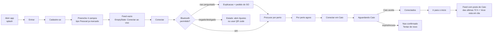
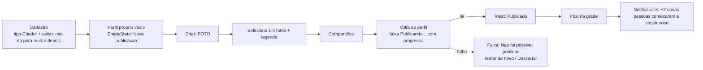
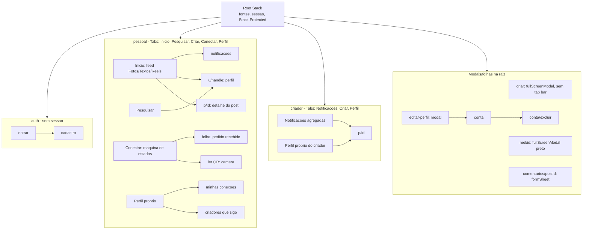
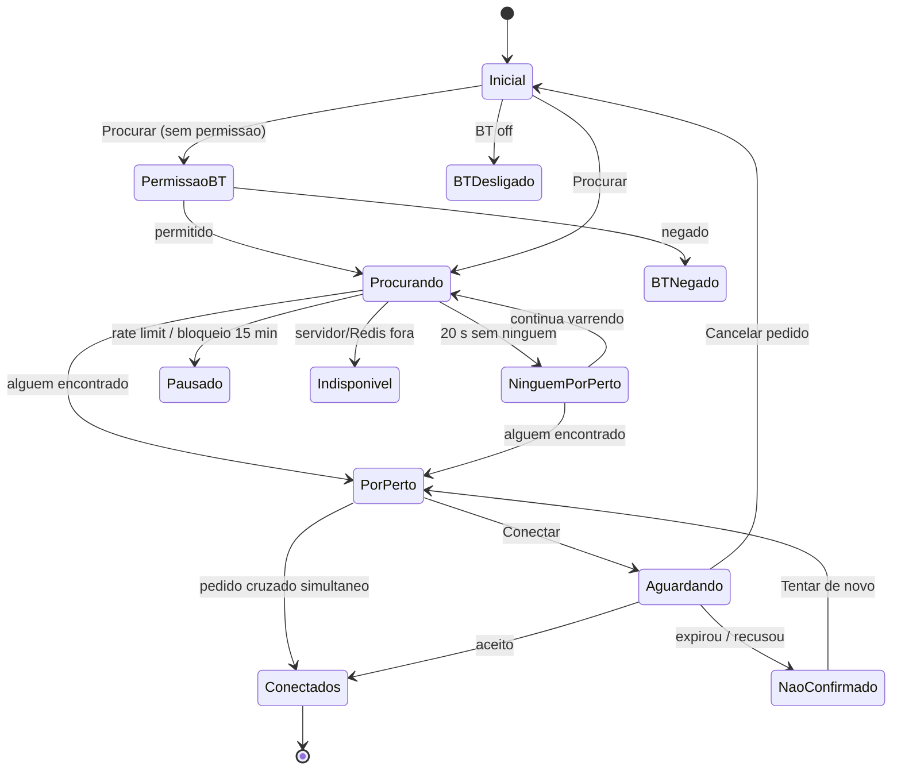
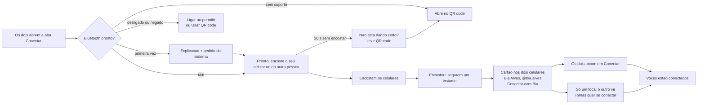
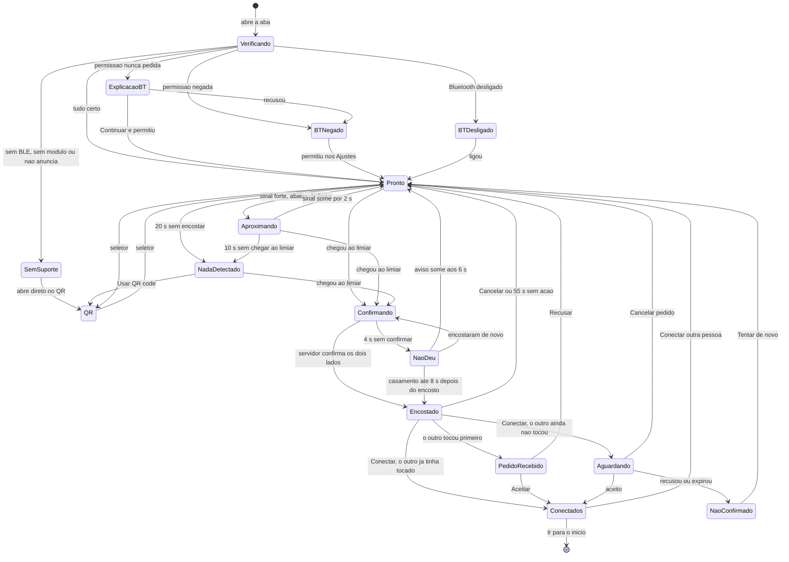

# UX/UI do Sussurro (v1)

> Autor: UX/UI Designer. Data: 2026-10-29. Status: proposta para revisão do PO.
> Entradas: `briefing.md` (seção 6 do PO = referência obrigatória), protótipo `docs/design/prototipo/p-01…p-22.png` + `texto-extraido.txt`, `arquitetura.md`, ADRs 0002–0005, 0008, 0011.
> Regra deste documento: o que está no protótipo é seguido como está; o que diverge da especificação ou do protótipo está marcado com **[DIVERGE]** e levado ao PO na seção 9.
> (atualizado em 2026-10-30) A tela Conectar mudou para **"encostar os celulares"** (D3 revisto, D13 substituído). A especificação nova está na **§11**, que substitui as partes do Conectar marcadas com "(atualizado em 2026-10-30)" ao longo do documento.

## 0. Leitura do protótipo (correções e método)

**Mapa real das páginas** (o briefing diz "p02–03 abertura/splash", mas não são telas):

| Página | Conteúdo real |
|---|---|
| p01 | Entrar |
| **p02** | **Asset solto: avatar "HS" (fundo azul pastel)**. Não é splash. |
| **p03** | **Asset solto: ilustração de paisagem quadrada** (imagem de exemplo). Não é splash. |
| p04 | Marca (símbolo, versões, cores) |
| p05 | Cadastro |
| p06–p08 | Feed Fotos / Textos / Reels + "Você está em dia" |
| p09 | Notificações (pessoal) |
| p10–p14 | Conectar: inicial, procurando, por perto, aguardando, conectados |
| p15 | Pesquisar (com resultado) |
| p16 | Perfil pessoal próprio |
| p17 | Perfil de criador visto por pessoa |
| p18 / p20 | Criar (pessoal / criador), modo FOTO |
| p19 | Perfil do próprio criador |
| p21 | Notificações do criador (agregadas) |
| p22 | Conectar bloqueado para criador |

Consequência: **não existe splash desenhada**. Proposta na seção 4.1, derivada do painel azul de p04.

**Método de medição**: o frame do protótipo tem 390 pt de largura (iPhone 14/15); os PNGs têm 447 px. Fator **1,146 px/pt**. Exemplo de verificação: o avatar do perfil mede 98 px = 85,5 pt, e a especificação diz 86. Todas as medidas abaixo estão em pt (unidades do React Native), já convertidas e arredondadas para a grade de 2/4 pt. Medidas marcadas com "≈" devem ser conferidas no catálogo com sobreposição do PNG (seção 6.15).

**Não desenhado no protótipo** (este documento cobre): splash, comentários, detalhe do post, visualizador de reels, Criar em modo TEXTO e REEL, folha de pedido recebido, QR, permissões, editar perfil, conta/exclusão, listas próprias de conexões e criadores, perfil de uma conexão, curtida ativa, e todos os estados de carregamento/erro/vazio/offline.

---

## 1. Personas

| | **Helena, 34** (pessoal) | **Tomás, 21** (pessoal) | **Bia, 41** (criadora) |
|---|---|---|---|
| Contexto | Arquiteta, iPhone, cansada de feed algorítmico. Usa o app 2–3x ao dia, rápido. | Universitário, Android intermediário. Conhece gente em festas e eventos, ambiente barulhento, celular na mão por segundos. | Padeira com perfil de receitas. Publica 2–3x por semana pelo celular. |
| Objetivo | Ver o que amigos reais postaram e "acabar". | Adicionar alguém que acabou de conhecer em < 30 s, sem trocar @. | Publicar e saber que as pessoas estão vendo, sem métricas de vaidade. |
| Dores | Rolagem infinita, anúncios, ver gente que não conhece. | Bluetooth que "não acha", permissões confusas, constrangimento se demorar. | Upload que falha em 4G, não saber se o post foi publicado. |
| Implicações | Feed com fim claro ("Você está em dia"), padrões do Instagram. | Conectar com 1 toque para começar, plano B (QR) visível, mensagens de erro acionáveis, nada de "NFC" enganoso. | Progresso de upload persistente, estado "processando" explícito, notificações agregadas. |

## 2. Jornadas principais

### 2.1 Pessoa: cadastro → primeira conexão → feed (meta: ≤ 9 toques após o cadastro)



Pontos de atrito e resposta de design: permissão de Bluetooth pedida **só ao tocar "Procurar por perto"** (não no cadastro); quem é procurado também precisa estar com a tela aberta (microcopy na tela inicial do Conectar); QR sempre a 1 toque.

(atualizado em 2026-10-30) Com o "encostar os celulares", esta jornada foi substituída pela §11.3.

### 2.2 Pessoa B (quem recebe o pedido)
Tela Conectar aberta (qualquer estado) → folha "Helena quer se conectar" com avatar, nome e @ → **Aceitar** → "Vocês estão conectados". Se B não está com a tela aberta, o pedido não chega na v1 (polling só com a tela aberta, ADR 0003); com push (Fase 6), a notificação abre o Conectar.

### 2.3 Criadora: cadastro → primeira publicação → seguidores



Criador não tem Início nem Pesquisar; a aba inicial do criador é **Perfil** (recomendação: a primeira coisa que o criador quer ver é o próprio conteúdo; Notificações fica à esquerda como no protótipo p19/p21).

---

## 3. Mapa de telas e navegação (Expo Router)

### 3.1 Diagrama



### 3.2 Árvore de rotas proposta

```
src/app/
  _layout.tsx                  Root Stack: carrega fontes, providers, Stack.Protected por sessão e tipo de conta
  index.tsx                    redireciona: sem sessão → /entrar; personal → /(pessoal); creator → /(criador)
  +not-found.tsx
  (auth)/
    _layout.tsx                Stack sem header
    entrar.tsx                 p01
    cadastro.tsx               p05
    esqueci-senha.tsx          só se D6 = sim
  (pessoal)/
    _layout.tsx                Tabs com <BottomTabBar variant="personal">
    (inicio)/_layout.tsx       Stack
    (inicio)/index.tsx         Feed p06–p08
    (inicio)/notificacoes.tsx  p09 (tab bar visível; ver D-UX19)
    (pesquisar)/_layout.tsx
    (pesquisar)/index.tsx      p15
    criar-tab.tsx              aba "fantasma": tabPress → preventDefault + router.push('/criar')
    conectar.tsx               p10–p14 (uma tela, máquina de estados)
    (perfil)/_layout.tsx
    (perfil)/index.tsx         p16
    (perfil)/conexoes.tsx      lista própria (GET /me/connections)
    (perfil)/seguindo.tsx      lista própria (GET /me/following)
    (inicio,pesquisar,perfil)/u/[handle].tsx   perfil de outra conta (p17 e perfil de conexão)
    (inicio,pesquisar,perfil)/p/[id].tsx       detalhe do post
  (criador)/
    _layout.tsx                Tabs com <BottomTabBar variant="creator">, initialRouteName = perfil
    (notificacoes)/index.tsx   p21
    criar-tab.tsx              aba fantasma
    (perfil)/index.tsx         p19
    (notificacoes,perfil)/p/[id].tsx
  criar.tsx                    fullScreenModal: Nova publicação (p18/p20 + modos TEXTO e REEL)
  reel/[id].tsx                fullScreenModal, fundo preto (ReelViewer); query ?origem=feed|perfil:@handle
  comentarios/[postId].tsx     formSheet (detents 0.7 / 0.95)
  conectar/pedido/[id].tsx     formSheet (pedido recebido)
  conectar/ler-qr.tsx          fullScreenModal (câmera)
  editar-perfil.tsx            modal (pageSheet no iOS)
  conta/index.tsx              "Conta": e-mail, sair de todos os dispositivos, excluir conta
  conta/excluir.tsx            exclusão de conta
  c/[token].tsx                deep link do QR (sussurro://c/{token}) → /conectar?qr={token}
  dev/catalog.tsx              catálogo (só dev, seção 6.15)
```

Notas de implementação de navegação:
- **Tab bars diferentes**: dois grupos `(pessoal)` e `(criador)` com `Tabs` próprios, protegidos por `Stack.Protected guard={accountType === 'personal'}` e `guard={accountType === 'creator'}` na raiz. O tipo de conta vem do claim `acct` do JWT (imutável), então não há troca em tempo de execução.
- **Aba Criar** não é uma tela: abre o modal `criar` e a tab bar some (spec). A aba nunca fica "ativa".
- **Notificações do pessoal** (p09) é empilhada no Início, com tab bar visível; a aba Início fica com o ícone ativo (preenchido). O protótipo mostra nenhuma aba ativa; recomendo Início ativo para manter a regra "sempre sei onde estou". **[DIVERGE leve]**
- **Rotas compartilhadas** `(inicio,pesquisar,perfil)/u/[handle]` mantêm a aba de origem ativa (p17 mostra Pesquisar ativo: confere).
- Tocar na aba ativa: volta ao topo da pilha; se já está na raiz, rola para o topo (padrão Instagram).
- **Deep link do QR** `sussurro://c/{token}`: se a câmera do sistema ler o QR, o app abre o Conectar já com o token e inicia o fluxo QR (o próprio token do usuário precisa estar ativo, então a tela é aberta antes de enviar o pedido). Sem sessão: guarda o token, pede login e descarta se tiver passado de 30 s.
- Orientação: **somente retrato** (inclusive no ReelViewer, vídeos são verticais). Somente celular (`supportsTablet: false`). Tema: **somente claro** na v1 (`userInterfaceStyle: "light"`). Ver D-UX12.

### 3.3 Inventário de telas

| Tela | Origem | Fase | Observação |
|---|---|---|---|
| Splash | novo (p04) | 0 | `expo-splash-screen` |
| Entrar | p01 | 1 | sem "demo"; rótulo "E-mail" |
| Cadastro | p05 | 1 | aviso de tipo imutável, termos |
| Feed (3 abas) | p06–p08 | 2 (reels: 5) | |
| Detalhe do post | novo | 2 | |
| Comentários (folha) | novo (spec) | 2 | |
| Criar FOTO | p18/p20 | 2 | |
| Criar TEXTO | novo (spec) | 2 | |
| Criar REEL | novo | 5 | |
| Perfil próprio pessoal | p16 | 1 (abas: 2) | |
| Perfil próprio criador | p19 | 1 | |
| Editar perfil | novo | 1 (foto: 2) | |
| Conta / Excluir conta | novo | 1 | App Store 5.1.1(v) |
| Pesquisar | p15 | 3 | |
| Perfil de criador visto por pessoa | p17 | 3 | |
| Minhas conexões / Criadores que sigo | novo | 3 (conexões: 4) | listas só do dono |
| Perfil de uma conexão | novo | 4 | |
| Conectar (5 estados + erros) | p10–p14, p22 | 4 | |
| Pedido recebido (folha) | novo (spec) | 4 | |
| QR: meu código / ler código | novo | 4 | |
| Visualizador de reels | novo | 5 | |
| Notificações pessoal / criador | p09 / p21 | 6 | |
| Catálogo (dev) | novo | 0 | |

---

## 4. Wireframes das telas não desenhadas

Convenções: `[Botão]` primário azul, `(Botão)` secundário cinza, `‹link›` texto azul, `▢` imagem, `◯` avatar, `───` divisor hairline.

### 4.1 Splash (Fase 0)
```
┌──────────────────────────┐
│                          │  fundo #0066FF (blue)
│                          │
│           S•             │  <Logo variant="mark" tone="onBrand"> 96 pt
│                          │  arco 1 branco, arco 2 #B3D1FF, ponto branco
│                          │  (sem texto: o expo-splash-screen usa imagem estática)
└──────────────────────────┘
```
Transição: fade de 200 ms para Entrar ou Feed. Ícone do app: mesmo símbolo onBrand sobre quadrado azul (p04 "Ícone do app"); Android adaptive icon = símbolo no foreground, `#0066FF` no background.

### 4.2 Detalhe do post (`p/[id]`)
```
┌──────────────────────────┐
│ ‹  Publicação            │  ScreenHeader 52, voltar + título titleLg
├──────────────────────────┤
│ <PostPhoto> ou <PostText>│  mesmo componente do feed
│ ...                      │
│ ───────────────────────  │
│ Comentários (inline)     │  lista de comentários (mesma do CommentsSheet)
│ ◯ lucasf 2 h             │
│   Que luz bonita!        │
│   Responder              │
├──────────────────────────┤
│ ◯ Adicione um coment… Publicar │ composer fixo acima do teclado
└──────────────────────────┘
```
Entradas: notificação, grade do perfil, lista de textos do perfil, toque no texto de um PostText. Reel → abre `reel/[id]` em vez desta tela. Post apagado/sem acesso (404): EmptyState "Esta publicação não está mais disponível."

### 4.3 Comentários (folha, `comentarios/[postId]`)
```
┌──────────────────────────┐
│          ▬▬▬             │  grabber 36×5, #DBDBDB, topo 8
│       Comentários      ✕ │  16/700 centralizado; ✕ 44×44 (alternativa ao arrasto)
├──────────────────────────┤
│ ◯ lucasf · 2 h           │  avatar 32; @ 14/600; tempo 13 grey
│   Que luz bonita!        │  14/20
│   Responder              │  13/600 grey
│      ◯ marinac · 1 h     │  resposta: recuo 44
│        Obrigada!         │
├──────────────────────────┤
│ Respondendo a @lucasf  ✕ │  chip só no modo resposta (bodySm grey, fundo greySoft)
│ ◯ [Adicione um comentário…]  Publicar │  Publicar azul; desabilitado = blueMist
└──────────────────────────┘
```
Ações por comentário (pressão longa + `accessibilityActions`): "Responder"; "Excluir" se autor do comentário ou do post. Contador "x/500" aparece a partir de 450.

### 4.4 Visualizador de reels (`reel/[id]`)
```
┌──────────────────────────┐ fundo #000, vídeo 9:16 (cover)
│ ✕                    🔊  │ ✕ fechar; alternar som (44×44, ícones brancos com sombra)
│                          │
│           ▶              │ toque = pausar/retomar (ícone 64 aparece 600 ms)
│                       ♡  │ coluna direita: curtir 28 + nº
│                      12  │
│                       ◌  │ comentar 28 + nº → CommentsSheet
│                       3  │
│ ◯ @cozinhadabia · Criador│ 14/600 branco
│ Receita do pão de quinta…│ 2 linhas, "mais" expande
│ ━━━━━━━━━━──────────────  │ progresso 2 pt (branco / branco 30%)
└──────────────────────────┘
Fim do vídeo: para no último quadro, escurece 40% e mostra
          ( ↻ Assistir de novo )
Nada avança sozinho.
```
Arrastar para baixo fecha. Navegação para o reel seguinte: ver D-UX7 (recomendo **sem paginação na v1**: o visualizador abre um reel; volta-se à grade para escolher outro).

### 4.5 Criar: modo TEXTO e modo REEL
```
TEXTO                                   REEL
┌──────────────────────────┐            ┌──────────────────────────┐
│ ✕ Nova publicação Compartilhar│       │ ✕ Nova publicação Compartilhar│
├──────────────────────────┤            ├──────────────────────────┤
│ ◯ helena                 │            │   ▢ prévia 9:16 (altura   │
│   [No que você está      │            │     limitada, centralizada)│
│    pensando?]            │            │   0:42 · toque p/ assistir│
│   (multilinha, 15/22)    │            ├──────────────────────────┤
│                   12/280 │            │ ◯ Escreva uma legenda…    │
│                          │            ├──────────────────────────┤
│ Para suas 4 conexões     │            │ Vídeos      Para suas 4 conexões│
│                          │            │ ▢0:42 ▢0:18 ▢1:35 ▢0:12  │ grade 4 col, só vídeos;
│                          │            │ (vídeo > 90 s: esmaecido, │ seleção única
│   ( FOTO  TEXTO  REEL )  │            │  "Até 90 s")              │
└──────────────────────────┘            └──( FOTO  TEXTO  REEL )────┘
```
Contador: grey até 260, preto 261–279, `danger` acima de 280 com Compartilhar desabilitado (o servidor conta code points; o app também). "Compartilhar" desabilitado = texto blueMist + `accessibilityState.disabled`.
Sair com conteúdo: Alert "Descartar publicação?" [Descartar] [Continuar editando].

### 4.6 Editar perfil (`editar-perfil`)
```
┌──────────────────────────┐
│ Cancelar  Editar perfil  Concluir │ Concluir azul 15/600; desabilitado sem mudanças
├──────────────────────────┤
│          ◯ 86            │
│     ‹Alterar foto›       │ Fase 2 (folha: Escolher da galeria / Remover foto)
│ Nome                     │
│ [Helena Souza      ]     │ 1–60
│ Nome de usuário          │
│ helena                   │ somente leitura (grey), helper "Não dá para mudar na v1."
│ Bio                      │
│ [Arquiteta. Café coado…] │ multilinha, contador x/150
│ Tipo de conta            │
│ Conta pessoal            │ somente leitura
├──────────────────────────┤
│ ‹Conta e segurança›    › │ → conta/index
└──────────────────────────┘
```

### 4.7 Conta (`conta/index`) e Excluir conta (`conta/excluir`)
```
┌──────────────────────────┐   ┌──────────────────────────┐
│ ‹  Conta                 │   │ ‹  Excluir conta         │
├──────────────────────────┤   ├──────────────────────────┤
│ E-mail                   │   │ Isso apaga sua conta para│
│ helena@exemplo.com       │   │ sempre:                  │
│ ───────────────────────  │   │ • publicações, curtidas e│
│ Sair deste dispositivo   │   │   comentários            │
│ Sair de todos os         │   │ • suas conexões (ou      │
│ dispositivos             │   │   seguidores)            │
│ ───────────────────────  │   │ • sua foto e seus dados  │
│ Termos de uso          › │   │ Some do app na hora; os  │
│ Política de privacidade› │   │ dados são apagados em até│
│ ───────────────────────  │   │ 30 dias.                 │
│ Excluir conta            │   │ Senha                    │
│ (texto danger)           │   │ [••••••••          ]     │
└──────────────────────────┘   │ [ Excluir minha conta ]  │ Button variant=destructive
                               └──────────────────────────┘
```
Depois do botão: Alert de confirmação final ("Excluir conta? Não dá para desfazer." [Cancelar] [Excluir]). Sucesso: volta para Entrar com Toast "Sua conta foi excluída." Pedir a senha exige que `DELETE /me` aceite `{password}` (a combinar com o Arquiteto). "Sair" no cabeçalho do perfil (ícone) também pede confirmação: "Sair da conta?".

(atualizado na Fase 6) Entre "Sair de todos os dispositivos" e "Contas bloqueadas" entrou a linha **"Notificações neste celular"** com um `Switch` e, abaixo, `bodySm` grey: "Curtidas, comentários, respostas e conexões. O texto dos comentários não aparece no aviso." (criador: "…respostas e novos seguidores."). Ligar pede a permissão do sistema (ou, negada de vez, Alert "Notificações bloqueadas" / "Permita as notificações do Sussurro nos Ajustes do celular." [Agora não] [Abrir Ajustes]); desligar apaga o token deste aparelho no servidor. Sem rede: Toast de erro e o `Switch` volta. É o único lugar para ligar de novo depois de "Agora não" (o pedido contextual não volta).

### 4.8 Minhas conexões / Criadores que sigo (só o dono)
```
┌──────────────────────────┐
│ ‹  Conexões              │
├──────────────────────────┤
│ Só você vê esta lista.   │ bodySm grey, ícone cadeado 16
│ ◯ caio.r                 │ UserRow: avatar 44, @ 14/600, nome 14 grey
│   Caio Ribeiro · desde 27 out │
│ ◯ bia.alves          ··· │ "···" → Desfazer conexão (se D8 = sim)
└──────────────────────────┘
```
"Criadores que sigo": mesma linha com `(Seguindo)` à direita (toque → deixar de seguir, com Alert). Vazio: EmptyState com ação ("Conectar ao vivo" / "Pesquisar criadores").

### 4.9 Perfil de uma conexão (pessoal visto por conexão)
Igual a p16 sem os ícones Criar/Sair, com `‹` e o @ no header, sem a nota de privacidade, números **não tocáveis** (a lista é privada), e um único botão `(Conectados ✓)` largura total. Toque em "Conectados" → folha de ações: "Desfazer conexão" (danger, se D8 = sim), "Cancelar". Pessoa não conectada (404 do servidor) → EmptyState "Perfil indisponível · Contas pessoais só aparecem para as conexões delas."

### 4.10 Conectar: seletor e QR (proposta para D3: "Bluetooth | QR code")
> (atualizado em 2026-10-30) O seletor passa a "Encostar | QR code" e o radar sai (§11). O QR (meu código, ler o código e o fluxo cruzado abaixo) continua valendo, com os textos da §11.9.

```
INICIAL (p10 com seletor novo)          QR: MEU CÓDIGO
┌──────────────────────────┐            ┌──────────────────────────┐
│ Conectar                 │            │ Conectar                 │
│ Conexões só acontecem ao │            │ [ Bluetooth | QR code ]  │
│ vivo… As duas pessoas    │            │                          │
│ precisam confirmar.      │            │   ┌────────────────┐     │
│ [ Bluetooth | QR code ]  │            │   │  ▓▓ QR 240 ▓▓  │     │ QR preto em card branco,
│      ((  Procurar  ))    │            │   │     (S• no centro)│   │ borda border, raio 16
│      ((  por perto ))    │            │   └────────────────┘     │
│ Fiquem a poucos metros,  │            │   ◯ helena               │
│ os dois com esta tela    │            │ Peça para a outra pessoa │
│ aberta.                  │            │ ler este código.         │
└──────────────────────────┘            │ [ Ler o código dela ]    │ → conectar/ler-qr
                                        └──────────────────────────┘
```
O QR se renova a cada 20 s sem piscar (troca com fade de 150 ms). Brilho da tela não é alterado.

**Fluxo QR cruzado (recomendado, D7)**:
1. A toca "Ler o código dela" e lê o QR de B → A vê "Aguardando Bia confirmar", e **o próprio QR de A aparece nessa tela** com o texto "Bia precisa ler este código para confirmar".
2. B (com a tela Conectar aberta) recebe a folha "Helena quer se conectar" com `[Ler código para aceitar]` e `(Recusar)`.
3. B lê o QR de A → conectados nos dois aparelhos.

### 4.11 Pedido recebido (folha, `conectar/pedido/[id]`)
```
┌──────────────────────────┐
│          ▬▬▬             │
│          ◯ 64            │
│   Helena quer se conectar│ titleMd
│   @helena · Helena Souza │ bodySm grey
│ Confirme só se a Helena  │ bodySm grey, centro
│ estiver aí com você.     │
│ [        Aceitar       ] │ lg (QR: "Ler código para aceitar")
│ (        Recusar       ) │ lg secundário
│ Expira em 1:45           │ caption grey; não é anunciado a cada segundo
└──────────────────────────┘
```
Haptic de notificação ao abrir. Vários pedidos: um por vez, em fila. Fecha sozinha ao expirar, com Toast "O pedido da Helena expirou."

### 4.12 Permissões (estados inline, não rotas)
> (atualizado em 2026-10-30) Os estados e os textos do Bluetooth foram revistos na §11.4 e na §11.9; o "Aparelho não anuncia" vira "Sem suporte". Câmera, fotos e notificações continuam como aqui.

```
BLUETOOTH: EXPLICAÇÃO (antes do diálogo do SO)
┌──────────────────────────┐
│ Conectar                 │
│        (ícone bluetooth) │ EmptyState
│  Permitir o Bluetooth    │
│ O Sussurro usa o Bluetooth para achar quem está com esta
│ tela aberta perto de você. Ninguém vê sua localização, e
│ nada é transmitido com o app fechado.
│ [      Continuar       ] │ → diálogo do sistema
│ ‹Usar QR code›           │
└──────────────────────────┘
```
| Estado | Título | Texto | Ações |
|---|---|---|---|
| Bluetooth negado | Bluetooth sem permissão | Para achar pessoas por perto, permita o Bluetooth nos Ajustes. | [Abrir Ajustes] ‹Usar QR code› |
| Bluetooth desligado | O Bluetooth está desligado | Ligue o Bluetooth para procurar quem está por perto. | [Abrir Ajustes] (Android: [Ligar Bluetooth]) ‹Usar QR code› |
| Aparelho não anuncia (Android) | Seu celular não consegue ser encontrado | Você ainda acha outras pessoas, mas elas não acham você. Use o QR code para garantir. | [Usar QR code] (Procurar mesmo assim) |
| Câmera: explicação | Ler o código da outra pessoa | A câmera é usada só para ler o QR code. | [Continuar] |
| Câmera negada | Câmera sem permissão | Permita a câmera nos Ajustes ou peça para a outra pessoa ler o seu código. | [Abrir Ajustes] ‹Mostrar meu código› |
| Fotos: sem acesso (Criar) | Escolha o que compartilhar | Permita o acesso às fotos para ver as recentes aqui. | [Permitir acesso] ‹Escolher fotos› (seletor do sistema, sem permissão) |
| Fotos: acesso limitado (iOS) | faixa no topo da grade | "Você deu acesso a algumas fotos." ‹Gerenciar› | |
| Notificações (Fase 6) | pedido contextual após a 1ª conexão ou 1º post | "Quer saber quando alguém curtir ou comentar?" | [Ativar] (Agora não) |

(atualizado na Fase 6) O pedido de notificações é um Alert nativo (como as confirmações), uns 800 ms depois do "Publicado." ou do "Vocês estão conectados", com o texto "Avisamos neste celular quando alguém curtir, comentar ou se conectar com você. Dá para desligar em Conta." (criador: "…curtir ou comentar e quando chegarem novos seguidores…"). Aparece **uma vez por conta neste aparelho**: "Agora não" ou a recusa no diálogo do sistema não são perguntadas de novo; com a permissão já negada de vez, nem aparece. "Ativar" sem conseguir o token: Toast "Não foi possível ativar as notificações agora. Tente de novo em Conta."

---

## 5. Estados

### 5.1 Matriz por tela

| Tela | Carregando | Vazio | Erro / offline | Específicos |
|---|---|---|---|---|
| Entrar | botão `loading` | n/a | inline sob o form: "E-mail ou senha incorretos." · 429: "Muitas tentativas. Tente de novo em 1 minuto." · offline: Toast | sessão expirada: Toast "Sua sessão expirou. Entre de novo." |
| Cadastro | botão `loading` | n/a | erros por campo (e-mail inválido/em uso, @ inválido/em uso, senha < 8) · 429: "Muitos cadastros desta rede. Tente mais tarde." | |
| Feed (cada aba) | 3 skeletons do item | **sem conexões e sem criadores**: EmptyState "Seu início está vazio" + [Conectar ao vivo] ‹Pesquisar criadores› · **sem posts na janela**: só o CaughtUp | primeira página falhou: EmptyState "Não foi possível carregar" [Tentar de novo] · páginas seguintes: linha "Não carregou. ‹Tentar de novo›" acima do fim · offline: OfflineBanner + conteúdo em cache | faixa de upload no topo (5.3); pull-to-refresh |
| Detalhe do post | skeleton | n/a | 404: "Esta publicação não está mais disponível." | |
| Comentários | 3 skeletons | "Ainda não há comentários. Comece a conversa." | lista: [Tentar de novo] · envio: item com "Não publicado. ‹Tentar de novo›" | enviando: item 50% opacidade |
| Pesquisar | spinner 20 no fim da barra | inicial: nada (sem sugestões, spec), só dica "Digite o @ de um criador." · 1–2 caracteres: "Digite pelo menos 3 letras." · sem resultado: "Nenhum criador com esse @. Contas pessoais não aparecem na busca: elas só se conectam ao vivo." | Toast/linha de erro | ver D-UX5 (não dá para saber se o @ é de conta pessoal) |
| Perfil (próprio/outro) | skeleton do header + grade | abas vazias: próprio "Compartilhe sua primeira foto" [Nova publicação]; outro "Nenhuma foto ainda." | 404 = "Perfil indisponível" | Seguir/Seguindo: otimista, rollback + Toast |
| Listas próprias | skeleton de linhas | EmptyState com ação | [Tentar de novo] | |
| Criar | — | grade sem fotos: "Nenhuma foto no aparelho." | ver permissões (4.12) | upload: 5.3 |
| Notificações | skeleton | "Nada por aqui ainda. Quando alguém curtir ou comentar, aparece aqui." | [Tentar de novo] | fim: "Isso é tudo por enquanto." (p09) |
| ReelViewer | spinner sobre o poster | n/a | "Não foi possível reproduzir este reel." [Tentar de novo] | processando (só autor): "Seu reel está sendo processado. Isso leva alguns minutos." |
| Conectar | — | 5.2 | 5.2 | 5.2 |

Regra geral de erro: mensagem humana + ação. Nunca mostrar `code` técnico na UI; o `code` vai para o Sentry. Erros sem ação na tela → Toast de erro.

### 5.2 Conectar: máquina de estados
> (atualizado em 2026-10-30) Substituída pela §11.4 (encostar os celulares). Daqui continuam valendo, com os textos da §11.9: Aguardando, Não confirmado, Conectados, Já conectados, Pausado, Indisponível, Offline e Criador. O resto descreve o que a Fase 4b implementou ("Por perto agora").




| Estado | Wireframe / texto | Ações |
|---|---|---|
| Procurando (p11) | radar + "Procurando por perto…" "Mantenha o app aberto" | (Cancelar) |
| **Ninguém por perto** (após 20 s; o radar continua) | "Ninguém por perto ainda" · "Peça para a outra pessoa abrir a tela Conectar. Se não aparecer, usem o QR code." | [Usar QR code] (Cancelar) |
| Por perto (p12) | lista ao vivo, ordenada por sinal; rótulo de faixa (D-UX2) | `[Conectar]` por linha; já conectado: rótulo grey "Conectados" no lugar do botão |
| Aguardando (p13) | "Aguardando Caio confirmar" | (Cancelar pedido) |
| **Não confirmado** (expirou ou recusou, sem diferenciar) | par de avatares com o tracejado em grey · "Caio não confirmou" · "O pedido vale por 2 minutos. Vocês podem tentar de novo." | [Tentar de novo] ‹Voltar› |
| Conectados (p14) | p14 | [Ir para o início] ‹Conectar outra pessoa› |
| **Já conectados** (409) | Toast "Vocês já estão conectados." | |
| **Pedido não pode ser enviado** (cooldown pós-recusa, token inválido) | Toast "Não foi possível enviar o pedido agora. Tente mais tarde." (não revela recusa) | |
| **Token de proximidade expirado** | invisível ao usuário: o app renova a cada 20 s. Se o token de B saiu do ar entre o "por perto" e o toque: linha some da lista + Toast "Caio saiu de perto. Procure de novo." | |
| **Pausado (rate limit)** | EmptyState ícone relógio · "Muitas tentativas" · "Você poderá procurar de novo em alguns minutos." | ‹Usar QR code› também fica pausado (mesmo limite) |
| **Indisponível** (Redis fora, fail-closed) | "Conectar está indisponível agora" · "Tente de novo em instantes." | [Tentar de novo] |
| Offline | "Sem internet" · "Conectar precisa de internet para confirmar quem é quem." | [Tentar de novo] |
| Criador (p22) | p22 | [Voltar ao perfil] |

Com a tela Conectar procurando ou aguardando: **manter a tela acesa** (`expo-keep-awake`); ao sair da tela ou ir para background, parar anúncio/varredura e voltar ao Inicial.

### 5.3 Upload e processamento

```
Faixa de publicação (topo do feed e do perfil próprio; criador: topo do perfil)
┌──────────────────────────┐
│ ▢ Publicando… 2 de 3     │ thumb 40, bodySm, ProgressBar 2 pt azul abaixo (determinada)
│ ━━━━━━━━━━━━──────────── │
└──────────────────────────┘
│ ▢ Processando o reel…    │ indeterminada (após upload, aguardando MediaConvert)
│ ▢ Não foi possível publicar.  ‹Tentar de novo›  ✕ │ falha: ícone alerta danger; ✕ = descartar (Alert)
```
- Sucesso: a faixa some e aparece Toast "Publicado." O post aparece no topo do próprio perfil (e no feed, se D9 = sim).
- Sair do app durante o upload: o upload continua enquanto o SO permitir; ao voltar, se o rascunho falhou, a faixa de falha aparece. Rascunhos órfãos são apagados pelo servidor em 24 h (arquitetura §5): o texto "Tentar de novo" some depois disso.
- Reel processando na grade do autor: `ReelTile status="processing"`. Outras pessoas não veem até `published`.
- Offline no Compartilhar: mantém o modal aberto, Toast "Sem internet. Sua publicação não foi enviada." (sem fila offline na v1).

### 5.4 Globais
| Situação | Comportamento |
|---|---|
| Offline | `OfflineBanner` fino sob o header: "Sem internet" (fundo ink, texto branco 13/600), aparece após 2 s sem rede, some com "Conectado" por 1,5 s. Ações que dependem de rede ficam habilitadas e falham com Toast (não desabilitar tudo). |
| Access token expirado | refresh silencioso (single-flight). Usuário não vê nada. |
| Refresh inválido/revogado | volta para Entrar + Toast "Sua sessão expirou. Entre de novo." Preserva o e-mail digitado. |
| 429 genérico | Toast "Muitas tentativas. Espere um pouco e tente de novo." |
| 5xx / timeout | Toast "Algo deu errado do nosso lado. Tente de novo." |
| 403 `ACCOUNT_TYPE_NOT_ALLOWED` | não deve acontecer pela UI; se acontecer: Toast "Essa ação não está disponível para o seu tipo de conta." |
| Curtir offline/falha | otimista; rollback do coração + Toast "Não foi possível curtir." |

---

## 6. Design system (`packages/ui`)

Princípios: componentes **apresentacionais** (recebem props simples, não tipos da API; o mapeamento fica no app), sem dependência de `packages/shared`. Dependências permitidas: `react-native-svg`, `expo-image`, `expo-video` (só ReelViewer), `react-native-reanimated`, `lucide-react-native`.

### 6.1 Cores: tokens do PO (inalterados)

| Token | Hex | Uso |
|---|---|---|
| `blue` | #0066FF | ações, curtida ativa, seleção, links |
| `blueMid` | #4D94FF | 2º arco do logo, anéis do radar |
| `blueMist` | #B3D1FF | arco sobre azul, estado desabilitado do primário/link, anéis externos |
| `blueLight` | #E5EFFF | fundos (avatar agregado "+N", seleção suave) |
| `black` | #000000 | texto principal, ícones |
| `grey` | #737373 | texto de apoio |
| `greySoft` | #EFEFEF | botões neutros, barra de busca, prévias vazias |
| `border` | #DBDBDB | divisores, bordas de campo, pontos inativos |
| `white` | #FFFFFF | fundo |

### 6.2 Cores: extensões (novas, justificadas)

| Token | Valor | Por quê |
|---|---|---|
| `bluePressed` | #0052CC | estado pressionado do primário (branco sobre ele: 6,6:1) |
| `greyStrong` | #666666 | texto/placeholder/ícone **sobre greySoft** (grey sobre greySoft = 4,12:1, falha; greyStrong = 4,99:1) |
| `field` | #FAFAFA | fundo dos campos de Entrar/Cadastro/Editar (p01/p05 mostram campo mais claro que o greySoft, com borda) |
| `ink` | #262626 | pílula FOTO/TEXTO/REEL, Toast, OfflineBanner |
| `inkMuted` | #A8A8A8 | texto inativo sobre `ink` (6,4:1) |
| `danger` | #D32F2F | erro de campo, "Excluir conta", falha de upload (4,98:1 no branco). A spec não tem cor de erro; uso mínimo, só texto/ícone. |
| `overlay` | rgba(0,0,0,0.4) | fundo atrás de folhas e Alerts |
| `mediaChip` | rgba(0,0,0,0.7) | contador "1/3" e afins sobre imagem |
| `mediaScrim` | gradiente rgba(0,0,0,0) → rgba(0,0,0,0.45), 40% inferior | legibilidade de duração do reel e textos sobre vídeo |
| `skeleton` | #EFEFEF (= greySoft) com pulso de opacidade 1 → 0,6 | carregamento |

### 6.3 Fundos pastel dos avatares

Medidos no protótipo (aproximados ao hex mais limpo):

| Token | Hex | Visto em |
|---|---|---|
| `avatar.lilac` | #D9D1FF | JP, CM |
| `avatar.mint` | #C2EFD4 | TO, RD |
| `avatar.peach` | #FFD3BF | MC, BL |
| `avatar.sky` | #B5E8F7 | LF, EA |
| `avatar.periwinkle` | #C4D6FF | HS, CR |
| `avatar.butter` | #FFE3A3 | BA |

Texto das iniciais: `black`, 600. Contraste mínimo do conjunto: 14,4:1 (periwinkle).

**Regra determinística**: `índice = fnv1a32(userId) mod 6`, na ordem da tabela. Usar o **`userId` (UUID)** e não o handle: o handle pode vir a ser editável e a cor mudaria. Quando só houver o handle (ex.: fixture do catálogo), usar o handle. FNV-1a 32 bits sobre os bytes UTF-8 da string em minúsculas (offset 2166136261, primo 16777619, aritmética `Math.imul` + `>>> 0`). A função fica em `packages/ui/avatar/color.ts` e tem teste de snapshot com 10 ids fixos.
**Iniciais**: primeira letra da primeira e da última palavra do `name` (maiúsculas, mantém acento: "Érica Lima" → "ÉL"); nome com uma palavra → 1 letra; sem nome → 2 primeiros caracteres alfanuméricos do handle.
**Exceção**: avatar agregado "+N" (notificação de seguidores, p21) usa `blueLight` e texto `black`.

### 6.4 Tipografia (Inter), medida no protótipo

| Token | Tamanho/entrelinha | Peso | Uso (página) |
|---|---|---|---|
| `titleLg` | 20/26 | 700 | título de tela ("Conectar", "Notificações"), @ no header do perfil, "Você e Caio estão conectados" (p09–p16) |
| `titleMd` | 18/24 | 700 | títulos de estado ("Aguardando Caio confirmar", "Indisponível para criadores", EmptyState) |
| `titleSm` | 16/22 | 700 | seções ("Hoje", "Por perto agora", "Recentes"), "Você está em dia", título de folha |
| `stat` | 17/22 | 700 | números do StatsRow |
| `bodyLg` | 16/22 | 400 | texto em campos, placeholders |
| `body` | 15/22 | 400 | texto de post (thread), legenda, bio, notificações |
| `bodyStrong` | 15/22 | 600 | @ em posts e linhas, nome no perfil |
| `bodySm` | 14/20 | 400 | apoio em grey, subtítulos, "Ver todos os N comentários", rótulos do StatsRow |
| `bodySmStrong` | 14/20 | 600 | "N curtidas", @ em comentários |
| `caption` | 13/18 | 400 | horários ("40 min", "Há 18 minutos"), "Conexão"/"Criador", helper de campo |
| `micro` | 12/16 | 600 | contador "1/2", duração do reel, badges |
| `button` | 16/20 | 600 | Button lg |
| `buttonSm` | 14/18 | 600 | Button sm, links de ação |
| `tab` | 15/20 | 600 | TopTabs de texto |

Letter-spacing: 0 em tudo, exceto `titleLg` −0,2. Rótulo "OU" (p01): `caption` 600 grey, letter-spacing 0,5.
Iniciais do Avatar: `fontSize = round(size × 0,36)`, 600, sem escala de fonte do sistema.
Números: `fontVariant: ['tabular-nums']` em contadores e durações.

### 6.5 Fontes: carregamento e regra de uso

| Família | Pesos | Pacote | Uso |
|---|---|---|---|
| Inter | 400, 600, 700 | `@expo-google-fonts/inter` (`Inter_400Regular`, `Inter_600SemiBold`, `Inter_700Bold`) | toda a interface |
| Bricolage Grotesque | 800 | `@expo-google-fonts/bricolage-grotesque` (`BricolageGrotesque_800ExtraBold`) | **somente** o wordmark "sussurro", minúsculo, no `<Logo variant="lockup">` |

- Embutir no build pelo **config plugin do `expo-font`** (`plugins: [["expo-font", { fonts: [...] }]]`), já que o app é dev build: sem carregamento assíncrono e sem flash de fonte. `useFonts` só como fallback.
- **No Android, `fontWeight` não escolhe o arquivo da fonte personalizada**: o tema mapeia cada peso para um `fontFamily` próprio (`Inter_600SemiBold` etc.) e os componentes nunca usam `fontWeight` sozinho. O componente `<Text variant="body">` do `packages/ui` resolve isso.
- Opcional (recomendado depois da Fase 0): converter o wordmark em **path SVG** a partir do Bricolage 800, o que remove a fonte do bundle e garante o desenho igual em toda plataforma. Na Fase 0, usar a fonte.
- Proibido: Bricolage em qualquer outro texto; maiúsculas no wordmark.

### 6.6 Espaçamento e layout

Escala (pt): `0, 2, 4, 6, 8, 12, 16, 20, 24, 32, 40, 48, 64` → tokens `space.0 … space.64` (nome = valor).

| Constante | Valor | Origem |
|---|---|---|
| `screenX` | 16 | margem lateral das telas do app (p06–p22) |
| `authX` | 32 | margem lateral de Entrar/Cadastro (p01/p05) |
| `fieldGap` | 8 | entre campos (p01) |
| `headerHeight` | 52 | header de tela (abaixo do safe area) |
| `topTabsHeight` | 44 | Fotos/Textos/Reels e abas do perfil |
| `bottomBarHeight` | 50 | + `insets.bottom` |
| `postHeaderHeight` | 56 | cabeçalho do PostPhoto |
| `actionsRowHeight` | 44 | coração/comentário/pontos |
| `rowMinHeight` | 64 | UserRow, notificação |
| `gridGap` | 2 | grades do perfil e de reels (≈1,75 medido) |
| `hitMin` | 44 | alvo mínimo de toque |

Proporções de mídia: post de foto **4:5**; tile de foto no perfil **3:4**; tile de reel **9:16**; grade do Criar **1:1**, 4 colunas.

### 6.7 Raios

| Token | Valor | Uso |
|---|---|---|
| `radius.sm` | 6 | miniaturas (notificação, faixa de upload), chips |
| `radius.md` | 10 | Button sm, SearchBar, SegmentedControl |
| `radius.lg` | 12 | Button lg, Input, Toast |
| `radius.xl` | 16 | cards (QR, catálogo) |
| `radius.sheet` | 20 | topo de folhas inferiores |
| `radius.full` | 9999 | avatares, pílulas, contador "1/2" |

### 6.8 Tamanhos

| Grupo | Valores |
|---|---|
| Avatar | `xs 24` (tab bar) · `sm 32` (post, comentário, legenda do Criar) · `md 36` (thread de textos) · `lg 44` (notificação, listas) · `xl 48` (busca, Por perto) · `2xl 64` (radar, aguardando, pedido) · `3xl 72` (conectados, p14) · `profile 86` |
| Ícones | 24 (padrão: barras, ações de post, header), 20 (ações do PostText, lupa da busca 18), 28 (ReelViewer, EmptyState), 16 (inline em texto) |
| Traço de ícone | 2 (inativo), 2,75 (ativo "mais grosso") |
| Botões | `lg` minHeight 44 · `sm` minHeight 34 (p12, p15, p16) |
| Campos | Input minHeight 46 · SearchBar minHeight 36 |
| Anel do avatar ativo | avatar 24 + folga 2 + traço 1,5 `black` = 31 total |
| Ponto de não lido | 8, `blue`, borda 1,5 branca, canto superior direito do coração |
| Indicadores | sublinhado TopTabs 2 · pontos do carrossel 6 (gap 4) · ProgressBar 2 |
| Botão "Procurar por perto" | 160 de diâmetro; anéis 196 e 252 (p10) |

### 6.9 Sombras (uso mínimo)
Usar a prop `boxShadow` (RN 0.76+, New Architecture), que vale para iOS e Android:

| Token | Valor | Uso |
|---|---|---|
| `shadow.sm` | `0 1px 3px rgba(0,0,0,0.10)` | segmento selecionado, setas do carrossel |
| `shadow.md` | `0 4px 12px rgba(0,0,0,0.15)` | Toast, pílula FOTO/TEXTO/REEL |
| `shadow.sheet` | `0 -2px 16px rgba(0,0,0,0.12)` | folhas (se não forem nativas) |
| `shadow.icon` | `0 1px 2px rgba(0,0,0,0.5)` | ícones brancos sobre vídeo/imagem |

### 6.10 Movimento

| Token | Duração | Uso |
|---|---|---|
| `motion.fast` | 120 ms | feedback de toque (opacidade 0,7 em ícones; cor em botões) |
| `motion.base` | 200 ms | sublinhado das abas, fades, troca do QR (150) |
| `motion.slow` | 300 ms | Toast entrar/sair, faixa de upload |
| `motion.heart` | 300 ms | "pop" do coração (escala 1 → 1,2 → 1) |
| `motion.radarCycle` | 2400 ms | anéis do radar (3 anéis, defasagem 800 ms, escala 0,6 → 1,4, opacidade 0,6 → 0) |
| `motion.toastVisible` | 4000 ms (6000 com ação) | |
| Easing | `Easing.bezier(0.2, 0, 0, 1)` | padrão |

Com **Reduzir movimento** ligado (`useReducedMotion` do Reanimated): durações viram 0 (exceto opacidade ≤ 150 ms), radar fica estático (2 anéis fixos em blueMist + texto "Procurando…" com reticências estáticas), sem "pop" do coração, sem pulso do skeleton.

(atualizado em 2026-10-30) O radar sai da tela Conectar. Para a ilustração do encostar entra o `motion.touchCycle` (2400 ms, 2 ciclos e para), descrito na §11.7.

### 6.11 Ícones

**Recomendação: `lucide-react-native`** (usa `react-native-svg`, importação por ícone, traço configurável, ISC).

| Opção | Contorno + ativo | Fidelidade ao protótipo | Veredito |
|---|---|---|---|
| **lucide-react-native** | contorno; ativo por `strokeWidth` 2,75 ou `fill` | **alta**: os ícones do protótipo são do estilo Lucide (traço 2, pontas redondas: `radio`, `square-plus`, `log-out`, `lock`, `image`) | **escolhida**, + 1 SVG próprio |
| phosphor-react-native | pesos `regular`/`bold`/`fill` nativos para todos | média: traço mais fino no regular, geometria diferente | boa alternativa se o PO preferir estados ativos "de fábrica" |
| @expo/vector-icons (Ionicons) | pares `home`/`home-outline` | baixa (estilo iOS), baseado em fonte, não SVG | não |
| Tabler | contorno + alguns preenchidos | média | não (cobertura de preenchidos incompleta) |

Ativo no estilo Instagram com Lucide: `heart` aceita `fill` sem problema; `search` usa traço 2,75; **`house` preenchido precisa de SVG próprio** (com `fill` o traço da porta some sobre o preenchimento). Os SVGs próprios ficam em `packages/ui/icons/` com a mesma interface `{size, color, strokeWidth}`.

| Lugar | Inativo | Ativo |
|---|---|---|
| Tab Início | `house` | `HouseFill` (próprio: casa preenchida com porta vazada) |
| Tab Pesquisar | `search` | `search` traço 2,75 |
| Tab Criar | `square-plus` | (nunca ativo) |
| Tab Conectar | `radio` | `radio` traço 2,75 em `blue` (p10–p14; ver D-UX8) |
| Tab Perfil | Avatar 24 | Avatar 24 com anel |
| Tab Notificações (criador) | `heart` | `heart` com `fill` black (p21) |
| Header do feed | `heart` + ponto azul | |
| Header do perfil próprio | `square-plus` (Criar), `log-out` (Sair) | |
| Voltar / fechar | `chevron-left` / `x` | |
| Post: curtir | `heart` | `heart` fill `blue`, traço `blue` |
| Post: comentar | `message-circle` | |
| Post: mais opções | `ellipsis` | |
| Carrossel | `chevron-left` / `chevron-right` (16 em círculo branco 28) | |
| Abas do perfil | `grid-3x3`, `align-left`, `square-play` (grey) | mesmos em `black` + sublinhado |
| Tile com várias fotos | `copy` 16 branco com `shadow.icon` | |
| Duração do reel | `play` 12 fill branco | |
| ReelViewer | `x`, `volume-2`/`volume-x`, `play`, `rotate-ccw` | |
| Prévia vazia do Criar | `image` 40 greyStrong | |
| Conectar | `radio` (botão central), `bluetooth`, `bluetooth-off`, `qr-code`, `scan-line`, `camera`, `clock` (pausado), `lock` (p22) | |
| Estados | `check` (CaughtUp, conectados), `circle-alert` (erro), `wifi-off` (offline), `refresh-cw` (tentar de novo), `trash-2` (excluir) | |
| Busca | `search` 18, `circle-x` (limpar) | |
| Senha | `eye` / `eye-off` | |

### 6.12 Logo

SVG exato (viewBox 0 0 64 64, `stroke-width` 8, `stroke-linecap="round"`, `fill="none"` nos arcos):

```svg
<svg viewBox="0 0 64 64" xmlns="http://www.w3.org/2000/svg">
  <path d="M42.34 18.24 A11 11 0 1 0 24.22 29.78" stroke="#0066FF" stroke-width="8" stroke-linecap="round" fill="none"/>
  <path d="M21.66 45.76 A11 11 0 1 0 39.78 34.22" stroke="#4D94FF" stroke-width="8" stroke-linecap="round" fill="none"/>
  <circle cx="32" cy="32" r="3" fill="#000000"/>
</svg>
```

| Prop | Tipo | Padrão | Descrição |
|---|---|---|---|
| `variant` | `'mark' \| 'lockup'` | `'mark'` | só o símbolo, ou símbolo + "sussurro" |
| `tone` | `'default' \| 'onBrand'` | `'default'` | `onBrand` = sobre azul ou preto: arco 1 `#FFFFFF`, arco 2 `#B3D1FF`, ponto `#FFFFFF`, wordmark branco |
| `size` | number | 32 | altura do símbolo em pt |
| `accessibilityLabel` | string | "Sussurro" | |

- Lockup: wordmark em Bricolage 800 com `fontSize ≈ size × 0,95`, letter-spacing −2%, gap símbolo→texto `size × 0,25`, alinhado verticalmente ao centro óptico (ajustar no catálogo contra p04/p06). Wordmark `black` (default) ou `white` (onBrand).
- Usos: header do feed = lockup, `size` 24 (p06); Entrar/Cadastro = mark 64 (p01) **empilhado** com o wordmark 40 pt centralizado embaixo (prop `layout: 'row' | 'stacked'`, padrão `row`); splash e ícone = mark onBrand.
- Tamanho mínimo do mark: 16 pt (p04 "Tamanhos reduzidos"). Abaixo de 20 pt, manter o traço 8 (a proporção já garante legibilidade).
- a11y: `accessibilityRole="image"`; no header do feed, o lockup é o título da tela (`accessibilityRole="header"`, label "Sussurro, início").

### 6.13 Componentes da lista do PO

Regras comuns: todo componente aceita `testID`; todo elemento tocável tem `accessibilityRole`, `accessibilityLabel` em português e alvo ≥ 44 (usar `hitSlop` quando o visual for menor); alturas são `minHeight` (crescem com a fonte do sistema); estado pressionado via `Pressable` com feedback em `motion.fast`.

#### Avatar
| | |
|---|---|
| Props | `size: 24\|32\|36\|44\|48\|64\|72\|86`; `name?: string`; `handle: string`; `seed?: string` (userId); `uri?: string \| null`; `ring?: boolean`; `count?: number` (modo agregado "+N") |
| Variantes | foto; iniciais sobre pastel; agregado "+N" (blueLight); com anel (tab bar ativa) |
| Estados | carregando a foto: mostra as iniciais por baixo, a foto entra com fade 150 ms; erro: fica nas iniciais |
| Medidas | círculo; iniciais `round(size×0,36)` / 600; anel: folga 2 + traço 1,5 black |
| a11y | decorativo por padrão (`accessible={false}`) quando há nome ao lado; isolado: "Foto de perfil de @handle"; "+N": "N novas pessoas" |

#### Button
| | |
|---|---|
| Props | `label`; `onPress`; `variant: 'primary'\|'secondary'\|'link'\|'destructive'`; `size: 'lg'\|'sm'`; `fullWidth?`; `disabled?`; `loading?`; `icon?` |
| Variantes | primary: fundo blue, texto white · secondary: fundo greySoft, texto black · link: sem fundo, texto blue · destructive: fundo white, borda border, texto danger |
| Estados | pressionado: primary `bluePressed`, secondary #E0E0E0, link opacidade 0,6 · desabilitado: primary fundo `blueMist` texto white; secondary texto grey; link texto blueMist · loading: spinner (white/black), rótulo oculto, largura mantida, `accessibilityState.busy` |
| Medidas | lg: minHeight 44, raio 12, paddingX 16, `button` · sm: minHeight 34, raio 10, paddingX 16, `buttonSm` (hitSlop vertical 5) |
| Uso | "Seguir" = primary sm, "Seguindo" = secondary sm (p15/p17); "Editar perfil", "Conectar ao vivo" = secondary sm em linha, gap 8 (p16) |
| a11y | role button; `accessibilityState {disabled, busy}`; Seguir/Seguindo: label "Seguir @x" / "Seguindo @x, toque para deixar de seguir" |

#### Input
| | |
|---|---|
| Props | `label` (vira placeholder vazio e rótulo flutuante preenchido); `value`; `onChangeText`; `type: 'text'\|'email'\|'password'\|'username'\|'multiline'`; `error?`; `helper?`; `maxLength?`; `showCounter?`; `readOnly?` |
| Variantes | campo (fundo `field`, borda 1 `border`, p01/p05); `SearchBar` (seção 6.14) |
| Estados | vazio: rótulo como placeholder `bodyLg` grey · preenchido: rótulo sobe para `caption` grey no topo interno (padrão Instagram), valor `bodyLg` black · foco: borda `grey` (4,74:1) · erro: borda `danger` + texto `caption` danger com `circle-alert` 14 abaixo · desabilitado/somente leitura: texto grey, sem borda de foco |
| Medidas | minHeight 46, raio 12, paddingX 16; senha: botão "Mostrar/Ocultar" (`buttonSm`, black) à direita |
| Teclado | email: `keyboardType="email-address"`, `autoCapitalize="none"`, `autoComplete="email"`, `textContentType="emailAddress"`; senha: `textContentType="password"` (Entrar) / `"newPassword"` (Cadastro), colar permitido; username: `autoCapitalize="none"`, `autoCorrect={false}`, converte para minúsculas ao digitar |
| a11y | `accessibilityLabel = label`; erro anunciado com `AccessibilityInfo.announceForAccessibility` ao submeter; contador anunciado só a 20 do limite |

#### TopTabs
| | |
|---|---|
| Props | `tabs: {key, label?, icon?, accessibilityLabel}[]`; `value`; `onChange`; `variant: 'text'\|'icon'` |
| text (feed, p06) | altura 44, abas de largura igual, `tab` 15/600, ativa black, inativa grey; sublinhado 2 `blue` na largura da aba, anima em `motion.base`; hairline `border` embaixo |
| icon (perfil, p16) | ícone 24, ativo black, inativo grey; sublinhado 2 `black` |
| Comportamento | swipe horizontal entre abas no feed (pager) com toque também; fixa (sticky) no perfil |
| a11y | contêiner `accessibilityRole="tablist"`, cada aba `role="tab"` com `selected`; icon: labels "Fotos", "Textos", "Reels" |

#### PostPhoto (p06)
| | |
|---|---|
| Props | `author {id, handle, name, avatarUrl}`; `relation: 'connection'\|'creator'\|'self'`; `images {uri, width, height}[]` (1–4); `caption?`; `likeCount`; `liked`; `commentCount`; `publishedAt`; `onLike`; `onOpenComments`; `onOpenAuthor`; `onMore` |
| Cabeçalho | 56: padding 16, Avatar 32, gap 10, @ `bodyStrong`, abaixo "Conexão"/"Criador" `caption` grey (self: sem rótulo); `ellipsis` à direita |
| Mídia | largura total, **4:5** (`contentFit="cover"`); várias: pager horizontal, contador "1/3" `micro` branco sobre `mediaChip`, raio full, padding 4×8, a 12 do topo/direita; setas 28 (círculo branco 90% + `shadow.sm`) centradas verticalmente a 8 da borda, ocultas nas pontas |
| Ações | linha 44: `heart` 24 (x=16), `message-circle` 24 (gap 16); pontos do carrossel **centralizados** na mesma linha (6, gap 4, ativo blue, inativo border); só aparecem com 2+ fotos |
| Texto | "N curtidas" `bodySmStrong` (1 → "1 curtida"; 0 → linha oculta) · legenda `body`: @ em 600 + texto, máx. 2 linhas + "mais" grey · "Ver todos os N comentários" `bodySm` grey (1 → "Ver 1 comentário"; 0 → oculto) · tempo `caption` grey ("Há 18 minutos", "Há 3 h", "Ontem", "27 out") · paddingX 16, gaps 4, 16 abaixo do post |
| Estados | foto carregando: fundo greySoft; erro: greySoft + `image-off` + "Não foi possível carregar a foto" (toque tenta de novo); curtida otimista com "pop" |
| Extra opcional | toque duplo na foto curte (Instagram); requer alternativa (o botão já existe) |
| a11y | carrossel `accessibilityRole="adjustable"` com label "Foto 1 de 3 de @marinac" e incremento/decremento; curtir: role button, label "Curtir", `selected` quando curtido ("Curtido"); grupo do cabeçalho leva ao perfil |

#### PostText (p07)
| | |
|---|---|
| Props | `author`; `relation`; `text`; `publishedAt`; `likeCount`; `liked`; `commentCount`; `onLike`; `onComment`; `onOpen`; `onOpenAuthor`; `onMore` |
| Medidas | padding 16 horizontal, 14 vertical; Avatar 36; gap 12; linha 1: @ `bodyStrong` + tempo `caption` grey (gap 6); texto `body` 15/22 completo (≤ 280, sem truncar); ações: `heart` 20 + nº `bodySm` grey, gap 24, `message-circle` 20 + nº; hairline `border` entre itens |
| Estados | curtido: coração blue preenchido; nº 0 visível ("0", como p07) |
| a11y | o item inteiro é um grupo com label "@juprado, há 40 min: {texto}"; curtir/comentar como `accessibilityActions` e também como botões |

#### ReelTile (p08, perfis)
| | |
|---|---|
| Props | `thumbUri`; `durationS`; `status: 'ready'\|'processing'\|'failed'`; `onPress`; `accessibilityLabel` |
| Medidas | largura `(tela − 2×gridGap)/3`, **9:16**; `mediaScrim` no rodapé; `play` 12 + "0:42" `micro` branco a 8 da esquerda/rodapé, com `shadow.icon` |
| Estados | processing: fundo greySoft, spinner 20 + "Processando" `micro` greyStrong · failed: `circle-alert` danger + "Falhou" + toque abre ações "Tentar de novo/Excluir" · carregando thumb: greySoft |
| a11y | "Reel de @x, 42 segundos"; processing: "Reel processando" |

#### ReelViewer (wireframe 4.4)
| | |
|---|---|
| Props | `source {uri, posterUri}`; `author`; `relation`; `caption`; `likeCount`; `liked`; `commentCount`; `onClose`; `onLike`; `onOpenComments`; `onOpenAuthor`; `status` |
| Comportamento | autoplay **só do reel aberto**, com som (respeita o modo silencioso do iOS); toque pausa/retoma; no fim para no último quadro e mostra "Assistir de novo"; **nunca avança para outro vídeo**; arrastar para baixo fecha |
| Medidas | fundo black; controles brancos com `shadow.icon`; coluna direita a 12 da borda, itens 28 + nº `micro`, gap 20; rodapé com `mediaScrim`, paddingX 16, acima do safe area; progresso 2 |
| Estados | carregando: poster + spinner branco; buffering: spinner; erro: mensagem + [Tentar de novo] em fundo black; processando (autor) |
| Fase 0 | casca visual com poster e estados simulados; reprodução real (`expo-video`) na Fase 5 |
| a11y | com leitor de tela ativo, os controles não somem e há botão "Pausar/Reproduzir" explícito (WCAG 2.2.2); label do vídeo "Reel de @x"; ✕ "Fechar" |

#### CommentsSheet (wireframe 4.3)
| | |
|---|---|
| Props | `comments {id, author, body, createdAt, parentId, canDelete}[]`; `postAuthorHandle`; `loading`; `error`; `onSubmit(body, parentId?)`; `onDelete`; `onLoadMore`; `onClose`; `currentUser` |
| Medidas | topo raio 20; grabber 36×5 a 8 do topo; título `titleSm` centralizado + ✕; itens: Avatar 32, padding 16, gap 12; respostas recuadas 44; composer: Avatar 32, campo sem fundo (borda 1 `border`, raio full, minHeight 40), "Publicar" `buttonSm` blue (desabilitado blueMist), fica acima do teclado |
| Detents | 70% → 95% ao focar o campo; implementação sugerida: rota `formSheet` do Expo Router (nativa) com `sheetAllowedDetents`; validar o teclado no Android no spike da Fase 2, fallback `@gorhom/bottom-sheet` |
| Estados | ver 5.1 |
| a11y | `accessibilityViewIsModal`; foco inicial no título; ✕ como alternativa ao arrasto (WCAG 2.5.7); @ de quem comentou só é tocável se o perfil for visível (ver D-UX10) |

#### CaughtUp (p08)
| | |
|---|---|
| Props | `kind: 'photo'\|'text'\|'reel'`; `windowHours: number` |
| Medidas | círculo 64 com **contorno** 2 `blue` e `check` 28 blue (p08 mostra contorno, a spec diz "círculo azul": seguir o protótipo); título `titleSm` "Você está em dia"; texto `bodySm` grey centralizado, maxWidth 300; padding vertical 40 |
| Texto | "Você viu todas as fotos / todos os textos / todos os reels dos últimos {período} de quem você conhece e segue." Período: múltiplo de 48 h ou mais → "dos últimos {n} dias"; 24 h → "do último dia" (ajustar a frase); outros valores → "das últimas {n} horas" |
| a11y | `accessibilityRole="text"`, lido como uma frase |

#### ProfileHeader (p16, p17, p19)
| | |
|---|---|
| Props | `handle`; `name`; `accountType`; `bio?`; `avatar`; `counts`; `mode: 'self'\|'creatorViewedByPerson'\|'connection'`; `following?`; callbacks |
| Barra superior | self: @ `titleLg` à esquerda; `square-plus` e `log-out` à direita (24, gap 20) · outros: `chevron-left` + @ |
| Corpo | padding 16; Avatar 86 à esquerda; StatsRow à direita (flex 1, centralizado na altura do avatar); 12 abaixo: nome `bodyStrong`; tipo `bodySm` grey ("Conta pessoal" / "Criador de conteúdo · não segue ninguém"); bio `body`; nota de privacidade só no self pessoal (`caption` grey); botões a 12, gap 8 |
| Botões | pessoal self: (Editar perfil) (Conectar ao vivo) · criador visto por pessoa: [Seguir] / (Seguindo) largura total · criador self: (Editar perfil) [Nova publicação] · conexão: (Conectados ✓) |
| a11y | @ do topo é `header`; avatar decorativo; bio lida em sequência |

#### StatsRow
| | |
|---|---|
| Props | `items {value: number, label: string, onPress?}[]` (2 ou 3) |
| Medidas | colunas de largura igual; número `stat`, rótulo `bodySm` black (p16 usa black, não grey) |
| Formatação | pt-BR: até 9.999 com ponto ("8.903"); 10.000–999.999 → "12,4 mil"; ≥ 1 milhão → "1,2 mi". Singular/plural: publicação(ões), conexão(ões), criador(es), seguidor(es) |
| Toque | só o dono: "conexões" → `/conexoes`, "criadores" → `/seguindo`. Seguidores de criador não têm lista (ADR 0004): não tocável |
| a11y | cada item é um elemento: "5 publicações"; tocáveis com role button e hint "Abre a lista, visível só para você" |

#### BottomTabBar
| | |
|---|---|
| Props | `variant: 'personal'\|'creator'`; `active`; `avatar`; `hasUnread?` (criador) ; `onPress(key)` |
| Ordem | pessoal: Início, Pesquisar, Criar, Conectar, Perfil · criador: Notificações, Criar, Perfil |
| Medidas | altura 50 + `insets.bottom`; fundo white; hairline `border` no topo; itens de largura igual; ícone 24 |
| Ativo | ver tabela 6.11 |
| Comportamento | escondida em `criar`, `reel/[id]`, folhas e com teclado aberto (Android) |
| a11y | `role="tablist"`, itens `tab` com label: "Início", "Pesquisar", "Criar publicação", "Conectar", "Perfil", "Notificações, há novidades"; ícones não escalam com a fonte do sistema (iOS: suportar o Large Content Viewer via `accessibilityShowsLargeContentViewer` em RN ≥ 0.76) |

#### Toast
| | |
|---|---|
| Props | `message`; `variant: 'info'\|'success'\|'error'`; `action? {label, onPress}`; `duration?` |
| Medidas | fundo `ink`, raio 12, `shadow.md`, padding 12×16, margem 16 laterais, 12 acima da tab bar (ou do safe area); texto `bodySm` white; ícone 16 à esquerda (success `check`, error `circle-alert`, ambos white); ação `buttonSm` em **blueMist** (blue sobre ink falha: 3,1:1) |
| Comportamento | 1 por vez (fila); some em 4 s (6 s com ação); arrastar para baixo dispensa; pausa o tempo enquanto o leitor de tela lê |
| a11y | `accessibilityLiveRegion="polite"` (Android) + `announceForAccessibility` (iOS); erros que exigem ação **não** dependem só do Toast (a tela mantém o estado) |

#### EmptyState (p22)
| | |
|---|---|
| Props | `icon`; `title`; `description?`; `primaryAction?`; `secondaryAction?` (link) |
| Medidas | coluna centralizada, paddingTop 64; círculo 72 com contorno 2 `black` e ícone 28 (p22); título `titleMd` a 16; descrição `bodySm` grey, maxWidth 320, a 6; ações a 16 (primário sm, como "Voltar ao perfil" em p22; link abaixo a 12) |
| a11y | título com role `header`; ícone decorativo |

### 6.14 Componentes extras (exigidos pelas telas, fora da lista do PO)

| Componente | Onde | Especificação curta |
|---|---|---|
| `Text` | todo lugar | `variant` = token tipográfico (6.4); resolve `fontFamily` por peso; `color` por token; `maxFontSizeMultiplier` padrão por variante (6.16) |
| `Icon` | todo lugar | wrapper de Lucide + SVGs próprios; `name`, `size`, `color`, `active` |
| `IconButton` | headers, posts | ícone 24 em área 44×44; label obrigatório |
| `ScreenHeader` | todas as telas | 52; variantes: título à esquerda (p10), voltar + título (p09/p17), modal (✕ + título + ação à direita, p18) |
| `SegmentedControl` | Conectar (p10) | minHeight 40 (≈45 px), fundo greySoft, raio 10, padding 3; segmento ativo white + `shadow.sm` + `bodyStrong` black; inativo `bodyStrong` greyStrong; a11y: `radiogroup`/`radio` |
| `SearchBar` | Pesquisar (p15) | minHeight 36, fundo greySoft, raio 10, `search` 18 greyStrong, placeholder "Pesquisar @criador" greyStrong, limpar `circle-x`; prefixo "@" opcional ignorado na busca |
| `UserRow` | busca, Por perto, listas | Avatar 44/48, @ `bodyStrong`, subtítulo `bodySm` grey, ação à direita (Button sm); minHeight 64 |
| `NotificationRow` | p09/p21 | Avatar 44, texto `body` com @ em 600 e tempo inline `caption` grey, miniatura 44 raio 6 à direita; não lida: sem fundo diferente (o protótipo não diferencia), ponto azul 8 à esquerda da miniatura ← proposta, validar. (atualizado na Fase 6) Implementado assim; texto de post sem miniatura; @ tocável só com `profileVisible` (senão, 600 sem toque) e, para o leitor de tela, a ação "Abrir o perfil de @x"; seguidores com "+N" (acima de 99, "99+") e sem toque; o texto dos seguidores fica todo em `body` (o p21 põe "2 novas pessoas" em 600) |
| `RadioOptionList` | Cadastro (p05) | fieldset com legenda "Tipo de conta" `caption` 600 grey sobre a borda; linhas com título `bodyStrong`, descrição `bodySm` grey, rádio 22 (ativo: anel 2 blue + miolo 10 blue; inativo: anel 1,5 border); hairline entre linhas; raio 12; a11y `radiogroup` |
| `Divider` | p01 "OU", listas | hairline `border`; variante com rótulo central |
| `Sheet` | base de CommentsSheet e pedido recebido | 6.13 CommentsSheet |
| `Radar` | Conectar (p10/p11) | botão central 160 blue com `radio` 28 white + "Procurar por perto" `button` white; anéis 196/252 em blueMist/blueLight; animação 6.10; no p11 o centro é o Avatar 64 com 2 anéis azuis |
| `PairAvatars` | p13/p14 | `waiting`: 2 Avatar 64 separados por tracejado blue (6 pontos); `connected`: 2 Avatar 72 sobrepostos 16, selo 28 blue com `check` white e borda white 3 |
| `ModePill` | Criar | pílula `ink` raio full, padding 4, segmentos FOTO/TEXTO/REEL `buttonSm` com letter-spacing 0,5; ativo fundo white texto black; inativo `inkMuted`; flutuante a 24 do rodapé, `shadow.md` |
| `MediaPickerGrid` | Criar | 4 colunas 1:1, gap 2; seletor 22 (anel white 1,5 sobre preto 20%); selecionado: círculo blue com número 1–4 `micro` white; 5ª seleção: Toast "Até 4 fotos por publicação." |
| `PhotoTile` | grade do perfil | 3:4, `copy` no canto se 2+ fotos |
| `UploadBanner` | feed/perfil | 5.3 |
| `OfflineBanner` | global | 5.4 |
| `ProgressBar` | upload, reel | 2, trilho greySoft, preenchimento blue; indeterminada com reduce motion = barra estática + texto |
| `Skeleton` | carregamentos | blocos greySoft nas formas dos itens |
| `Spinner` | geral | `ActivityIndicator` com cor black/white/grey |
| `QRCodeCard` | Conectar QR | QR 240 (`react-native-qrcode-svg`), correção de erro M, card white raio 16 borda border, Avatar 32 + @ abaixo |

(atualizado em 2026-10-30) No Conectar, o `Radar` e o `UserRow` saem, o `SegmentedControl` muda de rótulos e entra o `TouchHint`: ver §11.11.

### 6.15 Tela de catálogo (Fase 0)

- **Rota**: `src/app/dev/catalog.tsx`. Disponível só quando `__DEV__` ou `EXPO_PUBLIC_DEV_TOOLS === '1'`; em produção a rota redireciona para `/` (e o perfil de build `production` do EAS não define a variável). Na Fase 0 o `src/app/index.tsx` redireciona direto para o catálogo. A partir da Fase 1: deep link `sussurro://dev/catalog` e pressão longa de 2 s no logo da tela Entrar (só em dev).
- **Organização**: `SectionList` com índice fixo no topo (chips roláveis) e uma tela por seção:

| Seção | Conteúdo |
|---|---|
| Fundamentos | cores (amostra, token, hex, contraste sobre white/greySoft calculado em tempo real), pastéis do avatar com 12 handles de exemplo, tipografia (cada token com amostra "Domingo de manhã no Passaúna"), espaçamento (barras), raios, sombras, movimento (radar e coração com botão "reproduzir") |
| Marca | Logo mark/lockup × default/onBrand sobre white, blue e black; tamanhos 16, 24, 32, 64, 96; layout row/stacked |
| Ícones | grade de todos os ícones com nome, inativo e ativo lado a lado |
| Componentes | um bloco por componente com todas as variantes e estados (default, pressionado (fixo), desabilitado, loading, erro, vazio), com dados do protótipo (marinac, juprado, cozinhadabia, trilhasdosul…) em `packages/ui/catalog/fixtures` e imagens locais no estilo de p03 |
| Telas compostas | feed Fotos, Textos e Reels montados só com fixtures, para comparar com p06–p08 |

- **Controles no topo**: alternar "Reduzir movimento (simular)", "Escala de fonte" (1,0 / 1,3 / 2,0 aplicada via contexto do `Text`, para testar sem mudar o sistema), "Fundo" (white/greySoft) e **"Sobrepor protótipo"** (PNG da página correspondente com opacidade 50%, para conferência de fidelidade; os PNGs entram só no bundle de dev).
- **Teste**: um teste do Testing Library renderiza o catálogo inteiro (smoke) e falha se algum componente lançar erro.

### 6.16 Arquivo `theme.ts`: forma esperada
Um único export `theme` com: `colors` (6.1 + 6.2), `avatarPalette` (6.3, array ordenado), `fonts` (famílias por peso), `type` (6.4: fontFamily, fontSize, lineHeight, letterSpacing, maxFontSizeMultiplier), `space` (6.6), `layout` (constantes 6.6), `radius` (6.7), `size` (6.8), `shadow` (6.9), `motion` (6.10), `opacity` (`pressed 0.7`, `disabled 0.4`). Tipado com `as const`; exportar também os tipos `ColorToken`, `TypeToken`.

---

## 7. Acessibilidade (WCAG 2.2 AA)

### 7.1 Contraste (calculado pela fórmula de luminância relativa do WCAG)

| Par (texto/primeiro plano sobre fundo) | Razão | Texto normal (4,5) | Texto grande / UI (3,0) | Onde aparece / ação |
|---|---|---|---|---|
| black #000 / white | 21,0 | passa | passa | texto principal |
| grey #737373 / white | **4,74** | passa | passa | texto de apoio. No limite: não clarear |
| grey #737373 / field #FAFAFA | 4,54 | passa (justo) | passa | placeholder do Input |
| grey #737373 / greySoft #EFEFEF | **4,12** | **falha** | passa | prévia vazia do Criar, placeholder da busca → usar `greyStrong` |
| greyStrong #666666 / greySoft | 4,99 | passa | passa | correção acima |
| black / greySoft | 18,3 | passa | passa | botões secundários |
| blue #0066FF / white | **4,83** | passa | passa | links, "Publicar", tab ativa |
| white / blue | **4,83** | passa | passa | botão primário (16/600) |
| white / bluePressed #0052CC | 6,6 | passa | passa | pressionado |
| blueMid #4D94FF / white | **3,00** | **falha** | passa (no limite) | só gráfico (arco, radar). Nunca usar como texto |
| blueMist #B3D1FF / white | 1,56 | falha | falha | anéis decorativos e estado desabilitado (isento pelo 1.4.3, mas sempre com `accessibilityState.disabled`) |
| blueMist / blue | 3,10 | — | passa | arco 2 do logo onBrand |
| blue / blueLight #E5EFFF | 4,17 | **falha** | passa | evitar texto azul em fundo blueLight; "+N" usa black (18,1) |
| blue / ink #262626 | 3,13 | **falha** | passa | por isso a ação do Toast usa blueMist (9,7) |
| blue / black | 4,35 | **falha** | passa | não usar azul em texto no ReelViewer |
| white / ink | 15,1 | passa | passa | Toast, pílula |
| inkMuted #A8A8A8 / ink | 6,4 | passa | passa | segmentos inativos da pílula |
| danger #D32F2F / white | 4,98 | passa | passa | erros |
| black / pastéis do avatar | 14,4–16,8 | passa | passa | iniciais |
| white / mediaChip (70% preto sobre imagem clara) | ≥ 8,4 | passa | passa | "1/3" |
| white / miniatura de reel clara (sem scrim) | ~1,3 | **falha** | falha | p08 "0:55" sobre fundo creme: **por isso o `mediaScrim` + `shadow.icon`** |
| border #DBDBDB / white | 1,38 | — | **falha** (1.4.11) | divisores (decorativos, ok). Borda de Input: mitigada porque o campo tem rótulo persistente (flutuante) e a borda de foco usa grey (4,74). Pontos inativos do carrossel: a informação também está no contador "1/3" |

Resumo: a paleta do PO **passa** para texto principal e ações (blue/white 4,83 nos dois sentidos; grey/white 4,74). As falhas são de combinações específicas, todas resolvidas com tokens novos (`greyStrong`, scrim, ação do Toast em blueMist) sem alterar os tokens do PO.

### 7.2 Alvos de toque
- Mínimo 44×44 em tudo (acima do 24×24 do WCAG 2.5.8; segue a HIG). Ícones de 24 ganham área 44 por padding/`hitSlop`. Button sm (34) usa `hitSlop` vertical 5. Setas do carrossel (28) usam `hitSlop` 8.
- Distância mínima de 8 entre alvos adjacentes (coração ↔ comentário: gap 16 já dá isso).

### 7.3 Leitor de tela
- Tab bar só com ícones: todos os itens com `accessibilityLabel` (6.13). Coração do feed: "Notificações" + ", há novidades" com o ponto azul.
- Ordem de foco = ordem visual; no post: autor → mídia → curtir → comentar → curtidas → legenda → comentários → tempo.
- Ações secundárias em `accessibilityActions` (curtir, comentar, responder, excluir), além dos botões visíveis.
- Conectar: anunciar "Caio Ribeiro encontrado por perto" quando alguém entra na lista (no máximo 1 anúncio a cada 3 s), "Pedido enviado", "Vocês estão conectados", "Pedido recusado ou expirado". (atualizado em 2026-10-30: o "encontrado por perto" sai; os anúncios novos estão na §11.8.)
- Folhas e modais: `accessibilityViewIsModal`, foco no título ao abrir, retorno do foco ao elemento que abriu ao fechar.
- Imagens de post: label "Foto 1 de 3 de @marinac". Texto alternativo escrito pelo autor fica para depois (D-UX13).
- Tempo limitado (2.2.1): o pedido de conexão expira em 120 s por segurança (exceção "essencial"); a folha mostra o tempo restante e "Tentar de novo" está sempre disponível.

### 7.4 Escala de fonte (Dynamic Type / fonte do Android)
- `allowFontScaling` ligado em todo texto. Alturas são `minHeight`; nenhum texto com altura fixa.
- `maxFontSizeMultiplier` por variante: corpo e títulos 2,0; botões, abas de texto, SegmentedControl e ModePill 1,5; `micro` sobre mídia 1,3; iniciais do avatar e wordmark 1,0 (gráficos).
- Em 200%: StatsRow empilha número sobre rótulo com quebra; botões em linha do perfil passam a coluna; o header do PostPhoto quebra o rótulo "Conexão" para a linha de baixo (já é assim).
- Testar no catálogo com o controle de escala e nos aparelhos com o maior tamanho de acessibilidade.

### 7.5 Movimento
- Radar, coração, skeleton e transições respeitam Reduzir movimento (6.10). O radar nunca pisca mais de 3 vezes por segundo (2.3.1).
- ReelViewer: vídeo só toca quando aberto pelo usuário; pausa disponível (2.2.2).

### 7.6 Outros
- Autenticação acessível (3.3.8): colar senha permitido, `textContentType`/`autoComplete` para gerenciadores de senha, sem CAPTCHA.
- Foco não encoberto (2.4.11): campos e composer de comentário sobem com o teclado (`KeyboardAvoidingView`/`react-native-keyboard-controller`).
- Arrastar (2.5.7): toda ação de arrastar tem alternativa (✕ nas folhas, setas no carrossel, botão Excluir).
- Idioma: `pt-BR` declarado no app; datas e números com `Intl` pt-BR.
- Haptics leves (`expo-haptics`) em curtir, pedido recebido e conexão criada; nunca como único feedback.

---

## 8. Microcopy (decisões de texto)

| Onde | Protótipo | Proposta | Motivo |
|---|---|---|---|
| Entrar, 1º campo | "E-mail ou nome de usuário" | "E-mail" | D-UX4 / ADR 0007 |
| Cadastro, rodapé | "Tem uma conta? Conecte-se" | "Tem uma conta? **Entre**" | "Conectar" é a função de conexão presencial; usar o mesmo verbo para login confunde |
| Cadastro, Criador | "Só publica. Não segue nem se conecta." | manter + helper abaixo da lista: "Não dá para trocar o tipo de conta depois." | ADR 0008 (imutável) |
| Cadastro, rodapé do form | — | "Ao se cadastrar, você concorda com os ‹Termos› e a ‹Política de Privacidade›." | LGPD/App Store |
| Conectar, seletor | "NFC / Bluetooth" | "Bluetooth / QR code" | D-UX1 |
| Por perto | "Caio Ribeiro · a ~1 m" | "Caio Ribeiro · bem perto" / "· por perto" | D-UX2 |
| Por perto, rodapé | "Via Bluetooth. Só aparece quem está com a tela Conectar aberta agora. Ninguém vê sua localização." | manter | correto em relação ao ADR 0002 |
| Tempo relativo | "40 min", "3 h", "ontem", "2 d", "Há 18 minutos" | thread/notificação: "agora", "5 min", "3 h", "ontem", "2 d", "27 out"; PostPhoto: "Há 18 minutos", "Há 3 horas", "Ontem", "27 de outubro" | consistente com p06/p07/p09 |

(atualizado em 2026-10-30) As linhas "Conectar, seletor", "Por perto" e "Por perto, rodapé" foram substituídas pela lista da §11.9.

---

## 9. Decisões de UX que precisam do PO

| # | Tema | Opções | Recomendação UX |
|---|---|---|---|
| **D-UX1** (= D3) | Seletor "NFC / Bluetooth" | (a) manter "NFC / Bluetooth" com BLE por baixo · (b) "Bluetooth / QR code" · (c) sem seletor | **(b)**. Rotular "NFC" algo que não usa NFC **engana**: quem conhece NFC espera encostar os celulares, usuários de Android vão ligar o NFC à toa, e usuários de iPhone sabem que o iPhone não faz NFC entre celulares. Além disso, as duas abas fariam a mesma coisa, e um controle que não muda nada é ruído. O QR é o plano B da spec e hoje **não aparece em nenhuma tela**; ele é necessário para Android que não anuncia, Bluetooth negado e testes com um aparelho só. O visual do seletor (p10) fica igual, só os rótulos mudam. |
| **D-UX1b** (= D7) | QR cruzado | (a) B lê o QR de A para aceitar · (b) B só toca Aceitar | **(a)**, com o desenho de 4.10: o próprio ato de B ler o código **é** o aceite (botão "Ler código para aceitar"), então o custo é ~1 toque a mais e o fluxo fica parecido com "trocar cartões". Mantém a mesma garantia do BLE (ADR 0003). |
| **D-UX2** (= D13) | Distância "a ~1 m" | metros × faixas | **Faixas** "bem perto" / "por perto", lista ordenada pelo sinal. Metros prometem uma precisão que o RSSI não tem (erro de metros, arquitetura §11.2); errar "a ~1 m" para alguém a 5 m faz a pessoa duvidar de quem está na lista. |
| **D-UX3** (= D15) | Itens de demo ("Entrar na conta de criador (demo)", "Simular um pedido recebido") | v1 × só dev × remover | **Remover da UI da v1.** Em dev: o catálogo (Fase 0), seeds de contas de criador e a rota `/dev/simulate-request` da API acionada por um botão que só existe com `EXPO_PUBLIC_DEV_TOOLS=1`. O separador "OU" de p01 sai junto (sem segunda opção, ele sobra). |
| **D-UX4** (= D14) | Login | e-mail ou usuário × só e-mail | **Só e-mail**, rótulo "E-mail". Menos ambiguidade, alinhado à spec e ao ADR 0007. |
| D-UX5 | Busca por @ de conta pessoal | (a) servidor diz "é pessoal" · (b) mensagem genérica | **(b)**. A spec pede para "explicar que contas pessoais só se conectam ao vivo", mas confirmar que um @ pessoal existe vaza informação (a busca não deve revelar contas pessoais). A mensagem de "nenhum resultado" já explica: "Nenhum criador com esse @. Contas pessoais não aparecem na busca: elas só se conectam ao vivo." |
| D-UX6 | Prévia do Criar | quadrada (p18) × 4:5 | **4:5**, igual ao feed: o que a pessoa vê ao compartilhar é o que aparece no feed. Hoje a prévia quadrada corta diferente do post publicado. **[DIVERGE do protótipo]** |
| D-UX7 | ReelViewer: passar para o próximo | (a) abre só um reel · (b) deslizar para o próximo (sem autoplay ao fim) | **(a) na v1**: mais coerente com "sem rolagem infinita" e mais simples. (b) pode vir depois se os testes mostrarem atrito. |
| D-UX8 | Ícone ativo do Conectar | azul (p10–p14) × preto mais grosso (spec) | **Seguir o protótipo** (azul, traço mais grosso): o Conectar é a "ação" do app, e o azul ajuda a perceber que o Bluetooth está em uso. Exceção única à regra de ícone ativo preto. Confirmar. |
| D-UX9 (= D9) | Próprios posts no próprio feed | sim × não | **Sim**: é o feedback de que a publicação deu certo e o padrão das redes comuns. |
| D-UX10 (= D11) | Comentários e perfis | — | Recomendo comentários visíveis a quem vê o post (padrão das redes) **e** o @ de quem comentou só tocável se o perfil for visível para quem lê. Para isso a API precisa mandar `profileVisible` por autor de comentário (pedido ao Arquiteto). |
| D-UX11 (= D8) | Desfazer conexão | sim × não | **Sim**, discreto (perfil da conexão e lista própria), sem notificar a outra pessoa. É questão de segurança: alguém pode aceitar sob pressão. |
| D-UX12 | Escopo visual | modo escuro, tablet, paisagem | **Fora da v1**: só tema claro, só celular, só retrato. |
| D-UX13 | Texto alternativo nas fotos | v1 × depois | Depois (v1.1), com campo opcional no Criar. Na v1, label genérico. |
| D-UX14 (= D5) | Denunciar e bloquear | — | Precisa de lugar na UI: menu `ellipsis` em posts, comentários e perfis ("Denunciar", "Bloquear"). O `ellipsis` já está no PostPhoto/PostText desta proposta, que hoje servem a "Excluir publicação" (próprios posts). **[DIVERGE: p06/p07 não têm ⋯]** |
| D-UX15 (= D6) | Esqueci a senha | — | **Incluir antes do lançamento** (sem isso, quem esquece a senha perde a conta e as conexões presenciais). Link "Esqueceu a senha?" sob o campo de senha em Entrar. |
| D-UX16 | Sair pelo ícone do perfil (p16/p19) | 1 toque × confirmar | Confirmar com Alert ("Sair da conta?"). O ícone fica onde está (fidelidade). |
| D-UX17 | Aba inicial do criador | Notificações × Perfil | **Perfil.** |
| D-UX18 | Exclusão de conta pede senha? | sim × não | **Sim** (proteção contra celular desbloqueado nas mãos de outra pessoa); `DELETE /me` precisa receber a senha. |
| D-UX19 | Notificação do pessoal com tab bar | nenhuma aba ativa (p09) × Início ativo | Início ativo (a tela está na pilha do Início). Divergência visual mínima. |
| D-UX20 | "Você está em dia" | círculo azul cheio (spec) × contorno azul (p08) | **Contorno, como no p08.** |

(atualizado em 2026-10-30) O PO reviu o D-UX1 (= D3) e substituiu o D-UX2 (= D13): a conexão passa a ser "encostar os celulares", com o QR de reserva (§11). Decisões novas desta mudança: D-UX21 a D-UX24, na §11.10.

## 10. Pontos para validar com usuários (teste com 5 pessoas, em pares, na Fase 4)
1. Duas pessoas que acabaram de se conhecer conseguem se conectar em < 30 s sem ajuda? Onde travam (permissão, achar a outra pessoa, saber que a outra precisa abrir a tela)?
2. "Bluetooth / QR code": as pessoas entendem quando usar o QR? O passo de ler o código para aceitar parece natural?
3. "bem perto" / "por perto" bastam para escolher a pessoa certa quando há 3+ por perto?
4. O fim do feed ("Você está em dia") é entendido como fim, e não como erro ou feed vazio?
5. Criadores entendem que não verão quem os segue (só números) e que o tipo de conta é definitivo?
6. Leitor de tela: completar o fluxo do Conectar só com VoiceOver/TalkBack.

(atualizado em 2026-10-30) Os itens 2 e 3 foram substituídos pelos pontos da §11.12.

---

## 11. Conectar: encostar os celulares (atualizado em 2026-10-30)

> **Decisão do PO (2026-10-30; `PROJETO.md`, D3 revisto e D13 substituído).** A conexão presencial passa a ser "encostar os celulares": Bluetooth de curtíssimo alcance, só com a tela Conectar aberta nos dois aparelhos, e o QR code de reserva. O NFC foi descartado, porque o iPhone não deixa um app social emular cartão NFC. Motivo do PO: quem está a alguns metros não deve nem enxergar a pessoa.
>
> **O que esta seção substitui** na tela Conectar: a §4.10 (seletor e radar), os textos de Bluetooth da §4.12, a máquina de estados da §5.2, as linhas do Conectar na §8 e as decisões D-UX1 e D-UX2.
> **O que continua valendo:** o QR (meu código, ler o código e o fluxo cruzado do D7, §4.10), a folha do pedido recebido (§4.11, com os textos da §11.9), o p13 (Aguardando), o p14 (Conectados), o p22 (criador) e os estados Sem internet, Indisponível, Muitas tentativas e E-mail não confirmado.
>
> **Aprovado pelo PO em 2026-10-30**, com todas as recomendações: a ADR 0012 (`adr/0012-conectar-encostando.md`) e esta seção, com as decisões da §11.10 e os textos T1 a T42 da §11.9. As premissas técnicas da §11.2 foram confirmadas ou corrigidas pela ADR 0012 (§9 e §10), e as correções já estão incorporadas aqui.

### 11.1 Princípios
1. **Só quem encosta aparece.** Antes do "encostado" confirmado pelos dois aparelhos, a tela não mostra o nome, o @, a foto, a quantidade de pessoas nem a distância de ninguém.
2. **Abrir a aba já é o começo.** O "Procurar por perto" deixa de existir: com a permissão já dada, a tela fica pronta sozinha (D-UX21). Sem ela, primeiro vem a explicação (estado 2), nunca o pedido do sistema direto.
3. **Um gesto, uma pessoa.** No lugar da lista "Por perto agora", um único cartão: a pessoa cujo celular encostou no seu.
4. **O QR está sempre a 1 toque** (no seletor) e ganha destaque quando encostar não funciona.
5. **Sem jargão.** A interface fala em "encostar" e em "QR code". A palavra "Bluetooth" só aparece onde a pessoa precisa agir (permitir, ligar). Nunca aparecem: sinal, distância, NFC, token, varredura, proximidade.
6. **Três canais de feedback** em cada marco (encostou, pedido recebido, conectados): o visual, o texto anunciado ao leitor de tela e a vibração (D-UX24).

### 11.2 Premissas técnicas (confirmadas pela ADR 0012 §10)

| # | Premissa | Resposta da ADR 0012 e o que fica na tela |
|---|---|---|
| P1 | O nome, o @ e a foto só chegam ao app depois que o **servidor confirma a observação mútua**: os dois aparelhos informaram ter visto o token um do outro acima do limiar de "encostado". | **Confirmada.** A revelação é simétrica, mas não simultânea: quem relata primeiro recebe o cartão no relato seguinte, cerca de 1 s depois. |
| P2 | Dois limiares no aparelho: **"aproximando"** (o `quase` da ADR) e **"encostado"** (o sinal acima do limiar por cerca de 1 s). O "encostado" não dispara a 30 cm; o "aproximando" não dispara a mais de 1 m. | **Confirmada, com ressalva.** Os 30 cm são critério do spike, e o 1 m do "aproximando" é meta (no máximo 5% das leituras): vale para os pares medidos, não é garantia num aparelho fora da matriz. O que vale sempre: ninguém é revelado sem os dois lados afirmarem o encosto. Nada muda na tela. |
| P3 | O servidor confirma o outro lado em pouco tempo. | **Corrigida.** O normal é de 1 a 3 s. O aviso "Não deu para confirmar" (estado 9) sai aos **4 s**, mas o app **continua relatando por até 8 s** depois do primeiro "encostado", mesmo com os celulares afastados. Se o casamento chegar nesse intervalo, o cartão abre mesmo depois do aviso (transição 9 → 11). |
| P4 | Confirmado o par, o pedido pode ser feito mesmo com os celulares já afastados. | **Confirmada, com ajustes.** O par vale 60 s no servidor, contados do casamento; o app usa **55 s**. O estado 17 (cartão venceu) acontece aos 55 s. Esse prazo é só para **pedir**: o aceite segue a validade do pedido (120 s a partir do pedido), sem depender do par. |
| P5 | Se os dois tocam em "Conectar", a conexão sai na hora (a corrida A→B ∥ B→A). | **Confirmada.** O segundo toque precisa cair dentro dos 60 s do par; depois disso, o cartão já virou "Aceitar" pelo polling. |
| P6 | Um aparelho que **não consegue anunciar** não consegue encostar: vai para "Sem suporte" e usa o QR. O "Procurar mesmo assim" deixa de existir. | **Confirmada.** |
| P7 | O anúncio e a varredura **começam ao abrir a aba** e param ao sair dela ou ao ir para o background. | **Confirmada, com condições:** só com a **permissão já dada** (sem ela, primeiro a explicação, estado 2); no Android, uma sessão de varredura por visita à aba, uns 500 ms depois de abrir (o Verificando cobre essa espera); para ao sair da aba e no background, como hoje. |
| P8 | **Um par por vez.** | **Confirmada** e garantida pelo protocolo: sem cartão, o app relata só o token mais próximo; com cartão, não relata nada. |
| P9 | QR em destaque depois de **20 s** no Pronto, de **10 s** no "aproximando" ou de **2** "Não deu para confirmar" seguidos. | **Confirmada.** Os tempos ficam no arquivo de calibração da ADR. |
| P10 | Para quem encostou, não se distinguem bloqueio, conta excluída, criador, token vencido e falta de encosto mútuo. | **Confirmada.** Só a falta de rede se distingue (estado 18). |
| P11 | O método gravado na conexão continua `ble`. | **Confirmada:** `ble` = encostando, sem valor novo. |

### 11.3 Jornada: Tomás conhece Bia numa festa

Meta: do toque na aba até "Conectados" em menos de 20 s, com 2 toques por pessoa e um gesto.



Comparado à Fase 4b, somem o passo "Procurar por perto" e a escolha da pessoa certa numa lista, e entra o gesto. Quem recebe o pedido já está com o cartão de quem pediu na tela: aceitar custa 1 toque, sem folha nova.

### 11.4 Estados e transições



De qualquer estado, um erro de rede ou do servidor leva aos estados 18 a 20. O QR (meu código, ler o código, aguardando por QR) segue a §4.10 e a §11.6.

| # | Estado | Quando | O que a pessoa vê | Ações | Leitor de tela | Vibração (opcional) |
|---|---|---|---|---|---|---|
| 1 | Verificando | abre a aba; confere a permissão, o Bluetooth e o próprio token (no Android, a varredura começa uns 500 ms depois, P7) | título, introdução e seletor; a área do estado fica vazia, com Spinner 20 grey só depois de 300 ms | — | — | — |
| 2 | Explicação do Bluetooth | permissão nunca pedida | EmptyState `bluetooth` (T23; no Android ≤ 11, também o T24) | [Continuar] → pedido do sistema · ‹Usar QR code› | título e texto | — |
| 3 | Bluetooth negado | negado, ou o sistema não pergunta mais | EmptyState `bluetooth-off` (T25) | [Abrir Ajustes] ‹Usar QR code›; na volta dos Ajustes, confere de novo | título e texto | — |
| 4 | Bluetooth desligado | rádio desligado | EmptyState `bluetooth-off` (T26) | iOS [Abrir Ajustes] · Android [Ligar Bluetooth] · ‹Usar QR code›; ligou → Pronto sozinho | título e texto | — |
| 4b | Localização desligada (opcional) | só Android ≤ 11, que exige a localização ligada para varrer; depende de o módulo nativo informar isso | EmptyState `bluetooth-off` (T27) | [Abrir Ajustes] ‹Usar QR code› | título e texto | — |
| 5 | Sem suporte | sem BLE, sem o módulo nativo ou sem conseguir anunciar (P6) | a aba **abre direto no QR**, com a faixa T30; tocar em "Encostar" mostra o EmptyState `bluetooth-off` (T28, T29) | [Usar QR code] | título e texto | — |
| 6 | Pronto | tudo certo, com a permissão já dada; anuncia e varre (P7) | ilustração em demonstração (2 ciclos e para, §11.7), T4, T5 e a nota T6 | seletor | foco normal | — |
| 7 | Aproximando | sinal forte, abaixo do limiar (P2) | ilustração na pose "quase", T7 e T8. **Nenhum dado de ninguém** | — | A1, uma vez por aproximação e no máximo a cada 5 s | — |
| 8 | Confirmando | este celular chegou ao limiar; espera o servidor confirmar o outro lado (P3; o normal é de 1 a 3 s) | ilustração "encostados" com o selo, T9 e Spinner 16 + T10 ("segurem": ainda não é hora de afastar) | — | A2 | — |
| 9 | Não deu para confirmar | 4 s sem confirmação (P3, P10, sem dizer o motivo) | volta ao Pronto com o T11 no lugar do T5 por 6 s. O app continua relatando até 8 s depois do primeiro encosto: se o casamento chegar nesse intervalo, o cartão abre (9 → 11) | — | T11 | — |
| 10 | Nada detectado | P9 | Pronto + o bloco "Não está dando certo?" (T12, T13) com [Usar QR code]; a varredura continua | [Usar QR code] | A6, uma vez | — |
| 11 | Encostado | o servidor confirmou os dois lados (P1), inclusive até 8 s depois do encosto, já no estado 9 (P3) | cartão: Avatar 72, nome, @, T15, [Conectar com Caio] e ‹Cancelar›. Sem a introdução e sem o seletor. É aqui, e não no Confirmando, que a pessoa pode afastar os celulares | Conectar · Cancelar → Pronto | foco no nome; A3 | impacto médio, 1 vez: o "pode afastar" |
| 12 | Encostado, já conectados | o servidor diz que já são conexão | cartão com T18 e (Voltar) | Voltar → Pronto | foco no nome; A4 | impacto médio, 1 vez |
| 13 | Aguardando (p13) | tocou em Conectar e o outro ainda não tocou | p13 sem mudança | (Cancelar pedido) | "Pedido enviado" | — |
| 14 | Pedido recebido | o outro tocou em Conectar primeiro | **no próprio cartão**, se ele é da mesma pessoa; senão, a folha da §4.11. Daqui em diante vale o prazo do pedido (120 s), não o do cartão (P4) | [Aceitar] (Recusar) · "Expira em 1:45" | foco no título; A5 | impacto leve, 1 vez |
| 15 | Conectados (p14) | aceito, ou os dois tocaram em Conectar | p14 sem mudança | [Ir para o início] ‹Conectar outra pessoa› → Pronto | "Vocês estão conectados" | sucesso, 1 vez |
| 16 | Não confirmado | recusa, expiração (120 s) ou cancelamento, sem diferença | o da §5.2 (tracejado cinza), com o T21 | [Tentar de novo] → Pronto · ‹Voltar› | "Pedido recusado ou expirado" | — |
| 17 | Cartão venceu | 55 s no Encostado sem tocar em nada (P4; 60 s no servidor), ou o pedido recusado por token vencido. Não vale para o cartão que já virou pedido (estado 14) | volta ao Pronto + Toast T20 | — | T20 | — |
| 18 | Sem internet | erro de rede ao pedir o token ou durante o Confirmando | EmptyState `wifi-off` da §5.2, sem mudança | [Tentar de novo] | título e texto | — |
| 19 | Servidor indisponível | 503/5xx, Redis fora (fail-closed) | EmptyState `circle-alert` da §5.2, sem mudança | [Tentar de novo] | título e texto | — |
| 20 | Muitas tentativas | 429 | EmptyState `clock` da §5.2, com o T22 | [Tentar de novo] | título e texto | — |
| — | E-mail não confirmado; criador (p22) | sem mudança | sem mudança | — | — | — |

Regras gerais:
- **O cartão não some quando os celulares se afastam.** Ele fica até alguém tocar em Conectar, Cancelar ou Recusar, ou até vencer aos 55 s (P4). Virou pedido, vale o prazo do pedido (120 s). O app deixa de tirar a pessoa da tela quando o anúncio dela para (o "saiu de perto" de hoje).
- **Quando afastar.** "Segurem" vale até o cartão (estados 7 a 9); o "pode afastar" é o cartão, com a vibração. Quem afasta antes de o outro celular detectar o encosto impede o casamento (ADR 0012 §9).
- **Pedido recebido no cartão.** Quando o cartão de Helena está na tela e chega o pedido de Helena, o cartão vira o pedido (§11.5). O botão principal fica no mesmo lugar e com o mesmo estilo: um toque durante a troca conecta do mesmo jeito (P5). A folha da §4.11 só aparece quando o cartão não é dessa pessoa: o cartão já fechou, a pessoa está no QR, ou o pedido chegou por push.
- **Erro de rede no toque em Conectar ou Aceitar:** Toast com o `OFFLINE_MESSAGE`, e o cartão continua, para tentar de novo enquanto valer. Erro de rede ao abrir a aba ou no Confirmando: estado 18.
- **O seletor** aparece nos estados 6 a 10 e no QR. Some do cartão em diante (estados 11 a 17), para a pessoa se concentrar na decisão.
- **Background:** pausa e volta no mesmo estado (4.3 CA3). Se o cartão venceu no meio-tempo, cai no estado 17. **Sair da aba** para tudo, e a volta começa no Verificando.
- **Tela acesa:** no Pronto, só nos primeiros 2 min sem encostar (depois o sistema pode apagar a tela; ao voltar, a tela recomeça no Pronto); sempre no Confirmando, no Encostado e no Aguardando.
- `testID` sugeridos: `conectar-pronto`, `conectar-aproximando`, `conectar-confirmando`, `conectar-nao-deu`, `conectar-dica-qr`, `conectar-encostado`, `conectar-encostado-conectados`, `conectar-pedido-cartao`, `conectar-sem-suporte`, `bt-localizacao`. Continuam: `conectar-aguardando`, `conectar-nao-confirmou`, `conectar-conectados`, `conectar-qr`, `bt-explicacao`, `bt-negado`, `bt-desligado` e os de erro.

### 11.5 Wireframes

Convenções da §4: `[Botão]` primário, `(Botão)` secundário, `‹link›`, `◯` avatar. A tab bar continua visível (Conectar ativo, D-UX8).

**Pronto (estado 6)**, com a ilustração em repouso:
```
┌──────────────────────────────────┐
│ Conectar                         │ titleLg (header 52)
│ Conexões só acontecem ao vivo,   │ bodySm grey, centro (T1)
│ com os celulares encostados. As  │
│ duas pessoas precisam confirmar. │
│ [   Encostar   |   QR code    ]  │ SegmentedControl, "Encostar" ativo
│                                  │
│             ┌─────┐              │ TouchHint 240×216 (§11.7)
│             │     │              │ celular da outra pessoa,
│             │  ▬  │              │ de cabeça para baixo
│             └─────┘              │
│                ⌄                 │ setas: só na pose de repouso
│                ⌃                 │
│             ┌─────┐              │ o seu celular
│             │  ▬  │              │
│             │     │              │
│             └─────┘              │
│  Encoste o seu celular no da     │ titleMd, centro, role header (T4)
│  outra pessoa                    │
│  Os dois com esta tela aberta.   │ bodySm grey, centro (T5)
│  Juntem as partes de cima dos    │
│  celulares e segurem por um      │
│  instante.                       │
│  (cadeado 16) Só quem encosta    │ caption grey (T6)
│  aparece. Quem está por perto    │
│  não vê seu nome nem sua foto.   │
└──────────────────────────────────┘
```

**Aproximando (7)** e **Confirmando (8)**: o layout é o mesmo do Pronto; só mudam a ilustração e os dois textos.
```
APROXIMANDO                           CONFIRMANDO
│             ┌─────┐              │  │             ┌─────┐              │
│             │     │              │  │             │     │              │
│             │  ▬  │              │  │             │  ▬  │              │
│             └─────┘              │  │             ├(S•)─┤              │ encostados; selo branco 44
│              (S•)                │  │             │  ▬  │              │ com o logo em cores
│             ┌─────┐              │  │             │     │              │
│             │  ▬  │              │  │             └─────┘              │
│             │     │              │  │  Encostou!                       │ titleMd (T9)
│             └─────┘              │  │  ◌ Segurem mais um instante…     │ Spinner 16 + bodySm grey (T10)
│  Quase lá                        │  │  (nota T6)                       │
│  Encostem os celulares e         │
│  segurem por um instante.        │ vão de 8 pt; selo do logo a 40%
│  (nota T6)                       │ nenhum nome, foto ou @
```

**Encostado (11)**, sem a introdução e sem o seletor:
```
┌──────────────────────────────────┐
│ Conectar                         │
│                                  │
│               ◯ 72               │ Avatar (foto ou iniciais), decorativo
│           Caio Ribeiro           │ titleMd, role header, recebe o foco
│             @caio.r              │ bodySm grey
│   Confira se é a pessoa que      │ bodySm grey, maxWidth 300 (T15)
│   está com você.                 │
│                                  │
│ [       Conectar com Caio      ] │ Button lg primary, largura total (T16)
│            ‹Cancelar›            │ Button link sm, hitSlop 5 (T17)
└──────────────────────────────────┘
```
Medidas: coluna centralizada, paddingTop 32, gap 8 entre avatar, nome, @ e verificação; botões a 24 da verificação; o link a 12 do botão. Entrada: fade de 200 ms (sem fade com Reduzir movimento).

**Encostado, já conectados (12)** e **Pedido recebido no cartão (14)**, do lado de quem recebe:
```
JÁ CONECTADOS                          PEDIDO RECEBIDO (Bia vê o pedido de Helena)
│               ◯ 72               │   │               ◯ 72               │
│           Caio Ribeiro           │   │     Helena quer se conectar      │ titleMd (sheetTitle)
│             @caio.r              │   │     @helena · Helena Souza       │ bodySm grey
│   Vocês já estão conectados.     │   │  Confirme só se Helena estiver   │ bodySm grey (sheetConfirm)
│                                  │   │  aí com você.                    │
│ (             Voltar           ) │   │ [            Aceitar           ] │ lg primary, mesmo lugar do Conectar
│                                  │   │ (            Recusar           ) │ lg secondary
│                                  │   │          Expira em 1:45          │ caption grey, não anunciado a cada s
```
Erro no aceite: linha `bodySm` danger acima do prazo, como na folha (T35, T36).

**Nada detectado (10)**: o bloco entra no lugar do T5 e da nota T6, com fade de 200 ms, sem mexer na ilustração.
```
│  (ilustração em repouso)         │
│  Encoste o seu celular no da     │ titleMd (T4)
│  outra pessoa                    │
│ ┌──────────────────────────────┐ │ fundo greySoft, raio 12, padding 16
│ │ Não está dando certo?        │ │ bodyStrong black (T12)
│ │ Confiram se a outra pessoa   │ │ bodySm greyStrong (T13)
│ │ está com a tela Conectar     │ │
│ │ aberta e encostem as partes  │ │
│ │ de cima dos celulares. Se não│ │
│ │ funcionar, usem o QR code.   │ │
│ │ [ (qr-code) Usar QR code ]   │ │ Button sm primary (T14)
│ └──────────────────────────────┘ │
```

**QR code (reserva)** e **Sem suporte (5)**:
```
QR CODE                                SEM SUPORTE (a aba abre assim)
┌──────────────────────────────────┐   ┌──────────────────────────────────┐
│ Conectar                         │   │ Conectar                         │
│ [   Encostar   |   QR code    ]  │   │ [   Encostar   |   QR code    ]  │
│ Use quando encostar não          │   │ ┌──────────────────────────────┐ │ faixa greySoft, raio 12,
│ funcionar: um celular mostra o   │   │ │ Este celular não consegue    │ │ padding 12, bodySm
│ código e o outro lê com a câmera.│   │ │ encostar. Use o QR code.     │ │ greyStrong (T30)
│        ┌────────────────┐        │   │ └──────────────────────────────┘ │
│        │  ▓▓ QR 240 ▓▓  │        │   │ (o resto igual ao QR code)       │
│        └────────────────┘        │   └──────────────────────────────────┘
│            ◯ helena              │ QRCodeCard sem mudança
│ Peça para a outra pessoa ler     │ bodySm grey, centro (T33)
│ este código. Mostre só para quem │
│ está com você.                   │
│ [ (scan) Ler o código da outra   │ Button lg primary (T34)
│          pessoa                ] │
└──────────────────────────────────┘
```
O T32 (explicação) fica logo abaixo do seletor. "Aguardando por QR", leitura e aceite por QR: §4.10, sem mudança de layout.

**Bluetooth (2 a 5)**: mesmo layout de EmptyState da §4.12; textos na §11.9.

### 11.6 O QR code como reserva

**Onde fica.**
- No seletor "Encostar | QR code", no topo da tela, no mesmo lugar do p10. Fica sempre a 1 toque nos estados 6 a 10 (D-UX22).
- Como botão "Usar QR code": link nos estados de Bluetooth (2 a 4) e botão primário dentro do bloco "Não está dando certo?" (10).
- Sem suporte: a aba já abre no QR.
- Câmera negada: "Mostrar meu código", sem mudança.
- No QR, o celular não anuncia nem varre (como hoje). Voltar para "Encostar" recomeça no Pronto.

**Quando aparece em destaque.**

| Situação | Como o QR aparece |
|---|---|
| Tudo certo, tela recém-aberta | segmento "QR code" (secundário) |
| 20 s sem encostar, 10 s no "quase" ou 2 "não deu" seguidos (P9) | bloco "Não está dando certo?" com [Usar QR code] primário |
| Bluetooth negado ou desligado | ‹Usar QR code› em link: a ação principal é consertar |
| Sem suporte (sem BLE, sem módulo, não anuncia) | a aba abre no QR, com a faixa T30 |
| Pedido recebido por QR | sem mudança: "Ler código para aceitar" (D7) |

**Como explicar a diferença sem jargão.**
- Encostar: "Encoste o seu celular no da outra pessoa." É o caminho principal: rápido, sem câmera, e ninguém por perto vê você.
- QR code: "Use quando encostar não funcionar: um celular mostra o código e o outro lê com a câmera." (T32)
- Privacidade no QR: "Mostre só para quem está com você." (T33). Um QR na tela pode ser lido a alguns metros, com zoom; a frase mantém a promessa do PO também na reserva.
- Nunca: "BLE", "sinal", "NFC", "token", "proximidade", "varredura", "anúncio".

### 11.7 Visual: a ilustração do encostar (substitui o radar e as faixas)

**Ideia.** O p04 descreve o símbolo assim: "dois arcos iguais, um para cada pessoa, que se curvam um na direção do outro" e "a conexão só existe porque os dois lados se inclinam". A ilustração mostra exatamente isso: dois celulares se aproximam e, no ponto em que encostam, o S do Sussurro se forma. O arco de cima (`blue`) é da outra pessoa e o de baixo (`blueMid`), o seu. A marca explica o gesto.

**Composição** (`TouchHint`, 240 × 216 pt, centralizado; decorativo, some do leitor de tela):

| Elemento | Medidas | Cor |
|---|---|---|
| Celular | 52 × 92, raio 12, traço 2 | contorno `black`, fundo `white` |
| Tela do celular | recuo 4, raio 8 | `blueLight` |
| Marca do topo (alto-falante) | 14 × 3, raio 1,5, a 6 da borda de cima | `black` |
| Celular da outra pessoa | em cima, girado 180° (o topo aponta para o seu) | igual |
| O seu celular | embaixo, em pé | igual |
| Selo do encostar | círculo 44 `white` com `shadow.sm`, no centro da linha de contato, com o `<Logo variant="mark" size={28}>` | o logo em cores |
| Setas | chevron 16, traço 2: uma para baixo, acima do vão, e outra para cima, abaixo dele | `grey` |

Em telas com menos de 700 pt de altura (iPhone SE), a ilustração encolhe para 200 × 180 (celulares 44 × 78).

**Poses.**

| Pose | Vão | Selo | Setas | Usada em |
|---|---|---|---|---|
| afastados | 32 | — | só em repouso | Pronto (repouso), Nada detectado |
| quase | 8 | logo a 40%, sem sombra | não | Aproximando |
| encostados | 0 | logo a 100%, com sombra | não | Confirmando e o meio de cada ciclo da demonstração |

**Demonstração no Pronto**, com `motion.touchCycle` = 2400 ms e o easing padrão:

| Tempo | O que acontece |
|---|---|
| 0–800 ms | os celulares andam um para o outro (16 pt cada), de "afastados" a "encostados" |
| 800–1100 ms | o selo aparece: escala 0,6 → 1 e opacidade 0 → 1 |
| 1100–1700 ms | pausa encostados |
| 1700–2100 ms | o selo some e os celulares voltam |
| 2100–2400 ms | pausa afastados |

- Roda **2 ciclos (4,8 s) e para** na pose "afastados", com as setas. Com menos de 5 s, cumpre o WCAG 2.2.2 sem botão de pausa. Roda de novo (2 ciclos) a cada volta ao Pronto: Cancelar, cartão vencido, "Não deu para confirmar", volta do QR. Nada pisca (2.3.1).
- O radar de hoje roda sem parar no "Procurando": era uma pendência do 2.2.2 que some junto com ele.
- Transições: entre as poses, 200 ms (`motion.base`). No Confirmando, o selo dá um "pop" de 1 → 1,1 → 1 em 300 ms (`motion.heart`), uma vez. No Encostado, a ilustração sai em fade de 200 ms e o cartão entra em fade de 200 ms.
- **Reduzir movimento:** sem deslocamento e sem escala; as poses trocam com fade de até 150 ms; o Pronto já começa e fica na pose "afastados" com as setas; o selo aparece sem "pop".

**O gesto desenhado: topo com topo** (as partes de cima dos celulares se encostam, cada pessoa segurando o seu, uma de frente para a outra). É o gesto natural para duas pessoas frente a frente, e quem tem iPhone já o conhece do NameDrop. É provisório: **o gesto vai ser decidido no spike em aparelho** (D-UX23; ADR 0012 §8 e §9, spike 4.1-B), por dois motivos:
- **Risco do NameDrop:** entre dois iPhones, esse gesto pode abrir a troca de contatos do sistema por cima do Sussurro, e a pessoa pode compartilhar o telefone sem querer, o contrário do que o app promete. A Apple confirma que não há API para pausar o NameDrop dentro de um app ([fórum de desenvolvedores da Apple, thread 802004](https://developer.apple.com/forums/thread/802004)). O relato desse fórum é de celulares lado a lado, então o "lado a lado" também tem o risco. Entre iPhone e Android, o NameDrop não acontece.
- **Antena:** a posição da antena muda por modelo, e o limiar (P2) depende do gesto.

Regra de escolha do gesto (ADR 0012 §9):
1. entre os gestos que passam no critério de detecção do spike, o que menos abre o NameDrop entre iPhones;
2. se todos abrirem, o mais natural, com a nota T41 só no iPhone.

Se outro gesto vencer, mudam só a ilustração e os textos T5 e T13.

**Com o NameDrop, a tela segue estas regras:**
- **O app nunca pede para desligar o recurso do sistema** ("Aproximar dispositivos"): nenhum texto, link ou atalho para os Ajustes do AirDrop.
- **A vibração e o "pode afastar" pertencem ao cartão** (estado 11), não ao Confirmando: no Confirmando, o texto continua sendo "segurem" (T10).
- **A nota T41 é opcional.** Não há sinal confiável de que o NameDrop abriu. Se usada, aparece só no iPhone, quando o app fica `inactive` durante o Confirmando ou o Encostado (a heurística da ADR 0012 §9), no lugar do T10 ou abaixo do cartão, uma vez por visita à aba. Essa heurística também dispara com a central de controle e outros alertas do sistema, e por isso o texto não afirma que foi o NameDrop ("Se o iPhone abrir…"). Se o spike mostrar que o app vai para o `background` com o NameDrop, a nota não aparece, porque tudo pausa e recomeça na volta.

**O que substitui as faixas de distância:** nada. Não há número, faixa, lista nem contagem. O único sinal anterior ao "encostado" é o "Quase lá", que não identifica ninguém.

### 11.8 Acessibilidade

**Leitor de tela**
- A ilustração é decorativa (`accessibilityElementsHidden` / `importantForAccessibility="no-hide-descendants"`); todo o significado está no texto ao lado. O título de cada estado (T4, T7, T9 e o nome no cartão) tem `accessibilityRole="header"`.
- Ordem de foco: título da tela → introdução → seletor → título do estado → texto → nota (ou o bloco da dica com o botão).
- Anúncios: no iOS, `announceForAccessibility`; no Android, `accessibilityLiveRegion="polite"` no bloco do estado.

| # | Quando | Anúncio |
|---|---|---|
| A1 | entra no Aproximando (no máximo 1 a cada 5 s) | "Quase lá. Encostem os celulares." |
| A2 | Confirmando | "Encostou. Segurem mais um instante." |
| A3 | o cartão aparece | "Encostou em {nome}. Confira se é a pessoa que está com você." |
| A4 | cartão de quem já é conexão | "Encostou em {nome}. Vocês já estão conectados." |
| A5 | pedido recebido (cartão ou folha) | "{primeiro nome} quer se conectar com você." |
| A6 | Nada detectado (uma vez) | "Não está dando certo? Você pode usar o QR code." |
| — | "não deu", cartão vencido | T11, T20 |
| — | mantidos | "Pedido enviado", "Vocês estão conectados", "Pedido recusado ou expirado" |

- Foco: quando o cartão aparece, o foco vai para o nome (`AccessibilityInfo.setAccessibilityFocus`, uns 300 ms depois); no pedido recebido, para o título; em Conectados, para o título do p14; de volta ao Pronto, para o título do estado.
- Botão do cartão: label "Conectar com {nome}, @{handle}".
- Quem usa leitor de tela costuma contar com a outra pessoa para encostar. O A2 diz para segurar; o A3 (ou o A4) e a vibração do cartão avisam que já dá para afastar os celulares.

**Movimento reduzido:** ver §11.7.

**Vibração (`expo-haptics`, aprovado pelo PO em 2026-10-30, D-UX24; ainda depende do aval do `seguranca` na hora de adicionar)**

| Momento | Com `expo-haptics` | Sem ele (`Vibration` do React Native) |
|---|---|---|
| Encostou (o cartão aparece): o "pode afastar" | `impactAsync(Medium)`, 1 vez | Android: 40 ms · iOS: nada |
| Pedido recebido (o cartão vira pedido ou a folha abre) | `impactAsync(Light)` | nada |
| Conectados | `notificationAsync(Success)` | Android: `[0, 40, 80, 40]` · iOS: nada |
| Aproximando, Confirmando, "não deu", vencido, erros | nada | nada |

- Nada vibra no Confirmando: ali a pessoa ainda precisa segurar os celulares juntos.
- Nunca é o único aviso: cada vibração acompanha um texto na tela e um anúncio.
- Respeitar a configuração do sistema (no iOS, o `expo-haptics` já segue o "Feedback tátil do sistema"; no Android, conferir no teste).
- A coluna "Sem ele" só vale se o `seguranca` não aceitar o `expo-haptics`: o `Vibration` do React Native não traz dependência nova, mas no iOS vibra uns 0,4 s sem intensidade, forte demais para o momento, e por isso fica só no Android. Ele precisa da permissão `VIBRATE` no Android (permissão normal, sem pedido à pessoa), a conferir no `app.config`.

**Área de toque**
- Botões do cartão: `lg` (44 ou mais), largura total, ao alcance do polegar. "Cancelar": `link sm` com `hitSlop` vertical 5 (= 44).
- Seletor: hoje tem minHeight 40 e segmentos de 34. Recomendo minHeight 44 (segmentos de 38), pela regra `hitMin` do projeto; o WCAG 2.5.8 pede 24, então hoje já passa.
- Na tela, nenhum gesto além do toque. O encostar é físico e tem o QR como alternativa; a outra pessoa também pode levar o celular dela até o seu, que fica parado.

**Escala de fonte:** o T4 e o nome do cartão quebram em até 3 linhas; "Conectar com {nome}" pode quebrar em 2 (o Button limita a escala em 1,5); a ilustração não escala com a fonte; a tela continua em `ScrollView`.

**Tempo limitado (2.2.1):** o cartão vale 55 s no app (P4; 60 s no servidor) e o pedido, 120 s. São limites essenciais à segurança (exceção "essencial"). O cartão de quem pede não tem contagem, para não pressionar; encostar de novo está sempre disponível; o vencimento é anunciado (T20).

**Contraste:** texto do bloco da dica, `greyStrong` sobre `greySoft`, 4,99:1; título do bloco, black sobre greySoft, 18,3:1; nota T6, `grey` sobre white, 4,74:1. A ilustração é decorativa (contorno black 21:1; arcos blueMid 3,0:1, só gráfico).

### 11.9 Microcopy (aprovada pelo PO em 2026-10-30)

**Os textos T1 a T42 foram aprovados pelo PO em 2026-10-30 como estão**; o PO revisa de novo no app, em uso. Situação: **novo**, **alterado**, **mantido** ou **removido**. A chave é a do `apps/mobile/src/features/connect/copy.ts`, quando existe.

| # | Onde (chave) | Hoje (Fase 4b) | Proposta | Situação |
|---|---|---|---|---|
| T1 | Introdução (`intro`) | "Conexões só acontecem ao vivo, com os celulares próximos. As duas pessoas precisam confirmar." | "Conexões só acontecem ao vivo, com os celulares encostados. As duas pessoas precisam confirmar." | alterado |
| T2 | Seletor, 1º segmento (`modeBluetooth`) | "Bluetooth" | "Encostar" | alterado |
| T3 | Seletor, nome do grupo (`modeGroup`) e 2º segmento (`modeQr`) | "Como conectar" / "QR code" | iguais | mantido |
| T4 | Pronto, título (no lugar do `search`) | botão "Procurar por perto" | "Encoste o seu celular no da outra pessoa" | novo |
| T5 | Pronto, texto (no lugar do `searchHint`) | "Fiquem a poucos metros, os dois com esta tela aberta." | "Os dois com esta tela aberta. Juntem as partes de cima dos celulares e segurem por um instante." (o gesto depende do D-UX23) | alterado |
| T6 | Pronto, nota de privacidade (no lugar do `nearbyFooter`) | "Via Bluetooth. Só aparece quem está com a tela Conectar aberta agora. Ninguém vê sua localização." | "Só quem encosta aparece. Quem está por perto não vê seu nome nem sua foto." | alterado |
| T7 | Aproximando, título | — | "Quase lá" | novo |
| T8 | Aproximando, texto | — | "Encostem os celulares e segurem por um instante." | novo |
| T9 | Confirmando, título | — | "Encostou!" | novo |
| T10 | Confirmando, texto | — | "Segurem mais um instante…" | novo |
| T11 | Não deu para confirmar | — | "Não deu para confirmar. Afastem e encostem os celulares de novo." | novo |
| T12 | Nada detectado, título (`nobodyTitle`) | "Ninguém por perto ainda" | "Não está dando certo?" | alterado |
| T13 | Nada detectado, texto (`nobodyText`) | "Peça para a outra pessoa abrir a tela Conectar. Se não aparecer, usem o QR code." | "Confiram se a outra pessoa está com a tela Conectar aberta e encostem as partes de cima dos celulares. Se não funcionar, usem o QR code." | alterado |
| T14 | Botão (`useQr`) | "Usar QR code" | igual | mantido |
| T15 | Cartão, verificação | — | "Confira se é a pessoa que está com você." | novo |
| T16 | Cartão, botão (`connect`) | "Conectar" (leitor: "Conectar com @caio.r") | "Conectar com {primeiro nome}" (leitor: "Conectar com {nome}, @{handle}") | alterado |
| T17 | Cartão, sair (`cancel`) | "Cancelar" | igual | mantido |
| T18 | Cartão, já conectados (`connectedLabel`) | "Conectados" | "Vocês já estão conectados." + botão "Voltar" (`back`) | alterado |
| T19 | Lista "Por perto agora" (`nearbyTitle`, `searchAgain`, faixas "bem perto"/"por perto"), "Procurando por perto…" (`searching`), "Mantenha o app aberto" (`keepOpen`) | — | saem | removido |
| T20 | Cartão venceu: Toast e anúncio (no lugar do `left`) | "{nome} saiu de perto. Procure de novo." | "O tempo para conectar com {primeiro nome} acabou. Encostem os celulares de novo." | alterado |
| T21 | Não confirmado, texto (`notConfirmedText`) | "O pedido vale por 2 minutos. Vocês podem tentar de novo." | pelo encostar: "O pedido vale por 2 minutos. Para tentar de novo, encostem os celulares outra vez." · pelo QR: igual ao de hoje | alterado |
| T22 | Muitas tentativas, texto (`pausedText`) | "Você poderá procurar de novo em alguns minutos." | "Você poderá tentar de novo em alguns minutos." | alterado |
| T23 | Bluetooth, explicação (`btExplainText`) | "O Sussurro usa o Bluetooth para achar quem está com esta tela aberta perto de você. Ninguém vê sua localização, e nada é transmitido com o app fechado." | "O Sussurro usa o Bluetooth só para perceber quando o seu celular encosta no de outra pessoa. Quem está por perto não vê seu nome nem sua foto, e nada é transmitido com o app fechado." | alterado |
| T24 | Bluetooth, explicação, só Android ≤ 11 | — | "Neste celular, o sistema chama essa permissão de localização. O Sussurro não usa nem guarda onde você está." | novo |
| T25 | Bluetooth negado (`btDeniedText`) | "Para achar pessoas por perto, permita o Bluetooth nos Ajustes." | "Para encostar os celulares, permita o Bluetooth nos Ajustes." | alterado |
| T26 | Bluetooth desligado (`btOffText`) | "Ligue o Bluetooth para procurar quem está por perto." | "Ligue o Bluetooth para encostar os celulares." | alterado |
| T27 | Localização desligada, só Android ≤ 11 (opcional) | — | título "Ligue a localização do celular" · texto "Neste celular, o Android só deixa encostar com a localização ligada. O Sussurro não usa nem guarda onde você está." · [Abrir Ajustes] ‹Usar QR code› | novo |
| T28 | Sem suporte, título (`btUnavailableTitle`) | "Bluetooth indisponível neste celular" | "Este celular não consegue encostar" | alterado |
| T29 | Sem suporte, texto (`btUnavailableText`) | "Use o QR code para se conectar com quem está com você." | igual | mantido |
| T30 | Sem suporte, faixa no QR | — | "Este celular não consegue encostar. Use o QR code." | novo |
| T31 | Não anuncia (`cannotAdvertiseTitle`, `cannotAdvertiseText`, `searchAnyway`) | "Seu celular não consegue ser encontrado" / "Você ainda acha outras pessoas, mas elas não acham você. Use o QR code para garantir." / "Procurar mesmo assim" | saem: o caso vira "Sem suporte" (P6) | removido |
| T32 | QR, explicação | — | "Use quando encostar não funcionar: um celular mostra o código e o outro lê com a câmera." | novo |
| T33 | QR, dica (`qrHint`) | "Peça para a outra pessoa ler este código." | "Peça para a outra pessoa ler este código. Mostre só para quem está com você." | alterado |
| T34 | QR, botão (`readTheirCode`) | "Ler o código dela" | "Ler o código da outra pessoa" (sozinho no botão, o "dela" soa como gênero) | alterado |
| T35 | Aceite sem ter visto quem pediu (`notSeen`) | "O Sussurro ainda não encontrou {nome} por perto. Aproximem os celulares e tentem de novo." | "Encoste o seu celular no de {primeiro nome} e toque em Aceitar de novo." | alterado |
| T36 | Aceite recusado (`acceptFailed`) | "Não foi possível confirmar agora. Aproximem os celulares e tentem de novo." | "Não foi possível confirmar agora. Encostem os celulares e tentem de novo." | alterado |
| T37 | Pedido recebido no cartão | — | os mesmos textos da folha: `sheetTitle`, `sheetConfirm`, `accept`, `decline`, `expiresIn` | mantido |
| T38 | Leitor de tela (`announceFound`) | "{nome} encontrado por perto" | sai; entram A1 a A6 (§11.8) | removido / novo |
| T39 | Diálogo do sistema no iOS (`BLUETOOTH_USAGE` em `apps/mobile/modules/sussurro-proximity/app.plugin.js`) | "O Sussurro usa o Bluetooth para achar quem está com a tela Conectar aberta perto de você. Ninguém vê sua localização, e nada é transmitido com o app fechado." | "O Sussurro usa o Bluetooth só para perceber quando o seu celular encosta no de outra pessoa, com a tela Conectar aberta. Ninguém vê sua localização, e nada é transmitido com o app fechado." | alterado |
| T40 | Lista de conexões vazia (`apps/mobile/src/features/lists/OwnListScreens.tsx`, opcional) | "Conexões acontecem ao vivo: as duas pessoas confirmam, uma perto da outra." | "Conexões acontecem ao vivo: as duas pessoas encostam os celulares e confirmam." | alterado |
| T41 | Nota opcional, só no iPhone: quando o app fica `inactive` durante o Confirmando ou o Encostado, uma vez por visita à aba (§11.7; ADR 0012 §9) | — | "Se o iPhone abrir a troca de contatos, não precisa usar: o Sussurro conecta sem ela." | novo |
| T42 | Erro novo da ADR 0012, se houver (em `apps/mobile/src/lib/error-messages.ts`) | — | o mesmo T11 | novo, condicional |

Mantidos sem mudança: `title`, `cancelRequest`, `waitingTitle`, `waitingText`, `waitingQr`, `notConfirmedTitle`, `tryAgain`, `back`, `connectedTitle`, `connectedSince`, `connectedText`, `goHome`, `connectAnother`, `alreadyConnected`, `cannotSend`, `unavailable*`, `offline*`, `email*`, `btExplainTitle`, `continue`, `btDeniedTitle`, `openSettings`, `btOffTitle`, `turnOnBluetooth`, os textos da câmera e do leitor de QR, `qrInvalid`, `qrNotTheirs`, os textos da folha e os do criador. No `error-messages.ts`, o `PROXIMITY_TOKEN_INVALID` continua genérico de propósito (não revela recusa nem bloqueio).

### 11.10 Divergências do protótipo e decisões do PO

O PO aprovou em 2026-10-30 todas as recomendações desta seção: as divergências abaixo e as decisões D-UX21, D-UX22 e D-UX24. O D-UX23 (gesto) fica para o spike em aparelho.

| Tela | Protótipo | Fase 4b (hoje) | Proposta | Recomendação |
|---|---|---|---|---|
| p10, seletor | "NFC / Bluetooth", com Bluetooth ativo | "Bluetooth / QR code" | **"Encostar / QR code"**, com Encostar ativo | Aprovar. O "NFC" do protótipo prometia encostar; agora o gesto é esse, sem NFC. Mesmo componente, no mesmo lugar (D-UX22). |
| p10, centro | botão azul de 160 "Procurar por perto", com anéis | igual | a ilustração dos dois celulares (§11.7), sem botão: a tela começa pronta | Aprovar (D-UX21). |
| p10, textos | "…com os celulares próximos…" / "Fiquem a poucos metros…" | iguais | T1, T4, T5, T6 | Aprovar os textos. |
| p11 | "Procurando por perto…", radar, "Mantenha o app aberto", (Cancelar) | igual | sai: o Pronto já é a espera, e sair da aba para tudo | Aprovar. |
| p12 | lista "Por perto agora" com "a ~1 m", rodapé "Via Bluetooth…", (Procurar de novo) | faixas "bem perto" / "por perto" | sai: um cartão só, de quem encostou (§11.5) | Aprovar (é consequência direta do D13 substituído). |
| Folha do pedido (não desenhada) | — | folha (`Modal`) | dentro do cartão quando o cartão é da mesma pessoa; a folha nos outros casos | Aprovar. |
| p13, p14, p22 | — | iguais ao protótipo | sem mudança (só o T21 no "Não confirmado", que não está no protótipo) | — |
| Aba Conectar | ícone `radio` azul (D-UX8) | igual | igual | Manter na v1 e conferir no teste se as pessoas acham a função (§11.12). A alternativa do Lucide, `smartphone-nfc`, desenha o "encostar", mas leva NFC no nome do arquivo (a pessoa não vê o nome). |
| p10, "Simular um pedido recebido" | no protótipo | só em dev (D15) | só em dev | — |

| # | Tema | Opções | Recomendação UX | Decisão |
|---|---|---|---|---|
| **D-UX21** | Começo automático | (a) a tela fica pronta ao abrir a aba · (b) botão "Começar", como o "Procurar por perto" de hoje | **(a).** Abrir a aba Conectar já é a intenção, e é um passo a menos para o Tomás. A privacidade fica de pé porque ninguém é identificado sem encostar (P1). Muda a decisão da 4b de anunciar só depois do toque. | **Aprovada pelo PO em 2026-10-30:** (a), só com a permissão já dada (P7). |
| **D-UX22** | Onde fica o QR | (a) o seletor "Encostar / QR code" (p10) · (b) só o botão "Usar QR code" e a dica | **(a).** É fiel ao p10, o componente já existe e é acessível, e a volta é óbvia. O QR continua secundário: é a segunda opção e só ganha destaque na dica. | **Aprovada pelo PO em 2026-10-30:** (a). |
| **D-UX23** | Gesto ilustrado | (a) topo com topo · (b) lado a lado · (c) base com base · (d) costas com costas | **(a), provisório.** É o gesto natural frente a frente e o do NameDrop, que muita gente conhece. | **Vai ser decidido no spike em aparelho** (spike 4.1-B, ADR 0012 §8 e §9), por causa do NameDrop, com a regra de escolha da §11.7. Até lá, a ilustração e os textos usam o (a). |
| **D-UX24** | Vibração | (a) aprovar o `expo-haptics` (dependência nova do Expo) · (b) só o `Vibration` no Android · (c) nenhuma | **(a).** No encostar, a pessoa olha para os celulares, não para a tela: a vibração do cartão é o "pronto, pode afastar". | **Aprovada pelo PO em 2026-10-30:** (a). Ainda depende do aval do `seguranca` na hora de adicionar a dependência; sem esse aval, vale a coluna "Sem ele" da §11.8. |

### 11.11 Impacto nos componentes (indicação para o `frontend`; eu não altero código)

| Onde | Mudança |
|---|---|
| `packages/ui/src/components/Radar` | Sai da tela Conectar. **Apagar o componente foi aprovado pelo PO em 2026-10-30**: saem o componente, o teste, o bloco do catálogo e o token `motion.radarCycle`. |
| `TouchHint` (novo, `packages/ui`) | A ilustração da §11.7. Props: `pose: 'demo' \| 'approaching' \| 'touching'` (a demo roda 2 ciclos e fica em "afastados"), `compact?: boolean` (200 × 180) e `testID`. Desenho em `react-native-svg` e animação com o `Animated` (as dependências do `Radar`), sem dependência nova. Usa o `Logo` dentro do selo. Decorativo. Entra no catálogo com as 3 poses e o modo Reduzir movimento. Token novo: `motion.touchCycle` = 2400. |
| `SegmentedControl` | O componente fica. No Conectar, os rótulos passam a "Encostar" e "QR code", e a chave `ble` vira algo como `touch` (o `ConnectMode`). Sugestão: minHeight 44 (segmentos de 38). No catálogo, a legenda "Conectar (D3 revisto): Encostar / QR code". |
| `PairAvatars` | Sem mudança (waiting, notConfirmed e connected). |
| `QRCodeCard` | Sem mudança; o T32 e o T33 ficam fora do componente. |
| `UserRow` | Sai do Conectar e continua nas listas e na busca. |
| `EmptyState`, `Avatar`, `Button`, `Toast` | Sem mudança. O cartão usa o Avatar 72, o `Button lg` e o `link sm`. |
| Cartão de quem encostou (`apps/mobile/src/features/connect`, novo) | Composto no app, com as variantes `touched`, `alreadyConnected` e `incoming` (§11.5). Opcional: extrair o cabeçalho "avatar + título + subtítulo" para servir também a `IncomingRequestSheet`. |
| `IncomingRequestSheet.tsx` | Não abre quando o cartão da mesma pessoa está na tela (o pedido vira o cartão). Textos T35 e T36. Vibração leve (D-UX24). |
| `ConnectScreen.tsx` / `useConnectSession.ts` | Os estados da §11.4: sem `BluetoothStart`, `Searching` e `NearbyList`; com Pronto, Aproximando, Confirmando, "Não deu para confirmar", Encostado e a dica do QR; o "Sem suporte" abre no QR; começo automático só com a permissão já dada (P7); o relato continua até 8 s depois do primeiro encosto, e o cartão abre mesmo depois do aviso (9 → 11, P3); o cartão vence aos 55 s, e o pedido segue os 120 s (P4); o cartão não some quando o anúncio da pessoa para; um par por vez (P8); a tela acesa como nas regras gerais; a nota T41 opcional no iPhone. |
| `nearby.ts` | Sem faixas e sem lista. Entra o estado do contato (`none`, `approaching`, `touching`) com histerese: entra no "encostado" depois de leituras seguidas acima do limiar (P2) e sai do "aproximando" depois de 2 s sem sinal, sem piscar. Os valores vêm da ADR 0012. O RSSI continua sem sair do aparelho. |
| `timing.ts` e o arquivo de calibração da ADR 0012 | Da ADR (nomes dela): `noTouchFallbackMs` 20 s, `nearFallbackMs` 10 s, `failuresBeforeQr` 2, `confirmWarnAfterMs` 4 s, o relato por até 8 s depois do primeiro encosto e `cardTtlMarginMs` (o cartão vence aos 55 s). Da tela, sugeridos: `notConfirmedNoticeMs` 6 s, `approachingLeaveMs` 2 s, `keepAwakeIdleMs` 120 s, `announceApproachingEveryMs` 5 s. |
| `copy.ts` | Os textos da §11.9. |
| `error-messages.ts` | Sem mudança, a menos que a ADR 0012 crie um código novo (T42). |
| `modules/sussurro-proximity/app.plugin.js` | O texto T39. Opcional: o `getCapabilities` informar a localização desligada no Android ≤ 11 (estado 4b). |
| Vibração | `expo-haptics` (D-UX24 aprovado; adicionar só com o aval do `seguranca`): um helper com os 3 momentos da §11.8. O "Encostou" vibra no cartão, nunca no Confirmando. |
| `features/catalog/Phase4Blocks.tsx` | Trocar o bloco "Radar" pelo "TouchHint" e atualizar a legenda do seletor. |
| Testes (`testes`) | Os `testID` mudam (§11.4); os casos de "Por perto" e das faixas saem; entram os do encostar, os do cartão vencido e os do QR em destaque. |

### 11.12 Pontos para validar com usuários e em aparelho

1. **Spike em aparelho** (4.1-B; roteiro na ADR 0012 §8 e §9), com os pares da matriz (iPhone↔iPhone, iPhone↔Android, Android↔Android), para cada gesto do D-UX23:
   - tempo até o cartão;
   - falso positivo a 30 cm e a 1 m;
   - falso negativo;
   - se o NameDrop abre, se o casamento acontece com ele na tela e em que estado o app fica (`inactive` ou `background`).
   O resultado decide o D-UX23 e se a nota T41 é usada.
2. Só com a ilustração, que gesto as pessoas fazem? Entendem que os dois precisam estar com a tela aberta?
3. Duas pessoas que acabaram de se conhecer chegam a "Conectados" em menos de 20 s, sem ajuda?
4. O "Quase lá" ajuda ou confunde num lugar cheio, quando aparece por causa de outra pessoa?
5. "Só quem encosta aparece. Quem está por perto não vê seu nome nem sua foto." é entendido e passa segurança?
6. Quando a dica do QR aparece, as pessoas usam? O "Use quando encostar não funcionar" basta para explicar a diferença?
7. Só com VoiceOver/TalkBack, a pessoa completa o fluxo? A vibração ajuda a saber a hora de afastar?
8. Num lugar barulhento e escuro, com uma mão só, funciona?
9. As pessoas acham a função pela aba com o ícone `radio`?

---

### Arquivos
- Criado: `docs/equipe/ux.md` (este documento).
- Alterado em 2026-10-30: §11 nova (Conectar por encostar os celulares) e avisos "(atualizado em 2026-10-30)" no topo e nas §2.1, 4.10, 4.12, 5.2, 6.10, 6.14, 7.3, 8, 9 e 10. No mesmo dia: a aprovação do PO (D-UX21, D-UX22, D-UX24, T1 a T42 e a remoção do `Radar`; o D-UX23 fica para o spike) e as correções da ADR 0012 §9 e §10 às premissas (P3, P4, P7 e o NameDrop).
- Previsto para a Fase 0 (Dev): `packages/ui/theme.ts`, `packages/ui/icons/HouseFill.tsx`, `packages/ui/avatar/color.ts`, componentes da seção 6.13–6.14, `packages/ui/catalog/fixtures/*`, `apps/mobile/src/app/dev/catalog.tsx`.
