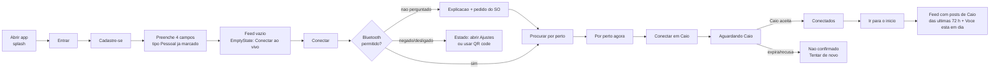
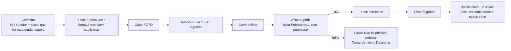
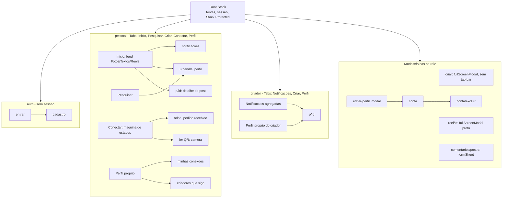
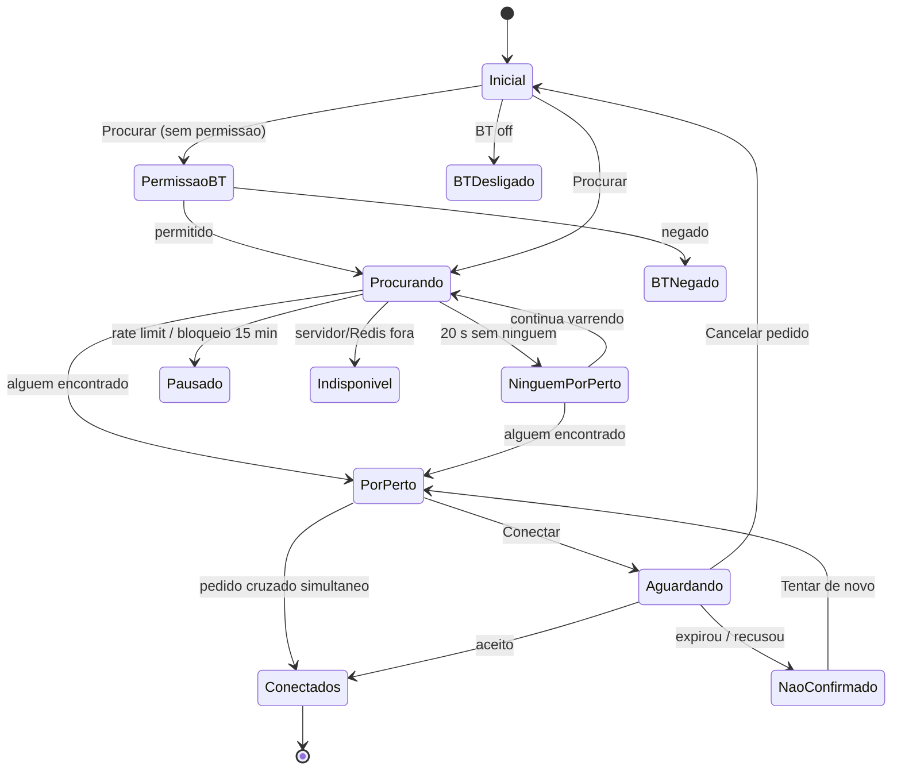

# UX/UI do Sussurro (v1)

> Autor: UX/UI Designer. Data: 2026-10-29. Status: proposta para revisão do PO.
> Entradas: `briefing.md` (seção 6 do PO = referência obrigatória), protótipo `docs/design/prototipo/p-01…p-22.png` + `texto-extraido.txt`, `arquitetura.md`, ADRs 0002–0005, 0008, 0011.
> Regra deste documento: o que está no protótipo é seguido como está; o que diverge da especificação ou do protótipo está marcado com **[DIVERGE]** e levado ao PO na seção 9.

## 0. Leitura do protótipo (correções e método)

**Mapa real das páginas** (o briefing diz "p02–03 abertura/splash", mas não são telas):

| Página | Conteúdo real |
|---|---|
| p01 | Entrar |
| **p02** | **Asset solto: avatar "HS" (fundo azul pastel)**. Não é splash. |
| **p03** | **Asset solto: ilustração de paisagem quadrada** (imagem de exemplo). Não é splash. |
| p04 | Marca (símbolo, versões, cores) |
| p05 | Cadastro |
| p06–p08 | Feed Fotos / Textos / Reels + "Você está em dia" |
| p09 | Notificações (pessoal) |
| p10–p14 | Conectar: inicial, procurando, por perto, aguardando, conectados |
| p15 | Pesquisar (com resultado) |
| p16 | Perfil pessoal próprio |
| p17 | Perfil de criador visto por pessoa |
| p18 / p20 | Criar (pessoal / criador), modo FOTO |
| p19 | Perfil do próprio criador |
| p21 | Notificações do criador (agregadas) |
| p22 | Conectar bloqueado para criador |

Consequência: **não existe splash desenhada**. Proposta na seção 4.1, derivada do painel azul de p04.

**Método de medição**: o frame do protótipo tem 390 pt de largura (iPhone 14/15); os PNGs têm 447 px. Fator **1,146 px/pt**. Exemplo de verificação: o avatar do perfil mede 98 px = 85,5 pt, e a especificação diz 86. Todas as medidas abaixo estão em pt (unidades do React Native), já convertidas e arredondadas para a grade de 2/4 pt. Medidas marcadas com "≈" devem ser conferidas no catálogo com sobreposição do PNG (seção 6.15).

**Não desenhado no protótipo** (este documento cobre): splash, comentários, detalhe do post, visualizador de reels, Criar em modo TEXTO e REEL, folha de pedido recebido, QR, permissões, editar perfil, conta/exclusão, listas próprias de conexões e criadores, perfil de uma conexão, curtida ativa, e todos os estados de carregamento/erro/vazio/offline.

---

## 1. Personas

| | **Helena, 34** (pessoal) | **Tomás, 21** (pessoal) | **Bia, 41** (criadora) |
|---|---|---|---|
| Contexto | Arquiteta, iPhone, cansada de feed algorítmico. Usa o app 2–3x ao dia, rápido. | Universitário, Android intermediário. Conhece gente em festas e eventos, ambiente barulhento, celular na mão por segundos. | Padeira com perfil de receitas. Publica 2–3x por semana pelo celular. |
| Objetivo | Ver o que amigos reais postaram e "acabar". | Adicionar alguém que acabou de conhecer em < 30 s, sem trocar @. | Publicar e saber que as pessoas estão vendo, sem métricas de vaidade. |
| Dores | Rolagem infinita, anúncios, ver gente que não conhece. | Bluetooth que "não acha", permissões confusas, constrangimento se demorar. | Upload que falha em 4G, não saber se o post foi publicado. |
| Implicações | Feed com fim claro ("Você está em dia"), padrões do Instagram. | Conectar com 1 toque para começar, plano B (QR) visível, mensagens de erro acionáveis, nada de "NFC" enganoso. | Progresso de upload persistente, estado "processando" explícito, notificações agregadas. |

## 2. Jornadas principais

### 2.1 Pessoa: cadastro → primeira conexão → feed (meta: ≤ 9 toques após o cadastro)



Pontos de atrito e resposta de design: permissão de Bluetooth pedida **só ao tocar "Procurar por perto"** (não no cadastro); quem é procurado também precisa estar com a tela aberta (microcopy na tela inicial do Conectar); QR sempre a 1 toque.

### 2.2 Pessoa B (quem recebe o pedido)
Tela Conectar aberta (qualquer estado) → folha "Helena quer se conectar" com avatar, nome e @ → **Aceitar** → "Vocês estão conectados". Se B não está com a tela aberta, o pedido não chega na v1 (polling só com a tela aberta, ADR 0003); com push (Fase 6), a notificação abre o Conectar.

### 2.3 Criadora: cadastro → primeira publicação → seguidores



Criador não tem Início nem Pesquisar; a aba inicial do criador é **Perfil** (recomendação: a primeira coisa que o criador quer ver é o próprio conteúdo; Notificações fica à esquerda como no protótipo p19/p21).

---

## 3. Mapa de telas e navegação (Expo Router)

### 3.1 Diagrama



### 3.2 Árvore de rotas proposta

```
src/app/
  _layout.tsx                  Root Stack: carrega fontes, providers, Stack.Protected por sessão e tipo de conta
  index.tsx                    redireciona: sem sessão → /entrar; personal → /(pessoal); creator → /(criador)
  +not-found.tsx
  (auth)/
    _layout.tsx                Stack sem header
    entrar.tsx                 p01
    cadastro.tsx               p05
    esqueci-senha.tsx          só se D6 = sim
  (pessoal)/
    _layout.tsx                Tabs com <BottomTabBar variant="personal">
    (inicio)/_layout.tsx       Stack
    (inicio)/index.tsx         Feed p06–p08
    (inicio)/notificacoes.tsx  p09 (tab bar visível; ver D-UX19)
    (pesquisar)/_layout.tsx
    (pesquisar)/index.tsx      p15
    criar-tab.tsx              aba "fantasma": tabPress → preventDefault + router.push('/criar')
    conectar.tsx               p10–p14 (uma tela, máquina de estados)
    (perfil)/_layout.tsx
    (perfil)/index.tsx         p16
    (perfil)/conexoes.tsx      lista própria (GET /me/connections)
    (perfil)/seguindo.tsx      lista própria (GET /me/following)
    (inicio,pesquisar,perfil)/u/[handle].tsx   perfil de outra conta (p17 e perfil de conexão)
    (inicio,pesquisar,perfil)/p/[id].tsx       detalhe do post
  (criador)/
    _layout.tsx                Tabs com <BottomTabBar variant="creator">, initialRouteName = perfil
    (notificacoes)/index.tsx   p21
    criar-tab.tsx              aba fantasma
    (perfil)/index.tsx         p19
    (notificacoes,perfil)/p/[id].tsx
  criar.tsx                    fullScreenModal: Nova publicação (p18/p20 + modos TEXTO e REEL)
  reel/[id].tsx                fullScreenModal, fundo preto (ReelViewer); query ?origem=feed|perfil:@handle
  comentarios/[postId].tsx     formSheet (detents 0.7 / 0.95)
  conectar/pedido/[id].tsx     formSheet (pedido recebido)
  conectar/ler-qr.tsx          fullScreenModal (câmera)
  editar-perfil.tsx            modal (pageSheet no iOS)
  conta/index.tsx              "Conta": e-mail, sair de todos os dispositivos, excluir conta
  conta/excluir.tsx            exclusão de conta
  c/[token].tsx                deep link do QR (sussurro://c/{token}) → /conectar?qr={token}
  dev/catalog.tsx              catálogo (só dev, seção 6.15)
```

Notas de implementação de navegação:
- **Tab bars diferentes**: dois grupos `(pessoal)` e `(criador)` com `Tabs` próprios, protegidos por `Stack.Protected guard={accountType === 'personal'}` e `guard={accountType === 'creator'}` na raiz. O tipo de conta vem do claim `acct` do JWT (imutável), então não há troca em tempo de execução.
- **Aba Criar** não é uma tela: abre o modal `criar` e a tab bar some (spec). A aba nunca fica "ativa".
- **Notificações do pessoal** (p09) é empilhada no Início, com tab bar visível; a aba Início fica com o ícone ativo (preenchido). O protótipo mostra nenhuma aba ativa; recomendo Início ativo para manter a regra "sempre sei onde estou". **[DIVERGE leve]**
- **Rotas compartilhadas** `(inicio,pesquisar,perfil)/u/[handle]` mantêm a aba de origem ativa (p17 mostra Pesquisar ativo: confere).
- Tocar na aba ativa: volta ao topo da pilha; se já está na raiz, rola para o topo (padrão Instagram).
- **Deep link do QR** `sussurro://c/{token}`: se a câmera do sistema ler o QR, o app abre o Conectar já com o token e inicia o fluxo QR (o próprio token do usuário precisa estar ativo, então a tela é aberta antes de enviar o pedido). Sem sessão: guarda o token, pede login e descarta se tiver passado de 30 s.
- Orientação: **somente retrato** (inclusive no ReelViewer, vídeos são verticais). Somente celular (`supportsTablet: false`). Tema: **somente claro** na v1 (`userInterfaceStyle: "light"`). Ver D-UX12.

### 3.3 Inventário de telas

| Tela | Origem | Fase | Observação |
|---|---|---|---|
| Splash | novo (p04) | 0 | `expo-splash-screen` |
| Entrar | p01 | 1 | sem "demo"; rótulo "E-mail" |
| Cadastro | p05 | 1 | aviso de tipo imutável, termos |
| Feed (3 abas) | p06–p08 | 2 (reels: 5) | |
| Detalhe do post | novo | 2 | |
| Comentários (folha) | novo (spec) | 2 | |
| Criar FOTO | p18/p20 | 2 | |
| Criar TEXTO | novo (spec) | 2 | |
| Criar REEL | novo | 5 | |
| Perfil próprio pessoal | p16 | 1 (abas: 2) | |
| Perfil próprio criador | p19 | 1 | |
| Editar perfil | novo | 1 (foto: 2) | |
| Conta / Excluir conta | novo | 1 | App Store 5.1.1(v) |
| Pesquisar | p15 | 3 | |
| Perfil de criador visto por pessoa | p17 | 3 | |
| Minhas conexões / Criadores que sigo | novo | 3 (conexões: 4) | listas só do dono |
| Perfil de uma conexão | novo | 4 | |
| Conectar (5 estados + erros) | p10–p14, p22 | 4 | |
| Pedido recebido (folha) | novo (spec) | 4 | |
| QR: meu código / ler código | novo | 4 | |
| Visualizador de reels | novo | 5 | |
| Notificações pessoal / criador | p09 / p21 | 6 | |
| Catálogo (dev) | novo | 0 | |

---

## 4. Wireframes das telas não desenhadas

Convenções: `[Botão]` primário azul, `(Botão)` secundário cinza, `‹link›` texto azul, `▢` imagem, `◯` avatar, `───` divisor hairline.

### 4.1 Splash (Fase 0)
```
┌──────────────────────────┐
│                          │  fundo #0066FF (blue)
│                          │
│           S•             │  <Logo variant="mark" tone="onBrand"> 96 pt
│                          │  arco 1 branco, arco 2 #B3D1FF, ponto branco
│                          │  (sem texto: o expo-splash-screen usa imagem estática)
└──────────────────────────┘
```
Transição: fade de 200 ms para Entrar ou Feed. Ícone do app: mesmo símbolo onBrand sobre quadrado azul (p04 "Ícone do app"); Android adaptive icon = símbolo no foreground, `#0066FF` no background.

### 4.2 Detalhe do post (`p/[id]`)
```
┌──────────────────────────┐
│ ‹  Publicação            │  ScreenHeader 52, voltar + título titleLg
├──────────────────────────┤
│ <PostPhoto> ou <PostText>│  mesmo componente do feed
│ ...                      │
│ ───────────────────────  │
│ Comentários (inline)     │  lista de comentários (mesma do CommentsSheet)
│ ◯ lucasf 2 h             │
│   Que luz bonita!        │
│   Responder              │
├──────────────────────────┤
│ ◯ Adicione um coment… Publicar │ composer fixo acima do teclado
└──────────────────────────┘
```
Entradas: notificação, grade do perfil, lista de textos do perfil, toque no texto de um PostText. Reel → abre `reel/[id]` em vez desta tela. Post apagado/sem acesso (404): EmptyState "Esta publicação não está mais disponível."

### 4.3 Comentários (folha, `comentarios/[postId]`)
```
┌──────────────────────────┐
│          ▬▬▬             │  grabber 36×5, #DBDBDB, topo 8
│       Comentários      ✕ │  16/700 centralizado; ✕ 44×44 (alternativa ao arrasto)
├──────────────────────────┤
│ ◯ lucasf · 2 h           │  avatar 32; @ 14/600; tempo 13 grey
│   Que luz bonita!        │  14/20
│   Responder              │  13/600 grey
│      ◯ marinac · 1 h     │  resposta: recuo 44
│        Obrigada!         │
├──────────────────────────┤
│ Respondendo a @lucasf  ✕ │  chip só no modo resposta (bodySm grey, fundo greySoft)
│ ◯ [Adicione um comentário…]  Publicar │  Publicar azul; desabilitado = blueMist
└──────────────────────────┘
```
Ações por comentário (pressão longa + `accessibilityActions`): "Responder"; "Excluir" se autor do comentário ou do post. Contador "x/500" aparece a partir de 450.

### 4.4 Visualizador de reels (`reel/[id]`)
```
┌──────────────────────────┐ fundo #000, vídeo 9:16 (cover)
│ ✕                    🔊  │ ✕ fechar; alternar som (44×44, ícones brancos com sombra)
│                          │
│           ▶              │ toque = pausar/retomar (ícone 64 aparece 600 ms)
│                       ♡  │ coluna direita: curtir 28 + nº
│                      12  │
│                       ◌  │ comentar 28 + nº → CommentsSheet
│                       3  │
│ ◯ @cozinhadabia · Criador│ 14/600 branco
│ Receita do pão de quinta…│ 2 linhas, "mais" expande
│ ━━━━━━━━━━──────────────  │ progresso 2 pt (branco / branco 30%)
└──────────────────────────┘
Fim do vídeo: para no último quadro, escurece 40% e mostra
          ( ↻ Assistir de novo )
Nada avança sozinho.
```
Arrastar para baixo fecha. Navegação para o reel seguinte: ver D-UX7 (recomendo **sem paginação na v1**: o visualizador abre um reel; volta-se à grade para escolher outro).

### 4.5 Criar: modo TEXTO e modo REEL
```
TEXTO                                   REEL
┌──────────────────────────┐            ┌──────────────────────────┐
│ ✕ Nova publicação Compartilhar│       │ ✕ Nova publicação Compartilhar│
├──────────────────────────┤            ├──────────────────────────┤
│ ◯ helena                 │            │   ▢ prévia 9:16 (altura   │
│   [No que você está      │            │     limitada, centralizada)│
│    pensando?]            │            │   0:42 · toque p/ assistir│
│   (multilinha, 15/22)    │            ├──────────────────────────┤
│                   12/280 │            │ ◯ Escreva uma legenda…    │
│                          │            ├──────────────────────────┤
│ Para suas 4 conexões     │            │ Vídeos      Para suas 4 conexões│
│                          │            │ ▢0:42 ▢0:18 ▢1:35 ▢0:12  │ grade 4 col, só vídeos;
│                          │            │ (vídeo > 90 s: esmaecido, │ seleção única
│   ( FOTO  TEXTO  REEL )  │            │  "Até 90 s")              │
└──────────────────────────┘            └──( FOTO  TEXTO  REEL )────┘
```
Contador: grey até 260, preto 261–279, `danger` acima de 280 com Compartilhar desabilitado (o servidor conta code points; o app também). "Compartilhar" desabilitado = texto blueMist + `accessibilityState.disabled`.
Sair com conteúdo: Alert "Descartar publicação?" [Descartar] [Continuar editando].

### 4.6 Editar perfil (`editar-perfil`)
```
┌──────────────────────────┐
│ Cancelar  Editar perfil  Concluir │ Concluir azul 15/600; desabilitado sem mudanças
├──────────────────────────┤
│          ◯ 86            │
│     ‹Alterar foto›       │ Fase 2 (folha: Escolher da galeria / Remover foto)
│ Nome                     │
│ [Helena Souza      ]     │ 1–60
│ Nome de usuário          │
│ helena                   │ somente leitura (grey), helper "Não dá para mudar na v1."
│ Bio                      │
│ [Arquiteta. Café coado…] │ multilinha, contador x/150
│ Tipo de conta            │
│ Conta pessoal            │ somente leitura
├──────────────────────────┤
│ ‹Conta e segurança›    › │ → conta/index
└──────────────────────────┘
```

### 4.7 Conta (`conta/index`) e Excluir conta (`conta/excluir`)
```
┌──────────────────────────┐   ┌──────────────────────────┐
│ ‹  Conta                 │   │ ‹  Excluir conta         │
├──────────────────────────┤   ├──────────────────────────┤
│ E-mail                   │   │ Isso apaga sua conta para│
│ helena@exemplo.com       │   │ sempre:                  │
│ ───────────────────────  │   │ • publicações, curtidas e│
│ Sair deste dispositivo   │   │   comentários            │
│ Sair de todos os         │   │ • suas conexões (ou      │
│ dispositivos             │   │   seguidores)            │
│ ───────────────────────  │   │ • sua foto e seus dados  │
│ Termos de uso          › │   │ Some do app na hora; os  │
│ Política de privacidade› │   │ dados são apagados em até│
│ ───────────────────────  │   │ 30 dias.                 │
│ Excluir conta            │   │ Senha                    │
│ (texto danger)           │   │ [••••••••          ]     │
└──────────────────────────┘   │ [ Excluir minha conta ]  │ Button variant=destructive
                               └──────────────────────────┘
```
Depois do botão: Alert de confirmação final ("Excluir conta? Não dá para desfazer." [Cancelar] [Excluir]). Sucesso: volta para Entrar com Toast "Sua conta foi excluída." Pedir a senha exige que `DELETE /me` aceite `{password}` (a combinar com o Arquiteto). "Sair" no cabeçalho do perfil (ícone) também pede confirmação: "Sair da conta?".

(atualizado na Fase 6) Entre "Sair de todos os dispositivos" e "Contas bloqueadas" entrou a linha **"Notificações neste celular"** com um `Switch` e, abaixo, `bodySm` grey: "Curtidas, comentários, respostas e conexões. O texto dos comentários não aparece no aviso." (criador: "…respostas e novos seguidores."). Ligar pede a permissão do sistema (ou, negada de vez, Alert "Notificações bloqueadas" / "Permita as notificações do Sussurro nos Ajustes do celular." [Agora não] [Abrir Ajustes]); desligar apaga o token deste aparelho no servidor. Sem rede: Toast de erro e o `Switch` volta. É o único lugar para ligar de novo depois de "Agora não" (o pedido contextual não volta).

### 4.8 Minhas conexões / Criadores que sigo (só o dono)
```
┌──────────────────────────┐
│ ‹  Conexões              │
├──────────────────────────┤
│ Só você vê esta lista.   │ bodySm grey, ícone cadeado 16
│ ◯ caio.r                 │ UserRow: avatar 44, @ 14/600, nome 14 grey
│   Caio Ribeiro · desde 27 out │
│ ◯ bia.alves          ··· │ "···" → Desfazer conexão (se D8 = sim)
└──────────────────────────┘
```
"Criadores que sigo": mesma linha com `(Seguindo)` à direita (toque → deixar de seguir, com Alert). Vazio: EmptyState com ação ("Conectar ao vivo" / "Pesquisar criadores").

### 4.9 Perfil de uma conexão (pessoal visto por conexão)
Igual a p16 sem os ícones Criar/Sair, com `‹` e o @ no header, sem a nota de privacidade, números **não tocáveis** (a lista é privada), e um único botão `(Conectados ✓)` largura total. Toque em "Conectados" → folha de ações: "Desfazer conexão" (danger, se D8 = sim), "Cancelar". Pessoa não conectada (404 do servidor) → EmptyState "Perfil indisponível · Contas pessoais só aparecem para as conexões delas."

### 4.10 Conectar: seletor e QR (proposta para D3: "Bluetooth | QR code")
```
INICIAL (p10 com seletor novo)          QR: MEU CÓDIGO
┌──────────────────────────┐            ┌──────────────────────────┐
│ Conectar                 │            │ Conectar                 │
│ Conexões só acontecem ao │            │ [ Bluetooth | QR code ]  │
│ vivo… As duas pessoas    │            │                          │
│ precisam confirmar.      │            │   ┌────────────────┐     │
│ [ Bluetooth | QR code ]  │            │   │  ▓▓ QR 240 ▓▓  │     │ QR preto em card branco,
│      ((  Procurar  ))    │            │   │     (S• no centro)│   │ borda border, raio 16
│      ((  por perto ))    │            │   └────────────────┘     │
│ Fiquem a poucos metros,  │            │   ◯ helena               │
│ os dois com esta tela    │            │ Peça para a outra pessoa │
│ aberta.                  │            │ ler este código.         │
└──────────────────────────┘            │ [ Ler o código dela ]    │ → conectar/ler-qr
                                        └──────────────────────────┘
```
O QR se renova a cada 20 s sem piscar (troca com fade de 150 ms). Brilho da tela não é alterado.

**Fluxo QR cruzado (recomendado, D7)**:
1. A toca "Ler o código dela" e lê o QR de B → A vê "Aguardando Bia confirmar", e **o próprio QR de A aparece nessa tela** com o texto "Bia precisa ler este código para confirmar".
2. B (com a tela Conectar aberta) recebe a folha "Helena quer se conectar" com `[Ler código para aceitar]` e `(Recusar)`.
3. B lê o QR de A → conectados nos dois aparelhos.

### 4.11 Pedido recebido (folha, `conectar/pedido/[id]`)
```
┌──────────────────────────┐
│          ▬▬▬             │
│          ◯ 64            │
│   Helena quer se conectar│ titleMd
│   @helena · Helena Souza │ bodySm grey
│ Confirme só se a Helena  │ bodySm grey, centro
│ estiver aí com você.     │
│ [        Aceitar       ] │ lg (QR: "Ler código para aceitar")
│ (        Recusar       ) │ lg secundário
│ Expira em 1:45           │ caption grey; não é anunciado a cada segundo
└──────────────────────────┘
```
Haptic de notificação ao abrir. Vários pedidos: um por vez, em fila. Fecha sozinha ao expirar, com Toast "O pedido da Helena expirou."

### 4.12 Permissões (estados inline, não rotas)
```
BLUETOOTH: EXPLICAÇÃO (antes do diálogo do SO)
┌──────────────────────────┐
│ Conectar                 │
│        (ícone bluetooth) │ EmptyState
│  Permitir o Bluetooth    │
│ O Sussurro usa o Bluetooth para achar quem está com esta
│ tela aberta perto de você. Ninguém vê sua localização, e
│ nada é transmitido com o app fechado.
│ [      Continuar       ] │ → diálogo do sistema
│ ‹Usar QR code›           │
└──────────────────────────┘
```
| Estado | Título | Texto | Ações |
|---|---|---|---|
| Bluetooth negado | Bluetooth sem permissão | Para achar pessoas por perto, permita o Bluetooth nos Ajustes. | [Abrir Ajustes] ‹Usar QR code› |
| Bluetooth desligado | O Bluetooth está desligado | Ligue o Bluetooth para procurar quem está por perto. | [Abrir Ajustes] (Android: [Ligar Bluetooth]) ‹Usar QR code› |
| Aparelho não anuncia (Android) | Seu celular não consegue ser encontrado | Você ainda acha outras pessoas, mas elas não acham você. Use o QR code para garantir. | [Usar QR code] (Procurar mesmo assim) |
| Câmera: explicação | Ler o código da outra pessoa | A câmera é usada só para ler o QR code. | [Continuar] |
| Câmera negada | Câmera sem permissão | Permita a câmera nos Ajustes ou peça para a outra pessoa ler o seu código. | [Abrir Ajustes] ‹Mostrar meu código› |
| Fotos: sem acesso (Criar) | Escolha o que compartilhar | Permita o acesso às fotos para ver as recentes aqui. | [Permitir acesso] ‹Escolher fotos› (seletor do sistema, sem permissão) |
| Fotos: acesso limitado (iOS) | faixa no topo da grade | "Você deu acesso a algumas fotos." ‹Gerenciar› | |
| Notificações (Fase 6) | pedido contextual após a 1ª conexão ou 1º post | "Quer saber quando alguém curtir ou comentar?" | [Ativar] (Agora não) |

(atualizado na Fase 6) O pedido de notificações é um Alert nativo (como as confirmações), uns 800 ms depois do "Publicado." ou do "Vocês estão conectados", com o texto "Avisamos neste celular quando alguém curtir, comentar ou se conectar com você. Dá para desligar em Conta." (criador: "…curtir ou comentar e quando chegarem novos seguidores…"). Aparece **uma vez por conta neste aparelho**: "Agora não" ou a recusa no diálogo do sistema não são perguntadas de novo; com a permissão já negada de vez, nem aparece. "Ativar" sem conseguir o token: Toast "Não foi possível ativar as notificações agora. Tente de novo em Conta."

---

## 5. Estados

### 5.1 Matriz por tela

| Tela | Carregando | Vazio | Erro / offline | Específicos |
|---|---|---|---|---|
| Entrar | botão `loading` | n/a | inline sob o form: "E-mail ou senha incorretos." · 429: "Muitas tentativas. Tente de novo em 1 minuto." · offline: Toast | sessão expirada: Toast "Sua sessão expirou. Entre de novo." |
| Cadastro | botão `loading` | n/a | erros por campo (e-mail inválido/em uso, @ inválido/em uso, senha < 8) · 429: "Muitos cadastros desta rede. Tente mais tarde." | |
| Feed (cada aba) | 3 skeletons do item | **sem conexões e sem criadores**: EmptyState "Seu início está vazio" + [Conectar ao vivo] ‹Pesquisar criadores› · **sem posts na janela**: só o CaughtUp | primeira página falhou: EmptyState "Não foi possível carregar" [Tentar de novo] · páginas seguintes: linha "Não carregou. ‹Tentar de novo›" acima do fim · offline: OfflineBanner + conteúdo em cache | faixa de upload no topo (5.3); pull-to-refresh |
| Detalhe do post | skeleton | n/a | 404: "Esta publicação não está mais disponível." | |
| Comentários | 3 skeletons | "Ainda não há comentários. Comece a conversa." | lista: [Tentar de novo] · envio: item com "Não publicado. ‹Tentar de novo›" | enviando: item 50% opacidade |
| Pesquisar | spinner 20 no fim da barra | inicial: nada (sem sugestões, spec), só dica "Digite o @ de um criador." · 1–2 caracteres: "Digite pelo menos 3 letras." · sem resultado: "Nenhum criador com esse @. Contas pessoais não aparecem na busca: elas só se conectam ao vivo." | Toast/linha de erro | ver D-UX5 (não dá para saber se o @ é de conta pessoal) |
| Perfil (próprio/outro) | skeleton do header + grade | abas vazias: próprio "Compartilhe sua primeira foto" [Nova publicação]; outro "Nenhuma foto ainda." | 404 = "Perfil indisponível" | Seguir/Seguindo: otimista, rollback + Toast |
| Listas próprias | skeleton de linhas | EmptyState com ação | [Tentar de novo] | |
| Criar | — | grade sem fotos: "Nenhuma foto no aparelho." | ver permissões (4.12) | upload: 5.3 |
| Notificações | skeleton | "Nada por aqui ainda. Quando alguém curtir ou comentar, aparece aqui." | [Tentar de novo] | fim: "Isso é tudo por enquanto." (p09) |
| ReelViewer | spinner sobre o poster | n/a | "Não foi possível reproduzir este reel." [Tentar de novo] | processando (só autor): "Seu reel está sendo processado. Isso leva alguns minutos." |
| Conectar | — | 5.2 | 5.2 | 5.2 |

Regra geral de erro: mensagem humana + ação. Nunca mostrar `code` técnico na UI; o `code` vai para o Sentry. Erros sem ação na tela → Toast de erro.

### 5.2 Conectar: máquina de estados



| Estado | Wireframe / texto | Ações |
|---|---|---|
| Procurando (p11) | radar + "Procurando por perto…" "Mantenha o app aberto" | (Cancelar) |
| **Ninguém por perto** (após 20 s; o radar continua) | "Ninguém por perto ainda" · "Peça para a outra pessoa abrir a tela Conectar. Se não aparecer, usem o QR code." | [Usar QR code] (Cancelar) |
| Por perto (p12) | lista ao vivo, ordenada por sinal; rótulo de faixa (D-UX2) | `[Conectar]` por linha; já conectado: rótulo grey "Conectados" no lugar do botão |
| Aguardando (p13) | "Aguardando Caio confirmar" | (Cancelar pedido) |
| **Não confirmado** (expirou ou recusou, sem diferenciar) | par de avatares com o tracejado em grey · "Caio não confirmou" · "O pedido vale por 2 minutos. Vocês podem tentar de novo." | [Tentar de novo] ‹Voltar› |
| Conectados (p14) | p14 | [Ir para o início] ‹Conectar outra pessoa› |
| **Já conectados** (409) | Toast "Vocês já estão conectados." | |
| **Pedido não pode ser enviado** (cooldown pós-recusa, token inválido) | Toast "Não foi possível enviar o pedido agora. Tente mais tarde." (não revela recusa) | |
| **Token de proximidade expirado** | invisível ao usuário: o app renova a cada 20 s. Se o token de B saiu do ar entre o "por perto" e o toque: linha some da lista + Toast "Caio saiu de perto. Procure de novo." | |
| **Pausado (rate limit)** | EmptyState ícone relógio · "Muitas tentativas" · "Você poderá procurar de novo em alguns minutos." | ‹Usar QR code› também fica pausado (mesmo limite) |
| **Indisponível** (Redis fora, fail-closed) | "Conectar está indisponível agora" · "Tente de novo em instantes." | [Tentar de novo] |
| Offline | "Sem internet" · "Conectar precisa de internet para confirmar quem é quem." | [Tentar de novo] |
| Criador (p22) | p22 | [Voltar ao perfil] |

Com a tela Conectar procurando ou aguardando: **manter a tela acesa** (`expo-keep-awake`); ao sair da tela ou ir para background, parar anúncio/varredura e voltar ao Inicial.

### 5.3 Upload e processamento

```
Faixa de publicação (topo do feed e do perfil próprio; criador: topo do perfil)
┌──────────────────────────┐
│ ▢ Publicando… 2 de 3     │ thumb 40, bodySm, ProgressBar 2 pt azul abaixo (determinada)
│ ━━━━━━━━━━━━──────────── │
└──────────────────────────┘
│ ▢ Processando o reel…    │ indeterminada (após upload, aguardando MediaConvert)
│ ▢ Não foi possível publicar.  ‹Tentar de novo›  ✕ │ falha: ícone alerta danger; ✕ = descartar (Alert)
```
- Sucesso: a faixa some e aparece Toast "Publicado." O post aparece no topo do próprio perfil (e no feed, se D9 = sim).
- Sair do app durante o upload: o upload continua enquanto o SO permitir; ao voltar, se o rascunho falhou, a faixa de falha aparece. Rascunhos órfãos são apagados pelo servidor em 24 h (arquitetura §5): o texto "Tentar de novo" some depois disso.
- Reel processando na grade do autor: `ReelTile status="processing"`. Outras pessoas não veem até `published`.
- Offline no Compartilhar: mantém o modal aberto, Toast "Sem internet. Sua publicação não foi enviada." (sem fila offline na v1).

### 5.4 Globais
| Situação | Comportamento |
|---|---|
| Offline | `OfflineBanner` fino sob o header: "Sem internet" (fundo ink, texto branco 13/600), aparece após 2 s sem rede, some com "Conectado" por 1,5 s. Ações que dependem de rede ficam habilitadas e falham com Toast (não desabilitar tudo). |
| Access token expirado | refresh silencioso (single-flight). Usuário não vê nada. |
| Refresh inválido/revogado | volta para Entrar + Toast "Sua sessão expirou. Entre de novo." Preserva o e-mail digitado. |
| 429 genérico | Toast "Muitas tentativas. Espere um pouco e tente de novo." |
| 5xx / timeout | Toast "Algo deu errado do nosso lado. Tente de novo." |
| 403 `ACCOUNT_TYPE_NOT_ALLOWED` | não deve acontecer pela UI; se acontecer: Toast "Essa ação não está disponível para o seu tipo de conta." |
| Curtir offline/falha | otimista; rollback do coração + Toast "Não foi possível curtir." |

---

## 6. Design system (`packages/ui`)

Princípios: componentes **apresentacionais** (recebem props simples, não tipos da API; o mapeamento fica no app), sem dependência de `packages/shared`. Dependências permitidas: `react-native-svg`, `expo-image`, `expo-video` (só ReelViewer), `react-native-reanimated`, `lucide-react-native`.

### 6.1 Cores: tokens do PO (inalterados)

| Token | Hex | Uso |
|---|---|---|
| `blue` | #0066FF | ações, curtida ativa, seleção, links |
| `blueMid` | #4D94FF | 2º arco do logo, anéis do radar |
| `blueMist` | #B3D1FF | arco sobre azul, estado desabilitado do primário/link, anéis externos |
| `blueLight` | #E5EFFF | fundos (avatar agregado "+N", seleção suave) |
| `black` | #000000 | texto principal, ícones |
| `grey` | #737373 | texto de apoio |
| `greySoft` | #EFEFEF | botões neutros, barra de busca, prévias vazias |
| `border` | #DBDBDB | divisores, bordas de campo, pontos inativos |
| `white` | #FFFFFF | fundo |

### 6.2 Cores: extensões (novas, justificadas)

| Token | Valor | Por quê |
|---|---|---|
| `bluePressed` | #0052CC | estado pressionado do primário (branco sobre ele: 6,6:1) |
| `greyStrong` | #666666 | texto/placeholder/ícone **sobre greySoft** (grey sobre greySoft = 4,12:1, falha; greyStrong = 4,99:1) |
| `field` | #FAFAFA | fundo dos campos de Entrar/Cadastro/Editar (p01/p05 mostram campo mais claro que o greySoft, com borda) |
| `ink` | #262626 | pílula FOTO/TEXTO/REEL, Toast, OfflineBanner |
| `inkMuted` | #A8A8A8 | texto inativo sobre `ink` (6,4:1) |
| `danger` | #D32F2F | erro de campo, "Excluir conta", falha de upload (4,98:1 no branco). A spec não tem cor de erro; uso mínimo, só texto/ícone. |
| `overlay` | rgba(0,0,0,0.4) | fundo atrás de folhas e Alerts |
| `mediaChip` | rgba(0,0,0,0.7) | contador "1/3" e afins sobre imagem |
| `mediaScrim` | gradiente rgba(0,0,0,0) → rgba(0,0,0,0.45), 40% inferior | legibilidade de duração do reel e textos sobre vídeo |
| `skeleton` | #EFEFEF (= greySoft) com pulso de opacidade 1 → 0,6 | carregamento |

### 6.3 Fundos pastel dos avatares

Medidos no protótipo (aproximados ao hex mais limpo):

| Token | Hex | Visto em |
|---|---|---|
| `avatar.lilac` | #D9D1FF | JP, CM |
| `avatar.mint` | #C2EFD4 | TO, RD |
| `avatar.peach` | #FFD3BF | MC, BL |
| `avatar.sky` | #B5E8F7 | LF, EA |
| `avatar.periwinkle` | #C4D6FF | HS, CR |
| `avatar.butter` | #FFE3A3 | BA |

Texto das iniciais: `black`, 600. Contraste mínimo do conjunto: 14,4:1 (periwinkle).

**Regra determinística**: `índice = fnv1a32(userId) mod 6`, na ordem da tabela. Usar o **`userId` (UUID)** e não o handle: o handle pode vir a ser editável e a cor mudaria. Quando só houver o handle (ex.: fixture do catálogo), usar o handle. FNV-1a 32 bits sobre os bytes UTF-8 da string em minúsculas (offset 2166136261, primo 16777619, aritmética `Math.imul` + `>>> 0`). A função fica em `packages/ui/avatar/color.ts` e tem teste de snapshot com 10 ids fixos.
**Iniciais**: primeira letra da primeira e da última palavra do `name` (maiúsculas, mantém acento: "Érica Lima" → "ÉL"); nome com uma palavra → 1 letra; sem nome → 2 primeiros caracteres alfanuméricos do handle.
**Exceção**: avatar agregado "+N" (notificação de seguidores, p21) usa `blueLight` e texto `black`.

### 6.4 Tipografia (Inter), medida no protótipo

| Token | Tamanho/entrelinha | Peso | Uso (página) |
|---|---|---|---|
| `titleLg` | 20/26 | 700 | título de tela ("Conectar", "Notificações"), @ no header do perfil, "Você e Caio estão conectados" (p09–p16) |
| `titleMd` | 18/24 | 700 | títulos de estado ("Aguardando Caio confirmar", "Indisponível para criadores", EmptyState) |
| `titleSm` | 16/22 | 700 | seções ("Hoje", "Por perto agora", "Recentes"), "Você está em dia", título de folha |
| `stat` | 17/22 | 700 | números do StatsRow |
| `bodyLg` | 16/22 | 400 | texto em campos, placeholders |
| `body` | 15/22 | 400 | texto de post (thread), legenda, bio, notificações |
| `bodyStrong` | 15/22 | 600 | @ em posts e linhas, nome no perfil |
| `bodySm` | 14/20 | 400 | apoio em grey, subtítulos, "Ver todos os N comentários", rótulos do StatsRow |
| `bodySmStrong` | 14/20 | 600 | "N curtidas", @ em comentários |
| `caption` | 13/18 | 400 | horários ("40 min", "Há 18 minutos"), "Conexão"/"Criador", helper de campo |
| `micro` | 12/16 | 600 | contador "1/2", duração do reel, badges |
| `button` | 16/20 | 600 | Button lg |
| `buttonSm` | 14/18 | 600 | Button sm, links de ação |
| `tab` | 15/20 | 600 | TopTabs de texto |

Letter-spacing: 0 em tudo, exceto `titleLg` −0,2. Rótulo "OU" (p01): `caption` 600 grey, letter-spacing 0,5.
Iniciais do Avatar: `fontSize = round(size × 0,36)`, 600, sem escala de fonte do sistema.
Números: `fontVariant: ['tabular-nums']` em contadores e durações.

### 6.5 Fontes: carregamento e regra de uso

| Família | Pesos | Pacote | Uso |
|---|---|---|---|
| Inter | 400, 600, 700 | `@expo-google-fonts/inter` (`Inter_400Regular`, `Inter_600SemiBold`, `Inter_700Bold`) | toda a interface |
| Bricolage Grotesque | 800 | `@expo-google-fonts/bricolage-grotesque` (`BricolageGrotesque_800ExtraBold`) | **somente** o wordmark "sussurro", minúsculo, no `<Logo variant="lockup">` |

- Embutir no build pelo **config plugin do `expo-font`** (`plugins: [["expo-font", { fonts: [...] }]]`), já que o app é dev build: sem carregamento assíncrono e sem flash de fonte. `useFonts` só como fallback.
- **No Android, `fontWeight` não escolhe o arquivo da fonte personalizada**: o tema mapeia cada peso para um `fontFamily` próprio (`Inter_600SemiBold` etc.) e os componentes nunca usam `fontWeight` sozinho. O componente `<Text variant="body">` do `packages/ui` resolve isso.
- Opcional (recomendado depois da Fase 0): converter o wordmark em **path SVG** a partir do Bricolage 800, o que remove a fonte do bundle e garante o desenho igual em toda plataforma. Na Fase 0, usar a fonte.
- Proibido: Bricolage em qualquer outro texto; maiúsculas no wordmark.

### 6.6 Espaçamento e layout

Escala (pt): `0, 2, 4, 6, 8, 12, 16, 20, 24, 32, 40, 48, 64` → tokens `space.0 … space.64` (nome = valor).

| Constante | Valor | Origem |
|---|---|---|
| `screenX` | 16 | margem lateral das telas do app (p06–p22) |
| `authX` | 32 | margem lateral de Entrar/Cadastro (p01/p05) |
| `fieldGap` | 8 | entre campos (p01) |
| `headerHeight` | 52 | header de tela (abaixo do safe area) |
| `topTabsHeight` | 44 | Fotos/Textos/Reels e abas do perfil |
| `bottomBarHeight` | 50 | + `insets.bottom` |
| `postHeaderHeight` | 56 | cabeçalho do PostPhoto |
| `actionsRowHeight` | 44 | coração/comentário/pontos |
| `rowMinHeight` | 64 | UserRow, notificação |
| `gridGap` | 2 | grades do perfil e de reels (≈1,75 medido) |
| `hitMin` | 44 | alvo mínimo de toque |

Proporções de mídia: post de foto **4:5**; tile de foto no perfil **3:4**; tile de reel **9:16**; grade do Criar **1:1**, 4 colunas.

### 6.7 Raios

| Token | Valor | Uso |
|---|---|---|
| `radius.sm` | 6 | miniaturas (notificação, faixa de upload), chips |
| `radius.md` | 10 | Button sm, SearchBar, SegmentedControl |
| `radius.lg` | 12 | Button lg, Input, Toast |
| `radius.xl` | 16 | cards (QR, catálogo) |
| `radius.sheet` | 20 | topo de folhas inferiores |
| `radius.full` | 9999 | avatares, pílulas, contador "1/2" |

### 6.8 Tamanhos

| Grupo | Valores |
|---|---|
| Avatar | `xs 24` (tab bar) · `sm 32` (post, comentário, legenda do Criar) · `md 36` (thread de textos) · `lg 44` (notificação, listas) · `xl 48` (busca, Por perto) · `2xl 64` (radar, aguardando, pedido) · `3xl 72` (conectados, p14) · `profile 86` |
| Ícones | 24 (padrão: barras, ações de post, header), 20 (ações do PostText, lupa da busca 18), 28 (ReelViewer, EmptyState), 16 (inline em texto) |
| Traço de ícone | 2 (inativo), 2,75 (ativo "mais grosso") |
| Botões | `lg` minHeight 44 · `sm` minHeight 34 (p12, p15, p16) |
| Campos | Input minHeight 46 · SearchBar minHeight 36 |
| Anel do avatar ativo | avatar 24 + folga 2 + traço 1,5 `black` = 31 total |
| Ponto de não lido | 8, `blue`, borda 1,5 branca, canto superior direito do coração |
| Indicadores | sublinhado TopTabs 2 · pontos do carrossel 6 (gap 4) · ProgressBar 2 |
| Botão "Procurar por perto" | 160 de diâmetro; anéis 196 e 252 (p10) |

### 6.9 Sombras (uso mínimo)
Usar a prop `boxShadow` (RN 0.76+, New Architecture), que vale para iOS e Android:

| Token | Valor | Uso |
|---|---|---|
| `shadow.sm` | `0 1px 3px rgba(0,0,0,0.10)` | segmento selecionado, setas do carrossel |
| `shadow.md` | `0 4px 12px rgba(0,0,0,0.15)` | Toast, pílula FOTO/TEXTO/REEL |
| `shadow.sheet` | `0 -2px 16px rgba(0,0,0,0.12)` | folhas (se não forem nativas) |
| `shadow.icon` | `0 1px 2px rgba(0,0,0,0.5)` | ícones brancos sobre vídeo/imagem |

### 6.10 Movimento

| Token | Duração | Uso |
|---|---|---|
| `motion.fast` | 120 ms | feedback de toque (opacidade 0,7 em ícones; cor em botões) |
| `motion.base` | 200 ms | sublinhado das abas, fades, troca do QR (150) |
| `motion.slow` | 300 ms | Toast entrar/sair, faixa de upload |
| `motion.heart` | 300 ms | "pop" do coração (escala 1 → 1,2 → 1) |
| `motion.radarCycle` | 2400 ms | anéis do radar (3 anéis, defasagem 800 ms, escala 0,6 → 1,4, opacidade 0,6 → 0) |
| `motion.toastVisible` | 4000 ms (6000 com ação) | |
| Easing | `Easing.bezier(0.2, 0, 0, 1)` | padrão |

Com **Reduzir movimento** ligado (`useReducedMotion` do Reanimated): durações viram 0 (exceto opacidade ≤ 150 ms), radar fica estático (2 anéis fixos em blueMist + texto "Procurando…" com reticências estáticas), sem "pop" do coração, sem pulso do skeleton.

### 6.11 Ícones

**Recomendação: `lucide-react-native`** (usa `react-native-svg`, importação por ícone, traço configurável, ISC).

| Opção | Contorno + ativo | Fidelidade ao protótipo | Veredito |
|---|---|---|---|
| **lucide-react-native** | contorno; ativo por `strokeWidth` 2,75 ou `fill` | **alta**: os ícones do protótipo são do estilo Lucide (traço 2, pontas redondas: `radio`, `square-plus`, `log-out`, `lock`, `image`) | **escolhida**, + 1 SVG próprio |
| phosphor-react-native | pesos `regular`/`bold`/`fill` nativos para todos | média: traço mais fino no regular, geometria diferente | boa alternativa se o PO preferir estados ativos "de fábrica" |
| @expo/vector-icons (Ionicons) | pares `home`/`home-outline` | baixa (estilo iOS), baseado em fonte, não SVG | não |
| Tabler | contorno + alguns preenchidos | média | não (cobertura de preenchidos incompleta) |

Ativo no estilo Instagram com Lucide: `heart` aceita `fill` sem problema; `search` usa traço 2,75; **`house` preenchido precisa de SVG próprio** (com `fill` o traço da porta some sobre o preenchimento). Os SVGs próprios ficam em `packages/ui/icons/` com a mesma interface `{size, color, strokeWidth}`.

| Lugar | Inativo | Ativo |
|---|---|---|
| Tab Início | `house` | `HouseFill` (próprio: casa preenchida com porta vazada) |
| Tab Pesquisar | `search` | `search` traço 2,75 |
| Tab Criar | `square-plus` | (nunca ativo) |
| Tab Conectar | `radio` | `radio` traço 2,75 em `blue` (p10–p14; ver D-UX8) |
| Tab Perfil | Avatar 24 | Avatar 24 com anel |
| Tab Notificações (criador) | `heart` | `heart` com `fill` black (p21) |
| Header do feed | `heart` + ponto azul | |
| Header do perfil próprio | `square-plus` (Criar), `log-out` (Sair) | |
| Voltar / fechar | `chevron-left` / `x` | |
| Post: curtir | `heart` | `heart` fill `blue`, traço `blue` |
| Post: comentar | `message-circle` | |
| Post: mais opções | `ellipsis` | |
| Carrossel | `chevron-left` / `chevron-right` (16 em círculo branco 28) | |
| Abas do perfil | `grid-3x3`, `align-left`, `square-play` (grey) | mesmos em `black` + sublinhado |
| Tile com várias fotos | `copy` 16 branco com `shadow.icon` | |
| Duração do reel | `play` 12 fill branco | |
| ReelViewer | `x`, `volume-2`/`volume-x`, `play`, `rotate-ccw` | |
| Prévia vazia do Criar | `image` 40 greyStrong | |
| Conectar | `radio` (botão central), `bluetooth`, `bluetooth-off`, `qr-code`, `scan-line`, `camera`, `clock` (pausado), `lock` (p22) | |
| Estados | `check` (CaughtUp, conectados), `circle-alert` (erro), `wifi-off` (offline), `refresh-cw` (tentar de novo), `trash-2` (excluir) | |
| Busca | `search` 18, `circle-x` (limpar) | |
| Senha | `eye` / `eye-off` | |

### 6.12 Logo

SVG exato (viewBox 0 0 64 64, `stroke-width` 8, `stroke-linecap="round"`, `fill="none"` nos arcos):

```svg
<svg viewBox="0 0 64 64" xmlns="http://www.w3.org/2000/svg">
  <path d="M42.34 18.24 A11 11 0 1 0 24.22 29.78" stroke="#0066FF" stroke-width="8" stroke-linecap="round" fill="none"/>
  <path d="M21.66 45.76 A11 11 0 1 0 39.78 34.22" stroke="#4D94FF" stroke-width="8" stroke-linecap="round" fill="none"/>
  <circle cx="32" cy="32" r="3" fill="#000000"/>
</svg>
```

| Prop | Tipo | Padrão | Descrição |
|---|---|---|---|
| `variant` | `'mark' \| 'lockup'` | `'mark'` | só o símbolo, ou símbolo + "sussurro" |
| `tone` | `'default' \| 'onBrand'` | `'default'` | `onBrand` = sobre azul ou preto: arco 1 `#FFFFFF`, arco 2 `#B3D1FF`, ponto `#FFFFFF`, wordmark branco |
| `size` | number | 32 | altura do símbolo em pt |
| `accessibilityLabel` | string | "Sussurro" | |

- Lockup: wordmark em Bricolage 800 com `fontSize ≈ size × 0,95`, letter-spacing −2%, gap símbolo→texto `size × 0,25`, alinhado verticalmente ao centro óptico (ajustar no catálogo contra p04/p06). Wordmark `black` (default) ou `white` (onBrand).
- Usos: header do feed = lockup, `size` 24 (p06); Entrar/Cadastro = mark 64 (p01) **empilhado** com o wordmark 40 pt centralizado embaixo (prop `layout: 'row' | 'stacked'`, padrão `row`); splash e ícone = mark onBrand.
- Tamanho mínimo do mark: 16 pt (p04 "Tamanhos reduzidos"). Abaixo de 20 pt, manter o traço 8 (a proporção já garante legibilidade).
- a11y: `accessibilityRole="image"`; no header do feed, o lockup é o título da tela (`accessibilityRole="header"`, label "Sussurro, início").

### 6.13 Componentes da lista do PO

Regras comuns: todo componente aceita `testID`; todo elemento tocável tem `accessibilityRole`, `accessibilityLabel` em português e alvo ≥ 44 (usar `hitSlop` quando o visual for menor); alturas são `minHeight` (crescem com a fonte do sistema); estado pressionado via `Pressable` com feedback em `motion.fast`.

#### Avatar
| | |
|---|---|
| Props | `size: 24\|32\|36\|44\|48\|64\|72\|86`; `name?: string`; `handle: string`; `seed?: string` (userId); `uri?: string \| null`; `ring?: boolean`; `count?: number` (modo agregado "+N") |
| Variantes | foto; iniciais sobre pastel; agregado "+N" (blueLight); com anel (tab bar ativa) |
| Estados | carregando a foto: mostra as iniciais por baixo, a foto entra com fade 150 ms; erro: fica nas iniciais |
| Medidas | círculo; iniciais `round(size×0,36)` / 600; anel: folga 2 + traço 1,5 black |
| a11y | decorativo por padrão (`accessible={false}`) quando há nome ao lado; isolado: "Foto de perfil de @handle"; "+N": "N novas pessoas" |

#### Button
| | |
|---|---|
| Props | `label`; `onPress`; `variant: 'primary'\|'secondary'\|'link'\|'destructive'`; `size: 'lg'\|'sm'`; `fullWidth?`; `disabled?`; `loading?`; `icon?` |
| Variantes | primary: fundo blue, texto white · secondary: fundo greySoft, texto black · link: sem fundo, texto blue · destructive: fundo white, borda border, texto danger |
| Estados | pressionado: primary `bluePressed`, secondary #E0E0E0, link opacidade 0,6 · desabilitado: primary fundo `blueMist` texto white; secondary texto grey; link texto blueMist · loading: spinner (white/black), rótulo oculto, largura mantida, `accessibilityState.busy` |
| Medidas | lg: minHeight 44, raio 12, paddingX 16, `button` · sm: minHeight 34, raio 10, paddingX 16, `buttonSm` (hitSlop vertical 5) |
| Uso | "Seguir" = primary sm, "Seguindo" = secondary sm (p15/p17); "Editar perfil", "Conectar ao vivo" = secondary sm em linha, gap 8 (p16) |
| a11y | role button; `accessibilityState {disabled, busy}`; Seguir/Seguindo: label "Seguir @x" / "Seguindo @x, toque para deixar de seguir" |

#### Input
| | |
|---|---|
| Props | `label` (vira placeholder vazio e rótulo flutuante preenchido); `value`; `onChangeText`; `type: 'text'\|'email'\|'password'\|'username'\|'multiline'`; `error?`; `helper?`; `maxLength?`; `showCounter?`; `readOnly?` |
| Variantes | campo (fundo `field`, borda 1 `border`, p01/p05); `SearchBar` (seção 6.14) |
| Estados | vazio: rótulo como placeholder `bodyLg` grey · preenchido: rótulo sobe para `caption` grey no topo interno (padrão Instagram), valor `bodyLg` black · foco: borda `grey` (4,74:1) · erro: borda `danger` + texto `caption` danger com `circle-alert` 14 abaixo · desabilitado/somente leitura: texto grey, sem borda de foco |
| Medidas | minHeight 46, raio 12, paddingX 16; senha: botão "Mostrar/Ocultar" (`buttonSm`, black) à direita |
| Teclado | email: `keyboardType="email-address"`, `autoCapitalize="none"`, `autoComplete="email"`, `textContentType="emailAddress"`; senha: `textContentType="password"` (Entrar) / `"newPassword"` (Cadastro), colar permitido; username: `autoCapitalize="none"`, `autoCorrect={false}`, converte para minúsculas ao digitar |
| a11y | `accessibilityLabel = label`; erro anunciado com `AccessibilityInfo.announceForAccessibility` ao submeter; contador anunciado só a 20 do limite |

#### TopTabs
| | |
|---|---|
| Props | `tabs: {key, label?, icon?, accessibilityLabel}[]`; `value`; `onChange`; `variant: 'text'\|'icon'` |
| text (feed, p06) | altura 44, abas de largura igual, `tab` 15/600, ativa black, inativa grey; sublinhado 2 `blue` na largura da aba, anima em `motion.base`; hairline `border` embaixo |
| icon (perfil, p16) | ícone 24, ativo black, inativo grey; sublinhado 2 `black` |
| Comportamento | swipe horizontal entre abas no feed (pager) com toque também; fixa (sticky) no perfil |
| a11y | contêiner `accessibilityRole="tablist"`, cada aba `role="tab"` com `selected`; icon: labels "Fotos", "Textos", "Reels" |

#### PostPhoto (p06)
| | |
|---|---|
| Props | `author {id, handle, name, avatarUrl}`; `relation: 'connection'\|'creator'\|'self'`; `images {uri, width, height}[]` (1–4); `caption?`; `likeCount`; `liked`; `commentCount`; `publishedAt`; `onLike`; `onOpenComments`; `onOpenAuthor`; `onMore` |
| Cabeçalho | 56: padding 16, Avatar 32, gap 10, @ `bodyStrong`, abaixo "Conexão"/"Criador" `caption` grey (self: sem rótulo); `ellipsis` à direita |
| Mídia | largura total, **4:5** (`contentFit="cover"`); várias: pager horizontal, contador "1/3" `micro` branco sobre `mediaChip`, raio full, padding 4×8, a 12 do topo/direita; setas 28 (círculo branco 90% + `shadow.sm`) centradas verticalmente a 8 da borda, ocultas nas pontas |
| Ações | linha 44: `heart` 24 (x=16), `message-circle` 24 (gap 16); pontos do carrossel **centralizados** na mesma linha (6, gap 4, ativo blue, inativo border); só aparecem com 2+ fotos |
| Texto | "N curtidas" `bodySmStrong` (1 → "1 curtida"; 0 → linha oculta) · legenda `body`: @ em 600 + texto, máx. 2 linhas + "mais" grey · "Ver todos os N comentários" `bodySm` grey (1 → "Ver 1 comentário"; 0 → oculto) · tempo `caption` grey ("Há 18 minutos", "Há 3 h", "Ontem", "27 out") · paddingX 16, gaps 4, 16 abaixo do post |
| Estados | foto carregando: fundo greySoft; erro: greySoft + `image-off` + "Não foi possível carregar a foto" (toque tenta de novo); curtida otimista com "pop" |
| Extra opcional | toque duplo na foto curte (Instagram); requer alternativa (o botão já existe) |
| a11y | carrossel `accessibilityRole="adjustable"` com label "Foto 1 de 3 de @marinac" e incremento/decremento; curtir: role button, label "Curtir", `selected` quando curtido ("Curtido"); grupo do cabeçalho leva ao perfil |

#### PostText (p07)
| | |
|---|---|
| Props | `author`; `relation`; `text`; `publishedAt`; `likeCount`; `liked`; `commentCount`; `onLike`; `onComment`; `onOpen`; `onOpenAuthor`; `onMore` |
| Medidas | padding 16 horizontal, 14 vertical; Avatar 36; gap 12; linha 1: @ `bodyStrong` + tempo `caption` grey (gap 6); texto `body` 15/22 completo (≤ 280, sem truncar); ações: `heart` 20 + nº `bodySm` grey, gap 24, `message-circle` 20 + nº; hairline `border` entre itens |
| Estados | curtido: coração blue preenchido; nº 0 visível ("0", como p07) |
| a11y | o item inteiro é um grupo com label "@juprado, há 40 min: {texto}"; curtir/comentar como `accessibilityActions` e também como botões |

#### ReelTile (p08, perfis)
| | |
|---|---|
| Props | `thumbUri`; `durationS`; `status: 'ready'\|'processing'\|'failed'`; `onPress`; `accessibilityLabel` |
| Medidas | largura `(tela − 2×gridGap)/3`, **9:16**; `mediaScrim` no rodapé; `play` 12 + "0:42" `micro` branco a 8 da esquerda/rodapé, com `shadow.icon` |
| Estados | processing: fundo greySoft, spinner 20 + "Processando" `micro` greyStrong · failed: `circle-alert` danger + "Falhou" + toque abre ações "Tentar de novo/Excluir" · carregando thumb: greySoft |
| a11y | "Reel de @x, 42 segundos"; processing: "Reel processando" |

#### ReelViewer (wireframe 4.4)
| | |
|---|---|
| Props | `source {uri, posterUri}`; `author`; `relation`; `caption`; `likeCount`; `liked`; `commentCount`; `onClose`; `onLike`; `onOpenComments`; `onOpenAuthor`; `status` |
| Comportamento | autoplay **só do reel aberto**, com som (respeita o modo silencioso do iOS); toque pausa/retoma; no fim para no último quadro e mostra "Assistir de novo"; **nunca avança para outro vídeo**; arrastar para baixo fecha |
| Medidas | fundo black; controles brancos com `shadow.icon`; coluna direita a 12 da borda, itens 28 + nº `micro`, gap 20; rodapé com `mediaScrim`, paddingX 16, acima do safe area; progresso 2 |
| Estados | carregando: poster + spinner branco; buffering: spinner; erro: mensagem + [Tentar de novo] em fundo black; processando (autor) |
| Fase 0 | casca visual com poster e estados simulados; reprodução real (`expo-video`) na Fase 5 |
| a11y | com leitor de tela ativo, os controles não somem e há botão "Pausar/Reproduzir" explícito (WCAG 2.2.2); label do vídeo "Reel de @x"; ✕ "Fechar" |

#### CommentsSheet (wireframe 4.3)
| | |
|---|---|
| Props | `comments {id, author, body, createdAt, parentId, canDelete}[]`; `postAuthorHandle`; `loading`; `error`; `onSubmit(body, parentId?)`; `onDelete`; `onLoadMore`; `onClose`; `currentUser` |
| Medidas | topo raio 20; grabber 36×5 a 8 do topo; título `titleSm` centralizado + ✕; itens: Avatar 32, padding 16, gap 12; respostas recuadas 44; composer: Avatar 32, campo sem fundo (borda 1 `border`, raio full, minHeight 40), "Publicar" `buttonSm` blue (desabilitado blueMist), fica acima do teclado |
| Detents | 70% → 95% ao focar o campo; implementação sugerida: rota `formSheet` do Expo Router (nativa) com `sheetAllowedDetents`; validar o teclado no Android no spike da Fase 2, fallback `@gorhom/bottom-sheet` |
| Estados | ver 5.1 |
| a11y | `accessibilityViewIsModal`; foco inicial no título; ✕ como alternativa ao arrasto (WCAG 2.5.7); @ de quem comentou só é tocável se o perfil for visível (ver D-UX10) |

#### CaughtUp (p08)
| | |
|---|---|
| Props | `kind: 'photo'\|'text'\|'reel'`; `windowHours: number` |
| Medidas | círculo 64 com **contorno** 2 `blue` e `check` 28 blue (p08 mostra contorno, a spec diz "círculo azul": seguir o protótipo); título `titleSm` "Você está em dia"; texto `bodySm` grey centralizado, maxWidth 300; padding vertical 40 |
| Texto | "Você viu todas as fotos / todos os textos / todos os reels dos últimos {período} de quem você conhece e segue." Período: múltiplo de 48 h ou mais → "dos últimos {n} dias"; 24 h → "do último dia" (ajustar a frase); outros valores → "das últimas {n} horas" |
| a11y | `accessibilityRole="text"`, lido como uma frase |

#### ProfileHeader (p16, p17, p19)
| | |
|---|---|
| Props | `handle`; `name`; `accountType`; `bio?`; `avatar`; `counts`; `mode: 'self'\|'creatorViewedByPerson'\|'connection'`; `following?`; callbacks |
| Barra superior | self: @ `titleLg` à esquerda; `square-plus` e `log-out` à direita (24, gap 20) · outros: `chevron-left` + @ |
| Corpo | padding 16; Avatar 86 à esquerda; StatsRow à direita (flex 1, centralizado na altura do avatar); 12 abaixo: nome `bodyStrong`; tipo `bodySm` grey ("Conta pessoal" / "Criador de conteúdo · não segue ninguém"); bio `body`; nota de privacidade só no self pessoal (`caption` grey); botões a 12, gap 8 |
| Botões | pessoal self: (Editar perfil) (Conectar ao vivo) · criador visto por pessoa: [Seguir] / (Seguindo) largura total · criador self: (Editar perfil) [Nova publicação] · conexão: (Conectados ✓) |
| a11y | @ do topo é `header`; avatar decorativo; bio lida em sequência |

#### StatsRow
| | |
|---|---|
| Props | `items {value: number, label: string, onPress?}[]` (2 ou 3) |
| Medidas | colunas de largura igual; número `stat`, rótulo `bodySm` black (p16 usa black, não grey) |
| Formatação | pt-BR: até 9.999 com ponto ("8.903"); 10.000–999.999 → "12,4 mil"; ≥ 1 milhão → "1,2 mi". Singular/plural: publicação(ões), conexão(ões), criador(es), seguidor(es) |
| Toque | só o dono: "conexões" → `/conexoes`, "criadores" → `/seguindo`. Seguidores de criador não têm lista (ADR 0004): não tocável |
| a11y | cada item é um elemento: "5 publicações"; tocáveis com role button e hint "Abre a lista, visível só para você" |

#### BottomTabBar
| | |
|---|---|
| Props | `variant: 'personal'\|'creator'`; `active`; `avatar`; `hasUnread?` (criador) ; `onPress(key)` |
| Ordem | pessoal: Início, Pesquisar, Criar, Conectar, Perfil · criador: Notificações, Criar, Perfil |
| Medidas | altura 50 + `insets.bottom`; fundo white; hairline `border` no topo; itens de largura igual; ícone 24 |
| Ativo | ver tabela 6.11 |
| Comportamento | escondida em `criar`, `reel/[id]`, folhas e com teclado aberto (Android) |
| a11y | `role="tablist"`, itens `tab` com label: "Início", "Pesquisar", "Criar publicação", "Conectar", "Perfil", "Notificações, há novidades"; ícones não escalam com a fonte do sistema (iOS: suportar o Large Content Viewer via `accessibilityShowsLargeContentViewer` em RN ≥ 0.76) |

#### Toast
| | |
|---|---|
| Props | `message`; `variant: 'info'\|'success'\|'error'`; `action? {label, onPress}`; `duration?` |
| Medidas | fundo `ink`, raio 12, `shadow.md`, padding 12×16, margem 16 laterais, 12 acima da tab bar (ou do safe area); texto `bodySm` white; ícone 16 à esquerda (success `check`, error `circle-alert`, ambos white); ação `buttonSm` em **blueMist** (blue sobre ink falha: 3,1:1) |
| Comportamento | 1 por vez (fila); some em 4 s (6 s com ação); arrastar para baixo dispensa; pausa o tempo enquanto o leitor de tela lê |
| a11y | `accessibilityLiveRegion="polite"` (Android) + `announceForAccessibility` (iOS); erros que exigem ação **não** dependem só do Toast (a tela mantém o estado) |

#### EmptyState (p22)
| | |
|---|---|
| Props | `icon`; `title`; `description?`; `primaryAction?`; `secondaryAction?` (link) |
| Medidas | coluna centralizada, paddingTop 64; círculo 72 com contorno 2 `black` e ícone 28 (p22); título `titleMd` a 16; descrição `bodySm` grey, maxWidth 320, a 6; ações a 16 (primário sm, como "Voltar ao perfil" em p22; link abaixo a 12) |
| a11y | título com role `header`; ícone decorativo |

### 6.14 Componentes extras (exigidos pelas telas, fora da lista do PO)

| Componente | Onde | Especificação curta |
|---|---|---|
| `Text` | todo lugar | `variant` = token tipográfico (6.4); resolve `fontFamily` por peso; `color` por token; `maxFontSizeMultiplier` padrão por variante (6.16) |
| `Icon` | todo lugar | wrapper de Lucide + SVGs próprios; `name`, `size`, `color`, `active` |
| `IconButton` | headers, posts | ícone 24 em área 44×44; label obrigatório |
| `ScreenHeader` | todas as telas | 52; variantes: título à esquerda (p10), voltar + título (p09/p17), modal (✕ + título + ação à direita, p18) |
| `SegmentedControl` | Conectar (p10) | minHeight 40 (≈45 px), fundo greySoft, raio 10, padding 3; segmento ativo white + `shadow.sm` + `bodyStrong` black; inativo `bodyStrong` greyStrong; a11y: `radiogroup`/`radio` |
| `SearchBar` | Pesquisar (p15) | minHeight 36, fundo greySoft, raio 10, `search` 18 greyStrong, placeholder "Pesquisar @criador" greyStrong, limpar `circle-x`; prefixo "@" opcional ignorado na busca |
| `UserRow` | busca, Por perto, listas | Avatar 44/48, @ `bodyStrong`, subtítulo `bodySm` grey, ação à direita (Button sm); minHeight 64 |
| `NotificationRow` | p09/p21 | Avatar 44, texto `body` com @ em 600 e tempo inline `caption` grey, miniatura 44 raio 6 à direita; não lida: sem fundo diferente (o protótipo não diferencia), ponto azul 8 à esquerda da miniatura ← proposta, validar. (atualizado na Fase 6) Implementado assim; texto de post sem miniatura; @ tocável só com `profileVisible` (senão, 600 sem toque) e, para o leitor de tela, a ação "Abrir o perfil de @x"; seguidores com "+N" (acima de 99, "99+") e sem toque; o texto dos seguidores fica todo em `body` (o p21 põe "2 novas pessoas" em 600) |
| `RadioOptionList` | Cadastro (p05) | fieldset com legenda "Tipo de conta" `caption` 600 grey sobre a borda; linhas com título `bodyStrong`, descrição `bodySm` grey, rádio 22 (ativo: anel 2 blue + miolo 10 blue; inativo: anel 1,5 border); hairline entre linhas; raio 12; a11y `radiogroup` |
| `Divider` | p01 "OU", listas | hairline `border`; variante com rótulo central |
| `Sheet` | base de CommentsSheet e pedido recebido | 6.13 CommentsSheet |
| `Radar` | Conectar (p10/p11) | botão central 160 blue com `radio` 28 white + "Procurar por perto" `button` white; anéis 196/252 em blueMist/blueLight; animação 6.10; no p11 o centro é o Avatar 64 com 2 anéis azuis |
| `PairAvatars` | p13/p14 | `waiting`: 2 Avatar 64 separados por tracejado blue (6 pontos); `connected`: 2 Avatar 72 sobrepostos 16, selo 28 blue com `check` white e borda white 3 |
| `ModePill` | Criar | pílula `ink` raio full, padding 4, segmentos FOTO/TEXTO/REEL `buttonSm` com letter-spacing 0,5; ativo fundo white texto black; inativo `inkMuted`; flutuante a 24 do rodapé, `shadow.md` |
| `MediaPickerGrid` | Criar | 4 colunas 1:1, gap 2; seletor 22 (anel white 1,5 sobre preto 20%); selecionado: círculo blue com número 1–4 `micro` white; 5ª seleção: Toast "Até 4 fotos por publicação." |
| `PhotoTile` | grade do perfil | 3:4, `copy` no canto se 2+ fotos |
| `UploadBanner` | feed/perfil | 5.3 |
| `OfflineBanner` | global | 5.4 |
| `ProgressBar` | upload, reel | 2, trilho greySoft, preenchimento blue; indeterminada com reduce motion = barra estática + texto |
| `Skeleton` | carregamentos | blocos greySoft nas formas dos itens |
| `Spinner` | geral | `ActivityIndicator` com cor black/white/grey |
| `QRCodeCard` | Conectar QR | QR 240 (`react-native-qrcode-svg`), correção de erro M, card white raio 16 borda border, Avatar 32 + @ abaixo |

### 6.15 Tela de catálogo (Fase 0)

- **Rota**: `src/app/dev/catalog.tsx`. Disponível só quando `__DEV__` ou `EXPO_PUBLIC_DEV_TOOLS === '1'`; em produção a rota redireciona para `/` (e o perfil de build `production` do EAS não define a variável). Na Fase 0 o `src/app/index.tsx` redireciona direto para o catálogo. A partir da Fase 1: deep link `sussurro://dev/catalog` e pressão longa de 2 s no logo da tela Entrar (só em dev).
- **Organização**: `SectionList` com índice fixo no topo (chips roláveis) e uma tela por seção:

| Seção | Conteúdo |
|---|---|
| Fundamentos | cores (amostra, token, hex, contraste sobre white/greySoft calculado em tempo real), pastéis do avatar com 12 handles de exemplo, tipografia (cada token com amostra "Domingo de manhã no Passaúna"), espaçamento (barras), raios, sombras, movimento (radar e coração com botão "reproduzir") |
| Marca | Logo mark/lockup × default/onBrand sobre white, blue e black; tamanhos 16, 24, 32, 64, 96; layout row/stacked |
| Ícones | grade de todos os ícones com nome, inativo e ativo lado a lado |
| Componentes | um bloco por componente com todas as variantes e estados (default, pressionado (fixo), desabilitado, loading, erro, vazio), com dados do protótipo (marinac, juprado, cozinhadabia, trilhasdosul…) em `packages/ui/catalog/fixtures` e imagens locais no estilo de p03 |
| Telas compostas | feed Fotos, Textos e Reels montados só com fixtures, para comparar com p06–p08 |

- **Controles no topo**: alternar "Reduzir movimento (simular)", "Escala de fonte" (1,0 / 1,3 / 2,0 aplicada via contexto do `Text`, para testar sem mudar o sistema), "Fundo" (white/greySoft) e **"Sobrepor protótipo"** (PNG da página correspondente com opacidade 50%, para conferência de fidelidade; os PNGs entram só no bundle de dev).
- **Teste**: um teste do Testing Library renderiza o catálogo inteiro (smoke) e falha se algum componente lançar erro.

### 6.16 Arquivo `theme.ts`: forma esperada
Um único export `theme` com: `colors` (6.1 + 6.2), `avatarPalette` (6.3, array ordenado), `fonts` (famílias por peso), `type` (6.4: fontFamily, fontSize, lineHeight, letterSpacing, maxFontSizeMultiplier), `space` (6.6), `layout` (constantes 6.6), `radius` (6.7), `size` (6.8), `shadow` (6.9), `motion` (6.10), `opacity` (`pressed 0.7`, `disabled 0.4`). Tipado com `as const`; exportar também os tipos `ColorToken`, `TypeToken`.

---

## 7. Acessibilidade (WCAG 2.2 AA)

### 7.1 Contraste (calculado pela fórmula de luminância relativa do WCAG)

| Par (texto/primeiro plano sobre fundo) | Razão | Texto normal (4,5) | Texto grande / UI (3,0) | Onde aparece / ação |
|---|---|---|---|---|
| black #000 / white | 21,0 | passa | passa | texto principal |
| grey #737373 / white | **4,74** | passa | passa | texto de apoio. No limite: não clarear |
| grey #737373 / field #FAFAFA | 4,54 | passa (justo) | passa | placeholder do Input |
| grey #737373 / greySoft #EFEFEF | **4,12** | **falha** | passa | prévia vazia do Criar, placeholder da busca → usar `greyStrong` |
| greyStrong #666666 / greySoft | 4,99 | passa | passa | correção acima |
| black / greySoft | 18,3 | passa | passa | botões secundários |
| blue #0066FF / white | **4,83** | passa | passa | links, "Publicar", tab ativa |
| white / blue | **4,83** | passa | passa | botão primário (16/600) |
| white / bluePressed #0052CC | 6,6 | passa | passa | pressionado |
| blueMid #4D94FF / white | **3,00** | **falha** | passa (no limite) | só gráfico (arco, radar). Nunca usar como texto |
| blueMist #B3D1FF / white | 1,56 | falha | falha | anéis decorativos e estado desabilitado (isento pelo 1.4.3, mas sempre com `accessibilityState.disabled`) |
| blueMist / blue | 3,10 | — | passa | arco 2 do logo onBrand |
| blue / blueLight #E5EFFF | 4,17 | **falha** | passa | evitar texto azul em fundo blueLight; "+N" usa black (18,1) |
| blue / ink #262626 | 3,13 | **falha** | passa | por isso a ação do Toast usa blueMist (9,7) |
| blue / black | 4,35 | **falha** | passa | não usar azul em texto no ReelViewer |
| white / ink | 15,1 | passa | passa | Toast, pílula |
| inkMuted #A8A8A8 / ink | 6,4 | passa | passa | segmentos inativos da pílula |
| danger #D32F2F / white | 4,98 | passa | passa | erros |
| black / pastéis do avatar | 14,4–16,8 | passa | passa | iniciais |
| white / mediaChip (70% preto sobre imagem clara) | ≥ 8,4 | passa | passa | "1/3" |
| white / miniatura de reel clara (sem scrim) | ~1,3 | **falha** | falha | p08 "0:55" sobre fundo creme: **por isso o `mediaScrim` + `shadow.icon`** |
| border #DBDBDB / white | 1,38 | — | **falha** (1.4.11) | divisores (decorativos, ok). Borda de Input: mitigada porque o campo tem rótulo persistente (flutuante) e a borda de foco usa grey (4,74). Pontos inativos do carrossel: a informação também está no contador "1/3" |

Resumo: a paleta do PO **passa** para texto principal e ações (blue/white 4,83 nos dois sentidos; grey/white 4,74). As falhas são de combinações específicas, todas resolvidas com tokens novos (`greyStrong`, scrim, ação do Toast em blueMist) sem alterar os tokens do PO.

### 7.2 Alvos de toque
- Mínimo 44×44 em tudo (acima do 24×24 do WCAG 2.5.8; segue a HIG). Ícones de 24 ganham área 44 por padding/`hitSlop`. Button sm (34) usa `hitSlop` vertical 5. Setas do carrossel (28) usam `hitSlop` 8.
- Distância mínima de 8 entre alvos adjacentes (coração ↔ comentário: gap 16 já dá isso).

### 7.3 Leitor de tela
- Tab bar só com ícones: todos os itens com `accessibilityLabel` (6.13). Coração do feed: "Notificações" + ", há novidades" com o ponto azul.
- Ordem de foco = ordem visual; no post: autor → mídia → curtir → comentar → curtidas → legenda → comentários → tempo.
- Ações secundárias em `accessibilityActions` (curtir, comentar, responder, excluir), além dos botões visíveis.
- Conectar: anunciar "Caio Ribeiro encontrado por perto" quando alguém entra na lista (no máximo 1 anúncio a cada 3 s), "Pedido enviado", "Vocês estão conectados", "Pedido recusado ou expirado".
- Folhas e modais: `accessibilityViewIsModal`, foco no título ao abrir, retorno do foco ao elemento que abriu ao fechar.
- Imagens de post: label "Foto 1 de 3 de @marinac". Texto alternativo escrito pelo autor fica para depois (D-UX13).
- Tempo limitado (2.2.1): o pedido de conexão expira em 120 s por segurança (exceção "essencial"); a folha mostra o tempo restante e "Tentar de novo" está sempre disponível.

### 7.4 Escala de fonte (Dynamic Type / fonte do Android)
- `allowFontScaling` ligado em todo texto. Alturas são `minHeight`; nenhum texto com altura fixa.
- `maxFontSizeMultiplier` por variante: corpo e títulos 2,0; botões, abas de texto, SegmentedControl e ModePill 1,5; `micro` sobre mídia 1,3; iniciais do avatar e wordmark 1,0 (gráficos).
- Em 200%: StatsRow empilha número sobre rótulo com quebra; botões em linha do perfil passam a coluna; o header do PostPhoto quebra o rótulo "Conexão" para a linha de baixo (já é assim).
- Testar no catálogo com o controle de escala e nos aparelhos com o maior tamanho de acessibilidade.

### 7.5 Movimento
- Radar, coração, skeleton e transições respeitam Reduzir movimento (6.10). O radar nunca pisca mais de 3 vezes por segundo (2.3.1).
- ReelViewer: vídeo só toca quando aberto pelo usuário; pausa disponível (2.2.2).

### 7.6 Outros
- Autenticação acessível (3.3.8): colar senha permitido, `textContentType`/`autoComplete` para gerenciadores de senha, sem CAPTCHA.
- Foco não encoberto (2.4.11): campos e composer de comentário sobem com o teclado (`KeyboardAvoidingView`/`react-native-keyboard-controller`).
- Arrastar (2.5.7): toda ação de arrastar tem alternativa (✕ nas folhas, setas no carrossel, botão Excluir).
- Idioma: `pt-BR` declarado no app; datas e números com `Intl` pt-BR.
- Haptics leves (`expo-haptics`) em curtir, pedido recebido e conexão criada; nunca como único feedback.

---

## 8. Microcopy (decisões de texto)

| Onde | Protótipo | Proposta | Motivo |
|---|---|---|---|
| Entrar, 1º campo | "E-mail ou nome de usuário" | "E-mail" | D-UX4 / ADR 0007 |
| Cadastro, rodapé | "Tem uma conta? Conecte-se" | "Tem uma conta? **Entre**" | "Conectar" é a função de conexão presencial; usar o mesmo verbo para login confunde |
| Cadastro, Criador | "Só publica. Não segue nem se conecta." | manter + helper abaixo da lista: "Não dá para trocar o tipo de conta depois." | ADR 0008 (imutável) |
| Cadastro, rodapé do form | — | "Ao se cadastrar, você concorda com os ‹Termos› e a ‹Política de Privacidade›." | LGPD/App Store |
| Conectar, seletor | "NFC / Bluetooth" | "Bluetooth / QR code" | D-UX1 |
| Por perto | "Caio Ribeiro · a ~1 m" | "Caio Ribeiro · bem perto" / "· por perto" | D-UX2 |
| Por perto, rodapé | "Via Bluetooth. Só aparece quem está com a tela Conectar aberta agora. Ninguém vê sua localização." | manter | correto em relação ao ADR 0002 |
| Tempo relativo | "40 min", "3 h", "ontem", "2 d", "Há 18 minutos" | thread/notificação: "agora", "5 min", "3 h", "ontem", "2 d", "27 out"; PostPhoto: "Há 18 minutos", "Há 3 horas", "Ontem", "27 de outubro" | consistente com p06/p07/p09 |

---

## 9. Decisões de UX que precisam do PO

| # | Tema | Opções | Recomendação UX |
|---|---|---|---|
| **D-UX1** (= D3) | Seletor "NFC / Bluetooth" | (a) manter "NFC / Bluetooth" com BLE por baixo · (b) "Bluetooth / QR code" · (c) sem seletor | **(b)**. Rotular "NFC" algo que não usa NFC **engana**: quem conhece NFC espera encostar os celulares, usuários de Android vão ligar o NFC à toa, e usuários de iPhone sabem que o iPhone não faz NFC entre celulares. Além disso, as duas abas fariam a mesma coisa, e um controle que não muda nada é ruído. O QR é o plano B da spec e hoje **não aparece em nenhuma tela**; ele é necessário para Android que não anuncia, Bluetooth negado e testes com um aparelho só. O visual do seletor (p10) fica igual, só os rótulos mudam. |
| **D-UX1b** (= D7) | QR cruzado | (a) B lê o QR de A para aceitar · (b) B só toca Aceitar | **(a)**, com o desenho de 4.10: o próprio ato de B ler o código **é** o aceite (botão "Ler código para aceitar"), então o custo é ~1 toque a mais e o fluxo fica parecido com "trocar cartões". Mantém a mesma garantia do BLE (ADR 0003). |
| **D-UX2** (= D13) | Distância "a ~1 m" | metros × faixas | **Faixas** "bem perto" / "por perto", lista ordenada pelo sinal. Metros prometem uma precisão que o RSSI não tem (erro de metros, arquitetura §11.2); errar "a ~1 m" para alguém a 5 m faz a pessoa duvidar de quem está na lista. |
| **D-UX3** (= D15) | Itens de demo ("Entrar na conta de criador (demo)", "Simular um pedido recebido") | v1 × só dev × remover | **Remover da UI da v1.** Em dev: o catálogo (Fase 0), seeds de contas de criador e a rota `/dev/simulate-request` da API acionada por um botão que só existe com `EXPO_PUBLIC_DEV_TOOLS=1`. O separador "OU" de p01 sai junto (sem segunda opção, ele sobra). |
| **D-UX4** (= D14) | Login | e-mail ou usuário × só e-mail | **Só e-mail**, rótulo "E-mail". Menos ambiguidade, alinhado à spec e ao ADR 0007. |
| D-UX5 | Busca por @ de conta pessoal | (a) servidor diz "é pessoal" · (b) mensagem genérica | **(b)**. A spec pede para "explicar que contas pessoais só se conectam ao vivo", mas confirmar que um @ pessoal existe vaza informação (a busca não deve revelar contas pessoais). A mensagem de "nenhum resultado" já explica: "Nenhum criador com esse @. Contas pessoais não aparecem na busca: elas só se conectam ao vivo." |
| D-UX6 | Prévia do Criar | quadrada (p18) × 4:5 | **4:5**, igual ao feed: o que a pessoa vê ao compartilhar é o que aparece no feed. Hoje a prévia quadrada corta diferente do post publicado. **[DIVERGE do protótipo]** |
| D-UX7 | ReelViewer: passar para o próximo | (a) abre só um reel · (b) deslizar para o próximo (sem autoplay ao fim) | **(a) na v1**: mais coerente com "sem rolagem infinita" e mais simples. (b) pode vir depois se os testes mostrarem atrito. |
| D-UX8 | Ícone ativo do Conectar | azul (p10–p14) × preto mais grosso (spec) | **Seguir o protótipo** (azul, traço mais grosso): o Conectar é a "ação" do app, e o azul ajuda a perceber que o Bluetooth está em uso. Exceção única à regra de ícone ativo preto. Confirmar. |
| D-UX9 (= D9) | Próprios posts no próprio feed | sim × não | **Sim**: é o feedback de que a publicação deu certo e o padrão das redes comuns. |
| D-UX10 (= D11) | Comentários e perfis | — | Recomendo comentários visíveis a quem vê o post (padrão das redes) **e** o @ de quem comentou só tocável se o perfil for visível para quem lê. Para isso a API precisa mandar `profileVisible` por autor de comentário (pedido ao Arquiteto). |
| D-UX11 (= D8) | Desfazer conexão | sim × não | **Sim**, discreto (perfil da conexão e lista própria), sem notificar a outra pessoa. É questão de segurança: alguém pode aceitar sob pressão. |
| D-UX12 | Escopo visual | modo escuro, tablet, paisagem | **Fora da v1**: só tema claro, só celular, só retrato. |
| D-UX13 | Texto alternativo nas fotos | v1 × depois | Depois (v1.1), com campo opcional no Criar. Na v1, label genérico. |
| D-UX14 (= D5) | Denunciar e bloquear | — | Precisa de lugar na UI: menu `ellipsis` em posts, comentários e perfis ("Denunciar", "Bloquear"). O `ellipsis` já está no PostPhoto/PostText desta proposta, que hoje servem a "Excluir publicação" (próprios posts). **[DIVERGE: p06/p07 não têm ⋯]** |
| D-UX15 (= D6) | Esqueci a senha | — | **Incluir antes do lançamento** (sem isso, quem esquece a senha perde a conta e as conexões presenciais). Link "Esqueceu a senha?" sob o campo de senha em Entrar. |
| D-UX16 | Sair pelo ícone do perfil (p16/p19) | 1 toque × confirmar | Confirmar com Alert ("Sair da conta?"). O ícone fica onde está (fidelidade). |
| D-UX17 | Aba inicial do criador | Notificações × Perfil | **Perfil.** |
| D-UX18 | Exclusão de conta pede senha? | sim × não | **Sim** (proteção contra celular desbloqueado nas mãos de outra pessoa); `DELETE /me` precisa receber a senha. |
| D-UX19 | Notificação do pessoal com tab bar | nenhuma aba ativa (p09) × Início ativo | Início ativo (a tela está na pilha do Início). Divergência visual mínima. |
| D-UX20 | "Você está em dia" | círculo azul cheio (spec) × contorno azul (p08) | **Contorno, como no p08.** |

## 10. Pontos para validar com usuários (teste com 5 pessoas, em pares, na Fase 4)
1. Duas pessoas que acabaram de se conhecer conseguem se conectar em < 30 s sem ajuda? Onde travam (permissão, achar a outra pessoa, saber que a outra precisa abrir a tela)?
2. "Bluetooth / QR code": as pessoas entendem quando usar o QR? O passo de ler o código para aceitar parece natural?
3. "bem perto" / "por perto" bastam para escolher a pessoa certa quando há 3+ por perto?
4. O fim do feed ("Você está em dia") é entendido como fim, e não como erro ou feed vazio?
5. Criadores entendem que não verão quem os segue (só números) e que o tipo de conta é definitivo?
6. Leitor de tela: completar o fluxo do Conectar só com VoiceOver/TalkBack.

---

### Arquivos
- Criado: `docs/equipe/ux.md` (este documento).
- Previsto para a Fase 0 (Dev): `packages/ui/theme.ts`, `packages/ui/icons/HouseFill.tsx`, `packages/ui/avatar/color.ts`, componentes da seção 6.13–6.14, `packages/ui/catalog/fixtures/*`, `apps/mobile/src/app/dev/catalog.tsx`.
